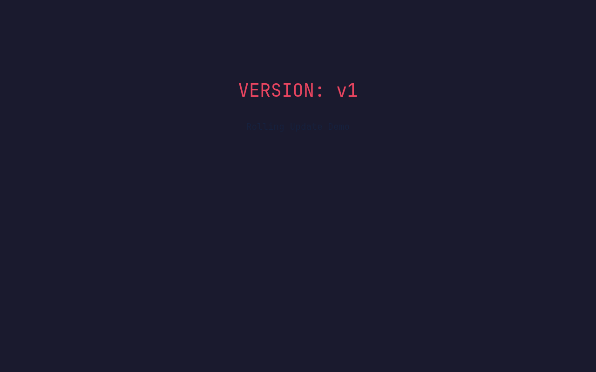
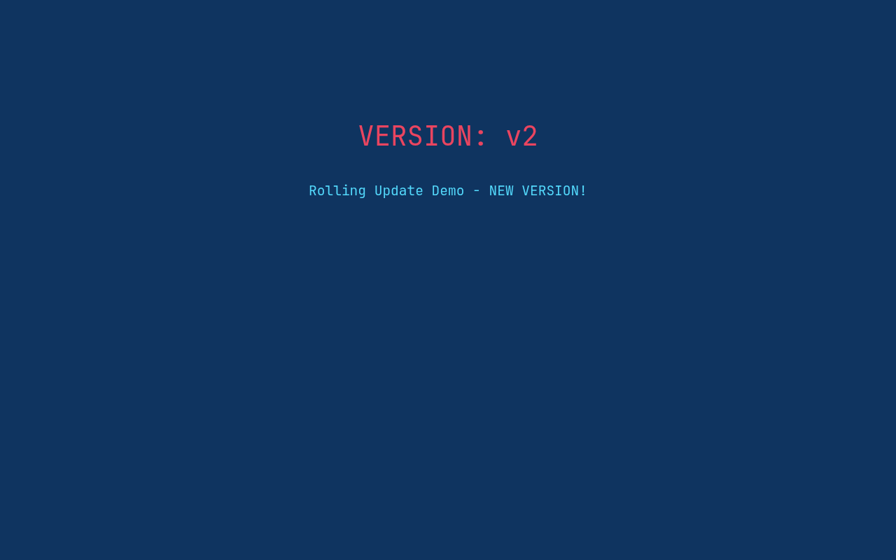
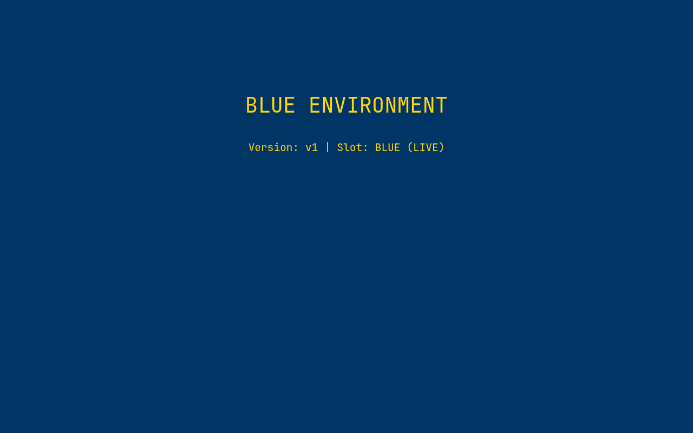
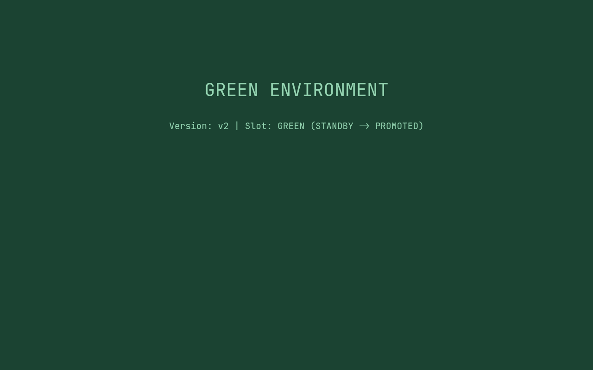
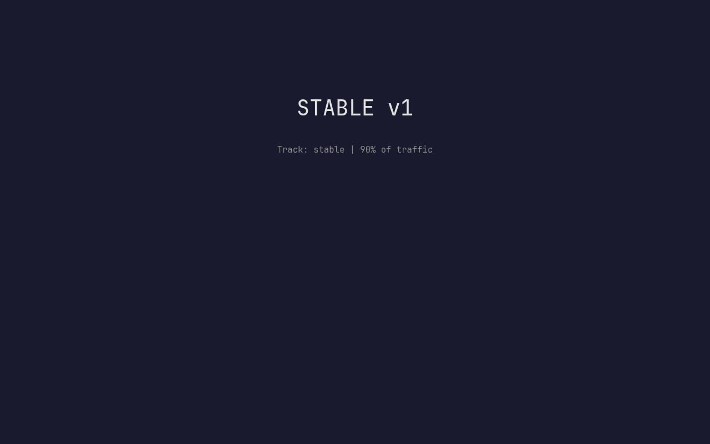
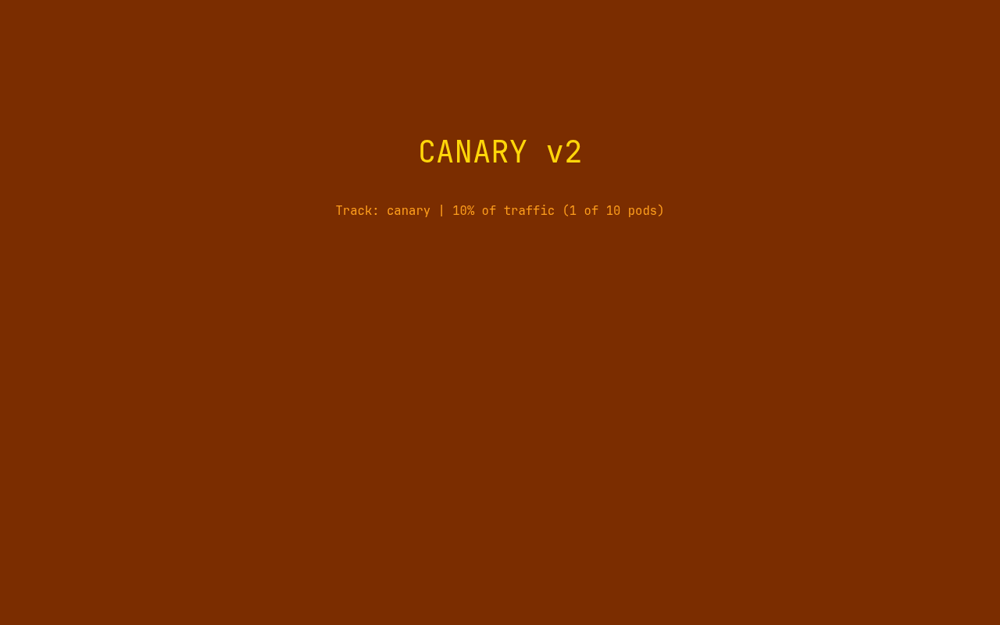
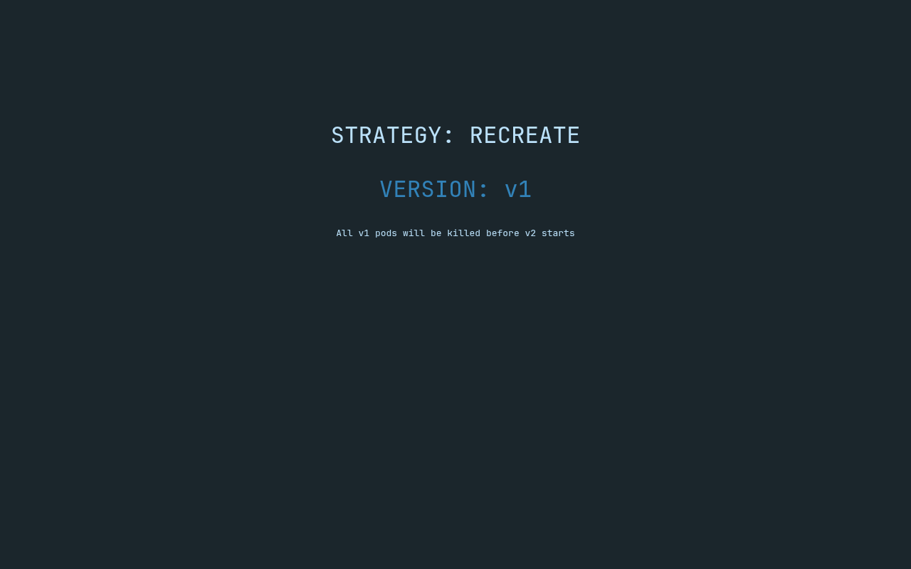
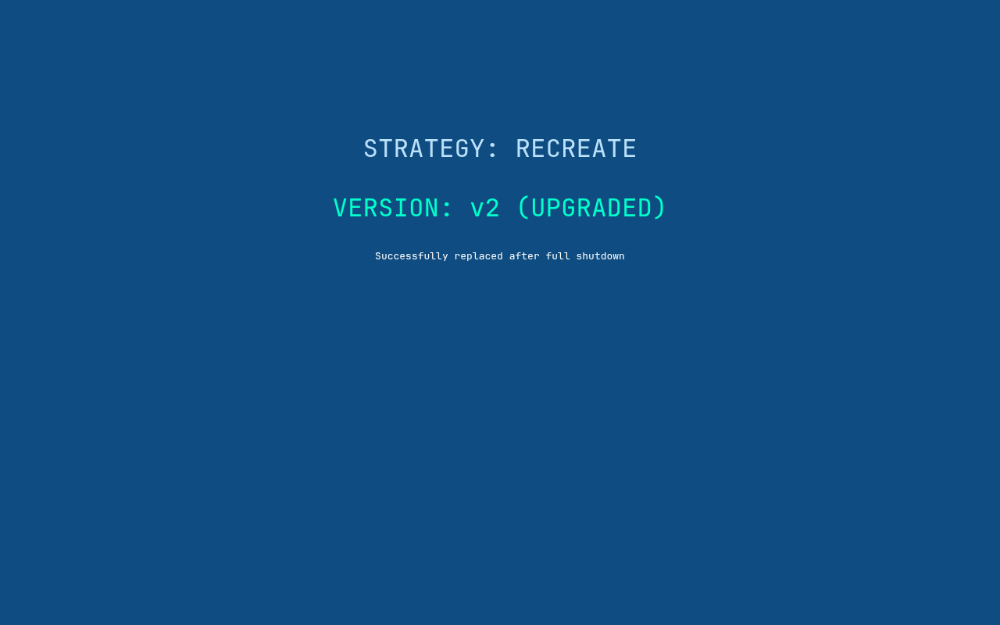

# Kubernetes Pods, ReplicaSets & Deployments

All commands were run on a local 3-node kind cluster (`s-a`: 1 control-plane + 2 workers). NodePort services are reached through host port mappings: `30010 -> localhost:18110`, `30020 -> 18120`, `30030 -> 18130`, `30040 -> 18140`, `30080 -> 18180`.

## Pod

A Pod is the smallest deployable unit - one or more containers that share a network namespace (one IP) and volumes.

```bash
…/session10-k8s-core-objects/pod ❯ kubectl apply -f nginx-pod.yaml
pod/yatri-demo-pod created

…/session10-k8s-core-objects/pod ❯ kubectl wait --for=condition=Ready pod/yatri-demo-pod --timeout=120s
pod/yatri-demo-pod condition met

…/session10-k8s-core-objects/pod ❯ kubectl get pods -o wide --show-labels
NAME                                   READY   STATUS        RESTARTS   AGE   IP           NODE          NOMINATED NODE   READINESS GATES   LABELS
kubernetes-bootcamp-5b97597885-2zv8z   1/1     Terminating   0          63s   10.244.1.4   s-a-worker2   <none>           <none>            app=kubernetes-bootcamp,pod-template-hash=5b97597885
kubernetes-bootcamp-5b97597885-dk5mr   1/1     Terminating   0          67s   10.244.2.4   s-a-worker    <none>           <none>            app=kubernetes-bootcamp,pod-template-hash=5b97597885
yatri-demo-pod                         1/1     Running       0          8s    10.244.2.6   s-a-worker    <none>           <none>            app=yatri-demo,tier=frontend

…/session10-k8s-core-objects/pod ❯ kubectl describe pod yatri-demo-pod
Name:             yatri-demo-pod
Namespace:        default
Priority:         0
Service Account:  default
Node:             s-a-worker/172.19.0.7
Start Time:       Mon, 26 Oct 2026 14:37:50 +0530
Labels:           app=yatri-demo
                  tier=frontend
Annotations:      <none>
Status:           Running
IP:               10.244.2.6
IPs:
  IP:  10.244.2.6
Containers:
  nginx-container:
    Container ID:   containerd://da06cfe777942a6344f91ae0745e6598a4030fe6abe77587eeb137ce0c24dcab
    Image:          nginx:1.25-alpine
    Image ID:       docker.io/library/nginx@sha256:516475cc129da42866742567714ddc681e5eed7b9ee0b9e9c015e464b4221a00
    Port:           80/TCP
    Host Port:      0/TCP
    State:          Running
      Started:      Mon, 26 Oct 2026 14:37:58 +0530
    Ready:          True
    Restart Count:  0
    Limits:
      cpu:     200m
      memory:  128Mi
    Requests:
      cpu:        50m
      memory:     64Mi
    Environment:  <none>
    Mounts:
      /var/run/secrets/kubernetes.io/serviceaccount from kube-api-access-d88pw (ro)
Conditions:
  Type                        Status
  PodReadyToStartContainers   True 
  Initialized                 True 
  Ready                       True 
  ContainersReady             True 
  PodScheduled                True 
Volumes:
  kube-api-access-d88pw:
    Type:                    Projected (a volume that contains injected data from multiple sources)
    TokenExpirationSeconds:  3607
    ConfigMapName:           kube-root-ca.crt
    Optional:                false
    DownwardAPI:             true
QoS Class:                   Burstable
Node-Selectors:              <none>
Tolerations:                 node.kubernetes.io/not-ready:NoExecute op=Exists for 300s
                             node.kubernetes.io/unreachable:NoExecute op=Exists for 300s
Events:
  Type    Reason     Age   From               Message
  ----    ------     ----  ----               -------
  Normal  Scheduled  8s    default-scheduler  Successfully assigned default/yatri-demo-pod to s-a-worker
  Normal  Pulling    7s    kubelet            spec.containers{nginx-container}: Pulling image "nginx:1.25-alpine"
  Normal  Pulled     0s    kubelet            spec.containers{nginx-container}: Successfully pulled image "nginx:1.25-alpine" in 7.229s (7.229s including waiting). Image size: 20461242 bytes.
  Normal  Created    0s    kubelet            spec.containers{nginx-container}: Container created
  Normal  Started    0s    kubelet            spec.containers{nginx-container}: Container started

…/session10-k8s-core-objects/pod ❯ kubectl logs yatri-demo-pod
/docker-entrypoint.sh: /docker-entrypoint.d/ is not empty, will attempt to perform configuration
/docker-entrypoint.sh: Looking for shell scripts in /docker-entrypoint.d/
/docker-entrypoint.sh: Launching /docker-entrypoint.d/10-listen-on-ipv6-by-default.sh
10-listen-on-ipv6-by-default.sh: info: Getting the checksum of /etc/nginx/conf.d/default.conf
10-listen-on-ipv6-by-default.sh: info: Enabled listen on IPv6 in /etc/nginx/conf.d/default.conf
/docker-entrypoint.sh: Sourcing /docker-entrypoint.d/15-local-resolvers.envsh
/docker-entrypoint.sh: Launching /docker-entrypoint.d/20-envsubst-on-templates.sh
/docker-entrypoint.sh: Launching /docker-entrypoint.d/30-tune-worker-processes.sh
/docker-entrypoint.sh: Configuration complete; ready for start up
2026/10/26 09:07:58 [notice] 1#1: using the "epoll" event method
2026/10/26 09:07:58 [notice] 1#1: nginx/1.25.5
2026/10/26 09:07:58 [notice] 1#1: built by gcc 13.2.1 20231014 (Alpine 13.2.1_git20231014) 
2026/10/26 09:07:58 [notice] 1#1: OS: Linux 7.2.5-3-omarchy
2026/10/26 09:07:58 [notice] 1#1: getrlimit(RLIMIT_NOFILE): 2147483584:2147483584
2026/10/26 09:07:58 [notice] 1#1: start worker processes
2026/10/26 09:07:58 [notice] 1#1: start worker process 37
2026/10/26 09:07:58 [notice] 1#1: start worker process 38
2026/10/26 09:07:58 [notice] 1#1: start worker process 39
2026/10/26 09:07:58 [notice] 1#1: start worker process 40
2026/10/26 09:07:58 [notice] 1#1: start worker process 41
2026/10/26 09:07:58 [notice] 1#1: start worker process 42
2026/10/26 09:07:58 [notice] 1#1: start worker process 43
2026/10/26 09:07:58 [notice] 1#1: start worker process 44

…/session10-k8s-core-objects/pod ❯ kubectl exec yatri-demo-pod -- nginx -v
nginx version: nginx/1.25.5

…/session10-k8s-core-objects/pod ❯ kubectl exec yatri-demo-pod -- curl -s localhost | head -5
<!DOCTYPE html>
<html>
<head>
<title>Welcome to nginx!</title>
<style>

…/session10-k8s-core-objects/pod ❯ kubectl exec yatri-demo-pod -- wget -qO- localhost | head -5
<!DOCTYPE html>
<html>
<head>
<title>Welcome to nginx!</title>
<style>

…/session10-k8s-core-objects/pod ❯ kubectl delete pod yatri-demo-pod
pod "yatri-demo-pod" deleted from default namespace

…/k8s-a/session10-k8s-core-objects ❯ kubectl apply -f pod.yml
pod/nginx-pod created

…/k8s-a/session10-k8s-core-objects ❯ kubectl apply -f hello.yml
pod/hello-pod created

…/k8s-a/session10-k8s-core-objects ❯ kubectl wait --for=condition=Ready pod/nginx-pod --timeout=120s
pod/nginx-pod condition met

…/k8s-a/session10-k8s-core-objects ❯ kubectl get pods
NAME        READY   STATUS      RESTARTS   AGE
hello-pod   0/1     Completed   0          28s
nginx-pod   1/1     Running     0          28s

…/k8s-a/session10-k8s-core-objects ❯ kubectl logs hello-pod
Hello Kubernetes
```


## Multi-container Pod (k8s-core-objects/pod.yml)

`nginx` + a `busybox` logger in the same Pod. `-c` picks the container for `logs`/`exec`.

```bash
…/session10-k8s-core-objects/k8s-core-objects ❯ kubectl apply -f pod.yml
pod/mypod created

…/session10-k8s-core-objects/k8s-core-objects ❯ kubectl wait --for=condition=Ready pod/mypod --timeout=120s
pod/mypod condition met

…/session10-k8s-core-objects/k8s-core-objects ❯ kubectl get pod mypod
NAME    READY   STATUS    RESTARTS   AGE
mypod   2/2     Running   0          39s

…/session10-k8s-core-objects/k8s-core-objects ❯ kubectl logs mypod -c logger --tail=3
log

…/session10-k8s-core-objects/k8s-core-objects ❯ kubectl exec mypod -c app -- nginx -v
nginx version: nginx/1.31.8

…/session10-k8s-core-objects/k8s-core-objects ❯ kubectl delete pod mypod
pod "mypod" deleted from default namespace

…/k8s-a/session10-k8s-core-objects ❯ kubectl delete -f pod.yml -f hello.yml
pod "nginx-pod" deleted from default namespace
pod "hello-pod" deleted from default namespace
```


## ReplicaSet

A ReplicaSet keeps N copies of a pod template alive. Deleting a pod causes an immediate replacement; scaling changes the count. A bare pod created with a matching label (`extra-nginx`) gets *adopted* by the ReplicaSet and, since that makes 4 > 3 replicas, it is deleted straight away.

```bash
…/session10-k8s-core-objects/replicaset ❯ kubectl apply -f backend-rs.yaml
replicaset.apps/yatri-backend-rs created

…/session10-k8s-core-objects/replicaset ❯ kubectl wait --for=condition=Ready pod -l app=yatri-backend --timeout=180s
pod/yatri-backend-rs-5tw9w condition met
pod/yatri-backend-rs-5zf5l condition met
pod/yatri-backend-rs-ttvr7 condition met

…/session10-k8s-core-objects/replicaset ❯ kubectl get rs yatri-backend-rs
NAME               DESIRED   CURRENT   READY   AGE
yatri-backend-rs   3         3         3       13s

…/session10-k8s-core-objects/replicaset ❯ kubectl get pods -l app=yatri-backend -o wide
NAME                     READY   STATUS    RESTARTS   AGE   IP           NODE          NOMINATED NODE   READINESS GATES
yatri-backend-rs-5tw9w   1/1     Running   0          13s   10.244.2.8   s-a-worker    <none>           <none>
yatri-backend-rs-5zf5l   1/1     Running   0          13s   10.244.2.9   s-a-worker    <none>           <none>
yatri-backend-rs-ttvr7   1/1     Running   0          13s   10.244.1.7   s-a-worker2   <none>           <none>

…/session10-k8s-core-objects/replicaset ❯ kubectl delete pod yatri-backend-rs-5tw9w
pod "yatri-backend-rs-5tw9w" deleted from default namespace

…/session10-k8s-core-objects/replicaset ❯ kubectl get pods -l app=yatri-backend
NAME                     READY   STATUS    RESTARTS   AGE
yatri-backend-rs-5zf5l   1/1     Running   0          44s
yatri-backend-rs-ttvr7   1/1     Running   0          44s
yatri-backend-rs-wqpl7   1/1     Running   0          30s

…/session10-k8s-core-objects/replicaset ❯ kubectl scale rs yatri-backend-rs --replicas=5
replicaset.apps/yatri-backend-rs scaled

…/session10-k8s-core-objects/replicaset ❯ kubectl get rs yatri-backend-rs
NAME               DESIRED   CURRENT   READY   AGE
yatri-backend-rs   5         5         5       50s

…/session10-k8s-core-objects/replicaset ❯ kubectl describe rs yatri-backend-rs | tail -15
      import http.server; http.server.test(HandlerClass=http.server.SimpleHTTPRequestHandler, port=5000)
    Environment:   <none>
    Mounts:        <none>
  Volumes:         <none>
  Node-Selectors:  <none>
  Tolerations:     <none>
Events:
  Type    Reason            Age   From                   Message
  ----    ------            ----  ----                   -------
  Normal  SuccessfulCreate  50s   replicaset-controller  Created pod: yatri-backend-rs-5tw9w
  Normal  SuccessfulCreate  50s   replicaset-controller  Created pod: yatri-backend-rs-ttvr7
  Normal  SuccessfulCreate  50s   replicaset-controller  Created pod: yatri-backend-rs-5zf5l
  Normal  SuccessfulCreate  36s   replicaset-controller  Created pod: yatri-backend-rs-wqpl7
  Normal  SuccessfulCreate  6s    replicaset-controller  Created pod: yatri-backend-rs-zvb8h
  Normal  SuccessfulCreate  6s    replicaset-controller  Created pod: yatri-backend-rs-m8v5q

…/session10-k8s-core-objects/replicaset ❯ kubectl scale rs yatri-backend-rs --replicas=2
replicaset.apps/yatri-backend-rs scaled

…/session10-k8s-core-objects/replicaset ❯ kubectl get pods -l app=yatri-backend
NAME                     READY   STATUS        RESTARTS   AGE
yatri-backend-rs-5zf5l   1/1     Running       0          50s
yatri-backend-rs-m8v5q   1/1     Terminating   0          6s
yatri-backend-rs-ttvr7   1/1     Terminating   0          50s
yatri-backend-rs-wqpl7   1/1     Running       0          36s
yatri-backend-rs-zvb8h   1/1     Terminating   0          6s

…/session10-k8s-core-objects/replicaset ❯ kubectl delete -f backend-rs.yaml
replicaset.apps "yatri-backend-rs" deleted from default namespace

…/k8s-a/session10-k8s-core-objects ❯ kubectl apply -f replicaset.yml
replicaset.apps/nginx-rs created

…/k8s-a/session10-k8s-core-objects ❯ kubectl get rs nginx-rs
NAME       DESIRED   CURRENT   READY   AGE
nginx-rs   3         3         3       10s

…/k8s-a/session10-k8s-core-objects ❯ kubectl get pods -l app=nginx --show-labels
NAME             READY   STATUS    RESTARTS   AGE   LABELS
nginx-rs-7gxps   1/1     Running   0          10s   app=nginx
nginx-rs-j8wvr   1/1     Running   0          10s   app=nginx
nginx-rs-tf62l   1/1     Running   0          10s   app=nginx

…/k8s-a/session10-k8s-core-objects ❯ kubectl run extra-nginx --image=nginx:latest --labels=app=nginx
pod/extra-nginx created

…/k8s-a/session10-k8s-core-objects ❯ kubectl get pods -l app=nginx
NAME             READY   STATUS    RESTARTS   AGE
nginx-rs-7gxps   1/1     Running   0          14s
nginx-rs-j8wvr   1/1     Running   0          14s
nginx-rs-tf62l   1/1     Running   0          14s

…/k8s-a/session10-k8s-core-objects ❯ kubectl delete -f replicaset.yml
replicaset.apps "nginx-rs" deleted from default namespace
```


## Deployment

A Deployment manages ReplicaSets. Each change to the pod template creates a new ReplicaSet (new `pod-template-hash`) and pods are rolled over to it; the old ReplicaSet is kept at 0 replicas for rollbacks.

> Note: `wget localhost:5000` is refused because in this Alpine image `localhost` resolves to `::1` (IPv6) while the Python server only listens on IPv4 - using `127.0.0.1` works. (`kubectl logs` shows nothing for these pods because Python buffers stdout when it is not attached to a TTY.)

```bash
…/session10-k8s-core-objects/deployment ❯ kubectl apply -f deployment-v1.yaml
deployment.apps/yatri-backend created

…/session10-k8s-core-objects/deployment ❯ kubectl rollout status deployment/yatri-backend --timeout=180s
Waiting for deployment "yatri-backend" rollout to finish: 0 of 3 updated replicas are available...
Waiting for deployment "yatri-backend" rollout to finish: 1 of 3 updated replicas are available...
Waiting for deployment "yatri-backend" rollout to finish: 2 of 3 updated replicas are available...
deployment "yatri-backend" successfully rolled out

…/session10-k8s-core-objects/deployment ❯ kubectl get deploy,rs,pods -l app=yatri-backend --show-labels
NAME                            READY   UP-TO-DATE   AVAILABLE   AGE   LABELS
deployment.apps/yatri-backend   3/3     3            3           1s    app=yatri-backend,version=1.0.0

NAME                                       DESIRED   CURRENT   READY   AGE   LABELS
replicaset.apps/yatri-backend-7554bd5c75   3         3         3       1s    app=yatri-backend,pod-template-hash=7554bd5c75,version=1.0.0

NAME                                 READY   STATUS    RESTARTS   AGE   LABELS
pod/yatri-backend-7554bd5c75-922x2   1/1     Running   0          1s    app=yatri-backend,pod-template-hash=7554bd5c75,version=1.0.0
pod/yatri-backend-7554bd5c75-wflhv   1/1     Running   0          1s    app=yatri-backend,pod-template-hash=7554bd5c75,version=1.0.0
pod/yatri-backend-7554bd5c75-zdgkk   1/1     Running   0          1s    app=yatri-backend,pod-template-hash=7554bd5c75,version=1.0.0

…/session10-k8s-core-objects/deployment ❯ kubectl exec deploy/yatri-backend -- wget -qO- -S localhost:5000 2>&1 | head -3
wget: can't connect to remote host: Connection refused
command terminated with exit code 1

…/session10-k8s-core-objects/deployment ❯ kubectl exec deploy/yatri-backend -- wget -qO- -S 127.0.0.1:5000 2>&1 | head -3
  HTTP/1.0 200 OK
  Server: SimpleHTTP/0.6 Python/3.11.11
  Date: Mon, 26 Oct 2026 10:01:04 GMT

…/session10-k8s-core-objects/deployment ❯ kubectl exec deploy/yatri-backend -- getent hosts localhost
::1               localhost  localhost

…/session10-k8s-core-objects/deployment ❯ kubectl apply -f deployment-v2.yaml
deployment.apps/yatri-backend configured

…/session10-k8s-core-objects/deployment ❯ kubectl rollout status deployment/yatri-backend --timeout=180s
Waiting for deployment "yatri-backend" rollout to finish: 1 out of 3 new replicas have been updated...
Waiting for deployment "yatri-backend" rollout to finish: 1 out of 3 new replicas have been updated...
Waiting for deployment "yatri-backend" rollout to finish: 2 out of 3 new replicas have been updated...
Waiting for deployment "yatri-backend" rollout to finish: 2 out of 3 new replicas have been updated...
Waiting for deployment "yatri-backend" rollout to finish: 2 out of 3 new replicas have been updated...
Waiting for deployment "yatri-backend" rollout to finish: 1 old replicas are pending termination...
Waiting for deployment "yatri-backend" rollout to finish: 1 old replicas are pending termination...
deployment "yatri-backend" successfully rolled out

…/session10-k8s-core-objects/deployment ❯ kubectl get rs -l app=yatri-backend
NAME                       DESIRED   CURRENT   READY   AGE
yatri-backend-7554bd5c75   0         0         0       3s
yatri-backend-cbc55c649    3         3         3       2s

…/session10-k8s-core-objects/deployment ❯ kubectl get pods -l app=yatri-backend --show-labels
NAME                             READY   STATUS    RESTARTS   AGE   LABELS
yatri-backend-7554bd5c75-wflhv   0/1     Error     0          34s   app=yatri-backend,pod-template-hash=7554bd5c75,version=1.0.0
yatri-backend-cbc55c649-cg9h9    1/1     Running   0          33s   app=yatri-backend,pod-template-hash=cbc55c649,version=2.0.0
yatri-backend-cbc55c649-dv9v9    1/1     Running   0          32s   app=yatri-backend,pod-template-hash=cbc55c649,version=2.0.0
yatri-backend-cbc55c649-gt9ch    1/1     Running   0          32s   app=yatri-backend,pod-template-hash=cbc55c649,version=2.0.0

…/session10-k8s-core-objects/deployment ❯ kubectl rollout history deployment/yatri-backend
deployment.apps/yatri-backend 
REVISION  CHANGE-CAUSE
1         <none>
2         <none>

…/session10-k8s-core-objects/deployment ❯ kubectl rollout history deployment/yatri-backend --revision=2 | head -14
deployment.apps/yatri-backend with revision #2
Pod Template:
  Labels:	app=yatri-backend
	pod-template-hash=cbc55c649
	version=2.0.0
  Containers:
   backend:
    Image:	python:3.11-alpine3.19
    Port:	5000/TCP
    Host Port:	0/TCP
    Command:
      python3
      -c
      import http.server; print('Backend v2.0.0 listening on 5000'); http.server.test(HandlerClass=http.server.SimpleHTTPRequestHandler, port=5000)

…/session10-k8s-core-objects/deployment ❯ kubectl rollout undo deployment/yatri-backend --to-revision=1
Warning: resource deployments/yatri-backend was previously managed with 'kubectl apply'. Rolling back will not update the kubectl.kubernetes.io/last-applied-configuration annotation, which may cause unexpected behavior on future 'kubectl apply' operations. Consider using 'kubectl apply' with your previous configuration file instead.
deployment.apps/yatri-backend rolled back

…/session10-k8s-core-objects/deployment ❯ kubectl rollout status deployment/yatri-backend --timeout=180s
Waiting for deployment "yatri-backend" rollout to finish: 1 out of 3 new replicas have been updated...
Waiting for deployment "yatri-backend" rollout to finish: 1 out of 3 new replicas have been updated...
Waiting for deployment "yatri-backend" rollout to finish: 1 out of 3 new replicas have been updated...
Waiting for deployment "yatri-backend" rollout to finish: 2 out of 3 new replicas have been updated...
Waiting for deployment "yatri-backend" rollout to finish: 2 out of 3 new replicas have been updated...
Waiting for deployment "yatri-backend" rollout to finish: 2 out of 3 new replicas have been updated...
Waiting for deployment "yatri-backend" rollout to finish: 1 old replicas are pending termination...
Waiting for deployment "yatri-backend" rollout to finish: 1 old replicas are pending termination...
deployment "yatri-backend" successfully rolled out

…/session10-k8s-core-objects/deployment ❯ kubectl get rs -l app=yatri-backend
NAME                       DESIRED   CURRENT   READY   AGE
yatri-backend-7554bd5c75   3         3         3       36s
yatri-backend-cbc55c649    0         0         0       35s

…/session10-k8s-core-objects/deployment ❯ kubectl rollout history deployment/yatri-backend
deployment.apps/yatri-backend 
REVISION  CHANGE-CAUSE
2         <none>
3         <none>

…/session10-k8s-core-objects/deployment ❯ kubectl apply -f deployment-v2.yaml
deployment.apps/yatri-backend configured

…/session10-k8s-core-objects/deployment ❯ kubectl rollout status deployment/yatri-backend --timeout=180s
Waiting for deployment "yatri-backend" rollout to finish: 1 out of 3 new replicas have been updated...
Waiting for deployment "yatri-backend" rollout to finish: 1 out of 3 new replicas have been updated...
Waiting for deployment "yatri-backend" rollout to finish: 1 out of 3 new replicas have been updated...
Waiting for deployment "yatri-backend" rollout to finish: 2 out of 3 new replicas have been updated...
Waiting for deployment "yatri-backend" rollout to finish: 2 out of 3 new replicas have been updated...
Waiting for deployment "yatri-backend" rollout to finish: 2 out of 3 new replicas have been updated...
Waiting for deployment "yatri-backend" rollout to finish: 1 old replicas are pending termination...
Waiting for deployment "yatri-backend" rollout to finish: 1 old replicas are pending termination...
deployment "yatri-backend" successfully rolled out
```


## Troubleshooting: broken image during a rollout

`troubleshooting/broken-image.yaml` points to an image tag that does not exist. With `maxUnavailable: 0` the rollout only creates one surge pod which sits in `ErrImagePull/ImagePullBackOff`, while the 3 old pods keep running - so there is no outage. `kubectl rollout undo` fixes it.

```bash
…/session10-k8s-core-objects/troubleshooting ❯ kubectl apply -f broken-image.yaml
deployment.apps/yatri-backend configured

…/session10-k8s-core-objects/troubleshooting ❯ kubectl rollout status deployment/yatri-backend --timeout=40s
Waiting for deployment "yatri-backend" rollout to finish: 1 out of 3 new replicas have been updated...
Waiting for deployment "yatri-backend" rollout to finish: 1 out of 3 new replicas have been updated...
Waiting for deployment "yatri-backend" rollout to finish: 1 out of 3 new replicas have been updated...
Waiting for deployment "yatri-backend" rollout to finish: 1 out of 3 new replicas have been updated...
Waiting for deployment "yatri-backend" rollout to finish: 1 out of 3 new replicas have been updated...
Waiting for deployment "yatri-backend" rollout to finish: 1 out of 3 new replicas have been updated...
Waiting for deployment "yatri-backend" rollout to finish: 1 out of 3 new replicas have been updated...
error: timed out waiting for the condition

…/session10-k8s-core-objects/troubleshooting ❯ kubectl get pods -l app=yatri-backend
NAME                             READY   STATUS         RESTARTS   AGE
yatri-backend-77dbb657cd-8b6vr   0/1     ErrImagePull   0          40s
yatri-backend-cbc55c649-crw9k    1/1     Running        0          42s
yatri-backend-cbc55c649-fmjd9    1/1     Running        0          41s
yatri-backend-cbc55c649-xc66m    1/1     Running        0          42s

…/session10-k8s-core-objects/troubleshooting ❯ kubectl describe pod yatri-backend-77dbb657cd-8b6vr | sed -n '/Events:/,$p'
Events:
  Type     Reason     Age                From               Message
  ----     ------     ----               ----               -------
  Normal   Scheduled  40s                default-scheduler  Successfully assigned default/yatri-backend-77dbb657cd-8b6vr to s-a-worker2
  Normal   Pulling    17s (x2 over 40s)  kubelet            spec.containers{backend}: Pulling image "yatri-backend:non-existent-tag-v999"
  Warning  Failed     16s (x2 over 31s)  kubelet            spec.containers{backend}: Failed to pull image "yatri-backend:non-existent-tag-v999": failed to pull and unpack image "docker.io/library/yatri-backend:non-existent-tag-v999": failed to resolve reference "docker.io/library/yatri-backend:non-existent-tag-v999": pull access denied, repository does not exist or may require authorization: server message: insufficient_scope: authorization failed
  Warning  Failed     16s (x2 over 31s)  kubelet            spec.containers{backend}: Error: ErrImagePull
  Normal   BackOff    2s (x2 over 30s)   kubelet            spec.containers{backend}: Back-off pulling image "yatri-backend:non-existent-tag-v999"
  Warning  Failed     2s (x2 over 30s)   kubelet            spec.containers{backend}: Error: ImagePullBackOff

…/session10-k8s-core-objects/troubleshooting ❯ kubectl get deploy yatri-backend
NAME            READY   UP-TO-DATE   AVAILABLE   AGE
yatri-backend   3/3     1            3           78s

…/session10-k8s-core-objects/troubleshooting ❯ kubectl rollout undo deployment/yatri-backend
Warning: resource deployments/yatri-backend was previously managed with 'kubectl apply'. Rolling back will not update the kubectl.kubernetes.io/last-applied-configuration annotation, which may cause unexpected behavior on future 'kubectl apply' operations. Consider using 'kubectl apply' with your previous configuration file instead.
deployment.apps/yatri-backend rolled back

…/session10-k8s-core-objects/troubleshooting ❯ kubectl rollout status deployment/yatri-backend --timeout=120s
deployment "yatri-backend" successfully rolled out

…/session10-k8s-core-objects/troubleshooting ❯ kubectl get pods -l app=yatri-backend --show-labels
NAME                             READY   STATUS        RESTARTS   AGE   LABELS
yatri-backend-77dbb657cd-8b6vr   0/1     Terminating   0          40s   app=yatri-backend,pod-template-hash=77dbb657cd,version=broken-v3
yatri-backend-cbc55c649-crw9k    1/1     Running       0          42s   app=yatri-backend,pod-template-hash=cbc55c649,version=2.0.0
yatri-backend-cbc55c649-fmjd9    1/1     Running       0          41s   app=yatri-backend,pod-template-hash=cbc55c649,version=2.0.0
yatri-backend-cbc55c649-xc66m    1/1     Running       0          42s   app=yatri-backend,pod-template-hash=cbc55c649,version=2.0.0
```


## Troubleshooting: selector does not match template labels

The API server rejects a Deployment whose `spec.selector.matchLabels` does not match `spec.template.metadata.labels`. Fix: make the template label match the selector.

```bash
…/session10-k8s-core-objects/troubleshooting ❯ kubectl apply -f selector-mismatch.yaml
The Deployment "selector-error-demo" is invalid: spec.template.metadata.labels: Invalid value: {"app":"wrong-app-name"}: `selector` does not match template `labels`

…/session10-k8s-core-objects/troubleshooting ❯ sed -i 's/app: wrong-app-name/app: correct-app-name/' selector-mismatch.yaml && grep -n 'app:' selector-mismatch.yaml
14:      app: correct-app-name
19:        app: correct-app-name

…/session10-k8s-core-objects/troubleshooting ❯ kubectl apply -f selector-mismatch.yaml
deployment.apps/selector-error-demo created

…/session10-k8s-core-objects/troubleshooting ❯ kubectl get deploy selector-error-demo
NAME                  READY   UP-TO-DATE   AVAILABLE   AGE
selector-error-demo   0/1     1            0           0s

…/session10-k8s-core-objects/troubleshooting ❯ kubectl delete -f selector-mismatch.yaml
deployment.apps "selector-error-demo" deleted from default namespace

…/session10-k8s-core-objects/deployment ❯ kubectl delete -f deployment-v2.yaml
deployment.apps "yatri-backend" deleted from default namespace
```


## DaemonSet

A DaemonSet runs exactly one pod per (eligible) node. The control-plane node has the `node-role.kubernetes.io/control-plane:NoSchedule` taint and these DaemonSets have no toleration, so they run on the 2 workers only.

```bash
…/session10-k8s-core-objects/daemonset ❯ kubectl apply -f node-agent-ds.yaml
daemonset.apps/node-logging-agent created

…/session10-k8s-core-objects/daemonset ❯ kubectl rollout status ds/node-logging-agent --timeout=120s
Waiting for daemon set "node-logging-agent" rollout to finish: 0 of 2 updated pods are available...
Waiting for daemon set "node-logging-agent" rollout to finish: 1 of 2 updated pods are available...
daemon set "node-logging-agent" successfully rolled out

…/session10-k8s-core-objects/daemonset ❯ kubectl get ds node-logging-agent
NAME                 DESIRED   CURRENT   READY   UP-TO-DATE   AVAILABLE   NODE SELECTOR   AGE
node-logging-agent   2         2         2       2            2           <none>          7s

…/session10-k8s-core-objects/daemonset ❯ kubectl get pods -l app=node-logging-agent -o wide
NAME                       READY   STATUS    RESTARTS   AGE   IP            NODE          NOMINATED NODE   READINESS GATES
node-logging-agent-5cmjz   1/1     Running   0          8s    10.244.2.24   s-a-worker    <none>           <none>
node-logging-agent-pwsgf   1/1     Running   0          8s    10.244.1.19   s-a-worker2   <none>           <none>

…/session10-k8s-core-objects/daemonset ❯ kubectl describe node s-a-control-plane | grep -A2 Taints
Taints:             node-role.kubernetes.io/control-plane:NoSchedule
Unschedulable:      false
Lease:

…/session10-k8s-core-objects/daemonset ❯ kubectl logs ds/node-logging-agent --tail=3
Found 2 pods, using pod/node-logging-agent-5cmjz
[Mon Oct 26 09:13:51 UTC 2026] Collecting host system metrics on node-logging-agent-5cmjz

…/session10-k8s-core-objects/daemonset ❯ kubectl delete -f node-agent-ds.yaml
daemonset.apps "node-logging-agent" deleted from default namespace

…/session10-k8s-core-objects/k8s-core-objects ❯ kubectl apply -f deamonset.yml
daemonset.apps/node-exporter created

…/session10-k8s-core-objects/k8s-core-objects ❯ kubectl rollout status ds/node-exporter --timeout=180s
Waiting for daemon set "node-exporter" rollout to finish: 0 of 2 updated pods are available...
Waiting for daemon set "node-exporter" rollout to finish: 1 of 2 updated pods are available...
daemon set "node-exporter" successfully rolled out

…/session10-k8s-core-objects/k8s-core-objects ❯ kubectl get ds node-exporter -o wide
NAME            DESIRED   CURRENT   READY   UP-TO-DATE   AVAILABLE   NODE SELECTOR   AGE   CONTAINERS      IMAGES               SELECTOR
node-exporter   2         2         2       2            2           <none>          8s    node-exporter   prom/node-exporter   app=node-exporter

…/session10-k8s-core-objects/k8s-core-objects ❯ kubectl get pods -l app=node-exporter -o wide
NAME                  READY   STATUS    RESTARTS   AGE   IP            NODE          NOMINATED NODE   READINESS GATES
node-exporter-qd8mk   1/1     Running   0          9s    10.244.1.20   s-a-worker2   <none>           <none>
node-exporter-slw24   1/1     Running   0          9s    10.244.2.25   s-a-worker    <none>           <none>

…/session10-k8s-core-objects/k8s-core-objects ❯ kubectl exec node-exporter-qd8mk -- wget -qO- localhost:9100/metrics | grep -E '^node_(load1|uname_info)'
node_load1 3.94
node_load15 3.29
node_uname_info{domainname="(none)",machine="x86_64",nodename="node-exporter-qd8mk",release="7.2.5-3-omarchy",sysname="Linux",version="#1 SMP PREEMPT_DYNAMIC Mon, 14 Sep 2026 19:55:01 +0000"} 1

…/session10-k8s-core-objects/k8s-core-objects ❯ kubectl delete -f deamonset.yml
daemonset.apps "node-exporter" deleted from default namespace
```


## Deployment (k8s-core-objects/deployment.yml)

```bash
…/session10-k8s-core-objects/k8s-core-objects ❯ kubectl apply -f deployment.yml
deployment.apps/myapp created

…/session10-k8s-core-objects/k8s-core-objects ❯ kubectl rollout status deploy/myapp --timeout=120s
Waiting for deployment "myapp" rollout to finish: 0 of 3 updated replicas are available...
Waiting for deployment "myapp" rollout to finish: 1 of 3 updated replicas are available...
Waiting for deployment "myapp" rollout to finish: 2 of 3 updated replicas are available...
deployment "myapp" successfully rolled out

…/session10-k8s-core-objects/k8s-core-objects ❯ kubectl get deploy,rs,pods -l app=myapp
NAME                               DESIRED   CURRENT   READY   AGE
replicaset.apps/myapp-5b9587f95d   3         3         3       4s

NAME                         READY   STATUS    RESTARTS   AGE
pod/myapp-5b9587f95d-7ng42   1/1     Running   0          4s
pod/myapp-5b9587f95d-kj47f   1/1     Running   0          4s
pod/myapp-5b9587f95d-mw6zb   1/1     Running   0          4s

…/session10-k8s-core-objects/k8s-core-objects ❯ kubectl delete -f deployment.yml
deployment.apps "myapp" deleted from default namespace
```


## StatefulSet (k8s-core-objects/statefulset.yml)

StatefulSet pods get stable names (`mysql-0`, `mysql-1`, ...), are created in order, and each gets its own PVC from `volumeClaimTemplates`.

**Problem found:** applying the original manifest, the `mysql:5.7` pods were `OOMKilled` / `CrashLoopBackOff` even though there is no memory limit. The cause is the container open-files limit on this host (`ulimit -n` = 2147483584): MySQL 5.7 sizes internal tables from that value and tries to allocate a huge amount of memory. The manifest also references `serviceName: mysql` but no headless Service exists.

```bash
…/session10-k8s-core-objects/k8s-core-objects ❯ kubectl apply -f statefulset.yml
statefulset.apps/mysql created

…/session10-k8s-core-objects/k8s-core-objects ❯ kubectl get pods -l app=mysql
NAME      READY   STATUS             RESTARTS      AGE
mysql-0   0/1     CrashLoopBackOff   1 (20s ago)   62s
mysql-1   1/1     Running            1 (31s ago)   58s

…/session10-k8s-core-objects/k8s-core-objects ❯ kubectl get pod mysql-0 -o jsonpath='{.status.containerStatuses[0].lastState}' ; echo
{"terminated":{"containerID":"containerd://036af2ba7d92fce05f469f1695ad4ed4560eff8979c67f02105298fdf34dfbbb","exitCode":137,"finishedAt":"2026-10-26T09:23:59Z","reason":"OOMKilled","startedAt":"2026-10-26T09:23:40Z"}}

…/session10-k8s-core-objects/k8s-core-objects ❯ kubectl logs mysql-0 --previous | tail -5
2026-10-26 09:23:40+00:00 [Note] [Entrypoint]: Entrypoint script for MySQL Server 5.7.44-1.el7 started.

…/session10-k8s-core-objects/k8s-core-objects ❯ kubectl run ulimit-check --rm -i --restart=Never --image=busybox:1.36 -- sh -c "ulimit -n"
2147483584
All commands and output from this session will be recorded in container logs, including credentials and sensitive information passed through the command prompt.
If you don't see a command prompt, try pressing enter.
warning: couldn't attach to pod/ulimit-check, falling back to streaming logs: unable to upgrade connection: container ulimit-check not found in pod ulimit-check_default
2147483584
pod "ulimit-check" deleted from default namespace

…/session10-k8s-core-objects/k8s-core-objects ❯ kubectl delete -f statefulset.yml && kubectl delete pvc -l app=mysql
statefulset.apps "mysql" deleted from default namespace
persistentvolumeclaim "mysql-persistent-storage-mysql-0" deleted from default namespace
persistentvolumeclaim "mysql-persistent-storage-mysql-1" deleted from default namespace

…/session10-k8s-core-objects/k8s-core-objects ❯ diff statefulset.yml statefulset-fixed.yml
0a1,11
> apiVersion: v1
> kind: Service
> metadata:
>   name: mysql
> spec:
>   clusterIP: None   # headless service referenced by serviceName
>   selector:
>     app: mysql
>   ports:
>     - port: 3306
> ---
6c17
<   serviceName: "mysql"  # Required headless service
---
>   serviceName: "mysql"
18a30,31
>           # FIX: lower the open-files limit before mysqld starts (huge default nofile on this host => OOM)
>           command: ["sh", "-c", "ulimit -n 65536 && exec docker-entrypoint.sh mysqld"]
34c47
<             storage: 5Gi
\ No newline at end of file
---
>             storage: 5Gi

…/session10-k8s-core-objects/k8s-core-objects ❯ kubectl apply -f statefulset-fixed.yml
service/mysql created
statefulset.apps/mysql created

…/session10-k8s-core-objects/k8s-core-objects ❯ kubectl rollout status sts/mysql --timeout=400s
Waiting for 3 pods to be ready...
Waiting for 2 pods to be ready...
Waiting for 2 pods to be ready...
Waiting for 1 pods to be ready...
Waiting for 1 pods to be ready...
partitioned roll out complete: 3 new pods have been updated...

…/session10-k8s-core-objects/k8s-core-objects ❯ kubectl get sts,pods -l app=mysql -o wide
NAME          READY   STATUS    RESTARTS   AGE   IP            NODE          NOMINATED NODE   READINESS GATES
pod/mysql-0   1/1     Running   0          31s   10.244.2.39   s-a-worker    <none>           <none>
pod/mysql-1   1/1     Running   0          28s   10.244.1.37   s-a-worker2   <none>           <none>
pod/mysql-2   1/1     Running   0          23s   10.244.2.41   s-a-worker    <none>           <none>

…/session10-k8s-core-objects/k8s-core-objects ❯ kubectl get pvc
NAME                               STATUS   VOLUME                                     CAPACITY   ACCESS MODES   STORAGECLASS   VOLUMEATTRIBUTESCLASS   AGE
mysql-persistent-storage-mysql-0   Bound    pvc-2ca02b0d-61f7-481b-9e6f-0f553bb47437   5Gi        RWO            standard       <unset>                 31s
mysql-persistent-storage-mysql-1   Bound    pvc-1271a5ea-35f6-4b87-b4db-95782ae6a734   5Gi        RWO            standard       <unset>                 28s
mysql-persistent-storage-mysql-2   Bound    pvc-0e3cca9a-b599-4e52-a37a-64af23511b14   5Gi        RWO            standard       <unset>                 23s

…/session10-k8s-core-objects/k8s-core-objects ❯ kubectl exec mysql-0 -- mysql -uroot -ppassword -e "CREATE DATABASE demo; SHOW DATABASES;"
mysql: [Warning] Using a password on the command line interface can be insecure.
Database
information_schema
demo
mysql
performance_schema
sys

…/session10-k8s-core-objects/k8s-core-objects ❯ kubectl delete pod mysql-0
pod "mysql-0" deleted from default namespace

…/session10-k8s-core-objects/k8s-core-objects ❯ kubectl wait --for=condition=Ready pod/mysql-0 --timeout=180s
pod/mysql-0 condition met

…/session10-k8s-core-objects/k8s-core-objects ❯ kubectl get pods -l app=mysql
NAME      READY   STATUS    RESTARTS   AGE
mysql-0   1/1     Running   0          0s
mysql-1   1/1     Running   0          31s
mysql-2   1/1     Running   0          26s

…/session10-k8s-core-objects/k8s-core-objects ❯ kubectl exec mysql-0 -- mysql -uroot -ppassword -e "SHOW DATABASES;"
mysql: [Warning] Using a password on the command line interface can be insecure.
ERROR 2002 (HY000): Can't connect to local MySQL server through socket '/var/run/mysqld/mysqld.sock' (2)
command terminated with exit code 1

…/session10-k8s-core-objects/k8s-core-objects ❯ kubectl exec mysql-0 -- mysql -uroot -ppassword -e "SHOW DATABASES;"
mysql: [Warning] Using a password on the command line interface can be insecure.
Database
information_schema
demo
mysql
performance_schema
sys

…/session10-k8s-core-objects/k8s-core-objects ❯ kubectl run dns --rm -i --restart=Never --image=busybox:1.36 -- nslookup mysql-1.mysql.default.svc.cluster.local
Server:		10.96.0.10
Address:	10.96.0.10:53

Name:	mysql-1.mysql.default.svc.cluster.local
Address: 10.244.1.37

All commands and output from this session will be recorded in container logs, including credentials and sensitive information passed through the command prompt.
If you don't see a command prompt, try pressing enter.
pod "dns" deleted from default namespace

…/session10-k8s-core-objects/k8s-core-objects ❯ kubectl delete -f statefulset-fixed.yml && kubectl delete pvc -l app=mysql
service "mysql" deleted from default namespace
statefulset.apps "mysql" deleted from default namespace
persistentvolumeclaim "mysql-persistent-storage-mysql-0" deleted from default namespace
persistentvolumeclaim "mysql-persistent-storage-mysql-1" deleted from default namespace
persistentvolumeclaim "mysql-persistent-storage-mysql-2" deleted from default namespace
```


> In the last part the first `SHOW DATABASES` right after the pod restart fails because the pod is marked Ready immediately (no readiness probe) while mysqld is still starting; a few seconds later the `demo` database is back - the data survived the pod being deleted because `mysql-0` re-attached the same PVC. `mysql-1.mysql...` resolves thanks to the headless service.

## Pod lifecycle

### 1. Running

```bash
…/session10-k8s-core-objects/pod-lifecycle ❯ kubectl apply -f 01-running.yaml
pod/lifecycle-running created

…/session10-k8s-core-objects/pod-lifecycle ❯ timeout 15 kubectl get pod lifecycle-running -w
NAME                READY   STATUS              RESTARTS   AGE
lifecycle-running   0/1     ContainerCreating   0          0s
lifecycle-running   0/1     ContainerCreating   0          0s

…/session10-k8s-core-objects/pod-lifecycle ❯ kubectl get pod lifecycle-running -o jsonpath='{.status.containerStatuses[0].state}'; echo
{"waiting":{"reason":"ContainerCreating"}}

…/session10-k8s-core-objects/pod-lifecycle ❯ kubectl describe pod lifecycle-running | sed -n '/Conditions:/,/Volumes:/p'
Conditions:
  Type                        Status
  PodReadyToStartContainers   True 
  Initialized                 True 
  Ready                       False 
  ContainersReady             False 
  PodScheduled                True 
Volumes:
```


### 2. Pending

On this machine the kind nodes report the full host capacity (8 CPU / ~15 GiB), so the original `02-pending.yaml` (1 CPU / 9Gi) actually fits and runs. To force `Pending` I made a copy that requests 32 CPU / 64Gi - the scheduler can't place it on any node and emits `FailedScheduling`.

```bash
…/session10-k8s-core-objects/pod-lifecycle ❯ kubectl apply -f 02-pending.yaml
pod/lifecycle-pending created

…/session10-k8s-core-objects/pod-lifecycle ❯ kubectl wait --for=condition=Ready pod/lifecycle-pending --timeout=60s
pod/lifecycle-pending condition met

…/session10-k8s-core-objects/pod-lifecycle ❯ kubectl get pod lifecycle-pending -o wide
NAME                READY   STATUS    RESTARTS   AGE   IP            NODE         NOMINATED NODE   READINESS GATES
lifecycle-pending   1/1     Running   0          1s    10.244.2.56   s-a-worker   <none>           <none>

…/session10-k8s-core-objects/pod-lifecycle ❯ kubectl get nodes -o custom-columns=NAME:.metadata.name,CPU:.status.allocatable.cpu,MEMORY:.status.allocatable.memory
NAME                CPU   MEMORY
s-a-control-plane   8     15928256Ki
s-a-worker          8     15928256Ki
s-a-worker2         8     15928256Ki

…/session10-k8s-core-objects/pod-lifecycle ❯ kubectl delete -f 02-pending.yaml
pod "lifecycle-pending" deleted from default namespace

…/session10-k8s-core-objects/pod-lifecycle ❯ sed 's/9Gi/64Gi/; s/cpu: "1"/cpu: "32"/; s/lifecycle-pending/lifecycle-pending-big/' 02-pending.yaml > 02-pending-big.yaml && cat 02-pending-big.yaml
apiVersion: v1
kind: Pod
metadata:
  name: lifecycle-pending-big
spec:
  containers:
    - name: impossible-resource
      image: nginx:1.27
      resources:
        requests:
          cpu: "32"
          memory: "64Gi"

…/session10-k8s-core-objects/pod-lifecycle ❯ kubectl apply -f 02-pending-big.yaml
pod/lifecycle-pending-big created

…/session10-k8s-core-objects/pod-lifecycle ❯ kubectl get pod lifecycle-pending-big
NAME                    READY   STATUS    RESTARTS   AGE
lifecycle-pending-big   0/1     Pending   0          8s

…/session10-k8s-core-objects/pod-lifecycle ❯ kubectl describe pod lifecycle-pending-big | sed -n '/Events:/,$p'
Events:
  Type     Reason            Age   From               Message
  ----     ------            ----  ----               -------
  Warning  FailedScheduling  8s    default-scheduler  0/3 nodes are available: 1 node(s) had untolerated taint(s), 2 Insufficient cpu, 2 Insufficient memory. preemption: 0/3 nodes are available: 3 Preemption is not helpful for scheduling.

…/session10-k8s-core-objects/pod-lifecycle ❯ kubectl delete -f 02-pending-big.yaml
pod "lifecycle-pending-big" deleted from default namespace
```


### 3. Succeeded

```bash
…/session10-k8s-core-objects/pod-lifecycle ❯ kubectl apply -f 03-succeeded.yaml
pod/lifecycle-succeeded created

…/session10-k8s-core-objects/pod-lifecycle ❯ timeout 20 kubectl get pod lifecycle-succeeded -w
NAME                  READY   STATUS              RESTARTS   AGE
lifecycle-succeeded   0/1     ContainerCreating   0          0s
lifecycle-succeeded   0/1     ContainerCreating   0          1s
lifecycle-succeeded   1/1     Running             0          1s
lifecycle-succeeded   0/1     Completed           0          6s
lifecycle-succeeded   0/1     Completed           0          7s

…/session10-k8s-core-objects/pod-lifecycle ❯ kubectl logs lifecycle-succeeded
Task started
Task completed successfully
```


### 4. Failed

```bash
…/session10-k8s-core-objects/pod-lifecycle ❯ kubectl apply -f 04-failed.yaml
pod/lifecycle-failed created

…/session10-k8s-core-objects/pod-lifecycle ❯ timeout 20 kubectl get pod lifecycle-failed -w
NAME               READY   STATUS              RESTARTS   AGE
lifecycle-failed   0/1     ContainerCreating   0          0s
lifecycle-failed   0/1     ContainerCreating   0          0s
lifecycle-failed   1/1     Running             0          0s
lifecycle-failed   0/1     Error               0          6s
lifecycle-failed   0/1     Error               0          7s

…/session10-k8s-core-objects/pod-lifecycle ❯ kubectl logs lifecycle-failed
Task started
Task failed

…/session10-k8s-core-objects/pod-lifecycle ❯ kubectl get pod lifecycle-failed -o jsonpath='{.status.containerStatuses[0].state.terminated}'; echo
{"containerID":"containerd://8e9a3f8e7eca01dcd40790499b4193d29dd365cdb0a817326eaf78a73fa331c3","exitCode":1,"finishedAt":"2026-10-26T09:30:53Z","reason":"Error","startedAt":"2026-10-26T09:30:48Z"}
```


### 5. CrashLoopBackOff

The container exits with code 1 every time; kubelet restarts it with an increasing back-off delay.

```bash
…/session10-k8s-core-objects/pod-lifecycle ❯ kubectl apply -f 05-crashloopbackoff.yaml
pod/lifecycle-crashloop created

…/session10-k8s-core-objects/pod-lifecycle ❯ timeout 60 kubectl get pod lifecycle-crashloop -w
NAME                  READY   STATUS              RESTARTS   AGE
lifecycle-crashloop   0/1     ContainerCreating   0          0s
lifecycle-crashloop   0/1     ContainerCreating   0          0s
lifecycle-crashloop   1/1     Running             0          0s
lifecycle-crashloop   0/1     Error               0          4s
lifecycle-crashloop   1/1     Running             1 (1s ago)   4s
lifecycle-crashloop   0/1     Error               1 (5s ago)   8s
lifecycle-crashloop   0/1     CrashLoopBackOff    1 (13s ago)   20s
lifecycle-crashloop   1/1     Running             2 (13s ago)   20s
lifecycle-crashloop   0/1     Error               2 (17s ago)   24s
lifecycle-crashloop   0/1     CrashLoopBackOff    2 (29s ago)   52s
lifecycle-crashloop   1/1     Running             3 (29s ago)   52s
lifecycle-crashloop   0/1     Error               3 (33s ago)   56s

…/session10-k8s-core-objects/pod-lifecycle ❯ kubectl logs lifecycle-crashloop --previous
unable to retrieve container logs for containerd://ad9409838cf5394dd6ba2f9755260e9f0c6ed2408d752ca263dfc1a824091829

…/session10-k8s-core-objects/pod-lifecycle ❯ kubectl describe pod lifecycle-crashloop | sed -n '/State:/,/Restart Count:/p;/Events:/,$p'
    State:          Terminated
      Reason:       Error
      Exit Code:    1
      Started:      Mon, 26 Oct 2026 15:02:00 +0530
      Finished:     Mon, 26 Oct 2026 15:02:03 +0530
    Last State:     Terminated
      Reason:       Error
      Exit Code:    1
      Started:      Mon, 26 Oct 2026 15:01:28 +0530
      Finished:     Mon, 26 Oct 2026 15:01:31 +0530
    Ready:          False
    Restart Count:  3
Events:
  Type     Reason     Age               From               Message
  ----     ------     ----              ----               -------
  Normal   Scheduled  60s               default-scheduler  Successfully assigned default/lifecycle-crashloop to s-a-worker
  Normal   Pulled     8s (x4 over 60s)  kubelet            spec.containers{crashing-app}: Container image "busybox:1.36" already present on machine and can be accessed by the pod
  Normal   Created    8s (x4 over 60s)  kubelet            spec.containers{crashing-app}: Container created
  Normal   Started    8s (x4 over 60s)  kubelet            spec.containers{crashing-app}: Container started
  Warning  BackOff    4s (x3 over 52s)  kubelet            spec.containers{crashing-app}: Back-off restarting failed container crashing-app in pod lifecycle-crashloop_default(9209151b-8bd8-4c82-a110-6e5d128cbf9e)
```


### 6. ImagePullBackOff

```bash
…/session10-k8s-core-objects/pod-lifecycle ❯ kubectl apply -f 06-imagepullbackoff.yaml
pod/lifecycle-image-error created

…/session10-k8s-core-objects/pod-lifecycle ❯ kubectl get pod lifecycle-image-error
NAME                    READY   STATUS             RESTARTS   AGE
lifecycle-image-error   0/1     ImagePullBackOff   0          20s

…/session10-k8s-core-objects/pod-lifecycle ❯ kubectl describe pod lifecycle-image-error | sed -n '/Events:/,$p'
Events:
  Type     Reason     Age               From               Message
  ----     ------     ----              ----               -------
  Normal   Scheduled  20s               default-scheduler  Successfully assigned default/lifecycle-image-error to s-a-worker
  Normal   BackOff    18s               kubelet            spec.containers{broken-image}: Back-off pulling image "jakwehrgkaejw:kahsdfgkhj"
  Warning  Failed     18s               kubelet            spec.containers{broken-image}: Error: ImagePullBackOff
  Normal   Pulling    7s (x2 over 19s)  kubelet            spec.containers{broken-image}: Pulling image "jakwehrgkaejw:kahsdfgkhj"
  Warning  Failed     3s (x2 over 18s)  kubelet            spec.containers{broken-image}: Failed to pull image "jakwehrgkaejw:kahsdfgkhj": failed to pull and unpack image "docker.io/library/jakwehrgkaejw:kahsdfgkhj": failed to resolve reference "docker.io/library/jakwehrgkaejw:kahsdfgkhj": pull access denied, repository does not exist or may require authorization: server message: insufficient_scope: authorization failed
  Warning  Failed     3s (x2 over 18s)  kubelet            spec.containers{broken-image}: Error: ErrImagePull
```


### 7. Readiness probe

The pod is `Running` but `0/1` READY until the first successful HTTP probe after `initialDelaySeconds: 5`.

```bash
…/session10-k8s-core-objects/pod-lifecycle ❯ kubectl apply -f 07-readiness.yaml
pod/lifecycle-readiness created

…/session10-k8s-core-objects/pod-lifecycle ❯ timeout 20 kubectl get pod lifecycle-readiness -w
NAME                  READY   STATUS              RESTARTS   AGE
lifecycle-readiness   0/1     ContainerCreating   0          0s
lifecycle-readiness   0/1     ContainerCreating   0          0s
lifecycle-readiness   0/1     Running             0          0s
lifecycle-readiness   1/1     Running             0          6s

…/session10-k8s-core-objects/pod-lifecycle ❯ kubectl describe pod lifecycle-readiness | grep -E 'Readiness|Ready'
    Ready:          True
    Readiness:      http-get http://:80/ delay=5s timeout=1s period=5s #success=1 #failure=3
  PodReadyToStartContainers   True 
  Ready                       True 
  ContainersReady             True 
```


### 8. Liveness probe

After 20s the health file is deleted, the exec probe fails twice (`failureThreshold: 2`), and kubelet kills and restarts the container (RESTARTS goes to 1).

```bash
…/session10-k8s-core-objects/pod-lifecycle ❯ kubectl apply -f 08-liveness.yaml
pod/lifecycle-liveness created

…/session10-k8s-core-objects/pod-lifecycle ❯ timeout 75 kubectl get pod lifecycle-liveness -w
NAME                 READY   STATUS              RESTARTS   AGE
lifecycle-liveness   0/1     ContainerCreating   0          0s
lifecycle-liveness   0/1     ContainerCreating   0          0s
lifecycle-liveness   1/1     Running             0          1s
lifecycle-liveness   1/1     Running             1 (0s ago)   60s

…/session10-k8s-core-objects/pod-lifecycle ❯ kubectl describe pod lifecycle-liveness | sed -n '/Events:/,$p'
Events:
  Type     Reason     Age                From               Message
  ----     ------     ----               ----               -------
  Normal   Scheduled  75s                default-scheduler  Successfully assigned default/lifecycle-liveness to s-a-worker
  Warning  Unhealthy  45s (x2 over 50s)  kubelet            spec.containers{app}: Liveness probe failed:
  Normal   Killing    45s                kubelet            spec.containers{app}: Container app failed liveness probe, will be restarted
  Normal   Pulled     15s (x2 over 75s)  kubelet            spec.containers{app}: Container image "busybox:1.36" already present on machine and can be accessed by the pod
  Normal   Created    15s (x2 over 75s)  kubelet            spec.containers{app}: Container created
  Normal   Started    15s (x2 over 74s)  kubelet            spec.containers{app}: Container started

…/session10-k8s-core-objects/pod-lifecycle ❯ kubectl logs lifecycle-liveness --previous
App started
Health file removed
```


### 9. Startup probe

The app needs ~30s to create `/tmp/started`. The startup probe allows up to `10 x 5s`, so failures during startup don't kill the container - it becomes Ready at ~36s.

```bash
…/session10-k8s-core-objects/pod-lifecycle ❯ kubectl apply -f 09-startup.yaml
pod/lifecycle-startup created

…/session10-k8s-core-objects/pod-lifecycle ❯ timeout 50 kubectl get pod lifecycle-startup -w
NAME                READY   STATUS              RESTARTS   AGE
lifecycle-startup   0/1     ContainerCreating   0          0s
lifecycle-startup   0/1     ContainerCreating   0          1s
lifecycle-startup   0/1     Running             0          1s
lifecycle-startup   0/1     Running             0          36s
lifecycle-startup   1/1     Running             0          36s

…/session10-k8s-core-objects/pod-lifecycle ❯ kubectl describe pod lifecycle-startup | sed -n '/Events:/,$p'
Events:
  Type     Reason     Age                From               Message
  ----     ------     ----               ----               -------
  Normal   Scheduled  50s                default-scheduler  Successfully assigned default/lifecycle-startup to s-a-worker
  Normal   Pulled     49s                kubelet            spec.containers{slow-app}: Container image "busybox:1.36" already present on machine and can be accessed by the pod
  Normal   Created    49s                kubelet            spec.containers{slow-app}: Container created
  Normal   Started    49s                kubelet            spec.containers{slow-app}: Container started
  Warning  Unhealthy  19s (x6 over 44s)  kubelet            spec.containers{slow-app}: Startup probe failed:
```


### 10. Init container

```bash
…/session10-k8s-core-objects/pod-lifecycle ❯ kubectl apply -f 10-init-container.yaml
pod/lifecycle-init created

…/session10-k8s-core-objects/pod-lifecycle ❯ timeout 25 kubectl get pod lifecycle-init -w
NAME             READY   STATUS     RESTARTS   AGE
lifecycle-init   0/1     Init:0/1   0          1s
lifecycle-init   0/1     Init:0/1   0          1s
lifecycle-init   0/1     Init:0/1   0          1s
lifecycle-init   0/1     PodInitializing   0          11s
lifecycle-init   1/1     Running           0          12s

…/session10-k8s-core-objects/pod-lifecycle ❯ kubectl logs lifecycle-init -c setup
Init container running
Init complete

…/session10-k8s-core-objects/pod-lifecycle ❯ kubectl describe pod lifecycle-init | sed -n '/Init Containers:/,/Containers:/p' | head -14
Init Containers:
  setup:
    Container ID:  containerd://dcd325a2b465f21d7758729b04472ec17c113025fa9c1ecb9d1e7bf2c998b2c1
    Image:         busybox:1.36
    Image ID:      docker.io/library/busybox@sha256:73aaf090f3d85aa34ee199857f03fa3a95c8ede2ffd4cc2cdb5b94e566b11662
    Port:          <none>
    Host Port:     <none>
    Command:
      sh
      -c
      echo 'Init container running'; sleep 10; echo 'Init complete'
    State:          Terminated
      Reason:       Completed
      Exit Code:    0
```


### 11. Multi-container pod

```bash
…/session10-k8s-core-objects/pod-lifecycle ❯ kubectl apply -f 11-multi-container.yaml
pod/lifecycle-multi-container created

…/session10-k8s-core-objects/pod-lifecycle ❯ kubectl wait --for=condition=Ready pod/lifecycle-multi-container --timeout=60s
pod/lifecycle-multi-container condition met

…/session10-k8s-core-objects/pod-lifecycle ❯ kubectl get pod lifecycle-multi-container
NAME                        READY   STATUS    RESTARTS   AGE
lifecycle-multi-container   2/2     Running   0          12s

…/session10-k8s-core-objects/pod-lifecycle ❯ kubectl logs lifecycle-multi-container -c app | tail -3
2026/10/26 09:35:32 [notice] 1#1: start worker process 41
2026/10/26 09:35:32 [notice] 1#1: start worker process 42
2026/10/26 09:35:32 [notice] 1#1: start worker process 43

…/session10-k8s-core-objects/pod-lifecycle ❯ kubectl logs lifecycle-multi-container -c sidecar
Sidecar is running
Sidecar is running
```


### 12. Graceful termination

On delete the container receives SIGTERM, the `trap` runs the 10s cleanup and exits 0 (well within `terminationGracePeriodSeconds: 20`), so `kubectl delete` takes ~10s.

```bash
…/session10-k8s-core-objects/pod-lifecycle ❯ kubectl apply -f 12-termination.yaml
pod/lifecycle-termination created

…/session10-k8s-core-objects/pod-lifecycle ❯ kubectl wait --for=condition=Ready pod/lifecycle-termination --timeout=60s
pod/lifecycle-termination condition met

…/session10-k8s-core-objects/pod-lifecycle ❯ kubectl get pod lifecycle-termination
NAME                    READY   STATUS    RESTARTS   AGE
lifecycle-termination   1/1     Running   0          0s

…/session10-k8s-core-objects/pod-lifecycle ❯ time kubectl delete pod lifecycle-termination
pod "lifecycle-termination" deleted from default namespace

real	0m10.364s
user	0m0.070s
sys	0m0.015s

…/session10-k8s-core-objects/pod-lifecycle ❯ kubectl get pod lifecycle-termination -w    # (second terminal, started before delete)
NAME                    READY   STATUS    RESTARTS   AGE
lifecycle-termination   1/1     Running   0          0s
lifecycle-termination   1/1     Terminating   0          2s
lifecycle-termination   1/1     Terminating   0          2s
lifecycle-termination   0/1     Completed     0          12s
lifecycle-termination   0/1     Completed     0          13s
lifecycle-termination   0/1     Completed     0          13s

…/session10-k8s-core-objects/pod-lifecycle ❯ kubectl logs -f lifecycle-termination    # (third terminal)
Application running
SIGTERM received; cleaning up...
Cleanup complete
```


### Cleanup

```bash
…/session10-k8s-core-objects/pod-lifecycle ❯ kubectl get pods
NAME                        READY   STATUS             RESTARTS      AGE
lifecycle-crashloop         0/1     CrashLoopBackOff   5 (85s ago)   4m52s
lifecycle-failed            0/1     Error              0             5m12s
lifecycle-image-error       0/1     ImagePullBackOff   0             3m52s
lifecycle-init              1/1     Running            0             54s
lifecycle-liveness          1/1     Running            2 (59s ago)   2m59s
lifecycle-multi-container   2/2     Running            0             28s
lifecycle-pending           1/1     Running            0             5m38s
lifecycle-readiness         1/1     Running            0             3m19s
lifecycle-running           1/1     Running            0             5m53s
lifecycle-startup           1/1     Running            0             104s
lifecycle-succeeded         0/1     Completed          0             5m33s

…/session10-k8s-core-objects/pod-lifecycle ❯ kubectl delete -f . --ignore-not-found
pod "lifecycle-running" deleted from default namespace
pod "lifecycle-pending" deleted from default namespace
pod "lifecycle-succeeded" deleted from default namespace
pod "lifecycle-failed" deleted from default namespace
pod "lifecycle-crashloop" deleted from default namespace
pod "lifecycle-image-error" deleted from default namespace
pod "lifecycle-readiness" deleted from default namespace
pod "lifecycle-liveness" deleted from default namespace
pod "lifecycle-startup" deleted from default namespace
pod "lifecycle-init" deleted from default namespace
pod "lifecycle-multi-container" deleted from default namespace
```


## Deployment strategy 1: Rolling update

`maxSurge: 1, maxUnavailable: 0`: one new v2 pod is created, waits for its readiness probe, then one v1 pod is terminated, and so on. The curl loop in a second terminal never got an error - only `200`s, with v1 and v2 answers mixed during the rollout.

```bash
…/k8s-a/session10-k8s-core-objects ❯ kubectl apply -f 01-rolling-update/deployment-v1.yaml
deployment.apps/app-rolling created

…/k8s-a/session10-k8s-core-objects ❯ kubectl apply -f 01-rolling-update/service.yaml
service/app-rolling-service created

…/k8s-a/session10-k8s-core-objects ❯ kubectl rollout status deployment/app-rolling --timeout=180s
Waiting for deployment "app-rolling" rollout to finish: 0 of 4 updated replicas are available...
Waiting for deployment "app-rolling" rollout to finish: 1 of 4 updated replicas are available...
Waiting for deployment "app-rolling" rollout to finish: 2 of 4 updated replicas are available...
Waiting for deployment "app-rolling" rollout to finish: 3 of 4 updated replicas are available...
deployment "app-rolling" successfully rolled out

…/k8s-a/session10-k8s-core-objects ❯ kubectl get pods -l app=app-rolling --show-labels
NAME                           READY   STATUS    RESTARTS   AGE   LABELS
app-rolling-86d7d44d5b-2cpbv   1/1     Running   0          18s   app=app-rolling,pod-template-hash=86d7d44d5b,version=v1
app-rolling-86d7d44d5b-7v5b2   1/1     Running   0          18s   app=app-rolling,pod-template-hash=86d7d44d5b,version=v1
app-rolling-86d7d44d5b-bthwg   1/1     Running   0          18s   app=app-rolling,pod-template-hash=86d7d44d5b,version=v1
app-rolling-86d7d44d5b-vb2vv   1/1     Running   0          18s   app=app-rolling,pod-template-hash=86d7d44d5b,version=v1

…/k8s-a/session10-k8s-core-objects ❯ kubectl get svc app-rolling-service
NAME                  TYPE       CLUSTER-IP      EXTERNAL-IP   PORT(S)        AGE
app-rolling-service   NodePort   10.96.249.248   <none>        80:30010/TCP   18s

…/k8s-a/session10-k8s-core-objects ❯ curl -s http://localhost:18110
<html><body style="background:#1a1a2e;color:#e94560;font-family:monospace;font-size:3em;text-align:center;padding-top:20vh">
<p>VERSION: v1</p><p style="font-size:0.5em;color:#16213e">Rolling Update Demo</p></body></html>

…/k8s-a/session10-k8s-core-objects ❯ kubectl apply -f 01-rolling-update/deployment-v2.yaml
deployment.apps/app-rolling configured

…/k8s-a/session10-k8s-core-objects ❯ kubectl rollout status deployment/app-rolling --timeout=180s
Waiting for deployment "app-rolling" rollout to finish: 1 out of 4 new replicas have been updated...
Waiting for deployment "app-rolling" rollout to finish: 1 out of 4 new replicas have been updated...
Waiting for deployment "app-rolling" rollout to finish: 1 out of 4 new replicas have been updated...
Waiting for deployment "app-rolling" rollout to finish: 2 out of 4 new replicas have been updated...
Waiting for deployment "app-rolling" rollout to finish: 2 out of 4 new replicas have been updated...
Waiting for deployment "app-rolling" rollout to finish: 2 out of 4 new replicas have been updated...
Waiting for deployment "app-rolling" rollout to finish: 2 out of 4 new replicas have been updated...
Waiting for deployment "app-rolling" rollout to finish: 3 out of 4 new replicas have been updated...
Waiting for deployment "app-rolling" rollout to finish: 3 out of 4 new replicas have been updated...
Waiting for deployment "app-rolling" rollout to finish: 3 out of 4 new replicas have been updated...
Waiting for deployment "app-rolling" rollout to finish: 3 out of 4 new replicas have been updated...
Waiting for deployment "app-rolling" rollout to finish: 1 old replicas are pending termination...
Waiting for deployment "app-rolling" rollout to finish: 1 old replicas are pending termination...
Waiting for deployment "app-rolling" rollout to finish: 1 old replicas are pending termination...
deployment "app-rolling" successfully rolled out

…/k8s-a/session10-k8s-core-objects ❯ kubectl get pods -l app=app-rolling -w    # terminal A
NAME                           READY   STATUS    RESTARTS   AGE
app-rolling-86d7d44d5b-2cpbv   1/1     Running   0          18s
app-rolling-86d7d44d5b-7v5b2   1/1     Running   0          18s
app-rolling-86d7d44d5b-bthwg   1/1     Running   0          18s
app-rolling-86d7d44d5b-vb2vv   1/1     Running   0          18s
app-rolling-56bff6d88c-2hdzr   0/1     Pending   0          0s
app-rolling-56bff6d88c-2hdzr   0/1     Pending   0          0s
app-rolling-56bff6d88c-2hdzr   0/1     ContainerCreating   0          0s
app-rolling-56bff6d88c-2hdzr   0/1     ContainerCreating   0          0s
app-rolling-56bff6d88c-2hdzr   0/1     Running             0          0s
app-rolling-56bff6d88c-2hdzr   1/1     Running             0          6s
app-rolling-56bff6d88c-2hdzr   1/1     Running             0          6s
app-rolling-86d7d44d5b-7v5b2   1/1     Terminating         0          26s
app-rolling-86d7d44d5b-7v5b2   1/1     Terminating         0          26s
app-rolling-56bff6d88c-wrftb   0/1     Pending             0          0s
app-rolling-56bff6d88c-wrftb   0/1     Pending             0          0s
app-rolling-56bff6d88c-wrftb   0/1     ContainerCreating   0          0s
app-rolling-86d7d44d5b-7v5b2   0/1     Completed           0          26s
app-rolling-56bff6d88c-wrftb   0/1     ContainerCreating   0          0s
app-rolling-86d7d44d5b-7v5b2   0/1     Completed           0          27s
app-rolling-86d7d44d5b-7v5b2   0/1     Completed           0          27s
app-rolling-86d7d44d5b-7v5b2   0/1     Completed           0          27s
app-rolling-56bff6d88c-wrftb   0/1     Running             0          14s
app-rolling-56bff6d88c-wrftb   1/1     Running             0          20s
app-rolling-56bff6d88c-wrftb   1/1     Running             0          20s
app-rolling-86d7d44d5b-bthwg   1/1     Terminating         0          46s
app-rolling-56bff6d88c-r6bwl   0/1     Pending             0          0s
app-rolling-86d7d44d5b-bthwg   1/1     Terminating         0          46s
app-rolling-56bff6d88c-r6bwl   0/1     Pending             0          0s
app-rolling-56bff6d88c-r6bwl   0/1     ContainerCreating   0          0s
app-rolling-86d7d44d5b-bthwg   0/1     Completed           0          46s
app-rolling-56bff6d88c-r6bwl   0/1     ContainerCreating   0          0s
app-rolling-56bff6d88c-r6bwl   0/1     Running             0          0s
app-rolling-86d7d44d5b-bthwg   0/1     Completed           0          47s
app-rolling-86d7d44d5b-bthwg   0/1     Completed           0          47s
app-rolling-86d7d44d5b-bthwg   0/1     Completed           0          47s
app-rolling-56bff6d88c-r6bwl   1/1     Running             0          6s
app-rolling-56bff6d88c-r6bwl   1/1     Running             0          6s
app-rolling-86d7d44d5b-2cpbv   1/1     Terminating         0          52s
app-rolling-86d7d44d5b-2cpbv   1/1     Terminating         0          52s
app-rolling-56bff6d88c-9k5k9   0/1     Pending             0          0s
app-rolling-56bff6d88c-9k5k9   0/1     Pending             0          0s
app-rolling-56bff6d88c-9k5k9   0/1     ContainerCreating   0          0s
app-rolling-86d7d44d5b-2cpbv   0/1     Completed           0          52s
app-rolling-56bff6d88c-9k5k9   0/1     ContainerCreating   0          0s
app-rolling-86d7d44d5b-2cpbv   0/1     Completed           0          53s
app-rolling-86d7d44d5b-2cpbv   0/1     Completed           0          53s
app-rolling-86d7d44d5b-2cpbv   0/1     Completed           0          53s
app-rolling-56bff6d88c-9k5k9   0/1     Running             0          1s
app-rolling-56bff6d88c-9k5k9   1/1     Running             0          7s
app-rolling-56bff6d88c-9k5k9   1/1     Running             0          7s
app-rolling-86d7d44d5b-vb2vv   1/1     Terminating         0          59s
app-rolling-86d7d44d5b-vb2vv   1/1     Terminating         0          59s
app-rolling-86d7d44d5b-vb2vv   0/1     Completed           0          59s
app-rolling-86d7d44d5b-vb2vv   0/1     Completed           0          60s
app-rolling-86d7d44d5b-vb2vv   0/1     Completed           0          60s

…/k8s-a/session10-k8s-core-objects ❯ for i in $(seq 1 40); do curl -s -o /dev/null -w '%{http_code} ' http://localhost:18110; curl -s http://localhost:18110 | grep -o 'VERSION: v[12]'; sleep 0.5; done    # terminal B
200 VERSION: v1
200 VERSION: v1
200 VERSION: v1
200 VERSION: v1
200 VERSION: v1
200 VERSION: v1
200 VERSION: v1
200 VERSION: v1
200 VERSION: v1
200 VERSION: v1
200 VERSION: v1
200 VERSION: v1
200 VERSION: v1
200 VERSION: v1
200 VERSION: v1
200 VERSION: v2
200 VERSION: v1
200 VERSION: v2
200 VERSION: v1
200 VERSION: v2
200 VERSION: v1
200 VERSION: v1
200 VERSION: v1
200 VERSION: v2
200 VERSION: v2
200 VERSION: v2
200 VERSION: v2
200 VERSION: v1
200 VERSION: v1
200 VERSION: v1
200 VERSION: v1
200 VERSION: v1
200 VERSION: v1
200 VERSION: v2
200 VERSION: v1
200 VERSION: v2
200 VERSION: v1
200 VERSION: v1
200 VERSION: v1
200 VERSION: v1

…/k8s-a/session10-k8s-core-objects ❯ kubectl get pods -l app=app-rolling --show-labels
NAME                           READY   STATUS    RESTARTS   AGE   LABELS
app-rolling-56bff6d88c-2hdzr   1/1     Running   0          64s   app=app-rolling,pod-template-hash=56bff6d88c,version=v2
app-rolling-56bff6d88c-9k5k9   1/1     Running   0          32s   app=app-rolling,pod-template-hash=56bff6d88c,version=v2
app-rolling-56bff6d88c-r6bwl   1/1     Running   0          38s   app=app-rolling,pod-template-hash=56bff6d88c,version=v2
app-rolling-56bff6d88c-wrftb   1/1     Running   0          58s   app=app-rolling,pod-template-hash=56bff6d88c,version=v2

…/k8s-a/session10-k8s-core-objects ❯ curl -s http://localhost:18110
<html><body style="background:#0f3460;color:#e94560;font-family:monospace;font-size:3em;text-align:center;padding-top:20vh">
<p>VERSION: v2</p><p style="font-size:0.5em;color:#53d8fb">Rolling Update Demo - NEW VERSION!</p></body></html>

…/k8s-a/session10-k8s-core-objects ❯ kubectl rollout history deployment/app-rolling
deployment.apps/app-rolling 
REVISION  CHANGE-CAUSE
1         <none>
2         <none>

…/k8s-a/session10-k8s-core-objects ❯ kubectl rollout undo deployment/app-rolling
Warning: resource deployments/app-rolling was previously managed with 'kubectl apply'. Rolling back will not update the kubectl.kubernetes.io/last-applied-configuration annotation, which may cause unexpected behavior on future 'kubectl apply' operations. Consider using 'kubectl apply' with your previous configuration file instead.
deployment.apps/app-rolling rolled back

…/k8s-a/session10-k8s-core-objects ❯ kubectl rollout status deployment/app-rolling --timeout=180s
Waiting for deployment "app-rolling" rollout to finish: 1 out of 4 new replicas have been updated...
Waiting for deployment "app-rolling" rollout to finish: 1 out of 4 new replicas have been updated...
Waiting for deployment "app-rolling" rollout to finish: 1 out of 4 new replicas have been updated...
Waiting for deployment "app-rolling" rollout to finish: 2 out of 4 new replicas have been updated...
Waiting for deployment "app-rolling" rollout to finish: 2 out of 4 new replicas have been updated...
Waiting for deployment "app-rolling" rollout to finish: 2 out of 4 new replicas have been updated...
Waiting for deployment "app-rolling" rollout to finish: 2 out of 4 new replicas have been updated...
Waiting for deployment "app-rolling" rollout to finish: 3 out of 4 new replicas have been updated...
Waiting for deployment "app-rolling" rollout to finish: 3 out of 4 new replicas have been updated...
Waiting for deployment "app-rolling" rollout to finish: 3 out of 4 new replicas have been updated...
Waiting for deployment "app-rolling" rollout to finish: 3 out of 4 new replicas have been updated...
Waiting for deployment "app-rolling" rollout to finish: 1 old replicas are pending termination...
Waiting for deployment "app-rolling" rollout to finish: 1 old replicas are pending termination...
Waiting for deployment "app-rolling" rollout to finish: 1 old replicas are pending termination...
deployment "app-rolling" successfully rolled out

…/k8s-a/session10-k8s-core-objects ❯ kubectl get pods -l app=app-rolling --show-labels
NAME                           READY   STATUS    RESTARTS   AGE   LABELS
app-rolling-86d7d44d5b-7v6bm   1/1     Running   0          35s   app=app-rolling,pod-template-hash=86d7d44d5b,version=v1
app-rolling-86d7d44d5b-f4wzb   1/1     Running   0          22s   app=app-rolling,pod-template-hash=86d7d44d5b,version=v1
app-rolling-86d7d44d5b-p6d7m   1/1     Running   0          42s   app=app-rolling,pod-template-hash=86d7d44d5b,version=v1
app-rolling-86d7d44d5b-whcw2   1/1     Running   0          28s   app=app-rolling,pod-template-hash=86d7d44d5b,version=v1

…/k8s-a/session10-k8s-core-objects ❯ curl -s http://localhost:18110 | grep -o "VERSION: v[12]"
VERSION: v1

…/k8s-a/session10-k8s-core-objects ❯ kubectl delete -f 01-rolling-update/service.yaml
service "app-rolling-service" deleted from default namespace

…/k8s-a/session10-k8s-core-objects ❯ kubectl delete -f 01-rolling-update/deployment-v1.yaml
deployment.apps "app-rolling" deleted from default namespace
```


| v1 | v2 |
|---|---|
|  |  |

## Deployment strategy 2: Blue-Green

Both versions run side by side; the Service selector (`slot: blue` / `slot: green`) decides which one gets 100% of the traffic. Switching (and rolling back) is instant.

```bash
…/k8s-a/session10-k8s-core-objects ❯ kubectl apply -f 02-blue-green/deployment-blue.yaml
deployment.apps/app-blue created

…/k8s-a/session10-k8s-core-objects ❯ kubectl apply -f 02-blue-green/deployment-green.yaml
deployment.apps/app-green created

…/k8s-a/session10-k8s-core-objects ❯ kubectl get pods -l app=myapp --show-labels
NAME                        READY   STATUS    RESTARTS   AGE   LABELS
app-blue-5c69d7785c-bsnvl   1/1     Running   0          6s    app=myapp,pod-template-hash=5c69d7785c,slot=blue,version=v1
app-blue-5c69d7785c-cnf5n   1/1     Running   0          6s    app=myapp,pod-template-hash=5c69d7785c,slot=blue,version=v1
app-blue-5c69d7785c-kch24   1/1     Running   0          6s    app=myapp,pod-template-hash=5c69d7785c,slot=blue,version=v1
app-green-84df7f978-49x4s   1/1     Running   0          6s    app=myapp,pod-template-hash=84df7f978,slot=green,version=v2
app-green-84df7f978-krbsz   1/1     Running   0          6s    app=myapp,pod-template-hash=84df7f978,slot=green,version=v2
app-green-84df7f978-nwh7h   1/1     Running   0          6s    app=myapp,pod-template-hash=84df7f978,slot=green,version=v2

…/k8s-a/session10-k8s-core-objects ❯ kubectl apply -f 02-blue-green/service-blue.yaml
service/myapp-service created

…/k8s-a/session10-k8s-core-objects ❯ curl -s http://localhost:18120
<html><body style="background:#003566;color:#ffd60a;font-family:monospace;font-size:3em;text-align:center;padding-top:20vh">
<p>BLUE ENVIRONMENT</p>
<p style="font-size:0.5em">Version: v1 | Slot: BLUE (LIVE)</p>
</body></html>

…/k8s-a/session10-k8s-core-objects ❯ kubectl describe svc myapp-service | grep Selector
Selector:                 app=myapp,slot=blue

…/k8s-a/session10-k8s-core-objects ❯ kubectl get endpoints myapp-service
Warning: v1 Endpoints is deprecated in v1.33+; use discovery.k8s.io/v1 EndpointSlice
NAME            ENDPOINTS                                      AGE
myapp-service   10.244.1.47:80,10.244.2.63:80,10.244.2.64:80   4s

…/k8s-a/session10-k8s-core-objects ❯ kubectl apply -f 02-blue-green/service-green.yaml
service/myapp-service configured

…/k8s-a/session10-k8s-core-objects ❯ curl -s http://localhost:18120
<html><body style="background:#1b4332;color:#95d5b2;font-family:monospace;font-size:3em;text-align:center;padding-top:20vh">
<p>GREEN ENVIRONMENT</p>
<p style="font-size:0.5em">Version: v2 | Slot: GREEN (STANDBY -> PROMOTED)</p>
</body></html>

…/k8s-a/session10-k8s-core-objects ❯ kubectl describe svc myapp-service | grep Selector
Selector:                 app=myapp,slot=green

…/k8s-a/session10-k8s-core-objects ❯ kubectl get endpoints myapp-service
Warning: v1 Endpoints is deprecated in v1.33+; use discovery.k8s.io/v1 EndpointSlice
NAME            ENDPOINTS                                      AGE
myapp-service   10.244.1.48:80,10.244.2.65:80,10.244.2.66:80   8s

…/k8s-a/session10-k8s-core-objects ❯ kubectl get pods -l slot=green -o wide
NAME                        READY   STATUS    RESTARTS   AGE   IP            NODE          NOMINATED NODE   READINESS GATES
app-green-84df7f978-49x4s   1/1     Running   0          14s   10.244.2.66   s-a-worker    <none>           <none>
app-green-84df7f978-krbsz   1/1     Running   0          14s   10.244.2.65   s-a-worker    <none>           <none>
app-green-84df7f978-nwh7h   1/1     Running   0          14s   10.244.1.48   s-a-worker2   <none>           <none>

…/k8s-a/session10-k8s-core-objects ❯ kubectl apply -f 02-blue-green/service-blue.yaml
service/myapp-service configured

…/k8s-a/session10-k8s-core-objects ❯ curl -s http://localhost:18120 | grep -o "BLUE ENVIRONMENT\|GREEN ENVIRONMENT"
BLUE ENVIRONMENT

…/k8s-a/session10-k8s-core-objects ❯ kubectl apply -f 02-blue-green/service-green.yaml
service/myapp-service configured

…/k8s-a/session10-k8s-core-objects ❯ kubectl delete deployment app-blue
deployment.apps "app-blue" deleted from default namespace

…/k8s-a/session10-k8s-core-objects ❯ kubectl get deploy,pods -l app=myapp
NAME                        READY   UP-TO-DATE   AVAILABLE   AGE
deployment.apps/app-green   3/3     3            3           18s

NAME                            READY   STATUS    RESTARTS   AGE
pod/app-green-84df7f978-49x4s   1/1     Running   0          18s
pod/app-green-84df7f978-krbsz   1/1     Running   0          18s
pod/app-green-84df7f978-nwh7h   1/1     Running   0          18s

…/k8s-a/session10-k8s-core-objects ❯ curl -s http://localhost:18120 | grep -o "BLUE ENVIRONMENT\|GREEN ENVIRONMENT"
GREEN ENVIRONMENT

…/k8s-a/session10-k8s-core-objects ❯ kubectl delete -f 02-blue-green/service-green.yaml -f 02-blue-green/deployment-green.yaml
service "myapp-service" deleted from default namespace
deployment.apps "app-green" deleted from default namespace
```


| Service -> blue | Service -> green |
|---|---|
|  |  |

## Deployment strategy 3: Canary

One Service selects both tracks (`app: myapp-canary`), so traffic is split roughly by pod count: 9 stable + 1 canary ~ 10%, 7 + 3 ~ 30%. Then rollback (canary -> 0) and promotion (canary -> 9, stable -> 0).

```bash
…/k8s-a/session10-k8s-core-objects ❯ kubectl apply -f 03-canary/deployment-stable.yaml
deployment.apps/app-stable created

…/k8s-a/session10-k8s-core-objects ❯ kubectl rollout status deployment/app-stable --timeout=180s
Waiting for deployment "app-stable" rollout to finish: 0 of 9 updated replicas are available...
Waiting for deployment "app-stable" rollout to finish: 1 of 9 updated replicas are available...
Waiting for deployment "app-stable" rollout to finish: 2 of 9 updated replicas are available...
Waiting for deployment "app-stable" rollout to finish: 3 of 9 updated replicas are available...
Waiting for deployment "app-stable" rollout to finish: 4 of 9 updated replicas are available...
Waiting for deployment "app-stable" rollout to finish: 5 of 9 updated replicas are available...
Waiting for deployment "app-stable" rollout to finish: 6 of 9 updated replicas are available...
Waiting for deployment "app-stable" rollout to finish: 7 of 9 updated replicas are available...
Waiting for deployment "app-stable" rollout to finish: 8 of 9 updated replicas are available...
deployment "app-stable" successfully rolled out

…/k8s-a/session10-k8s-core-objects ❯ kubectl apply -f 03-canary/service.yaml
service/myapp-canary-service created

…/k8s-a/session10-k8s-core-objects ❯ for i in $(seq 1 10); do curl -s http://localhost:18130 | grep -o "STABLE v1\|CANARY v2"; done
STABLE v1
STABLE v1
STABLE v1
STABLE v1
STABLE v1
STABLE v1
STABLE v1
STABLE v1
STABLE v1
STABLE v1

…/k8s-a/session10-k8s-core-objects ❯ kubectl apply -f 03-canary/deployment-canary.yaml
deployment.apps/app-canary created

…/k8s-a/session10-k8s-core-objects ❯ kubectl get pods -l app=myapp-canary --show-labels
NAME                          READY   STATUS    RESTARTS   AGE   LABELS
app-canary-5849994497-sb82c   1/1     Running   0          10s   app=myapp-canary,pod-template-hash=5849994497,track=canary,version=v2
app-stable-6ffb777f9d-5k8n6   1/1     Running   0          21s   app=myapp-canary,pod-template-hash=6ffb777f9d,track=stable,version=v1
app-stable-6ffb777f9d-98lvj   1/1     Running   0          21s   app=myapp-canary,pod-template-hash=6ffb777f9d,track=stable,version=v1
app-stable-6ffb777f9d-f5vtc   1/1     Running   0          21s   app=myapp-canary,pod-template-hash=6ffb777f9d,track=stable,version=v1
app-stable-6ffb777f9d-gkvz4   1/1     Running   0          21s   app=myapp-canary,pod-template-hash=6ffb777f9d,track=stable,version=v1
app-stable-6ffb777f9d-jcfls   1/1     Running   0          21s   app=myapp-canary,pod-template-hash=6ffb777f9d,track=stable,version=v1
app-stable-6ffb777f9d-jh4mr   1/1     Running   0          21s   app=myapp-canary,pod-template-hash=6ffb777f9d,track=stable,version=v1
app-stable-6ffb777f9d-kzsr4   1/1     Running   0          21s   app=myapp-canary,pod-template-hash=6ffb777f9d,track=stable,version=v1
app-stable-6ffb777f9d-xk52g   1/1     Running   0          21s   app=myapp-canary,pod-template-hash=6ffb777f9d,track=stable,version=v1
app-stable-6ffb777f9d-xwfxr   1/1     Running   0          21s   app=myapp-canary,pod-template-hash=6ffb777f9d,track=stable,version=v1

…/k8s-a/session10-k8s-core-objects ❯ for i in $(seq 1 20); do curl -s http://localhost:18130 | grep -o "STABLE v1\|CANARY v2"; done | sort | uniq -c
      5 CANARY v2
     15 STABLE v1

…/k8s-a/session10-k8s-core-objects ❯ kubectl scale deployment app-canary --replicas=3
deployment.apps/app-canary scaled

…/k8s-a/session10-k8s-core-objects ❯ kubectl scale deployment app-stable --replicas=7
deployment.apps/app-stable scaled

…/k8s-a/session10-k8s-core-objects ❯ kubectl get endpoints myapp-canary-service
Warning: v1 Endpoints is deprecated in v1.33+; use discovery.k8s.io/v1 EndpointSlice
NAME                   ENDPOINTS                                                  AGE
myapp-canary-service   10.244.1.50:80,10.244.1.51:80,10.244.1.52:80 + 7 more...   29s

…/k8s-a/session10-k8s-core-objects ❯ for i in $(seq 1 50); do curl -s http://localhost:18130 | grep -o "STABLE v1\|CANARY v2"; done | sort | uniq -c
     12 CANARY v2
     38 STABLE v1

…/k8s-a/session10-k8s-core-objects ❯ kubectl scale deployment app-canary --replicas=0
deployment.apps/app-canary scaled

…/k8s-a/session10-k8s-core-objects ❯ kubectl scale deployment app-stable --replicas=9
deployment.apps/app-stable scaled

…/k8s-a/session10-k8s-core-objects ❯ for i in $(seq 1 5); do curl -s http://localhost:18130 | grep -o "STABLE v1\|CANARY v2"; done
STABLE v1
STABLE v1
STABLE v1
STABLE v1
STABLE v1

…/k8s-a/session10-k8s-core-objects ❯ kubectl scale deployment app-canary --replicas=9
deployment.apps/app-canary scaled

…/k8s-a/session10-k8s-core-objects ❯ kubectl scale deployment app-stable --replicas=0
deployment.apps/app-stable scaled

…/k8s-a/session10-k8s-core-objects ❯ kubectl get deploy -l app=myapp-canary
NAME         READY   UP-TO-DATE   AVAILABLE   AGE
app-canary   9/9     9            9           62s
app-stable   0/0     0            0           73s

…/k8s-a/session10-k8s-core-objects ❯ for i in $(seq 1 5); do curl -s http://localhost:18130 | grep -o "STABLE v1\|CANARY v2"; done
CANARY v2
CANARY v2
CANARY v2
CANARY v2
CANARY v2

…/k8s-a/session10-k8s-core-objects ❯ kubectl delete -f 03-canary/service.yaml -f 03-canary/deployment-canary.yaml -f 03-canary/deployment-stable.yaml
service "myapp-canary-service" deleted from default namespace
deployment.apps "app-canary" deleted from default namespace
deployment.apps "app-stable" deleted from default namespace

…/k8s-a/session10-k8s-core-objects ❯ kubectl apply -f 03-canary/deployment-canary.yaml && kubectl rollout status deploy/app-canary --timeout=120s
deployment.apps/app-canary created
Waiting for deployment "app-canary" rollout to finish: 0 of 1 updated replicas are available...
deployment "app-canary" successfully rolled out

…/k8s-a/session10-k8s-core-objects ❯ kubectl port-forward deploy/app-canary 18131:80 &
Forwarding from 127.0.0.1:18131 -> 80
Forwarding from [::1]:18131 -> 80

…/k8s-a/session10-k8s-core-objects ❯ curl -s http://localhost:18131 | grep -o "CANARY v2"
CANARY v2

…/k8s-a/session10-k8s-core-objects ❯ kubectl delete -f 03-canary/deployment-canary.yaml
deployment.apps "app-canary" deleted from default namespace
```


| stable v1 | canary v2 |
|---|---|
|  |  |

## Deployment strategy 4: Recreate

All v1 pods are terminated before any v2 pod is created - the curl loop shows a short window where the connection fails (downtime).

```bash
…/k8s-a/session10-k8s-core-objects ❯ kubectl apply -f 04-recreate/deployment-v1.yaml
deployment.apps/app-recreate created

…/k8s-a/session10-k8s-core-objects ❯ kubectl apply -f 04-recreate/service.yaml
service/app-recreate-service created

…/k8s-a/session10-k8s-core-objects ❯ kubectl rollout status deployment/app-recreate --timeout=120s
Waiting for deployment "app-recreate" rollout to finish: 0 of 3 updated replicas are available...
Waiting for deployment "app-recreate" rollout to finish: 1 of 3 updated replicas are available...
Waiting for deployment "app-recreate" rollout to finish: 2 of 3 updated replicas are available...
deployment "app-recreate" successfully rolled out

…/k8s-a/session10-k8s-core-objects ❯ kubectl get pods -l app=app-recreate
NAME                            READY   STATUS    RESTARTS   AGE
app-recreate-6c78cb55bb-5f7fx   1/1     Running   0          4s
app-recreate-6c78cb55bb-bq6h5   1/1     Running   0          4s
app-recreate-6c78cb55bb-chnts   1/1     Running   0          4s

…/k8s-a/session10-k8s-core-objects ❯ curl -s http://localhost:18140
<html><body style="background:#1b262c;color:#0f4c81;font-family:monospace;font-size:2.5em;text-align:center;padding-top:20vh">
<p style="color:#bbe1fa">STRATEGY: RECREATE</p>
<p style="color:#3282b8">VERSION: v1</p>
<p style="font-size:0.4em;color:#bbe1fa">All v1 pods will be killed before v2 starts</p>
</body></html>

…/k8s-a/session10-k8s-core-objects ❯ kubectl apply -f 04-recreate/deployment-v2.yaml
deployment.apps/app-recreate configured

…/k8s-a/session10-k8s-core-objects ❯ kubectl get pods -l app=app-recreate -w    # terminal 1
NAME                            READY   STATUS    RESTARTS   AGE
app-recreate-6c78cb55bb-5f7fx   1/1     Running   0          5s
app-recreate-6c78cb55bb-bq6h5   1/1     Running   0          5s
app-recreate-6c78cb55bb-chnts   1/1     Running   0          5s
app-recreate-6c78cb55bb-chnts   1/1     Terminating   0          6s
app-recreate-6c78cb55bb-bq6h5   1/1     Terminating   0          6s
app-recreate-6c78cb55bb-5f7fx   1/1     Terminating   0          6s
app-recreate-6c78cb55bb-chnts   1/1     Terminating   0          6s
app-recreate-6c78cb55bb-bq6h5   1/1     Terminating   0          6s
app-recreate-6c78cb55bb-5f7fx   1/1     Terminating   0          6s
app-recreate-6c78cb55bb-chnts   0/1     Completed     0          6s
app-recreate-6c78cb55bb-5f7fx   0/1     Completed     0          6s
app-recreate-6c78cb55bb-bq6h5   0/1     Completed     0          6s
app-recreate-7bd8d89b8b-mjrdx   0/1     Pending       0          0s
app-recreate-7bd8d89b8b-mjrdx   0/1     Pending       0          0s
app-recreate-7bd8d89b8b-xxlnf   0/1     Pending       0          0s
app-recreate-7bd8d89b8b-c55st   0/1     Pending       0          0s
app-recreate-7bd8d89b8b-xxlnf   0/1     Pending       0          0s
app-recreate-7bd8d89b8b-c55st   0/1     Pending       0          0s
app-recreate-7bd8d89b8b-mjrdx   0/1     ContainerCreating   0          0s
app-recreate-7bd8d89b8b-xxlnf   0/1     ContainerCreating   0          0s
app-recreate-7bd8d89b8b-c55st   0/1     ContainerCreating   0          0s
app-recreate-6c78cb55bb-chnts   0/1     Completed           0          6s
app-recreate-6c78cb55bb-chnts   0/1     Completed           0          6s
app-recreate-6c78cb55bb-bq6h5   0/1     Completed           0          6s
app-recreate-6c78cb55bb-bq6h5   0/1     Completed           0          6s
app-recreate-6c78cb55bb-5f7fx   0/1     Completed           0          6s
app-recreate-6c78cb55bb-5f7fx   0/1     Completed           0          6s
app-recreate-7bd8d89b8b-mjrdx   0/1     ContainerCreating   0          0s
app-recreate-7bd8d89b8b-xxlnf   0/1     ContainerCreating   0          0s
app-recreate-7bd8d89b8b-c55st   0/1     ContainerCreating   0          1s
app-recreate-7bd8d89b8b-xxlnf   1/1     Running             0          1s
app-recreate-7bd8d89b8b-mjrdx   1/1     Running             0          1s
app-recreate-7bd8d89b8b-c55st   1/1     Running             0          1s

…/k8s-a/session10-k8s-core-objects ❯ for i in $(seq 1 30); do printf '%s ' "$(date +%T)"; curl -s --max-time 1 http://localhost:18140 | grep -o 'VERSION: v[12]' || echo "connection failed (no pods)"; sleep 0.5; done    # terminal 2
15:11:59 VERSION: v1
15:12:00 VERSION: v1
15:12:00 VERSION: v1
15:12:01 connection failed (no pods)
15:12:03 connection failed (no pods)
15:12:04 VERSION: v2
15:12:05 VERSION: v2
15:12:05 VERSION: v2
15:12:06 VERSION: v2
15:12:06 VERSION: v2
15:12:07 VERSION: v2
15:12:07 VERSION: v2
15:12:08 VERSION: v2
15:12:08 VERSION: v2
15:12:09 VERSION: v2
15:12:09 VERSION: v2
15:12:10 VERSION: v2
15:12:10 VERSION: v2
15:12:11 VERSION: v2
15:12:11 VERSION: v2
15:12:12 VERSION: v2
15:12:12 VERSION: v2
15:12:13 VERSION: v2
15:12:13 VERSION: v2
15:12:14 VERSION: v2
15:12:14 VERSION: v2
15:12:15 VERSION: v2
15:12:15 VERSION: v2
15:12:16 VERSION: v2
15:12:16 VERSION: v2

…/k8s-a/session10-k8s-core-objects ❯ curl -s http://localhost:18140
<html><body style="background:#0f4c81;color:#ffffff;font-family:monospace;font-size:2.5em;text-align:center;padding-top:20vh">
<p style="color:#bbe1fa">STRATEGY: RECREATE</p>
<p style="color:#00ffcc">VERSION: v2 (UPGRADED)</p>
<p style="font-size:0.4em;color:#ffffff">Successfully replaced after full shutdown</p>
</body></html>

…/k8s-a/session10-k8s-core-objects ❯ kubectl rollout undo deployment/app-recreate
Warning: resource deployments/app-recreate was previously managed with 'kubectl apply'. Rolling back will not update the kubectl.kubernetes.io/last-applied-configuration annotation, which may cause unexpected behavior on future 'kubectl apply' operations. Consider using 'kubectl apply' with your previous configuration file instead.
deployment.apps/app-recreate rolled back

…/k8s-a/session10-k8s-core-objects ❯ kubectl rollout status deployment/app-recreate --timeout=120s
Waiting for deployment "app-recreate" rollout to finish: 0 out of 3 new replicas have been updated...
Waiting for deployment "app-recreate" rollout to finish: 0 out of 3 new replicas have been updated...
Waiting for deployment "app-recreate" rollout to finish: 0 out of 3 new replicas have been updated...
Waiting for deployment "app-recreate" rollout to finish: 0 out of 3 new replicas have been updated...
Waiting for deployment "app-recreate" rollout to finish: 0 out of 3 new replicas have been updated...
Waiting for deployment "app-recreate" rollout to finish: 0 of 3 updated replicas are available...
Waiting for deployment "app-recreate" rollout to finish: 1 of 3 updated replicas are available...
Waiting for deployment "app-recreate" rollout to finish: 2 of 3 updated replicas are available...
deployment "app-recreate" successfully rolled out

…/k8s-a/session10-k8s-core-objects ❯ curl -s http://localhost:18140 | grep -o "VERSION: v[12]"
VERSION: v1

…/k8s-a/session10-k8s-core-objects ❯ kubectl delete -f 04-recreate/service.yaml -f 04-recreate/deployment-v2.yaml
service "app-recreate-service" deleted from default namespace
deployment.apps "app-recreate" deleted from default namespace
```


| v1 | v2 |
|---|---|
|  |  |

## deployment.yml + service.yml (NodePort 30080)

```bash
…/k8s-a/session10-k8s-core-objects ❯ kubectl apply -f deployment.yml -f service.yml
deployment.apps/nginx-deployment created
service/nginx-service created

…/k8s-a/session10-k8s-core-objects ❯ kubectl rollout status deploy/nginx-deployment --timeout=120s
Waiting for deployment "nginx-deployment" rollout to finish: 0 of 3 updated replicas are available...
Waiting for deployment "nginx-deployment" rollout to finish: 1 of 3 updated replicas are available...
Waiting for deployment "nginx-deployment" rollout to finish: 2 of 3 updated replicas are available...
deployment "nginx-deployment" successfully rolled out

…/k8s-a/session10-k8s-core-objects ❯ kubectl get deploy,rs,pods,svc -l app=nginx
NAME                                          DESIRED   CURRENT   READY   AGE
replicaset.apps/nginx-deployment-6946987795   3         3         3       38s

NAME                                    READY   STATUS    RESTARTS   AGE
pod/nginx-deployment-6946987795-5x5t6   1/1     Running   0          38s
pod/nginx-deployment-6946987795-lgwrx   1/1     Running   0          38s
pod/nginx-deployment-6946987795-qfdfm   1/1     Running   0          38s

…/k8s-a/session10-k8s-core-objects ❯ kubectl get svc nginx-service
NAME            TYPE       CLUSTER-IP      EXTERNAL-IP   PORT(S)        AGE
nginx-service   NodePort   10.96.157.170   <none>        80:30080/TCP   38s

…/k8s-a/session10-k8s-core-objects ❯ curl -s http://localhost:18180 | grep title
<title>Welcome to nginx!</title>

…/k8s-a/session10-k8s-core-objects ❯ kubectl delete -f deployment.yml -f service.yml
deployment.apps "nginx-deployment" deleted from default namespace
service "nginx-service" deleted from default namespace

…/k8s-a/session10-k8s-core-objects ❯ kubectl get all
NAME                                    READY   STATUS        RESTARTS   AGE
pod/nginx-deployment-6946987795-5x5t6   1/1     Terminating   0          41s
pod/nginx-deployment-6946987795-lgwrx   1/1     Terminating   0          41s
pod/nginx-deployment-6946987795-qfdfm   1/1     Terminating   0          41s

NAME                 TYPE        CLUSTER-IP   EXTERNAL-IP   PORT(S)   AGE
service/kubernetes   ClusterIP   10.96.0.1    <none>        443/TCP   40m
```


