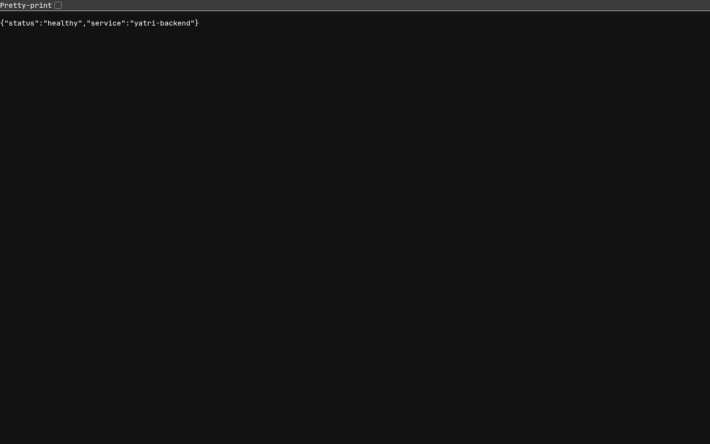
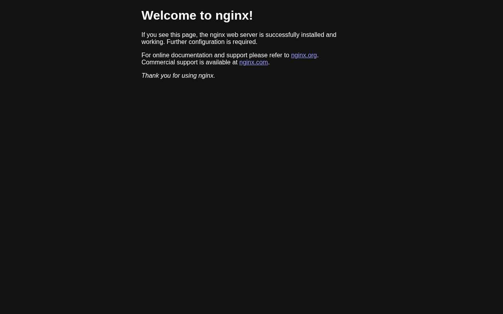

# Kubernetes Networking & Services

Pod IPs change every time a pod is recreated, so clients never talk to pods directly. A **Service** gives a stable virtual IP + DNS name and load-balances to whatever pods currently match its label selector (the matching pod IPs are the Service's **endpoints**).

| Type | Reachable from | Notes |
|---|---|---|
| ClusterIP | inside the cluster only | default; stable VIP + DNS name |
| NodePort | `<any-node-ip>:30000-32767` | builds on ClusterIP |
| LoadBalancer | cloud LB external IP | builds on NodePort; needs a cloud controller |
| ExternalName | inside the cluster | DNS CNAME to an outside hostname, no proxying |
| Headless (`clusterIP: None`) | inside the cluster | DNS returns the pod IPs directly |

`port` = the Service port, `targetPort` = the container port, `nodePort` = the port opened on every node.

Cluster: local kind cluster `s-a` (1 control-plane + 2 workers). NodePort `30080` is mapped to `localhost:18180` on the host.

## Lab 1 - Deploy backend pods

```bash
…/k8s-a/session-11-kubernetes-services ❯ kubectl apply -f deployment/backend-deployment.yaml
deployment.apps/yatri-backend created

…/k8s-a/session-11-kubernetes-services ❯ kubectl rollout status deploy/yatri-backend --timeout=180s
Waiting for deployment "yatri-backend" rollout to finish: 0 of 3 updated replicas are available...
Waiting for deployment "yatri-backend" rollout to finish: 1 of 3 updated replicas are available...
Waiting for deployment "yatri-backend" rollout to finish: 2 of 3 updated replicas are available...
deployment "yatri-backend" successfully rolled out

…/k8s-a/session-11-kubernetes-services ❯ kubectl get pods -l app=yatri-backend -o wide
NAME                            READY   STATUS    RESTARTS   AGE   IP            NODE          NOMINATED NODE   READINESS GATES
yatri-backend-dc5888c55-6sknj   1/1     Running   0          0s    10.244.2.88   s-a-worker    <none>           <none>
yatri-backend-dc5888c55-r859h   1/1     Running   0          0s    10.244.1.65   s-a-worker2   <none>           <none>
yatri-backend-dc5888c55-th9th   1/1     Running   0          0s    10.244.2.87   s-a-worker    <none>           <none>
```


## Lab 2 - Expose the backend with a ClusterIP Service

```bash
…/k8s-a/session-11-kubernetes-services ❯ kubectl apply -f service/clusterip.yaml
service/yatri-backend-service created

…/k8s-a/session-11-kubernetes-services ❯ kubectl get svc yatri-backend-service
NAME                    TYPE        CLUSTER-IP      EXTERNAL-IP   PORT(S)   AGE
yatri-backend-service   ClusterIP   10.96.242.125   <none>        80/TCP    0s

…/k8s-a/session-11-kubernetes-services ❯ kubectl get endpoints yatri-backend-service
Warning: v1 Endpoints is deprecated in v1.33+; use discovery.k8s.io/v1 EndpointSlice
NAME                    ENDPOINTS                                            AGE
yatri-backend-service   10.244.1.65:5000,10.244.2.87:5000,10.244.2.88:5000   0s

…/k8s-a/session-11-kubernetes-services ❯ kubectl get endpointslices -l kubernetes.io/service-name=yatri-backend-service
NAME                          ADDRESSTYPE   PORTS   ENDPOINTS                             AGE
yatri-backend-service-57nlb   IPv4          5000    10.244.1.65,10.244.2.88,10.244.2.87   0s

…/k8s-a/session-11-kubernetes-services ❯ kubectl describe svc yatri-backend-service
Name:                     yatri-backend-service
Namespace:                default
Labels:                   app=yatri-backend
Annotations:              <none>
Selector:                 app=yatri-backend
Type:                     ClusterIP
IP Family Policy:         SingleStack
IP Families:              IPv4
IP:                       10.96.242.125
IPs:                      10.96.242.125
Port:                     http  80/TCP
TargetPort:               5000/TCP
Endpoints:                10.244.1.65:5000,10.244.2.88:5000,10.244.2.87:5000
Session Affinity:         None
Internal Traffic Policy:  Cluster
Events:                   <none>
```


## Lab 3 - Internal DNS & service discovery (CoreDNS)

The pod's `/etc/resolv.conf` points at the `kube-dns` service (`10.96.0.10`) and has search domains `default.svc.cluster.local svc.cluster.local cluster.local`, so the short name `yatri-backend-service` expands to the FQDN. (busybox `nslookup` also prints the NXDOMAIN answers for the other search-domain attempts and exits 1, but the `default.svc.cluster.local` lookup succeeds.)

```bash
…/k8s-a/session-11-kubernetes-services ❯ kubectl apply -f dns-test/curl-test-pod.yaml
pod/curl-test-pod created

…/k8s-a/session-11-kubernetes-services ❯ kubectl wait --for=condition=Ready pod/curl-test-pod --timeout=120s
pod/curl-test-pod condition met

…/k8s-a/session-11-kubernetes-services ❯ kubectl get pod curl-test-pod
NAME            READY   STATUS    RESTARTS   AGE
curl-test-pod   1/1     Running   0          6s

…/k8s-a/session-11-kubernetes-services ❯ kubectl exec curl-test-pod -- nslookup yatri-backend-service
Server:		10.96.0.10
Address:	10.96.0.10:53

** server can't find yatri-backend-service.cluster.local: NXDOMAIN

Name:	yatri-backend-service.default.svc.cluster.local
Address: 10.96.242.125

** server can't find yatri-backend-service.cluster.local: NXDOMAIN

** server can't find yatri-backend-service.svc.cluster.local: NXDOMAIN

** server can't find yatri-backend-service.svc.cluster.local: NXDOMAIN

command terminated with exit code 1

…/k8s-a/session-11-kubernetes-services ❯ kubectl exec curl-test-pod -- cat /etc/resolv.conf
search default.svc.cluster.local svc.cluster.local cluster.local
nameserver 10.96.0.10
options ndots:5

…/k8s-a/session-11-kubernetes-services ❯ kubectl exec curl-test-pod -- curl -s http://yatri-backend-service:80
Backend v1.0.0 listening on port 5000

…/k8s-a/session-11-kubernetes-services ❯ kubectl exec curl-test-pod -- curl -s http://yatri-backend-service/healthz
{"status":"healthy","service":"yatri-backend"}

…/k8s-a/session-11-kubernetes-services ❯ kubectl exec curl-test-pod -- curl -s http://yatri-backend-service.default.svc.cluster.local/healthz
{"status":"healthy","service":"yatri-backend"}

…/k8s-a/session-11-kubernetes-services ❯ kubectl get pods -n kube-system -l k8s-app=kube-dns -o wide
NAME                       READY   STATUS    RESTARTS   AGE   IP           NODE                NOMINATED NODE   READINESS GATES
coredns-559f6c778d-62hkk   1/1     Running   0          40m   10.244.0.2   s-a-control-plane   <none>           <none>
coredns-559f6c778d-g9kwp   1/1     Running   0          40m   10.244.0.3   s-a-control-plane   <none>           <none>

…/k8s-a/session-11-kubernetes-services ❯ kubectl get svc -n kube-system kube-dns
NAME       TYPE        CLUSTER-IP   EXTERNAL-IP   PORT(S)                  AGE
kube-dns   ClusterIP   10.96.0.10   <none>        53/UDP,53/TCP,9153/TCP   40m
```


## Lab 4 - NodePort

On kind the "node IP" is the node container's IP (`172.19.0.x`); from the host it is reached through the `30080 -> 18180` port mapping. A NodePort is opened on **every** node, even nodes that don't run a backend pod.

```bash
…/k8s-a/session-11-kubernetes-services ❯ kubectl apply -f service/nodeport.yaml
service/yatri-backend-nodeport created

…/k8s-a/session-11-kubernetes-services ❯ kubectl get svc yatri-backend-nodeport
NAME                     TYPE       CLUSTER-IP      EXTERNAL-IP   PORT(S)        AGE
yatri-backend-nodeport   NodePort   10.96.166.108   <none>        80:30080/TCP   10s

…/k8s-a/session-11-kubernetes-services ❯ kubectl get nodes -o wide
NAME                STATUS   ROLES           AGE   VERSION   INTERNAL-IP   EXTERNAL-IP   OS-IMAGE                       KERNEL-VERSION            CONTAINER-RUNTIME
s-a-control-plane   Ready    control-plane   41m   v1.37.0   172.19.0.6    <none>        Debian GNU/Linux 13 (trixie)   7.2.5-3-omarchy (amd64)   containerd://2.3.4
s-a-worker          Ready    <none>          41m   v1.37.0   172.19.0.7    <none>        Debian GNU/Linux 13 (trixie)   7.2.5-3-omarchy (amd64)   containerd://2.3.4
s-a-worker2         Ready    <none>          41m   v1.37.0   172.19.0.5    <none>        Debian GNU/Linux 13 (trixie)   7.2.5-3-omarchy (amd64)   containerd://2.3.4

…/k8s-a/session-11-kubernetes-services ❯ docker exec s-a-worker curl -s http://localhost:30080/healthz
{"status":"healthy","service":"yatri-backend"}

…/k8s-a/session-11-kubernetes-services ❯ docker exec s-a-worker2 curl -s http://172.19.0.6:30080/
Backend v1.0.0 listening on port 5000

…/k8s-a/session-11-kubernetes-services ❯ curl -s http://localhost:18180/healthz
{"status":"healthy","service":"yatri-backend"}
```




## Lab 5 - LoadBalancer

There is no cloud controller in kind, so `EXTERNAL-IP` stays `<pending>` forever (on EKS/GKE/AKS a cloud load balancer would be provisioned). The LoadBalancer still gets a ClusterIP and a NodePort, so it can be reached via the NodePort or `kubectl port-forward`.

```bash
…/k8s-a/session-11-kubernetes-services ❯ kubectl apply -f service/loadbalancer.yaml
service/yatri-backend-lb created

…/k8s-a/session-11-kubernetes-services ❯ kubectl get svc yatri-backend-lb
NAME               TYPE           CLUSTER-IP      EXTERNAL-IP   PORT(S)        AGE
yatri-backend-lb   LoadBalancer   10.96.107.137   <pending>     80:30785/TCP   15s

…/k8s-a/session-11-kubernetes-services ❯ kubectl describe svc yatri-backend-lb | grep -E 'Type|LoadBalancer|NodePort|Endpoints|Events'
Type:                     LoadBalancer
NodePort:                 http  30785/TCP
Endpoints:                10.244.2.87:5000,10.244.1.65:5000,10.244.2.88:5000
Events:                   <none>

…/k8s-a/session-11-kubernetes-services ❯ docker exec s-a-control-plane sh -c "curl -s http://localhost:$(kubectl get svc yatri-backend-lb -o jsonpath={.spec.ports[0].nodePort})/healthz"
{"status":"healthy","service":"yatri-backend"}

…/k8s-a/session-11-kubernetes-services ❯ kubectl port-forward svc/yatri-backend-lb 18192:80 &
Forwarding from 127.0.0.1:18192 -> 5000
Forwarding from [::1]:18192 -> 5000

…/k8s-a/session-11-kubernetes-services ❯ curl -s http://localhost:18192/
Backend v1.0.0 listening on port 5000
```


## Lab 6 - Triage: empty endpoints

The Service selector `app: wrong-backend-name` matches no pods, so it has `<none>` endpoints and connections fail. Triage: check endpoints -> compare `Selector` with `kubectl get pods --show-labels` -> fix the selector.

```bash
…/k8s-a/session-11-kubernetes-services ❯ kubectl apply -f troubleshooting/empty-endpoints.yaml
service/broken-backend-service created

…/k8s-a/session-11-kubernetes-services ❯ kubectl get endpoints broken-backend-service
Warning: v1 Endpoints is deprecated in v1.33+; use discovery.k8s.io/v1 EndpointSlice
NAME                     ENDPOINTS   AGE
broken-backend-service   <none>      3s

…/k8s-a/session-11-kubernetes-services ❯ kubectl exec curl-test-pod -- curl -sS --connect-timeout 3 http://broken-backend-service
curl: (7) Failed to connect to broken-backend-service port 80 after 0 ms: Couldn't connect to server
command terminated with exit code 7

…/k8s-a/session-11-kubernetes-services ❯ kubectl describe svc broken-backend-service | grep -E "Selector|Endpoints"
Selector:                 app=wrong-backend-name
Endpoints:                

…/k8s-a/session-11-kubernetes-services ❯ kubectl get pods --show-labels
NAME                            READY   STATUS    RESTARTS   AGE   LABELS
curl-test-pod                   1/1     Running   0          84s   tool=diagnostic
yatri-backend-dc5888c55-6sknj   1/1     Running   0          85s   app=yatri-backend,pod-template-hash=dc5888c55,tier=api
yatri-backend-dc5888c55-r859h   1/1     Running   0          85s   app=yatri-backend,pod-template-hash=dc5888c55,tier=api
yatri-backend-dc5888c55-th9th   1/1     Running   0          85s   app=yatri-backend,pod-template-hash=dc5888c55,tier=api

…/k8s-a/session-11-kubernetes-services ❯ kubectl patch svc broken-backend-service -p '{"spec":{"selector":{"app":"yatri-backend"}}}'
service/broken-backend-service patched

…/k8s-a/session-11-kubernetes-services ❯ kubectl get endpoints broken-backend-service
Warning: v1 Endpoints is deprecated in v1.33+; use discovery.k8s.io/v1 EndpointSlice
NAME                     ENDPOINTS                                            AGE
broken-backend-service   10.244.1.65:5000,10.244.2.87:5000,10.244.2.88:5000   11s

…/k8s-a/session-11-kubernetes-services ❯ kubectl exec curl-test-pod -- curl -sS --connect-timeout 3 http://broken-backend-service
Backend v1.0.0 listening on port 5000

…/k8s-a/session-11-kubernetes-services ❯ kubectl delete -f troubleshooting/empty-endpoints.yaml
service "broken-backend-service" deleted from default namespace
```


## Lab cleanup

```bash
…/k8s-a/session-11-kubernetes-services ❯ kubectl delete -f service/ -f deployment/ -f dns-test/
service "yatri-backend-service" deleted from default namespace
service "yatri-backend-lb" deleted from default namespace
service "yatri-backend-nodeport" deleted from default namespace
deployment.apps "yatri-backend" deleted from default namespace
pod "curl-test-pod" deleted from default namespace
```


## 01 - ClusterIP (web-service-clusterip, port 8080 -> 80)

Reached from a client pod by name, by ClusterIP and by FQDN. From the host the ClusterIP is not routable (`curl` exit 28 = timeout), so for local debugging use `kubectl port-forward`.

```bash
…/k8s-a/session-11-kubernetes-services ❯ kubectl apply -f 01-clusterip/app-deployment.yaml
deployment.apps/web-app-clusterip created

…/k8s-a/session-11-kubernetes-services ❯ kubectl rollout status deploy/web-app-clusterip --timeout=120s
Waiting for deployment "web-app-clusterip" rollout to finish: 0 of 3 updated replicas are available...
Waiting for deployment "web-app-clusterip" rollout to finish: 1 of 3 updated replicas are available...
Waiting for deployment "web-app-clusterip" rollout to finish: 2 of 3 updated replicas are available...
deployment "web-app-clusterip" successfully rolled out

…/k8s-a/session-11-kubernetes-services ❯ kubectl get pods -l app=web-clusterip -o wide
NAME                                 READY   STATUS    RESTARTS   AGE   IP            NODE          NOMINATED NODE   READINESS GATES
web-app-clusterip-66865d4855-9kfm4   1/1     Running   0          1s    10.244.1.67   s-a-worker2   <none>           <none>
web-app-clusterip-66865d4855-h8cqd   1/1     Running   0          1s    10.244.2.90   s-a-worker    <none>           <none>
web-app-clusterip-66865d4855-v262p   1/1     Running   0          1s    10.244.2.91   s-a-worker    <none>           <none>

…/k8s-a/session-11-kubernetes-services ❯ kubectl apply -f 01-clusterip/service.yaml
service/web-service-clusterip created

…/k8s-a/session-11-kubernetes-services ❯ kubectl get svc web-service-clusterip
NAME                    TYPE        CLUSTER-IP      EXTERNAL-IP   PORT(S)    AGE
web-service-clusterip   ClusterIP   10.96.212.122   <none>        8080/TCP   0s

…/k8s-a/session-11-kubernetes-services ❯ kubectl get endpoints web-service-clusterip
Warning: v1 Endpoints is deprecated in v1.33+; use discovery.k8s.io/v1 EndpointSlice
NAME                    ENDPOINTS                                      AGE
web-service-clusterip   10.244.1.67:80,10.244.2.90:80,10.244.2.91:80   0s

…/k8s-a/session-11-kubernetes-services ❯ kubectl apply -f 01-clusterip/client-pod.yaml
pod/curl-client created

…/k8s-a/session-11-kubernetes-services ❯ kubectl wait --for=condition=Ready pod/curl-client --timeout=120s
pod/curl-client condition met

…/k8s-a/session-11-kubernetes-services ❯ kubectl get pod curl-client
NAME          READY   STATUS    RESTARTS   AGE
curl-client   1/1     Running   0          6s

…/k8s-a/session-11-kubernetes-services ❯ kubectl exec curl-client -- sh -c "curl -s http://web-service-clusterip:8080 | grep -i title"
<title>Welcome to nginx!</title>

…/k8s-a/session-11-kubernetes-services ❯ kubectl exec curl-client -- sh -c 'curl -s http://10.96.212.122:8080 | grep -i title'
<title>Welcome to nginx!</title>

…/k8s-a/session-11-kubernetes-services ❯ kubectl exec curl-client -- sh -c "curl -s http://web-service-clusterip.default.svc.cluster.local:8080 | grep -i title"
<title>Welcome to nginx!</title>

…/k8s-a/session-11-kubernetes-services ❯ curl -s --max-time 3 http://10.96.212.122:8080; echo "exit code: $?"
exit code: 28

…/k8s-a/session-11-kubernetes-services ❯ kubectl port-forward svc/web-service-clusterip 18193:8080 &
Forwarding from 127.0.0.1:18193 -> 80
Forwarding from [::1]:18193 -> 80

…/k8s-a/session-11-kubernetes-services ❯ curl -s http://localhost:18193 | grep -i title
<title>Welcome to nginx!</title>

…/k8s-a/session-11-kubernetes-services ❯ kubectl delete -f 01-clusterip/client-pod.yaml -f 01-clusterip/service.yaml -f 01-clusterip/app-deployment.yaml
pod "curl-client" deleted from default namespace
service "web-service-clusterip" deleted from default namespace
deployment.apps "web-app-clusterip" deleted from default namespace
```


## 02 - NodePort (web-service-nodeport, 30080)

```bash
…/k8s-a/session-11-kubernetes-services ❯ kubectl apply -f 02-nodeport/app-deployment.yaml
deployment.apps/web-app-nodeport created

…/k8s-a/session-11-kubernetes-services ❯ kubectl rollout status deploy/web-app-nodeport --timeout=120s
Waiting for deployment "web-app-nodeport" rollout to finish: 0 of 2 updated replicas are available...
Waiting for deployment "web-app-nodeport" rollout to finish: 1 of 2 updated replicas are available...
deployment "web-app-nodeport" successfully rolled out

…/k8s-a/session-11-kubernetes-services ❯ kubectl get pods -l app=web-nodeport -o wide
NAME                              READY   STATUS    RESTARTS   AGE   IP            NODE          NOMINATED NODE   READINESS GATES
web-app-nodeport-6c8f48bd-cztb7   1/1     Running   0          0s    10.244.2.92   s-a-worker    <none>           <none>
web-app-nodeport-6c8f48bd-lc69l   1/1     Running   0          0s    10.244.1.69   s-a-worker2   <none>           <none>

…/k8s-a/session-11-kubernetes-services ❯ kubectl apply -f 02-nodeport/service.yaml
service/web-service-nodeport created

…/k8s-a/session-11-kubernetes-services ❯ kubectl get svc web-service-nodeport
NAME                   TYPE       CLUSTER-IP     EXTERNAL-IP   PORT(S)        AGE
web-service-nodeport   NodePort   10.96.249.75   <none>        80:30080/TCP   10s

…/k8s-a/session-11-kubernetes-services ❯ docker port s-a-control-plane
80/tcp -> 0.0.0.0:18080
443/tcp -> 0.0.0.0:18443
6443/tcp -> 127.0.0.1:35339
30010/tcp -> 0.0.0.0:18110
30020/tcp -> 0.0.0.0:18120
30030/tcp -> 0.0.0.0:18130
30040/tcp -> 0.0.0.0:18140
30080/tcp -> 0.0.0.0:18180

…/k8s-a/session-11-kubernetes-services ❯ curl -s http://localhost:18180 | grep -i title
<title>Welcome to nginx!</title>

…/k8s-a/session-11-kubernetes-services ❯ docker exec s-a-worker2 sh -c "curl -s http://172.19.0.7:30080 | grep -i title"
<title>Welcome to nginx!</title>

…/k8s-a/session-11-kubernetes-services ❯ kubectl delete -f 02-nodeport/service.yaml -f 02-nodeport/app-deployment.yaml
service "web-service-nodeport" deleted from default namespace
deployment.apps "web-app-nodeport" deleted from default namespace
```




## 03 - LoadBalancer (web-service-loadbalancer)

`<pending>` on kind - `.status.loadBalancer` is empty because nothing provisions an external LB. Accessed with port-forward instead.

```bash
…/k8s-a/session-11-kubernetes-services ❯ kubectl apply -f 03-loadbalancer/app-deployment.yaml
deployment.apps/web-app-loadbalancer created

…/k8s-a/session-11-kubernetes-services ❯ kubectl rollout status deploy/web-app-loadbalancer --timeout=120s
Waiting for deployment "web-app-loadbalancer" rollout to finish: 0 of 3 updated replicas are available...
Waiting for deployment "web-app-loadbalancer" rollout to finish: 1 of 3 updated replicas are available...
Waiting for deployment "web-app-loadbalancer" rollout to finish: 2 of 3 updated replicas are available...
deployment "web-app-loadbalancer" successfully rolled out

…/k8s-a/session-11-kubernetes-services ❯ kubectl get pods -l app=web-loadbalancer
NAME                                   READY   STATUS    RESTARTS   AGE
web-app-loadbalancer-5db87c7b9-28qdk   1/1     Running   0          1s
web-app-loadbalancer-5db87c7b9-7wj8g   1/1     Running   0          1s
web-app-loadbalancer-5db87c7b9-kgrfh   1/1     Running   0          1s

…/k8s-a/session-11-kubernetes-services ❯ kubectl apply -f 03-loadbalancer/service.yaml
service/web-service-loadbalancer created

…/k8s-a/session-11-kubernetes-services ❯ kubectl get svc web-service-loadbalancer
NAME                       TYPE           CLUSTER-IP      EXTERNAL-IP   PORT(S)        AGE
web-service-loadbalancer   LoadBalancer   10.96.208.149   <pending>     80:30686/TCP   20s

…/k8s-a/session-11-kubernetes-services ❯ kubectl get svc web-service-loadbalancer -o jsonpath="{.status}"; echo
{"loadBalancer":{}}

…/k8s-a/session-11-kubernetes-services ❯ kubectl port-forward svc/web-service-loadbalancer 18194:80 &
Forwarding from 127.0.0.1:18194 -> 80
Forwarding from [::1]:18194 -> 80

…/k8s-a/session-11-kubernetes-services ❯ curl -s http://localhost:18194 | grep -i title
<title>Welcome to nginx!</title>

…/k8s-a/session-11-kubernetes-services ❯ kubectl delete -f 03-loadbalancer/service.yaml -f 03-loadbalancer/app-deployment.yaml
service "web-service-loadbalancer" deleted from default namespace
deployment.apps "web-app-loadbalancer" deleted from default namespace
```


## 04 - ExternalName

The Service is just a CNAME record. With the original `externalName: nencyravaliya.me` the CNAME is returned, but that domain itself does not resolve (NXDOMAIN), so `curl` fails with exit code 6 (could not resolve host).

```bash
…/k8s-a/session-11-kubernetes-services ❯ kubectl apply -f 04-externalname/service.yaml
service/external-database-service created

…/k8s-a/session-11-kubernetes-services ❯ kubectl get svc external-database-service
NAME                        TYPE           CLUSTER-IP   EXTERNAL-IP        PORT(S)   AGE
external-database-service   ExternalName   <none>       nencyravaliya.me   <none>    0s

…/k8s-a/session-11-kubernetes-services ❯ kubectl apply -f 04-externalname/client-pod.yaml
pod/dns-test-client created

…/k8s-a/session-11-kubernetes-services ❯ kubectl wait --for=condition=Ready pod/dns-test-client --timeout=120s
pod/dns-test-client condition met

…/k8s-a/session-11-kubernetes-services ❯ kubectl get pod dns-test-client
NAME              READY   STATUS    RESTARTS   AGE
dns-test-client   1/1     Running   0          7s

…/k8s-a/session-11-kubernetes-services ❯ kubectl exec dns-test-client -- nslookup external-database-service
Server:		10.96.0.10
Address:	10.96.0.10:53

** server can't find external-database-service.cluster.local: NXDOMAIN

** server can't find external-database-service.cluster.local: NXDOMAIN

** server can't find external-database-service.svc.cluster.local: NXDOMAIN

** server can't find external-database-service.svc.cluster.local: NXDOMAIN

external-database-service.default.svc.cluster.local	canonical name = nencyravaliya.me

external-database-service.default.svc.cluster.local	canonical name = nencyravaliya.me

command terminated with exit code 1

…/k8s-a/session-11-kubernetes-services ❯ kubectl exec dns-test-client -- nslookup -type=CNAME external-database-service.default.svc.cluster.local
Server:		10.96.0.10
Address:	10.96.0.10:53

external-database-service.default.svc.cluster.local	canonical name = nencyravaliya.me

…/k8s-a/session-11-kubernetes-services ❯ kubectl exec dns-test-client -- sh -c "curl -sk -o /dev/null -w \"HTTP %{http_code} from %{remote_ip}\n\" --max-time 10 https://external-database-service"
HTTP 000 from 
command terminated with exit code 6

…/k8s-a/session-11-kubernetes-services ❯ kubectl exec dns-test-client -- curl -s -H "Host: api.github.com" --max-time 10 https://external-database-service
command terminated with exit code 6

…/k8s-a/session-11-kubernetes-services ❯ kubectl delete -f 04-externalname/client-pod.yaml -f 04-externalname/service.yaml
pod "dns-test-client" deleted from default namespace
service "external-database-service" deleted from default namespace
```


**Fix:** point the ExternalName at a resolvable host (`api.github.com`). Now DNS follows the CNAME to a real IP. Gotcha: plain HTTPS to `https://external-database-service` fails TLS verification (exit 60) because the certificate is for `api.github.com`, not the alias - ExternalName does no proxying, TLS/Host headers still have to match the real host.

```bash
…/k8s-a/session-11-kubernetes-services ❯ kubectl apply -f 04-externalname/service.yaml -f 04-externalname/client-pod.yaml
service/external-database-service created
pod/dns-test-client created

…/k8s-a/session-11-kubernetes-services ❯ kubectl wait --for=condition=Ready pod/dns-test-client --timeout=120s
pod/dns-test-client condition met

…/k8s-a/session-11-kubernetes-services ❯ kubectl exec dns-test-client -- nslookup nencyravaliya.me
Server:		10.96.0.10
Address:	10.96.0.10:53

** server can't find nencyravaliya.me: NXDOMAIN

** server can't find nencyravaliya.me: NXDOMAIN

command terminated with exit code 1

…/k8s-a/session-11-kubernetes-services ❯ kubectl patch svc external-database-service -p '{"spec":{"externalName":"api.github.com"}}'
service/external-database-service patched

…/k8s-a/session-11-kubernetes-services ❯ kubectl get svc external-database-service
NAME                        TYPE           CLUSTER-IP   EXTERNAL-IP      PORT(S)   AGE
external-database-service   ExternalName   <none>       api.github.com   <none>    0s

…/k8s-a/session-11-kubernetes-services ❯ kubectl exec dns-test-client -- nslookup external-database-service.default.svc.cluster.local
Server:		10.96.0.10
Address:	10.96.0.10:53

external-database-service.default.svc.cluster.local	canonical name = api.github.com

external-database-service.default.svc.cluster.local	canonical name = api.github.com
Name:	api.github.com
Address: 20.207.73.85

…/k8s-a/session-11-kubernetes-services ❯ kubectl exec dns-test-client -- curl -s -H "Host: api.github.com" --max-time 10 https://external-database-service
command terminated with exit code 60

…/k8s-a/session-11-kubernetes-services ❯ kubectl exec dns-test-client -- curl -sS --max-time 10 -o /dev/null https://external-database-service
curl: (60) SSL: no alternative certificate subject name matches target host name 'external-database-service'
More details here: https://curl.se/docs/sslcerts.html

curl failed to verify the legitimacy of the server and therefore could not
establish a secure connection to it. To learn more about this situation and
how to fix it, please visit the web page mentioned above.
command terminated with exit code 60

…/k8s-a/session-11-kubernetes-services ❯ kubectl exec dns-test-client -- curl -sk -H "Host: api.github.com" --max-time 10 https://external-database-service | head -8
{"current_user_url":"https://api.github.com/user","current_user_authorizations_html_url":"https://github.com/settings/connections/applications{/client_id}","authorizations_url":"https://api.github.com/authorizations","code_search_url":"https://api.github.com/search/code?q={query}{&page,per_page,sort,order}","commit_search_url":"https://api.github.com/search/commits?q={query}{&page,per_page,sort,order}","emails_url":"https://api.github.com/user/emails","emojis_url":"https://api.github.com/emojis","events_url":"https://api.github.com/events","feeds_url":"https://api.github.com/feeds","followers_url":"https://api.github.com/user/followers","following_url":"https://api.github.com/user/following{/target}","gists_url":"https://api.github.com/gists{/gist_id}","hub_url":"https://api.github.com/hub","issue_search_url":"https://api.github.com/search/issues?q={query}{&page,per_page,sort,order}","issues_url":"https://api.github.com/issues","keys_url":"https://api.github.com/user/keys","label_search_url":"https://api.github.com/search/labels?q={query}&repository_id={repository_id}{&page,per_page}","notifications_url":"https://api.github.com/notifications","organization_url":"https://api.github.com/orgs/{org}","organization_repositories_url":"https://api.github.com/orgs/{org}/repos{?type,page,per_page,sort}","organization_teams_url":"https://api.github.com/orgs/{org}/teams","public_gists_url":"https://api.github.com/gists/public","rate_limit_url":"https://api.github.com/rate_limit","repository_url":"https://api.github.com/repos/{owner}/{repo}","repository_search_url":"https://api.github.com/search/repositories?q={query}{&page,per_page,sort,order}","current_user_repositories_url":"https://api.github.com/user/repos{?type,page,per_page,sort}","starred_url":"https://api.github.com/user/starred{/owner}{/repo}","starred_gists_url":"https://api.github.com/gists/starred","topic_search_url":"https://api.github.com/search/topics?q={query}{&page,per_page}","user_url":"https://api.github.com/users/{user}","user_organizations_url":"https://api.github.com/user/orgs","user_repositories_url":"https://api.github.com/users/{user}/repos{?type,page,per_page,sort}","user_search_url":"https://api.github.com/search/users?q={query}{&page,per_page,sort,order}"}

…/k8s-a/session-11-kubernetes-services ❯ kubectl exec dns-test-client -- curl -s --max-time 10 --connect-to api.github.com:443:external-database-service:443 https://api.github.com/zen; echo
Half measures are as bad as nothing at all.

…/k8s-a/session-11-kubernetes-services ❯ kubectl delete -f 04-externalname/client-pod.yaml -f 04-externalname/service.yaml
pod "dns-test-client" deleted from default namespace
service "external-database-service" deleted from default namespace
```


## 05 - Headless Service + StatefulSet

`clusterIP: None` - DNS for the service returns all pod IPs, and every StatefulSet pod gets its own stable record `<pod>.<service>.<ns>.svc.cluster.local`.

```bash
…/k8s-a/session-11-kubernetes-services ❯ kubectl apply -f 05-headless/service.yaml
service/web-service-headless created

…/k8s-a/session-11-kubernetes-services ❯ kubectl get svc web-service-headless
NAME                   TYPE        CLUSTER-IP   EXTERNAL-IP   PORT(S)   AGE
web-service-headless   ClusterIP   None         <none>        80/TCP    0s

…/k8s-a/session-11-kubernetes-services ❯ kubectl apply -f 05-headless/app-statefulset.yaml
statefulset.apps/web-stateful created

…/k8s-a/session-11-kubernetes-services ❯ kubectl rollout status sts/web-stateful --timeout=180s
Waiting for 3 pods to be ready...
Waiting for 2 pods to be ready...
Waiting for 2 pods to be ready...
Waiting for 1 pods to be ready...
Waiting for 1 pods to be ready...
partitioned roll out complete: 3 new pods have been updated...

…/k8s-a/session-11-kubernetes-services ❯ kubectl get pods -l app=web-headless -o wide
NAME             READY   STATUS    RESTARTS   AGE   IP            NODE          NOMINATED NODE   READINESS GATES
web-stateful-0   1/1     Running   0          3s    10.244.2.96   s-a-worker    <none>           <none>
web-stateful-1   1/1     Running   0          2s    10.244.1.71   s-a-worker2   <none>           <none>
web-stateful-2   1/1     Running   0          1s    10.244.2.97   s-a-worker    <none>           <none>

…/k8s-a/session-11-kubernetes-services ❯ kubectl apply -f 05-headless/client-pod.yaml
pod/headless-dns-client created

…/k8s-a/session-11-kubernetes-services ❯ kubectl wait --for=condition=Ready pod/headless-dns-client --timeout=120s
pod/headless-dns-client condition met

…/k8s-a/session-11-kubernetes-services ❯ kubectl get pod headless-dns-client
NAME                  READY   STATUS    RESTARTS   AGE
headless-dns-client   1/1     Running   0          0s

…/k8s-a/session-11-kubernetes-services ❯ kubectl exec headless-dns-client -- nslookup web-service-headless.default.svc.cluster.local
Server:		10.96.0.10
Address:	10.96.0.10:53

Name:	web-service-headless.default.svc.cluster.local
Address: 10.244.2.97
Name:	web-service-headless.default.svc.cluster.local
Address: 10.244.2.96
Name:	web-service-headless.default.svc.cluster.local
Address: 10.244.1.71

…/k8s-a/session-11-kubernetes-services ❯ kubectl exec headless-dns-client -- nslookup web-stateful-0.web-service-headless.default.svc.cluster.local
Server:		10.96.0.10
Address:	10.96.0.10:53

Name:	web-stateful-0.web-service-headless.default.svc.cluster.local
Address: 10.244.2.96

…/k8s-a/session-11-kubernetes-services ❯ kubectl exec headless-dns-client -- sh -c "curl -s http://web-stateful-0.web-service-headless:80 | grep -i title"
<title>Welcome to nginx!</title>

…/k8s-a/session-11-kubernetes-services ❯ kubectl exec web-stateful-1 -- sh -c "echo I am \$(hostname) > /usr/share/nginx/html/index.html"

…/k8s-a/session-11-kubernetes-services ❯ kubectl exec headless-dns-client -- curl -s http://web-stateful-1.web-service-headless
I am web-stateful-1

…/k8s-a/session-11-kubernetes-services ❯ kubectl delete -f 05-headless/client-pod.yaml -f 05-headless/app-statefulset.yaml -f 05-headless/service.yaml
pod "headless-dns-client" deleted from default namespace
statefulset.apps "web-stateful" deleted from default namespace
service "web-service-headless" deleted from default namespace
```


## FQDN - cross-namespace DNS (fqdn.md)

A short name only resolves inside the caller's namespace. A pod in `default` can't resolve `backend` (which lives in `production`); `backend.production` or the full FQDN `backend.production.svc.cluster.local` works.

```bash
…/k8s-a/session-11-kubernetes-services ❯ kubectl apply -f dns-test/curl-test-pod.yaml
pod/curl-test-pod created

…/k8s-a/session-11-kubernetes-services ❯ kubectl create namespace production
namespace/production created

…/k8s-a/session-11-kubernetes-services ❯ kubectl create deployment backend --image=nginx:1.25-alpine -n production
deployment.apps/backend created

…/k8s-a/session-11-kubernetes-services ❯ kubectl expose deployment backend --port=80 -n production
service/backend exposed

…/k8s-a/session-11-kubernetes-services ❯ kubectl rollout status deploy/backend -n production --timeout=120s
Waiting for deployment "backend" rollout to finish: 0 of 1 updated replicas are available...
deployment "backend" successfully rolled out

…/k8s-a/session-11-kubernetes-services ❯ kubectl wait --for=condition=Ready pod/curl-test-pod --timeout=120s
pod/curl-test-pod condition met

…/k8s-a/session-11-kubernetes-services ❯ kubectl exec curl-test-pod -- curl -sS --connect-timeout 3 http://backend
curl: (6) Could not resolve host: backend
command terminated with exit code 6

…/k8s-a/session-11-kubernetes-services ❯ kubectl exec curl-test-pod -- sh -c "curl -sS --connect-timeout 3 http://backend.production | grep title"
<title>Welcome to nginx!</title>

…/k8s-a/session-11-kubernetes-services ❯ kubectl exec curl-test-pod -- sh -c "curl -sS --connect-timeout 3 http://backend.production.svc.cluster.local | grep title"
<title>Welcome to nginx!</title>

…/k8s-a/session-11-kubernetes-services ❯ kubectl exec curl-test-pod -- nslookup kubernetes.default.svc.cluster.local
Server:		10.96.0.10
Address:	10.96.0.10:53

Name:	kubernetes.default.svc.cluster.local
Address: 10.96.0.1

…/k8s-a/session-11-kubernetes-services ❯ kubectl delete namespace production
namespace "production" deleted

…/k8s-a/session-11-kubernetes-services ❯ kubectl delete -f dns-test/curl-test-pod.yaml
pod "curl-test-pod" deleted from default namespace
```

