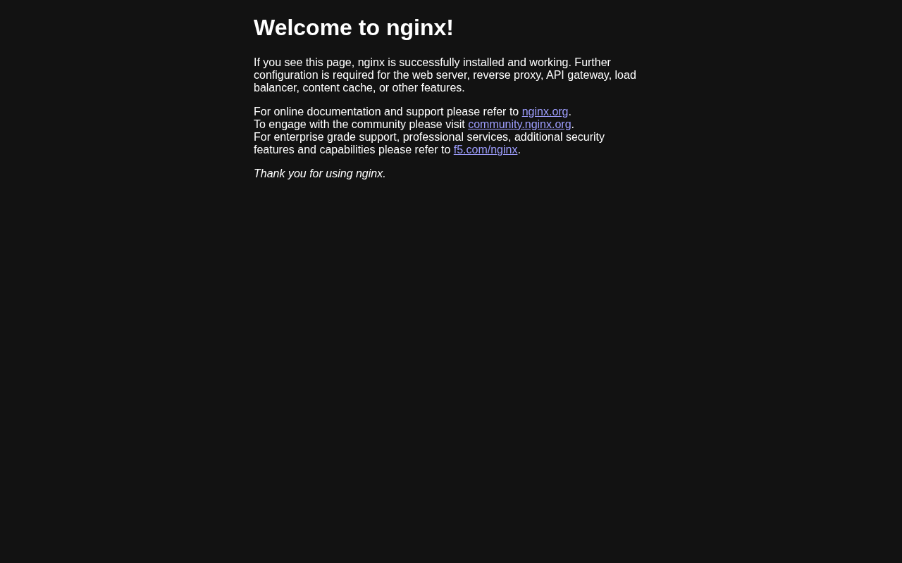

# 15

Lab run with **Helm v4.2.2** against a local **kind** cluster (`s-b`, Kubernetes v1.37). Helm 4 still uses the `helm install / upgrade / rollback` workflow from the course. Differences I hit are noted inline (e.g. `--atomic` is now `--rollback-on-failure`).

## 01 - What is Helm

```bash
…/session-15-helm/01-what-is-helm ❯ helm version
version.BuildInfo{Version:"v4.2.2", GitCommit:"b05881cf967a5a09e19866799d0edfd40675803a", GitTreeState:"", GoVersion:"go1.26.4-X:nodwarf5", KubeClientVersion:"v1.36"}

…/session-15-helm/01-what-is-helm ❯ helm list
NAME	NAMESPACE	REVISION	UPDATED	STATUS	CHART	APP VERSION

…/session-15-helm/01-what-is-helm ❯ helm repo add bitnami https://charts.bitnami.com/bitnami
"bitnami" has been added to your repositories

…/session-15-helm/01-what-is-helm ❯ helm repo update
Hang tight while we grab the latest from your chart repositories...
...Successfully got an update from the "bitnami" chart repository
Update Complete. ⎈Happy Helming!⎈

…/session-15-helm/01-what-is-helm ❯ helm search repo nginx | head -5
NAME                            	CHART VERSION	APP VERSION	DESCRIPTION                                       
bitnami/nginx                   	25.2.12      	1.31.8     	NGINX Open Source is a web server that can be a...
bitnami/nginx-ingress-controller	12.0.7       	1.13.1     	NGINX Ingress Controller is an Ingress controll...
bitnami/nginx-intel             	2.1.15       	0.4.9      	DEPRECATED NGINX Open Source for Intel is a lig...

…/session-15-helm/01-what-is-helm ❯ helm install my-nginx bitnami/nginx
NAME: my-nginx
LAST DEPLOYED: Mon Oct 26 15:33:56 2026
NAMESPACE: default
STATUS: deployed
REVISION: 1
DESCRIPTION: Install complete
TEST SUITE: None
NOTES:
CHART NAME: nginx
CHART VERSION: 25.2.12
APP VERSION: 1.31.8

⚠ WARNING: Since August 28th, 2025, only a limited subset of images/charts are available for free.
    Subscribe to Bitnami Secure Images to receive continued support and security updates.
    More info at https://bitnami.com and https://github.com/bitnami/containers/issues/83267

** Please be patient while the chart is being deployed **
NGINX can be accessed through the following DNS name from within your cluster:

    my-nginx.default.svc.cluster.local (port 80)

To access NGINX from outside the cluster, follow the steps below:

1. Get the NGINX URL by running these commands:

  NOTE: It may take a few minutes for the LoadBalancer IP to be available.
        Watch the status with: 'kubectl get svc --namespace default -w my-nginx'

    export SERVICE_PORT=$(kubectl get --namespace default -o jsonpath="{.spec.ports[0].port}" services my-nginx)
    export SERVICE_IP=$(kubectl get svc --namespace default my-nginx -o jsonpath='{.status.loadBalancer.ingress[0].ip}')
    echo "http://${SERVICE_IP}:${SERVICE_PORT}"
WARNING: Rolling tag detected (bitnami/nginx:latest), please note that it is strongly recommended to avoid using rolling tags in a production environment.
+info https://techdocs.broadcom.com/us/en/vmware-tanzu/bitnami-secure-images/bitnami-secure-images/services/bsi-doc/apps-tutorials-understand-rolling-tags-containers-index.html
WARNING: Rolling tag detected (bitnami/git:latest), please note that it is strongly recommended to avoid using rolling tags in a production environment.
+info https://techdocs.broadcom.com/us/en/vmware-tanzu/bitnami-secure-images/bitnami-secure-images/services/bsi-doc/apps-tutorials-understand-rolling-tags-containers-index.html
WARNING: Rolling tag detected (bitnami/nginx-exporter:latest), please note that it is strongly recommended to avoid using rolling tags in a production environment.
+info https://techdocs.broadcom.com/us/en/vmware-tanzu/bitnami-secure-images/bitnami-secure-images/services/bsi-doc/apps-tutorials-understand-rolling-tags-containers-index.html

WARNING: There are "resources" sections in the chart not set. Using "resourcesPreset" is not recommended for production. For production installations, please set the following values according to your workload needs:
  - cloneStaticSiteFromGit.gitSync.resources
  - resources
+info https://kubernetes.io/docs/concepts/configuration/manage-resources-containers/

…/session-15-helm/01-what-is-helm ❯ kubectl get pods
NAME                        READY   STATUS    RESTARTS   AGE
my-nginx-849f6c887f-t5j78   1/1     Running   0          46s

…/session-15-helm/01-what-is-helm ❯ kubectl get services
NAME         TYPE           CLUSTER-IP      EXTERNAL-IP   PORT(S)                      AGE
kubernetes   ClusterIP      10.96.0.1       <none>        443/TCP                      61m
my-nginx     LoadBalancer   10.96.137.252   <pending>     80:30531/TCP,443:31870/TCP   46s

…/session-15-helm/01-what-is-helm ❯ helm list
NAME    	NAMESPACE	REVISION	UPDATED                                	STATUS  	CHART        	APP VERSION
my-nginx	default  	1       	2026-10-26 15:33:56.696738617 +0530 IST	deployed	nginx-25.2.12	1.31.8     

…/session-15-helm/01-what-is-helm ❯ helm uninstall my-nginx
release "my-nginx" uninstalled

…/session-15-helm/01-what-is-helm ❯ kubectl get pods,svc
NAME                            READY   STATUS        RESTARTS   AGE
pod/my-nginx-849f6c887f-t5j78   1/1     Terminating   0          54s

NAME                 TYPE        CLUSTER-IP   EXTERNAL-IP   PORT(S)   AGE
service/kubernetes   ClusterIP   10.96.0.1    <none>        443/TCP   61m
```

> Bitnami's chart still installs, but its NOTES now warn that since Aug 2025 only a limited set of Bitnami images is free.

## 02 - Helm Charts

`demo-chart/` and `myapp/` are already in the folder. I ran `helm create` in a fresh `new/` subfolder to compare with the committed chart (the only difference is the bumped chart version):

```bash
…/session-15-helm/02-helm-charts ❯ ls
demo-chart
myapp
README.md

…/session-15-helm/02-helm-charts/new ❯ helm create demo-chart
Creating demo-chart

…/session-15-helm/02-helm-charts/new ❯ ls demo-chart/
charts
Chart.yaml
templates
values.yaml

…/session-15-helm/02-helm-charts/new ❯ ls -a demo-chart/templates/
.
..
deployment.yaml
_helpers.tpl
hpa.yaml
httproute.yaml
ingress.yaml
NOTES.txt
serviceaccount.yaml
service.yaml
tests

…/session-15-helm/02-helm-charts ❯ diff -r new/demo-chart demo-chart
Only in new/demo-chart: charts
diff -r new/demo-chart/Chart.yaml demo-chart/Chart.yaml
18c18
< version: 0.1.0
---
> version: 0.1.1

…/session-15-helm/02-helm-charts ❯ helm template my-release demo-chart | head -60
---
# Source: demo-chart/templates/serviceaccount.yaml
apiVersion: v1
kind: ServiceAccount
metadata:
  name: my-release-demo-chart
  labels:
    helm.sh/chart: demo-chart-0.1.1
    app.kubernetes.io/name: demo-chart
    app.kubernetes.io/instance: my-release
    app.kubernetes.io/version: "1.16.0"
    app.kubernetes.io/managed-by: Helm
automountServiceAccountToken: true

---
# Source: demo-chart/templates/service.yaml
apiVersion: v1
kind: Service
metadata:
  name: my-release-demo-chart
  labels:
    helm.sh/chart: demo-chart-0.1.1
    app.kubernetes.io/name: demo-chart
    app.kubernetes.io/instance: my-release
    app.kubernetes.io/version: "1.16.0"
    app.kubernetes.io/managed-by: Helm
spec:
  type: ClusterIP
  ports:
    - port: 80
      targetPort: http
      protocol: TCP
      name: http
  selector:
    app.kubernetes.io/name: demo-chart
    app.kubernetes.io/instance: my-release

---
# Source: demo-chart/templates/deployment.yaml
apiVersion: apps/v1
kind: Deployment
metadata:
  name: my-release-demo-chart
  labels:
    helm.sh/chart: demo-chart-0.1.1
    app.kubernetes.io/name: demo-chart
    app.kubernetes.io/instance: my-release
    app.kubernetes.io/version: "1.16.0"
    app.kubernetes.io/managed-by: Helm
spec:
  replicas: 1
  selector:
    matchLabels:
      app.kubernetes.io/name: demo-chart
      app.kubernetes.io/instance: my-release
  template:
    metadata:
      labels:
        helm.sh/chart: demo-chart-0.1.1
        app.kubernetes.io/name: demo-chart

…/session-15-helm/02-helm-charts ❯ helm install demo-release demo-chart
NAME: demo-release
LAST DEPLOYED: Mon Oct 26 15:34:50 2026
NAMESPACE: default
STATUS: deployed
REVISION: 1
DESCRIPTION: Install complete
NOTES:
1. Get the application URL by running these commands:
  export POD_NAME=$(kubectl get pods --namespace default -l "app.kubernetes.io/name=demo-chart,app.kubernetes.io/instance=demo-release" -o jsonpath="{.items[0].metadata.name}")
  export CONTAINER_PORT=$(kubectl get pod --namespace default $POD_NAME -o jsonpath="{.spec.containers[0].ports[0].containerPort}")
  echo "Visit http://127.0.0.1:8080 to use your application"
  kubectl --namespace default port-forward $POD_NAME 8080:$CONTAINER_PORT

…/session-15-helm/02-helm-charts ❯ kubectl get pods
NAME                                       READY   STATUS    RESTARTS   AGE
demo-release-demo-chart-5f75979fb9-v4mcq   1/1     Running   0          16s

…/session-15-helm/02-helm-charts ❯ helm list
NAME        	NAMESPACE	REVISION	UPDATED                                	STATUS  	CHART           	APP VERSION
demo-release	default  	1       	2026-10-26 15:34:50.339995794 +0530 IST	deployed	demo-chart-0.1.1	1.16.0     

…/session-15-helm/02-helm-charts ❯ helm uninstall demo-release
release "demo-release" uninstalled

…/session-15-helm/02-helm-charts ❯ helm lint myapp
==> Linting myapp
[INFO] Chart.yaml: icon is recommended

1 chart(s) linted, 0 chart(s) failed

…/session-15-helm/02-helm-charts ❯ helm template test myapp | grep -E '^kind:|name: test'
kind: ServiceAccount
  name: test-myapp
kind: Service
  name: test-myapp
kind: Deployment
  name: test-myapp
kind: Pod
```

## 03 - Chart Structure

```bash
…/session-15-helm/03-chart-structure ❯ find simple-chart -type f
simple-chart/values.yaml
simple-chart/Chart.yaml
simple-chart/templates/service.yaml
simple-chart/templates/deployment.yaml

…/session-15-helm/03-chart-structure ❯ cat simple-chart/Chart.yaml simple-chart/values.yaml
apiVersion: v2
name: simple-chart
description: A simple Helm chart for learning
type: application
version: 0.1.0
appVersion: "1.0"
replicaCount: 1

image:
  repository: nginx
  tag: latest

service:
  port: 80

…/session-15-helm/03-chart-structure ❯ helm lint simple-chart
==> Linting simple-chart
[INFO] Chart.yaml: icon is recommended

1 chart(s) linted, 0 chart(s) failed

…/session-15-helm/03-chart-structure ❯ helm template my-release simple-chart
---
# Source: simple-chart/templates/service.yaml
apiVersion: v1
kind: Service
metadata:
  name: my-release-svc
spec:
  selector:
    app: my-release
  ports:
    - port: 80
      targetPort: 80

---
# Source: simple-chart/templates/deployment.yaml
apiVersion: apps/v1
kind: Deployment
metadata:
  name: my-release-app
spec:
  replicas: 1
  selector:
    matchLabels:
      app: my-release
  template:
    metadata:
      labels:
        app: my-release
    spec:
      containers:
        - name: app
          image: "nginx:latest"
          ports:
            - containerPort: 80

…/session-15-helm/03-chart-structure ❯ helm install my-release simple-chart
NAME: my-release
LAST DEPLOYED: Mon Oct 26 15:35:18 2026
NAMESPACE: default
STATUS: deployed
REVISION: 1
DESCRIPTION: Install complete
TEST SUITE: None

…/session-15-helm/03-chart-structure ❯ kubectl get pods
NAME                              READY   STATUS    RESTARTS   AGE
my-release-app-75cbf546ff-r5s75   1/1     Running   0          14s

…/session-15-helm/03-chart-structure ❯ kubectl get services
NAME             TYPE        CLUSTER-IP     EXTERNAL-IP   PORT(S)   AGE
kubernetes       ClusterIP   10.96.0.1      <none>        443/TCP   62m
my-release-svc   ClusterIP   10.96.50.107   <none>        80/TCP    14s

…/session-15-helm/03-chart-structure ❯ helm uninstall my-release
release "my-release" uninstalled
```

## 04 - Chart.yaml

The folder only has a bare `Chart.yaml`, so `helm lint my-app/` fails as written. I created `my-app/` with that `Chart.yaml` and a template that reads `.Chart.*` values:

```bash
…/session-15-helm/04-chart-yaml ❯ ls
Chart.yaml
README.md

…/session-15-helm/04-chart-yaml ❯ cat Chart.yaml
apiVersion: v2
name: my-app
description: A learning chart for the Chart.yaml topic
type: application
version: 0.1.0
appVersion: "1.0"
keywords:
  - nginx
  - web
maintainers:
  - name: Student
    email: student@example.com

…/session-15-helm/04-chart-yaml ❯ helm lint my-app/
==> Linting my-app/
Error unable to check Chart.yaml file in chart: stat my-app/Chart.yaml: no such file or directory

Error: 1 chart(s) linted, 1 chart(s) failed

…/session-15-helm/04-chart-yaml ❯ cat my-app/templates/configmap.yaml
apiVersion: v1
kind: ConfigMap
metadata:
  name: {{ .Release.Name }}-meta
  labels:
    chart: "{{ .Chart.Name }}-{{ .Chart.Version }}"
    app-version: "{{ .Chart.AppVersion }}"
data:
  description: {{ .Chart.Description | quote }}

…/session-15-helm/04-chart-yaml ❯ helm lint my-app/
==> Linting my-app/
[INFO] Chart.yaml: icon is recommended
[INFO] values.yaml: file does not exist

1 chart(s) linted, 0 chart(s) failed

…/session-15-helm/04-chart-yaml ❯ helm template demo my-app/
---
# Source: my-app/templates/configmap.yaml
apiVersion: v1
kind: ConfigMap
metadata:
  name: demo-meta
  labels:
    chart: "my-app-0.1.0"
    app-version: "1.0"
data:
  description: "A learning chart for the Chart.yaml topic"

…/session-15-helm/04-chart-yaml ❯ head -3 broken-app/Chart.yaml

name: my-app
description: A learning chart for the Chart.yaml topic

…/session-15-helm/04-chart-yaml ❯ helm lint broken-app/
==> Linting broken-app/
[ERROR] Chart.yaml: apiVersion is required. The value must be either "v1" or "v2"
[INFO] Chart.yaml: icon is recommended
[ERROR] Chart.yaml: chart type is not valid in apiVersion ''. It is valid in apiVersion 'v2'
[INFO] values.yaml: file does not exist
[WARNING] templates/: directory does not exist

Error: 1 chart(s) linted, 1 chart(s) failed
```

For the error case I copied the same `Chart.yaml` into `broken-app/` with the `apiVersion: v2` line removed.

## 05 - values.yaml

`values.yaml` and `values-prod.yaml` are overrides for the `my-app` chart (a `helm create` chart). Precedence: chart defaults -> `-f file` -> `--set`.

```bash
…/session-15-helm/05-values-yaml ❯ ls
my-app
README.md
values-prod.yaml
values.yaml

…/session-15-helm/05-values-yaml ❯ cat values.yaml values-prod.yaml
replicaCount: 1

image:
  repository: nginx
  tag: latest

service:
  port: 80

app:
  name: demo-app
replicaCount: 5

image:
  repository: nginx
  tag: latest

service:
  port: 80

app:
  name: demo-app-prod

…/session-15-helm/05-values-yaml ❯ helm template my-app ./my-app | grep 'replicas:'
  replicas: 1

…/session-15-helm/05-values-yaml ❯ helm template my-app ./my-app --set replicaCount=3 | grep 'replicas:'
  replicas: 3

…/session-15-helm/05-values-yaml ❯ helm template my-app ./my-app -f values-prod.yaml | grep -E 'replicas:|image:'
  replicas: 5
          image: "nginx:latest"
      image: busybox

…/session-15-helm/05-values-yaml ❯ helm template my-app ./my-app -f values-prod.yaml --set replicaCount=7 | grep -E 'replicas:|image:'
  replicas: 7
          image: "nginx:latest"
      image: busybox

…/session-15-helm/05-values-yaml ❯ helm template my-app ./my-app | grep -E 'image:'
          image: "nginx:1.16.0"
      image: busybox

…/session-15-helm/05-values-yaml ❯ helm install my-app ./my-app -f values-prod.yaml
NAME: my-app
LAST DEPLOYED: Mon Oct 26 15:35:43 2026
NAMESPACE: default
STATUS: deployed
REVISION: 1
DESCRIPTION: Install complete
NOTES:
1. Get the application URL by running these commands:
  export POD_NAME=$(kubectl get pods --namespace default -l "app.kubernetes.io/name=my-app,app.kubernetes.io/instance=my-app" -o jsonpath="{.items[0].metadata.name}")
  export CONTAINER_PORT=$(kubectl get pod --namespace default $POD_NAME -o jsonpath="{.spec.containers[0].ports[0].containerPort}")
  echo "Visit http://127.0.0.1:8080 to use your application"
  kubectl --namespace default port-forward $POD_NAME 8080:$CONTAINER_PORT

…/session-15-helm/05-values-yaml ❯ kubectl get deploy,pods -l app.kubernetes.io/instance=my-app
NAME                     READY   UP-TO-DATE   AVAILABLE   AGE
deployment.apps/my-app   5/5     5            5           25s

NAME                         READY   STATUS    RESTARTS   AGE
pod/my-app-cd4984644-6hx5z   1/1     Running   0          25s
pod/my-app-cd4984644-j7bmx   1/1     Running   0          25s
pod/my-app-cd4984644-n4gzc   1/1     Running   0          25s
pod/my-app-cd4984644-nl5rq   1/1     Running   0          25s
pod/my-app-cd4984644-vjxfn   1/1     Running   0          25s

…/session-15-helm/05-values-yaml ❯ helm get values my-app
USER-SUPPLIED VALUES:
app:
  name: demo-app-prod
image:
  repository: nginx
  tag: latest
replicaCount: 5
service:
  port: 80

…/session-15-helm/05-values-yaml ❯ helm get values my-app --all | head -20
COMPUTED VALUES:
affinity: {}
app:
  name: demo-app-prod
autoscaling:
  enabled: false
  maxReplicas: 100
  minReplicas: 1
  targetCPUUtilizationPercentage: 80
fullnameOverride: ""
httpRoute:
  annotations: {}
  enabled: false
  hostnames:
  - chart-example.local
  parentRefs:
  - name: gateway
    sectionName: http
  rules:
  - matches:

…/session-15-helm/05-values-yaml ❯ helm uninstall my-app
release "my-app" uninstalled

…/session-15-helm/05-values-yaml ❯ helm install my-app ./my-app --set replicaCount=3
NAME: my-app
LAST DEPLOYED: Mon Oct 26 15:36:08 2026
NAMESPACE: default
STATUS: deployed
REVISION: 1
DESCRIPTION: Install complete
NOTES:
1. Get the application URL by running these commands:
  export POD_NAME=$(kubectl get pods --namespace default -l "app.kubernetes.io/name=my-app,app.kubernetes.io/instance=my-app" -o jsonpath="{.items[0].metadata.name}")
  export CONTAINER_PORT=$(kubectl get pod --namespace default $POD_NAME -o jsonpath="{.spec.containers[0].ports[0].containerPort}")
  echo "Visit http://127.0.0.1:8080 to use your application"
  kubectl --namespace default port-forward $POD_NAME 8080:$CONTAINER_PORT

…/session-15-helm/05-values-yaml ❯ kubectl get pods -l app.kubernetes.io/instance=my-app
NAME                      READY   STATUS        RESTARTS   AGE
my-app-746c67b6df-6lwx9   1/1     Running       0          1s
my-app-746c67b6df-92pd4   1/1     Running       0          1s
my-app-746c67b6df-zzpk7   1/1     Running       0          1s
my-app-cd4984644-6hx5z    0/1     Completed     0          26s
my-app-cd4984644-n4gzc    1/1     Terminating   0          26s
my-app-cd4984644-nl5rq    0/1     Completed     0          26s
my-app-cd4984644-vjxfn    0/1     Completed     0          26s

…/session-15-helm/05-values-yaml ❯ helm uninstall my-app
release "my-app" uninstalled
```

## 06 - Templates

```bash
…/session-15-helm/06-templates ❯ cat template-demo/templates/service.yaml
{{- if .Values.service.enabled }}
apiVersion: v1
kind: Service
metadata:
  name: {{ .Release.Name }}-svc
spec:
  selector:
    app: {{ .Release.Name }}
  ports:
    - port: {{ .Values.service.port }}
      targetPort: {{ .Values.service.port }}
{{- end }}

…/session-15-helm/06-templates ❯ helm template my-release template-demo
---
# Source: template-demo/templates/service.yaml
apiVersion: v1
kind: Service
metadata:
  name: my-release-svc
spec:
  selector:
    app: my-release
  ports:
    - port: 80
      targetPort: 80

---
# Source: template-demo/templates/deployment.yaml
apiVersion: apps/v1
kind: Deployment
metadata:
  name: my-release-app
  labels:
    app: my-release
spec:
  replicas: 2
  selector:
    matchLabels:
      app: my-release
  template:
    metadata:
      labels:
        app: my-release
    spec:
      containers:
        - name: app
          image: "nginx:latest"
          ports:
            - containerPort: 80

…/session-15-helm/06-templates ❯ helm template my-release template-demo --set replicaCount=5 | grep 'replicas:'
  replicas: 5

…/session-15-helm/06-templates ❯ helm template my-release template-demo --set service.enabled=false
---
# Source: template-demo/templates/deployment.yaml
apiVersion: apps/v1
kind: Deployment
metadata:
  name: my-release-app
  labels:
    app: my-release
spec:
  replicas: 2
  selector:
    matchLabels:
      app: my-release
  template:
    metadata:
      labels:
        app: my-release
    spec:
      containers:
        - name: app
          image: "nginx:latest"
          ports:
            - containerPort: 80

…/session-15-helm/06-templates ❯ helm template my-release template-demo --set service.enabled=false | grep -c 'kind: Service'
0

…/session-15-helm/06-templates ❯ helm lint template-demo
==> Linting template-demo
[INFO] Chart.yaml: icon is recommended

1 chart(s) linted, 0 chart(s) failed
```

## 07 - Install and Upgrade

```bash
…/session-15-helm/07-install-upgrade ❯ helm install web-app ./app-chart
NAME: web-app
LAST DEPLOYED: Mon Oct 26 15:36:19 2026
NAMESPACE: default
STATUS: deployed
REVISION: 1
DESCRIPTION: Install complete
TEST SUITE: None

…/session-15-helm/07-install-upgrade ❯ kubectl get pods
NAME                           READY   STATUS    RESTARTS   AGE
web-app-app-5769cccf7c-ldf9r   1/1     Running   0          14s

…/session-15-helm/07-install-upgrade ❯ helm list
NAME   	NAMESPACE	REVISION	UPDATED                                	STATUS  	CHART          	APP VERSION
web-app	default  	1       	2026-10-26 15:36:19.012241783 +0530 IST	deployed	app-chart-0.1.0	1.0        

…/session-15-helm/07-install-upgrade ❯ helm install web-app ./app-chart
level=ERROR msg="release name check failed" error="cannot reuse a name that is still in use"
Error: INSTALLATION FAILED: release name check failed: cannot reuse a name that is still in use

…/session-15-helm/07-install-upgrade ❯ helm upgrade web-app ./app-chart --set replicaCount=3
Release "web-app" has been upgraded. Happy Helming!
NAME: web-app
LAST DEPLOYED: Mon Oct 26 15:36:33 2026
NAMESPACE: default
STATUS: deployed
REVISION: 2
DESCRIPTION: Upgrade complete
TEST SUITE: None

…/session-15-helm/07-install-upgrade ❯ kubectl get pods
NAME                           READY   STATUS    RESTARTS   AGE
web-app-app-5769cccf7c-hbfp9   1/1     Running   0          13s
web-app-app-5769cccf7c-ldf9r   1/1     Running   0          27s
web-app-app-5769cccf7c-tq77m   1/1     Running   0          13s

…/session-15-helm/07-install-upgrade ❯ helm history web-app
REVISION	UPDATED                 	STATUS    	CHART          	APP VERSION	DESCRIPTION     
1       	Mon Oct 26 15:36:19 2026	superseded	app-chart-0.1.0	1.0        	Install complete
2       	Mon Oct 26 15:36:33 2026	deployed  	app-chart-0.1.0	1.0        	Upgrade complete

…/session-15-helm/07-install-upgrade ❯ helm upgrade --install web-app ./app-chart
Release "web-app" has been upgraded. Happy Helming!
NAME: web-app
LAST DEPLOYED: Mon Oct 26 15:36:46 2026
NAMESPACE: default
STATUS: deployed
REVISION: 3
DESCRIPTION: Upgrade complete
TEST SUITE: None

…/session-15-helm/07-install-upgrade ❯ helm upgrade new-app ./app-chart
Error: UPGRADE FAILED: "new-app" has no deployed releases

…/session-15-helm/07-install-upgrade ❯ helm history web-app
REVISION	UPDATED                 	STATUS    	CHART          	APP VERSION	DESCRIPTION     
1       	Mon Oct 26 15:36:19 2026	superseded	app-chart-0.1.0	1.0        	Install complete
2       	Mon Oct 26 15:36:33 2026	superseded	app-chart-0.1.0	1.0        	Upgrade complete
3       	Mon Oct 26 15:36:46 2026	deployed  	app-chart-0.1.0	1.0        	Upgrade complete

…/session-15-helm/07-install-upgrade ❯ kubectl get pods
NAME                           READY   STATUS    RESTARTS   AGE
web-app-app-5769cccf7c-hbfp9   1/1     Running   0          13s
web-app-app-5769cccf7c-ldf9r   1/1     Running   0          27s
web-app-app-5769cccf7c-tq77m   1/1     Running   0          13s

…/session-15-helm/07-install-upgrade ❯ helm uninstall web-app
release "web-app" uninstalled
```

`helm install` refuses an existing release name. `helm upgrade` refuses a release that doesn't exist. `helm upgrade --install` handles both cases.

## 08 - Rollback

```bash
…/session-15-helm/08-rollback ❯ helm install rollback-demo ../07-install-upgrade/app-chart
NAME: rollback-demo
LAST DEPLOYED: Mon Oct 26 15:36:59 2026
NAMESPACE: default
STATUS: deployed
REVISION: 1
DESCRIPTION: Install complete
TEST SUITE: None

…/session-15-helm/08-rollback ❯ kubectl get pods
NAME                                 READY   STATUS    RESTARTS   AGE
rollback-demo-app-5666bb45b5-sl45q   1/1     Running   0          0s

…/session-15-helm/08-rollback ❯ helm upgrade rollback-demo ../07-install-upgrade/app-chart --set image.tag=doesnotexist
Release "rollback-demo" has been upgraded. Happy Helming!
NAME: rollback-demo
LAST DEPLOYED: Mon Oct 26 15:36:59 2026
NAMESPACE: default
STATUS: deployed
REVISION: 2
DESCRIPTION: Upgrade complete
TEST SUITE: None

…/session-15-helm/08-rollback ❯ kubectl get pods
NAME                                 READY   STATUS             RESTARTS   AGE
rollback-demo-app-5666bb45b5-sl45q   1/1     Running            0          25s
rollback-demo-app-6d599696f7-pfsh6   0/1     ImagePullBackOff   0          25s

…/session-15-helm/08-rollback ❯ helm history rollback-demo
REVISION	UPDATED                 	STATUS    	CHART          	APP VERSION	DESCRIPTION     
1       	Mon Oct 26 15:36:59 2026	superseded	app-chart-0.1.0	1.0        	Install complete
2       	Mon Oct 26 15:36:59 2026	deployed  	app-chart-0.1.0	1.0        	Upgrade complete

…/session-15-helm/08-rollback ❯ helm rollback rollback-demo 1
Rollback was a success! Happy Helming!

…/session-15-helm/08-rollback ❯ kubectl get pods
NAME                                 READY   STATUS    RESTARTS   AGE
rollback-demo-app-5666bb45b5-sl45q   1/1     Running   0          34s

…/session-15-helm/08-rollback ❯ helm history rollback-demo
REVISION	UPDATED                 	STATUS    	CHART          	APP VERSION	DESCRIPTION     
1       	Mon Oct 26 15:36:59 2026	superseded	app-chart-0.1.0	1.0        	Install complete
2       	Mon Oct 26 15:36:59 2026	superseded	app-chart-0.1.0	1.0        	Upgrade complete
3       	Mon Oct 26 15:37:24 2026	deployed  	app-chart-0.1.0	1.0        	Rollback to 1   

…/session-15-helm/08-rollback ❯ kubectl get deploy rollback-demo-app -o jsonpath='{.spec.template.spec.containers[0].image}'; echo
nginx:1.24
```

During the broken revision the old Pod kept running: the Deployment's rolling update won't remove the last Ready Pod while the new one can't pull its image. `helm rollback` creates a **new** revision (3, "Rollback to 1") instead of deleting history.

### Auto-rollback (`--atomic` / `--rollback-on-failure`)

In Helm 4, `--atomic` is deprecated in favour of `--rollback-on-failure`. Both waited 60s, saw the Deployment wasn't ready, and rolled back automatically:

```bash
…/session-15-helm/08-rollback ❯ helm upgrade rollback-demo ../07-install-upgrade/app-chart --set image.tag=doesnotexist --rollback-on-failure --timeout 60s
level=WARN msg="upgrade failed" name=rollback-demo error="resource Deployment/default/rollback-demo-app not ready. status: InProgress, message: Pending termination: 1\ncontext deadline exceeded"
Error: UPGRADE FAILED: release rollback-demo failed, and has been rolled back due to rollback-on-failure being set: resource Deployment/default/rollback-demo-app not ready. status: InProgress, message: Pending termination: 1
context deadline exceeded

…/session-15-helm/08-rollback ❯ helm upgrade rollback-demo ../07-install-upgrade/app-chart --set image.tag=doesnotexist --atomic --timeout 60s
Flag --atomic has been deprecated, use --rollback-on-failure instead
level=WARN msg="upgrade failed" name=rollback-demo error="resource Deployment/default/rollback-demo-app not ready. status: InProgress, message: Pending termination: 1\ncontext deadline exceeded"
Error: UPGRADE FAILED: release rollback-demo failed, and has been rolled back due to rollback-on-failure being set: resource Deployment/default/rollback-demo-app not ready. status: InProgress, message: Pending termination: 1
context deadline exceeded

…/session-15-helm/08-rollback ❯ helm history rollback-demo
REVISION	UPDATED                 	STATUS    	CHART          	APP VERSION	DESCRIPTION                                                                                                                                 
1       	Mon Oct 26 15:36:59 2026	superseded	app-chart-0.1.0	1.0        	Install complete                                                                                                                            
2       	Mon Oct 26 15:36:59 2026	superseded	app-chart-0.1.0	1.0        	Upgrade complete                                                                                                                            
3       	Mon Oct 26 15:37:24 2026	superseded	app-chart-0.1.0	1.0        	Rollback to 1                                                                                                                               
4       	Mon Oct 26 15:37:33 2026	failed    	app-chart-0.1.0	1.0        	Upgrade "rollback-demo" failed: resource Deployment/default/rollback-demo-app not ready. status: InProgress, message: Pending termination...
5       	Mon Oct 26 15:38:33 2026	superseded	app-chart-0.1.0	1.0        	Rollback to 3                                                                                                                               
6       	Mon Oct 26 15:38:33 2026	failed    	app-chart-0.1.0	1.0        	Upgrade "rollback-demo" failed: resource Deployment/default/rollback-demo-app not ready. status: InProgress, message: Pending termination...
7       	Mon Oct 26 15:39:33 2026	deployed  	app-chart-0.1.0	1.0        	Rollback to 5                                                                                                                               

…/session-15-helm/08-rollback ❯ kubectl get pods
NAME                                 READY   STATUS        RESTARTS   AGE
rollback-demo-app-5666bb45b5-sl45q   1/1     Running       0          2m34s
rollback-demo-app-6d599696f7-9xj55   0/1     Terminating   0          60s

…/session-15-helm/08-rollback ❯ helm uninstall rollback-demo
release "rollback-demo" uninstalled
```

## 09 - Deploying an Application (guestbook-chart)

```bash
…/session-15-helm/09-deploying-application ❯ find guestbook-chart -type f
guestbook-chart/values.yaml
guestbook-chart/Chart.yaml
guestbook-chart/templates/service.yaml
guestbook-chart/templates/deployment.yaml
guestbook-chart/templates/configmap.yaml

…/session-15-helm/09-deploying-application ❯ helm lint guestbook-chart
==> Linting guestbook-chart
[INFO] Chart.yaml: icon is recommended

1 chart(s) linted, 0 chart(s) failed

…/session-15-helm/09-deploying-application ❯ helm template my-guestbook guestbook-chart
---
# Source: guestbook-chart/templates/configmap.yaml
apiVersion: v1
kind: ConfigMap
metadata:
  name: my-guestbook-config
data:
  welcome: "Welcome to the Guestbook!"
  appName: "My Guestbook"

---
# Source: guestbook-chart/templates/service.yaml
apiVersion: v1
kind: Service
metadata:
  name: my-guestbook-svc
spec:
  type: NodePort
  selector:
    app: my-guestbook
  ports:
    - port: 80
      targetPort: 80
      nodePort: 30080

---
# Source: guestbook-chart/templates/deployment.yaml
apiVersion: apps/v1
kind: Deployment
metadata:
  name: my-guestbook-app
spec:
  replicas: 1
  selector:
    matchLabels:
      app: my-guestbook
  template:
    metadata:
      labels:
        app: my-guestbook
    spec:
      containers:
        - name: guestbook
          image: "nginx:latest"
          ports:
            - containerPort: 80
          envFrom:
            - configMapRef:
                name: my-guestbook-config

…/session-15-helm/09-deploying-application ❯ helm install my-guestbook guestbook-chart
NAME: my-guestbook
LAST DEPLOYED: Mon Oct 26 15:39:44 2026
NAMESPACE: default
STATUS: deployed
REVISION: 1
DESCRIPTION: Install complete
TEST SUITE: None

…/session-15-helm/09-deploying-application ❯ kubectl get pods
NAME                                READY   STATUS    RESTARTS   AGE
my-guestbook-app-744fd6b4cc-7gxsz   1/1     Running   0          2s

…/session-15-helm/09-deploying-application ❯ kubectl get services
NAME               TYPE        CLUSTER-IP     EXTERNAL-IP   PORT(S)        AGE
kubernetes         ClusterIP   10.96.0.1      <none>        443/TCP        66m
my-guestbook-svc   NodePort    10.96.202.91   <none>        80:30080/TCP   2s

…/session-15-helm/09-deploying-application ❯ kubectl get configmaps
NAME                  DATA   AGE
kube-root-ca.crt      1      66m
my-guestbook-config   2      2s

…/session-15-helm/09-deploying-application ❯ kubectl exec deploy/my-guestbook-app -- env | grep -E 'welcome|appName'
appName=My Guestbook
welcome=Welcome to the Guestbook!

…/session-15-helm/09-deploying-application ❯ curl -s http://localhost:18260 | grep -i title
<title>Welcome to nginx!</title>
```

The ConfigMap values reach the container as env vars via `envFrom`. Opened through `kubectl port-forward svc/my-guestbook-svc 18260:80`:

```bash
…/session-15-helm/09-deploying-application ❯ helm upgrade my-guestbook guestbook-chart --set replicaCount=3
Release "my-guestbook" has been upgraded. Happy Helming!
NAME: my-guestbook
LAST DEPLOYED: Mon Oct 26 15:39:50 2026
NAMESPACE: default
STATUS: deployed
REVISION: 2
DESCRIPTION: Upgrade complete
TEST SUITE: None
```



```bash
…/session-15-helm/09-deploying-application ❯ kubectl get pods
NAME                                READY   STATUS    RESTARTS   AGE
my-guestbook-app-744fd6b4cc-6qtwp   1/1     Running   0          2s
my-guestbook-app-744fd6b4cc-7gxsz   1/1     Running   0          8s
my-guestbook-app-744fd6b4cc-lfvgl   1/1     Running   0          2s

…/session-15-helm/09-deploying-application ❯ helm history my-guestbook
REVISION	UPDATED                 	STATUS    	CHART                	APP VERSION	DESCRIPTION     
1       	Mon Oct 26 15:39:44 2026	superseded	guestbook-chart-0.1.0	1.0        	Install complete
2       	Mon Oct 26 15:39:50 2026	deployed  	guestbook-chart-0.1.0	1.0        	Upgrade complete

…/session-15-helm/09-deploying-application ❯ helm rollback my-guestbook 1
Rollback was a success! Happy Helming!

…/session-15-helm/09-deploying-application ❯ kubectl get pods
NAME                                READY   STATUS    RESTARTS   AGE
my-guestbook-app-744fd6b4cc-6qtwp   1/1     Running   0          12s

…/session-15-helm/09-deploying-application ❯ helm history my-guestbook
REVISION	UPDATED                 	STATUS    	CHART                	APP VERSION	DESCRIPTION     
1       	Mon Oct 26 15:39:44 2026	superseded	guestbook-chart-0.1.0	1.0        	Install complete
2       	Mon Oct 26 15:39:50 2026	superseded	guestbook-chart-0.1.0	1.0        	Upgrade complete
3       	Mon Oct 26 15:39:52 2026	deployed  	guestbook-chart-0.1.0	1.0        	Rollback to 1   

…/session-15-helm/09-deploying-application ❯ helm uninstall my-guestbook
release "my-guestbook" uninstalled

…/session-15-helm/09-deploying-application ❯ kubectl get deploy,svc,configmap
NAME                 TYPE        CLUSTER-IP   EXTERNAL-IP   PORT(S)   AGE
service/kubernetes   ClusterIP   10.96.0.1    <none>        443/TCP   66m

NAME                         DATA   AGE
configmap/kube-root-ca.crt   1      66m
```

## Mini Project - Notes App (notes-chart)

### Steps 8-10: lint, template, install (development values)

```bash
…/session-15-helm/mini-project ❯ find notes-chart -type f
notes-chart/values.yaml
notes-chart/values-prod.yaml
notes-chart/Chart.yaml
notes-chart/templates/service.yaml
notes-chart/templates/deployment.yaml
notes-chart/templates/configmap.yaml

…/session-15-helm/mini-project ❯ helm lint notes-chart
==> Linting notes-chart
[INFO] Chart.yaml: icon is recommended

1 chart(s) linted, 0 chart(s) failed

…/session-15-helm/mini-project ❯ helm template notes-dev notes-chart
---
# Source: notes-chart/templates/configmap.yaml
apiVersion: v1
kind: ConfigMap
metadata:
  name: notes-dev-config
data:
  APP_NAME: "notes-app"
  ENVIRONMENT: "development"

---
# Source: notes-chart/templates/service.yaml
apiVersion: v1
kind: Service
metadata:
  name: notes-dev-svc
spec:
  type: NodePort
  selector:
    app: notes-dev
  ports:
    - port: 80
      targetPort: 80
      nodePort: 30090

---
# Source: notes-chart/templates/deployment.yaml
apiVersion: apps/v1
kind: Deployment
metadata:
  name: notes-dev-deploy
  labels:
    app: notes-dev
    environment: development
spec:
  replicas: 1
  selector:
    matchLabels:
      app: notes-dev
  template:
    metadata:
      labels:
        app: notes-dev
    spec:
      containers:
        - name: notes
          image: "nginx:1.24"
          ports:
            - containerPort: 80
          envFrom:
            - configMapRef:
                name: notes-dev-config

…/session-15-helm/mini-project ❯ helm install notes-dev notes-chart
NAME: notes-dev
LAST DEPLOYED: Mon Oct 26 15:40:19 2026
NAMESPACE: default
STATUS: deployed
REVISION: 1
DESCRIPTION: Install complete
TEST SUITE: None

…/session-15-helm/mini-project ❯ kubectl get pods
NAME                                READY   STATUS    RESTARTS   AGE
notes-dev-deploy-74956bd987-7jt9v   1/1     Running   0          1s

…/session-15-helm/mini-project ❯ kubectl get services
NAME            TYPE        CLUSTER-IP     EXTERNAL-IP   PORT(S)        AGE
kubernetes      ClusterIP   10.96.0.1      <none>        443/TCP        67m
notes-dev-svc   NodePort    10.96.24.144   <none>        80:30090/TCP   1s

…/session-15-helm/mini-project ❯ kubectl get configmaps
NAME               DATA   AGE
kube-root-ca.crt   1      67m
notes-dev-config   2      1s

…/session-15-helm/mini-project ❯ kubectl exec deploy/notes-dev-deploy -- sh -c 'echo $APP_NAME $ENVIRONMENT; nginx -v'
notes-app development
nginx version: nginx/1.24.0

…/session-15-helm/mini-project ❯ curl -s http://172.19.0.4:30090 | grep -i title
```

The first NodePort `curl` came back empty because it ran right after the Pod started. Retried further down, after the upgrade.

### Step 11-12: upgrade to production values + history

```bash
…/session-15-helm/mini-project ❯ helm upgrade notes-dev notes-chart -f notes-chart/values-prod.yaml
Release "notes-dev" has been upgraded. Happy Helming!
NAME: notes-dev
LAST DEPLOYED: Mon Oct 26 15:40:24 2026
NAMESPACE: default
STATUS: deployed
REVISION: 2
DESCRIPTION: Upgrade complete
TEST SUITE: None

…/session-15-helm/mini-project ❯ kubectl get pods
NAME                                READY   STATUS        RESTARTS   AGE
notes-dev-deploy-74956bd987-7jt9v   1/1     Terminating   0          37s
notes-dev-deploy-bbcc464b4-jrhg8    1/1     Running       0          32s
notes-dev-deploy-bbcc464b4-swmv4    1/1     Running       0          1s
notes-dev-deploy-bbcc464b4-vfn52    1/1     Running       0          16s

…/session-15-helm/mini-project ❯ kubectl get deploy notes-dev-deploy --show-labels; kubectl get cm notes-dev-config -o jsonpath='{.data}'; echo
NAME               READY   UP-TO-DATE   AVAILABLE   AGE   LABELS
notes-dev-deploy   3/3     3            3           37s   app.kubernetes.io/managed-by=Helm,app=notes-dev,environment=production
{"APP_NAME":"notes-app","ENVIRONMENT":"production"}

…/session-15-helm/mini-project ❯ kubectl exec deploy/notes-dev-deploy -- sh -c 'echo $APP_NAME $ENVIRONMENT; nginx -v'
notes-app production
nginx version: nginx/1.25.5

…/session-15-helm/mini-project ❯ helm history notes-dev
REVISION	UPDATED                 	STATUS    	CHART            	APP VERSION	DESCRIPTION     
1       	Mon Oct 26 15:40:19 2026	superseded	notes-chart-0.1.0	1.0        	Install complete
2       	Mon Oct 26 15:40:24 2026	deployed  	notes-chart-0.1.0	1.0        	Upgrade complete
```

Same `ConfigMap`, now `ENVIRONMENT=production`, 3 replicas, and `nginx:1.25`. The NodePort (`30090`) is reachable on the kind node IPs:

```bash
…/session-15-helm/mini-project ❯ kubectl get nodes -o wide | awk '{print $1, $6}'
NAME INTERNAL-IP
s-b-control-plane 172.19.0.3
s-b-worker 172.19.0.4
s-b-worker2 172.19.0.2

…/session-15-helm/mini-project ❯ curl -s http://172.19.0.4:30090 | grep -i title
<title>Welcome to nginx!</title>
```

### Step 13-14: bad upgrade and rollback to revision 2

```bash
…/session-15-helm/mini-project ❯ helm upgrade notes-dev notes-chart --set image.tag=broken-tag-does-not-exist
Release "notes-dev" has been upgraded. Happy Helming!
NAME: notes-dev
LAST DEPLOYED: Mon Oct 26 15:41:11 2026
NAMESPACE: default
STATUS: deployed
REVISION: 3
DESCRIPTION: Upgrade complete
TEST SUITE: None

…/session-15-helm/mini-project ❯ kubectl get pods
NAME                                READY   STATUS             RESTARTS   AGE
notes-dev-deploy-79b4dbdffd-qjj74   0/1     ImagePullBackOff   0          25s
notes-dev-deploy-bbcc464b4-vfn52    1/1     Running            0          56s

…/session-15-helm/mini-project ❯ helm history notes-dev
REVISION	UPDATED                 	STATUS    	CHART            	APP VERSION	DESCRIPTION     
1       	Mon Oct 26 15:40:19 2026	superseded	notes-chart-0.1.0	1.0        	Install complete
2       	Mon Oct 26 15:40:24 2026	superseded	notes-chart-0.1.0	1.0        	Upgrade complete
3       	Mon Oct 26 15:41:11 2026	deployed  	notes-chart-0.1.0	1.0        	Upgrade complete

…/session-15-helm/mini-project ❯ helm rollback notes-dev 2
Rollback was a success! Happy Helming!

…/session-15-helm/mini-project ❯ kubectl get pods
NAME                               READY   STATUS    RESTARTS   AGE
notes-dev-deploy-bbcc464b4-hssxt   1/1     Running   0          12s
notes-dev-deploy-bbcc464b4-v2h4d   1/1     Running   0          11s
notes-dev-deploy-bbcc464b4-vfn52   1/1     Running   0          68s

…/session-15-helm/mini-project ❯ helm history notes-dev
REVISION	UPDATED                 	STATUS    	CHART            	APP VERSION	DESCRIPTION     
1       	Mon Oct 26 15:40:19 2026	superseded	notes-chart-0.1.0	1.0        	Install complete
2       	Mon Oct 26 15:40:24 2026	superseded	notes-chart-0.1.0	1.0        	Upgrade complete
3       	Mon Oct 26 15:41:11 2026	superseded	notes-chart-0.1.0	1.0        	Upgrade complete
4       	Mon Oct 26 15:41:36 2026	deployed  	notes-chart-0.1.0	1.0        	Rollback to 2   
```

The bad upgrade used only `--set`, without `-f values-prod.yaml`, so Helm went back to the chart defaults (`replicaCount: 1`). That's why only one broken Pod shows up next to one surviving prod Pod. `helm rollback notes-dev 2` restored the full revision-2 config: 3 replicas, `nginx:1.25`, production env.

```bash
…/session-15-helm/mini-project ❯ kubectl exec deploy/notes-dev-deploy -- nginx -v
nginx version: nginx/1.25.5

…/session-15-helm/mini-project ❯ curl -s http://localhost:18261 | grep -i title
<title>Welcome to nginx!</title>
```


### Step 15: clean up

```bash
…/session-15-helm/mini-project ❯ helm uninstall notes-dev
release "notes-dev" uninstalled

…/session-15-helm/mini-project ❯ kubectl get pods
No resources found in default namespace.

…/session-15-helm/mini-project ❯ kubectl get services
NAME         TYPE        CLUSTER-IP   EXTERNAL-IP   PORT(S)   AGE
kubernetes   ClusterIP   10.96.0.1    <none>        443/TCP   68m
```

## Key learnings

```text
helm create / lint / template   -> scaffold, validate, preview locally
helm install / upgrade          -> every change = new REVISION
helm upgrade --install          -> idempotent (CI/CD friendly)
-f values-prod.yaml / --set     -> overrides (--set wins); values not passed fall back to chart defaults
helm history / rollback N       -> rollback is itself a new revision
--rollback-on-failure (--atomic)-> wait for readiness, auto-rollback on timeout
helm uninstall                  -> deletes every resource the release created
```
