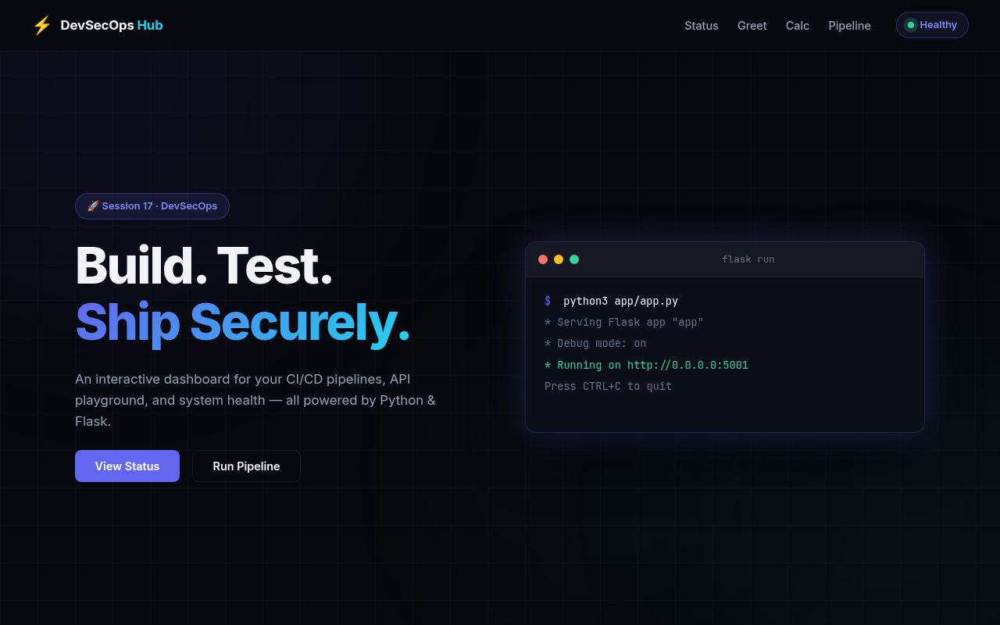
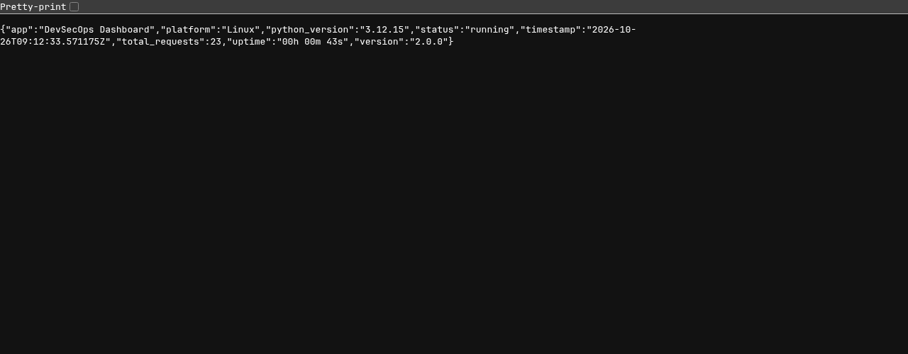

# 17

Complete CI/CD + DevSecOps pipeline for a Flask app (`devsecops/` folder) in my repo [GarrettSpot/gitops-demo](https://github.com/GarrettSpot/gitops-demo).

> **Note:** `devsecops.yml` is in a local working copy and has **not been pushed**, so it has not run on GitHub Actions yet. Each job's steps were **executed locally (not yet run on GitHub Actions)**, with the security tools run from their official Docker images (Trivy, Gitleaks, Semgrep) or a Python venv (Bandit, pip-audit). Nothing was pushed to Docker Hub / GHCR; the registry part uses a local `registry:2` container, and the deploy uses a throwaway kind cluster.

## The Pipeline

```text
test ─┐
sast ─┤
sca  ─┼─► docker-build ─► image-scan ─► push (GHCR) ─► deploy (kind)
secret-scan ─┘   (security gate: every job must pass before the next one runs)
```

`.github/workflows/devsecops.yml`:

```yaml
name: Python DevSecOps Pipeline

on:
  push:
    branches: [main]
    paths:
      - "devsecops/**"
      - ".github/workflows/devsecops.yml"
  pull_request:
    branches: [main]
    paths:
      - "devsecops/**"
      - ".github/workflows/devsecops.yml"
  workflow_dispatch:

permissions:
  contents: read

env:
  APP_DIR: devsecops
  IMAGE_NAME: ghcr.io/garrettspot/gitops-demo-devsecops   # GHCR names must be lowercase

jobs:
  # 1. Unit tests
  test:
    name: Unit Tests
    runs-on: ubuntu-latest
    defaults:
      run:
        working-directory: devsecops
    steps:
      - uses: actions/checkout@v4
      - uses: actions/setup-python@v5
        with:
          python-version: "3.12"
      - name: Install dependencies
        run: pip install -r requirements-dev.txt
      - name: Run tests
        run: pytest --cov=app --cov-report=term-missing

  # 2. SAST - CodeQL (GitHub) + Bandit
  sast:
    name: SAST - CodeQL + Bandit
    runs-on: ubuntu-latest
    permissions:
      contents: read
      security-events: write
    steps:
      - uses: actions/checkout@v4
      - name: Initialize CodeQL
        uses: github/codeql-action/init@v3
        with:
          languages: python
      - name: Analyze code
        uses: github/codeql-action/analyze@v3
      - name: Bandit
        run: |
          pip install bandit
          bandit -r devsecops/app -ll

  # 3. SCA - vulnerable dependencies
  sca:
    name: SCA - pip-audit
    runs-on: ubuntu-latest
    steps:
      - uses: actions/checkout@v4
      - uses: actions/setup-python@v5
        with:
          python-version: "3.12"
      - name: Run dependency scan
        run: |
          pip install pip-audit
          pip-audit -r devsecops/requirements.txt

  # 4. Secret scanning
  secret-scan:
    name: Secret Scan - Gitleaks
    runs-on: ubuntu-latest
    steps:
      - uses: actions/checkout@v4
        with:
          fetch-depth: 0
      - name: Run gitleaks
        run: |
          docker run --rm -v "$PWD:/repo" zricethezav/gitleaks:latest \
            git /repo --redact --verbose

  # 5. Security gate: build only if every check passed
  docker-build:
    name: Docker Build
    needs: [test, sast, sca, secret-scan]
    runs-on: ubuntu-latest
    steps:
      - uses: actions/checkout@v4
      - name: Build Docker image
        run: docker build -t "$IMAGE_NAME:${{ github.sha }}" "$APP_DIR"
      - name: Save image
        run: docker save "$IMAGE_NAME:${{ github.sha }}" -o image.tar
      - uses: actions/upload-artifact@v4
        with:
          name: docker-image
          path: image.tar
          retention-days: 1

  # 6. Container image scan (gate: fail on HIGH/CRITICAL)
  image-scan:
    name: Image Scan - Trivy
    needs: docker-build
    runs-on: ubuntu-latest
    steps:
      - uses: actions/checkout@v4
      - uses: actions/download-artifact@v4
        with:
          name: docker-image
      - name: Load image
        run: docker load -i image.tar
      - name: Scan Dockerfile for misconfigurations
        run: |
          docker run --rm -v "$PWD:/src" aquasec/trivy:latest \
            config --exit-code 1 /src/devsecops/Dockerfile
      - name: Scan image
        run: |
          docker run --rm -v /var/run/docker.sock:/var/run/docker.sock \
            aquasec/trivy:latest image \
            --severity HIGH,CRITICAL --ignore-unfixed --exit-code 1 \
            "$IMAGE_NAME:${{ github.sha }}"

  # 7. Push to GitHub Container Registry
  push:
    name: Push Image to GHCR
    needs: image-scan
    if: github.event_name != 'pull_request'
    runs-on: ubuntu-latest
    permissions:
      contents: read
      packages: write
    steps:
      - uses: actions/download-artifact@v4
        with:
          name: docker-image
      - run: docker load -i image.tar
      - name: Login to GHCR
        uses: docker/login-action@v3
        with:
          registry: ghcr.io
          username: ${{ github.actor }}
          password: ${{ secrets.GITHUB_TOKEN }}
      - name: Tag and push
        run: |
          docker tag "$IMAGE_NAME:${{ github.sha }}" "$IMAGE_NAME:latest"
          docker push "$IMAGE_NAME:${{ github.sha }}"
          docker push "$IMAGE_NAME:latest"

  # 8. Deploy to a throwaway kind cluster (only for pushes to main)
  deploy:
    name: Deploy to Kubernetes (kind)
    needs: push
    if: github.ref == 'refs/heads/main' && github.event_name == 'push'
    runs-on: ubuntu-latest
    steps:
      - uses: actions/checkout@v4
      - uses: actions/download-artifact@v4
        with:
          name: docker-image
      - name: Create kind cluster
        uses: helm/kind-action@v1.10.0
        with:
          cluster_name: kind
      - name: Load image into kind
        run: |
          docker load -i image.tar
          kind load docker-image "$IMAGE_NAME:${{ github.sha }}" --name kind
      - name: Deploy
        run: |
          sed -i "s|__IMAGE__|$IMAGE_NAME:${{ github.sha }}|g" devsecops/k8s/deployment.yaml
          kubectl apply -f devsecops/k8s/
          kubectl rollout status deployment/session17-python --timeout=120s
      - name: Smoke test
        run: |
          kubectl port-forward service/session17-python 5001:80 &
          sleep 3
          curl -sf http://localhost:5001/health
          curl -sf http://localhost:5001/api/status
```

Changes from the class demo so it works in my repo: paths point to `devsecops/` (the repo's `app/` folder is Argo CD's sync path), the image goes to `ghcr.io/garrettspot/...` with `GITHUB_TOKEN` instead of a personal Docker Hub account, and the deploy loads the image into kind directly (`kind load docker-image`) so it works even if the GHCR package is private.

```bash
…/cicd/gitops-demo main ❯ docker run --rm -v $PWD:/repo -w /repo rhysd/actionlint:latest -no-color && echo 'actionlint: 0 errors'
actionlint: 0 errors

…/cicd/gitops-demo main ❯ git status --short
?? .github/
?? .gitignore
?? calculator/
?? devsecops/
```

## Unit Tests

```bash
…/gitops-demo/devsecops main ❯ pip install -q --disable-pip-version-check -r requirements-dev.txt && pip list 2>/dev/null | grep -Ei '^(flask|pytest|werkzeug)'
Flask        3.1.3
pytest       8.4.2
pytest-cov   6.0.0
Werkzeug     3.1.9

…/gitops-demo/devsecops main ❯ pytest --cov=app --cov-report=term-missing
============================= test session starts ==============================
platform linux -- Python 3.14.7, pytest-8.4.2, pluggy-1.7.0
rootdir: /tmp/…/cicd/gitops-demo/devsecops
configfile: pytest.ini
testpaths: tests
plugins: cov-6.0.0
collected 8 items

tests/test_app.py ........                                               [100%]

=============================== warnings summary ===============================
app/app.py:13
  /tmp/…/cicd/gitops-demo/devsecops/app/app.py:13: DeprecationWarning: datetime.datetime.utcnow() is deprecated and scheduled for removal in a future version. Use timezone-aware objects to represent datetimes in UTC: datetime.datetime.now(datetime.UTC).
    _start_time = datetime.datetime.utcnow()

tests/test_app.py::test_health
  /tmp/…/cicd/gitops-demo/devsecops/app/app.py:38: DeprecationWarning: datetime.datetime.utcnow() is deprecated and scheduled for removal in a future version. Use timezone-aware objects to represent datetimes in UTC: datetime.datetime.now(datetime.UTC).
    uptime_seconds = (datetime.datetime.utcnow() - _start_time).total_seconds()

tests/test_app.py::test_health
  /tmp/…/cicd/gitops-demo/devsecops/app/app.py:42: DeprecationWarning: datetime.datetime.utcnow() is deprecated and scheduled for removal in a future version. Use timezone-aware objects to represent datetimes in UTC: datetime.datetime.now(datetime.UTC).
    "timestamp": datetime.datetime.utcnow().isoformat() + "Z",

tests/test_app.py::test_greet
  /tmp/…/cicd/gitops-demo/devsecops/app/app.py:81: DeprecationWarning: datetime.datetime.utcnow() is deprecated and scheduled for removal in a future version. Use timezone-aware objects to represent datetimes in UTC: datetime.datetime.now(datetime.UTC).
    "timestamp": datetime.datetime.utcnow().isoformat() + "Z",

tests/test_app.py::test_status
  /tmp/…/cicd/gitops-demo/devsecops/app/app.py:49: DeprecationWarning: datetime.datetime.utcnow() is deprecated and scheduled for removal in a future version. Use timezone-aware objects to represent datetimes in UTC: datetime.datetime.now(datetime.UTC).
    uptime = datetime.datetime.utcnow() - _start_time

tests/test_app.py::test_status
  /tmp/…/cicd/gitops-demo/devsecops/app/app.py:60: DeprecationWarning: datetime.datetime.utcnow() is deprecated and scheduled for removal in a future version. Use timezone-aware objects to represent datetimes in UTC: datetime.datetime.now(datetime.UTC).
    "timestamp": datetime.datetime.utcnow().isoformat() + "Z",

-- Docs: https://docs.pytest.org/en/stable/how-to/capture-warnings.html

---------- coverage: platform linux, python 3.14.7-final-0 -----------
Name              Stmts   Miss  Cover   Missing
-----------------------------------------------
app/__init__.py       0      0   100%
app/app.py          102     32    69%   94, 104-105, 121, 128, 132-133, 145, 179-209, 225, 230, 234
-----------------------------------------------
TOTAL               102     32    69%

======================== 8 passed, 6 warnings in 0.12s =========================
```

## SAST (Static Application Security Testing)

SAST reads the **source code** for insecure patterns. In GitHub the pipeline uses CodeQL (runs only inside GitHub Actions, so not run here) plus Bandit. Locally I ran Bandit and Semgrep.

```bash
…/cicd/gitops-demo main ❯ pip install -q --disable-pip-version-check bandit && bandit --version
bandit 1.9.4
  python version = 3.14.7 (main, Aug 10 2026, 07:46:56) [GCC 16.1.1 20260728]

…/cicd/gitops-demo main ❯ bandit -r devsecops/app -ll
[main]	INFO	profile include tests: None
[main]	INFO	profile exclude tests: None
[main]	INFO	cli include tests: None
[main]	INFO	cli exclude tests: None
[main]	INFO	running on Python 3.14.7
Run started:2026-10-26 09:06:56.815789+00:00

Test results:
>> Issue: [B201:flask_debug_true] A Flask app appears to be run with debug=True, which exposes the Werkzeug debugger and allows the execution of arbitrary code.
   Severity: High   Confidence: Medium
   CWE: CWE-94 (https://cwe.mitre.org/data/definitions/94.html)
   More Info: https://bandit.readthedocs.io/en/1.9.4/plugins/b201_flask_debug_true.html
   Location: devsecops/app/app.py:234:4
233	if __name__ == "__main__":
234	    app.run(host="0.0.0.0", port=5001, debug=True)

--------------------------------------------------
>> Issue: [B104:hardcoded_bind_all_interfaces] Possible binding to all interfaces.
   Severity: Medium   Confidence: Medium
   CWE: CWE-605 (https://cwe.mitre.org/data/definitions/605.html)
   More Info: https://bandit.readthedocs.io/en/1.9.4/plugins/b104_hardcoded_bind_all_interfaces.html
   Location: devsecops/app/app.py:234:17
233	if __name__ == "__main__":
234	    app.run(host="0.0.0.0", port=5001, debug=True)

--------------------------------------------------

Code scanned:
	Total lines of code: 168
	Total lines skipped (#nosec): 0
	Total potential issues skipped due to specifically being disabled (e.g., #nosec BXXX): 0

Run metrics:
	Total issues (by severity):
		Undefined: 0
		Low: 5
		Medium: 1
		High: 1
	Total issues (by confidence):
		Undefined: 0
		Low: 0
		Medium: 2
		High: 5
Files skipped (0):
```

```bash
…/cicd/gitops-demo main ❯ docker run --rm --name cicd-semgrep -v $PWD:/src semgrep/semgrep:latest semgrep scan --config p/python --metrics=off --disable-version-check devsecops/app

┌─────────────┐
│ Scan Status │
└─────────────┘
  Scanning 5 files tracked by git with 151 Code rules:
  Scanning 2 files with 151 python rules.

┌─────────────────┐
│ 2 Code Findings │
└─────────────────┘

    devsecops/app/app.py
    ❯❱ python.flask.security.audit.app-run-param-config.avoid_app_run_with_bad_host
          ❰❰ Blocking ❱❱
          Running flask app with host 0.0.0.0 could expose the server publicly.
          Details: https://sg.run/eLby

          234┆ app.run(host="0.0.0.0", port=5001, debug=True)

    ❯❱ python.flask.security.audit.debug-enabled.debug-enabled
          ❰❰ Blocking ❱❱
          Detected Flask app with debug=True. Do not deploy to production with this flag enabled as it will
          leak sensitive information. Instead, consider using Flask configuration variables or setting 'debug'
          using system environment variables.
          Details: https://sg.run/dKrd

          234┆ app.run(host="0.0.0.0", port=5001, debug=True)

┌──────────────┐
│ Scan Summary │
└──────────────┘
✅ Scan completed successfully.
 • Findings: 2 (2 blocking)
 • Rules run: 151
 • Targets scanned: 2
 • Parsed lines: ~100.0%
 • Scan was limited to files tracked by git
 • For a detailed list of skipped files and lines, run semgrep with the --verbose flag
Ran 151 rules on 2 files: 2 findings.
```

Both tools flag the same line: `app.run(host="0.0.0.0", port=5001, debug=True)`. Debug mode exposes the Werkzeug debugger (remote code execution). Fix in `devsecops/app/app.py`:

```diff
 if __name__ == "__main__":
-    app.run(host="0.0.0.0", port=5001, debug=True)
+    # Host/debug come from the environment (SAST fix: no hard-coded 0.0.0.0 / debug=True)
+    app.run(
+        host=os.environ.get("APP_HOST", "127.0.0.1"),
+        port=int(os.environ.get("APP_PORT", "5001")),
+        debug=os.environ.get("FLASK_DEBUG", "0") == "1",
+    )
```

```bash
…/cicd/gitops-demo main ❯ bandit -r devsecops/app -ll 2>&1 | sed -n '/Test results/,/Total lines of code/p'
Test results:
	No issues identified.

Code scanned:
	Total lines of code: 172
```

```bash
…/cicd/gitops-demo main ❯ docker run --rm --name cicd-semgrep -v $PWD:/src semgrep/semgrep:latest semgrep scan --config p/python --metrics=off --disable-version-check --error devsecops/app

┌─────────────┐
│ Scan Status │
└─────────────┘
  Scanning 5 files tracked by git with 151 Code rules:
  Scanning 2 files with 151 python rules.

┌──────────────┐
│ Scan Summary │
└──────────────┘
✅ Scan completed successfully.
 • Findings: 0 (0 blocking)
 • Rules run: 151
 • Targets scanned: 2
 • Parsed lines: ~100.0%
 • Scan was limited to files tracked by git
 • For a detailed list of skipped files and lines, run semgrep with the --verbose flag
Ran 151 rules on 2 files: 0 findings.
(need more rules? `semgrep login` for additional free Semgrep Registry rules)

…/gitops-demo/devsecops main ❯ pytest -q 2>&1 | tail -1
8 passed, 6 warnings in 0.07s
```

## SCA (Software Composition Analysis)

SCA checks the **dependencies** (not my code) against known CVEs. `pip-audit` on the app's `requirements.txt`:

```bash
…/cicd/gitops-demo main ❯ pip install -q --disable-pip-version-check pip-audit && pip-audit --version
pip-audit 2.10.1

…/cicd/gitops-demo main ❯ cat devsecops/requirements.txt; echo; pip-audit -r devsecops/requirements.txt
Flask==3.1.3
No known vulnerabilities found
```

What a failing SCA job looks like, using an old `requirements` file with outdated Flask/requests:

```bash
…/cicd/gitops-demo main ❯ printf 'Flask==2.2.0\nrequests==2.25.0\n' > /tmp/…/cicd/old-reqs.txt && pip-audit -r /tmp/…/cicd/old-reqs.txt
Found 28 known vulnerabilities in 4 packages
Name     Version ID              Fix Versions
-------- ------- --------------- ------------
flask    2.2.0   PYSEC-2023-62   2.2.5,2.3.2
flask    2.2.0   PYSEC-2023-62   2.2.5,2.3.2
flask    2.2.0   PYSEC-2026-2151 3.1.3
flask    2.2.0   PYSEC-2026-2151 3.1.3
requests 2.25.0  PYSEC-2023-74   2.31.0
requests 2.25.0  PYSEC-2023-74   2.31.0
requests 2.25.0  PYSEC-2026-1873 2.32.0
requests 2.25.0  PYSEC-2026-1872 2.32.4
requests 2.25.0  PYSEC-2026-2275 2.33.0
requests 2.25.0  PYSEC-2026-1873 2.32.0
requests 2.25.0  PYSEC-2026-1872 2.32.4
requests 2.25.0  PYSEC-2026-2275 2.33.0
idna     2.10    PYSEC-2024-60   3.7
idna     2.10    PYSEC-2024-60   3.7
idna     2.10    PYSEC-2026-215  3.15
idna     2.10    PYSEC-2026-215  3.15
urllib3  1.26.20 PYSEC-2026-1999 2.5.0
urllib3  1.26.20 PYSEC-2026-1998 2.6.0
urllib3  1.26.20 PYSEC-2026-1994 2.6.0
urllib3  1.26.20 PYSEC-2026-1996 2.6.3
urllib3  1.26.20 PYSEC-2026-141  2.7.0
urllib3  1.26.20 PYSEC-2026-141  2.7.0
urllib3  1.26.20 PYSEC-2026-1999 2.5.0
urllib3  1.26.20 PYSEC-2026-1998 2.6.0
urllib3  1.26.20 PYSEC-2026-1994 2.6.0
urllib3  1.26.20 PYSEC-2026-1996 2.6.3
urllib3  1.26.20 PYSEC-2026-4177 2.8.0
urllib3  1.26.20 PYSEC-2026-4175 2.8.0
```

Remediation = bump to the "Fix Versions" (the app already pins `Flask==3.1.3`, which is clean).

## Secret Scanning

Gitleaks scans the git history (`git` mode, what the pipeline runs) and the working tree (`dir` mode):

```bash
…/cicd/gitops-demo main ❯ docker run --rm zricethezav/gitleaks:latest version
v8.30.1

…/cicd/gitops-demo main ❯ docker run --rm --name cicd-gitleaks -v $PWD:/repo zricethezav/gitleaks:latest git /repo --redact --verbose --no-banner
9:08AM INF Unknown SCM platform. Use --platform to include links in findings. host=
9:08AM INF 3 commits scanned.
9:08AM INF scanned ~1171 bytes (1.17 KB) in 26.9ms
9:08AM INF no leaks found

…/cicd/gitops-demo main ❯ docker run --rm --name cicd-gitleaks -v $PWD:/repo zricethezav/gitleaks:latest dir /repo --redact --verbose --no-banner
9:08AM INF scanned ~90703 bytes (90.70 KB) in 12.8ms
9:08AM INF no leaks found
```

Leak test with a fake (randomly generated) GitHub token in a file. The token is masked here and `--redact` hides it in gitleaks' output:

```bash
…/cicd/gitops-demo main ❯ sed -E 's/(ghp_....).*"/\1****************"/' devsecops/app/leak_demo.py
import requests

GITHUB_TOKEN = "ghp_yb67****************"

…/cicd/gitops-demo main ❯ docker run --rm --name cicd-gitleaks -v $PWD:/repo zricethezav/gitleaks:latest dir /repo --redact --verbose --no-banner --no-color
Finding:     REDACTED
Secret:      REDACTED
RuleID:      github-pat
Entropy:     4.903056
File:        /repo/devsecops/app/leak_demo.py
Line:        3
Fingerprint: /repo/devsecops/app/leak_demo.py:github-pat:3

9:08AM INF scanned ~90778 bytes (90.78 KB) in 15ms
9:08AM WRN leaks found: 1

…/cicd/gitops-demo main ❯ rm devsecops/app/leak_demo.py && docker run --rm --name cicd-gitleaks -v $PWD:/repo zricethezav/gitleaks:latest dir /repo --redact --no-banner --no-color
9:08AM INF scanned ~90703 bytes (90.70 KB) in 11.6ms
9:08AM INF no leaks found
```

If a real secret is leaked: revoke/rotate it first, then remove it from history, and keep it in GitHub Secrets (`${{ secrets.NAME }}`) or env vars.

## Docker Build

```bash
…/cicd/gitops-demo main ❯ cat devsecops/Dockerfile
FROM python:3.12-slim

WORKDIR /app

COPY requirements.txt .

RUN pip install -r requirements.txt

COPY app ./app

EXPOSE 5001

CMD ["python", "app/app.py"]

…/cicd/gitops-demo main ❯ docker build -t cicd-session17-python:9164d81 devsecops
#0 building with "default" instance using docker driver

#1 [internal] load build definition from Dockerfile
#1 transferring dockerfile: 195B done
#1 DONE 0.0s

#2 [internal] load metadata for docker.io/library/python:3.12-slim
#2 DONE 0.0s

#3 [internal] load .dockerignore
#3 transferring context: 103B done
#3 DONE 0.0s

#4 [1/5] FROM docker.io/library/python:3.12-slim@sha256:a0f57064cbdcd6285fa45f51237ab0b35ea8ebaed06a1f5973e89e19dfb86704
#4 resolve docker.io/library/python:3.12-slim@sha256:a0f57064cbdcd6285fa45f51237ab0b35ea8ebaed06a1f5973e89e19dfb86704 0.0s done
#4 DONE 0.0s

#5 [internal] load build context
#5 transferring context: 49.69kB done
#5 DONE 0.0s

#6 [2/5] WORKDIR /app
#6 CACHED

#7 [3/5] COPY requirements.txt .
#7 DONE 0.1s

#8 [4/5] RUN pip install -r requirements.txt
#8 1.644 Collecting Flask==3.1.3 (from -r requirements.txt (line 1))
#8 2.385   Downloading flask-3.1.3-py3-none-any.whl.metadata (3.2 kB)
#8 2.485 Collecting blinker>=1.9.0 (from Flask==3.1.3->-r requirements.txt (line 1))
#8 2.529   Downloading blinker-1.9.0-py3-none-any.whl.metadata (1.6 kB)
#8 2.666 Collecting click>=8.1.3 (from Flask==3.1.3->-r requirements.txt (line 1))
#8 2.708   Downloading click-8.5.0-py3-none-any.whl.metadata (2.6 kB)
#8 2.776 Collecting itsdangerous>=2.2.0 (from Flask==3.1.3->-r requirements.txt (line 1))
#8 2.823   Downloading itsdangerous-2.2.0-py3-none-any.whl.metadata (1.9 kB)
#8 2.915 Collecting jinja2>=3.1.2 (from Flask==3.1.3->-r requirements.txt (line 1))
#8 2.957   Downloading jinja2-3.1.6-py3-none-any.whl.metadata (2.9 kB)
#8 3.781 Collecting markupsafe>=2.1.1 (from Flask==3.1.3->-r requirements.txt (line 1))
#8 3.824   Downloading markupsafe-3.0.4-cp312-cp312-manylinux2014_x86_64.manylinux_2_17_x86_64.manylinux_2_28_x86_64.whl.metadata (2.7 kB)
#8 3.991 Collecting werkzeug>=3.1.0 (from Flask==3.1.3->-r requirements.txt (line 1))
#8 4.034   Downloading werkzeug-3.1.9-py3-none-any.whl.metadata (4.1 kB)
#8 4.097 Downloading flask-3.1.3-py3-none-any.whl (103 kB)
#8 4.389 Downloading blinker-1.9.0-py3-none-any.whl (8.5 kB)
#8 4.639 Downloading click-8.5.0-py3-none-any.whl (125 kB)
#8 6.616 Downloading itsdangerous-2.2.0-py3-none-any.whl (16 kB)
#8 6.942 Downloading jinja2-3.1.6-py3-none-any.whl (134 kB)
#8 9.770 Downloading markupsafe-3.0.4-cp312-cp312-manylinux2014_x86_64.manylinux_2_17_x86_64.manylinux_2_28_x86_64.whl (22 kB)
#8 10.02 Downloading werkzeug-3.1.9-py3-none-any.whl (228 kB)
#8 10.97 Installing collected packages: markupsafe, itsdangerous, click, blinker, werkzeug, jinja2, Flask
#8 11.30 Successfully installed Flask-3.1.3 blinker-1.9.0 click-8.5.0 itsdangerous-2.2.0 jinja2-3.1.6 markupsafe-3.0.4 werkzeug-3.1.9
#8 11.30 WARNING: Running pip as the 'root' user can result in broken permissions and conflicting behaviour with the system package manager, possibly rendering your system unusable. It is recommended to use a virtual environment instead: https://pip.pypa.io/warnings/venv. Use the --root-user-action option if you know what you are doing and want to suppress this warning.
#8 11.50
#8 11.50 [notice] A new release of pip is available: 25.0.1 -> 26.2.2
#8 11.50 [notice] To update, run: pip install --upgrade pip
#8 DONE 11.6s

#9 [5/5] COPY app ./app
#9 DONE 0.0s

#10 exporting to image
#10 exporting layers
#10 exporting layers 0.6s done
#10 exporting manifest sha256:f37b0cdd39a24c6ed89cf5c478e2c81ad74f410765219774c46c20a866f8a8b9 done
#10 exporting config sha256:cb132a525f94ab3e3eb728ae0c1ef6c10dd94f09ec5beeb12725dc868dfffed0 done
#10 exporting attestation manifest sha256:e068f0f8b3e207576f6646cab19af9ea2bb0db8d4bb0554c37364eae05645e58 done
#10 exporting manifest list sha256:10c1837abd40f743960281683bea739fc9f8eb9a25f5e8a2629f3b6d1768b2f3 done
#10 naming to docker.io/library/cicd-session17-python:9164d81 done
#10 unpacking to docker.io/library/cicd-session17-python:9164d81
#10 unpacking to docker.io/library/cicd-session17-python:9164d81 0.2s done
#10 DONE 0.9s
```

## Container Image Scanning (Trivy)

Gate: `--severity HIGH,CRITICAL --exit-code 1`. First scan of the image:

```bash
…/cicd/gitops-demo main ❯ docker run --rm aquasec/trivy:latest --version
Version: 0.76.1

…/cicd/gitops-demo main ❯ docker run --rm --name cicd-trivy -v /var/run/docker.sock:/var/run/docker.sock -v $PWD/../trivy-cache:/root/.cache/trivy aquasec/trivy:latest image --severity HIGH,CRITICAL --exit-code 1 cicd-session17-python:9164d81
2026-10-26T09:10:05Z	INFO	[vuln] Vulnerability scanning is enabled
2026-10-26T09:10:05Z	INFO	[secret] Secret scanning is enabled
2026-10-26T09:10:05Z	INFO	[secret] If your scanning is slow, please try '--scanners vuln' to disable secret scanning
2026-10-26T09:10:05Z	INFO	[secret] Please see https://trivy.dev/docs/v0.76/guide/scanner/secret#recommendation for faster secret detection
2026-10-26T09:10:06Z	INFO	Detected OS	family="debian" version="13.7"
2026-10-26T09:10:06Z	INFO	[debian] Detecting vulnerabilities...	os_version="13" pkg_num=87
2026-10-26T09:10:06Z	INFO	Number of language-specific files	num=1
2026-10-26T09:10:06Z	INFO	[python-pkg] Detecting vulnerabilities...
2026-10-26T09:10:06Z	WARN	Using severities from other vendors for some vulnerabilities. Read https://trivy.dev/docs/v0.76/guide/scanner/vulnerability#severity-selection for details.

Report Summary

┌──────────────────────────────────────────────────────────────────────────────┬────────────┬─────────────────┬─────────┐
│                                    Target                                    │    Type    │ Vulnerabilities │ Secrets │
├──────────────────────────────────────────────────────────────────────────────┼────────────┼─────────────────┼─────────┤
│ cicd-session17-python:9164d81 (debian 13.7)                                  │   debian   │       44        │    -    │
├──────────────────────────────────────────────────────────────────────────────┼────────────┼─────────────────┼─────────┤
│ usr/local/lib/python3.12/site-packages/blinker-1.9.0.dist-info/METADATA      │ python-pkg │        0        │    -    │
├──────────────────────────────────────────────────────────────────────────────┼────────────┼─────────────────┼─────────┤
│ usr/local/lib/python3.12/site-packages/click-8.5.0.dist-info/METADATA        │ python-pkg │        0        │    -    │
├──────────────────────────────────────────────────────────────────────────────┼────────────┼─────────────────┼─────────┤
│ usr/local/lib/python3.12/site-packages/flask-3.1.3.dist-info/METADATA        │ python-pkg │        0        │    -    │
├──────────────────────────────────────────────────────────────────────────────┼────────────┼─────────────────┼─────────┤
│ usr/local/lib/python3.12/site-packages/itsdangerous-2.2.0.dist-info/METADATA │ python-pkg │        0        │    -    │
├──────────────────────────────────────────────────────────────────────────────┼────────────┼─────────────────┼─────────┤
│ usr/local/lib/python3.12/site-packages/jinja2-3.1.6.dist-info/METADATA       │ python-pkg │        0        │    -    │
├──────────────────────────────────────────────────────────────────────────────┼────────────┼─────────────────┼─────────┤
│ usr/local/lib/python3.12/site-packages/markupsafe-3.0.4.dist-info/METADATA   │ python-pkg │        0        │    -    │
├──────────────────────────────────────────────────────────────────────────────┼────────────┼─────────────────┼─────────┤
│ usr/local/lib/python3.12/site-packages/pip-25.0.1.dist-info/METADATA         │ python-pkg │        0        │    -    │
├──────────────────────────────────────────────────────────────────────────────┼────────────┼─────────────────┼─────────┤
│ usr/local/lib/python3.12/site-packages/werkzeug-3.1.9.dist-info/METADATA     │ python-pkg │        0        │    -    │
└──────────────────────────────────────────────────────────────────────────────┴────────────┴─────────────────┴─────────┘
Legend:
- '-': Not scanned
- '0': Clean (no security findings detected)

cicd-session17-python:9164d81 (debian 13.7)
===========================================
Total: 44 (HIGH: 44, CRITICAL: 0)

┌───────────────┬────────────────┬──────────┬──────────────┬───────────────────────────────────┬───────────────┬─────────────────────────────────────────────────────────────┐
│    Library    │ Vulnerability  │ Severity │    Status    │         Installed Version         │ Fixed Version │                            Title                            │
├───────────────┼────────────────┼──────────┼──────────────┼───────────────────────────────────┼───────────────┼─────────────────────────────────────────────────────────────┤
│ bsdutils      │ CVE-2026-76642 │ HIGH     │ affected     │ 1:2.41.5-0+deb13u1                │               │ util-linux: util-linux: failed external mount helper still  │
│               │                │          │              │                                   │               │ runs privileged X-mount post-hooks                          │
│               │                │          │              │                                   │               │ https://avd.aquasec.com/nvd/cve-2026-76642                  │
│               ├────────────────┤          │              │                                   ├───────────────┼─────────────────────────────────────────────────────────────┤
│               │ CVE-2026-78408 │          │              │                                   │               │ util-linux: util-linux: nsenter --join-cgroup leaks root    │
│               │                │          │              │                                   │               │ cgroup migration authority                                  │
│               │                │          │              │                                   │               │ https://avd.aquasec.com/nvd/cve-2026-78408                  │
│               ├────────────────┤          │              │                                   ├───────────────┼─────────────────────────────────────────────────────────────┤
│               │ CVE-2026-78409 │          │              │                                   │               │ util-linux: util-linux: X-mount.subdir detached-tree        │
│               │                │          │              │                                   │               │ resolution can escape via intermediate symlinks             │
│               │                │          │              │                                   │               │ https://avd.aquasec.com/nvd/cve-2026-78409                  │
│               ├────────────────┤          │              │                                   ├───────────────┼─────────────────────────────────────────────────────────────┤
│               │ CVE-2026-78410 │          │              │                                   │               │ util-linux: util-linux: restricted bind mounts do not pin   │
│ …             │ (table truncated here – 44 HIGH rows in total, all Debian OS packages) …
└───────────────┴────────────────┴──────────┴──────────────┴───────────────────────────────────┴───────────────┴─────────────────────────────────────────────────────────────┘
```

All 44 HIGHs are in Debian base packages with **no fixed version yet** (`affected` / `fix_deferred`), so nothing in the Dockerfile can fix them. The gate uses `--ignore-unfixed` so it only blocks on vulnerabilities that actually have a fix:

```bash
…/cicd/gitops-demo main ❯ docker run --rm --name cicd-trivy -v /var/run/docker.sock:/var/run/docker.sock -v $PWD/../trivy-cache:/root/.cache/trivy aquasec/trivy:latest image --severity HIGH,CRITICAL --ignore-unfixed --exit-code 1 --scanners vuln cicd-session17-python:9164d81
2026-10-26T09:10:13Z	INFO	[vuln] Vulnerability scanning is enabled
2026-10-26T09:10:15Z	INFO	[python] Licenses acquired from one or more METADATA files may be subject to additional terms. Use `--debug` flag to see all affected packages.
2026-10-26T09:10:15Z	INFO	Detected OS	family="debian" version="13.7"
2026-10-26T09:10:15Z	INFO	[debian] Detecting vulnerabilities...	os_version="13" pkg_num=87
2026-10-26T09:10:15Z	INFO	Number of language-specific files	num=1
2026-10-26T09:10:15Z	INFO	[python-pkg] Detecting vulnerabilities...
2026-10-26T09:10:15Z	WARN	Using severities from other vendors for some vulnerabilities. Read https://trivy.dev/docs/v0.76/guide/scanner/vulnerability#severity-selection for details.

Report Summary

┌──────────────────────────────────────────────────────────────────────────────┬────────────┬─────────────────┐
│                                    Target                                    │    Type    │ Vulnerabilities │
├──────────────────────────────────────────────────────────────────────────────┼────────────┼─────────────────┤
│ cicd-session17-python:9164d81 (debian 13.7)                                  │   debian   │        0        │
├──────────────────────────────────────────────────────────────────────────────┼────────────┼─────────────────┤
│ usr/local/lib/python3.12/site-packages/blinker-1.9.0.dist-info/METADATA      │ python-pkg │        0        │
├──────────────────────────────────────────────────────────────────────────────┼────────────┼─────────────────┤
│ usr/local/lib/python3.12/site-packages/click-8.5.0.dist-info/METADATA        │ python-pkg │        0        │
├──────────────────────────────────────────────────────────────────────────────┼────────────┼─────────────────┤
│ usr/local/lib/python3.12/site-packages/flask-3.1.3.dist-info/METADATA        │ python-pkg │        0        │
├──────────────────────────────────────────────────────────────────────────────┼────────────┼─────────────────┤
│ usr/local/lib/python3.12/site-packages/itsdangerous-2.2.0.dist-info/METADATA │ python-pkg │        0        │
├──────────────────────────────────────────────────────────────────────────────┼────────────┼─────────────────┤
│ usr/local/lib/python3.12/site-packages/jinja2-3.1.6.dist-info/METADATA       │ python-pkg │        0        │
├──────────────────────────────────────────────────────────────────────────────┼────────────┼─────────────────┤
│ usr/local/lib/python3.12/site-packages/markupsafe-3.0.4.dist-info/METADATA   │ python-pkg │        0        │
├──────────────────────────────────────────────────────────────────────────────┼────────────┼─────────────────┤
│ usr/local/lib/python3.12/site-packages/pip-25.0.1.dist-info/METADATA         │ python-pkg │        0        │
├──────────────────────────────────────────────────────────────────────────────┼────────────┼─────────────────┤
│ usr/local/lib/python3.12/site-packages/werkzeug-3.1.9.dist-info/METADATA     │ python-pkg │        0        │
└──────────────────────────────────────────────────────────────────────────────┴────────────┴─────────────────┘
Legend:
- '-': Not scanned
- '0': Clean (no security findings detected)
```

Trivy also scans the Dockerfile for misconfigurations:

```bash
…/cicd/gitops-demo main ❯ docker run --rm --name cicd-trivy -v $PWD:/src -v $PWD/../trivy-cache:/root/.cache/trivy aquasec/trivy:latest config --exit-code 1 /src/devsecops/Dockerfile
2026-10-26T09:10:22Z	INFO	[misconfig] Misconfiguration scanning is enabled
2026-10-26T09:10:22Z	INFO	[checks-client] Need to update the checks bundle
2026-10-26T09:10:22Z	INFO	[checks-client] Downloading the checks bundle...
2026-10-26T09:10:25Z	INFO	Detected config files	num=1

Report Summary

┌────────────┬────────────┬───────────────────┐
│   Target   │    Type    │ Misconfigurations │
├────────────┼────────────┼───────────────────┤
│ Dockerfile │ dockerfile │         2         │
└────────────┴────────────┴───────────────────┘
Legend:
- '-': Not scanned
- '0': Clean (no security findings detected)

Dockerfile (dockerfile)
=======================
Tests: 27 (SUCCESSES: 25, FAILURES: 2)
Failures: 2 (UNKNOWN: 0, LOW: 1, MEDIUM: 0, HIGH: 1, CRITICAL: 0)

DS-0002 (HIGH): Specify at least 1 USER command in Dockerfile with non-root user as argument
════════════════════════════════════════
Running containers with 'root' user can lead to a container escape situation. It is a best practice to run containers as non-root users, which can be done by adding a 'USER' statement to the Dockerfile.

See https://avd.aquasec.com/misconfig/ds-0002
────────────────────────────────────────

DS-0026 (LOW): Add HEALTHCHECK instruction in your Dockerfile
════════════════════════════════════════
You should add HEALTHCHECK instruction in your docker container images to perform the health check on running containers.

See https://avd.aquasec.com/misconfig/ds-0026
────────────────────────────────────────
```

Fixed Dockerfile (non-root user, HEALTHCHECK, no pip cache, `APP_HOST=0.0.0.0` set only inside the container):

```dockerfile
FROM python:3.12-slim

ENV PYTHONDONTWRITEBYTECODE=1 \
    PYTHONUNBUFFERED=1 \
    APP_HOST=0.0.0.0 \
    APP_PORT=5001

WORKDIR /app

COPY requirements.txt .

RUN pip install --no-cache-dir --root-user-action=ignore -r requirements.txt \
    && useradd --uid 10001 --no-create-home --shell /usr/sbin/nologin appuser

COPY app ./app

USER 10001

EXPOSE 5001

HEALTHCHECK --interval=30s --timeout=3s --start-period=5s \
  CMD python -c "import urllib.request; urllib.request.urlopen('http://127.0.0.1:5001/health')" || exit 1

CMD ["python", "app/app.py"]
```

```bash
…/cicd/gitops-demo main ❯ docker run --rm --name cicd-trivy -v $PWD:/src -v $PWD/../trivy-cache:/root/.cache/trivy aquasec/trivy:latest config --exit-code 1 /src/devsecops/Dockerfile
2026-10-26T09:10:37Z	INFO	[misconfig] Misconfiguration scanning is enabled
2026-10-26T09:10:37Z	INFO	[checks-client] Using existing checks from cache	path="/root/.cache/trivy/policy/content"
2026-10-26T09:10:38Z	INFO	Detected config files	num=1

Report Summary

┌────────────┬────────────┬───────────────────┐
│   Target   │    Type    │ Misconfigurations │
├────────────┼────────────┼───────────────────┤
│ Dockerfile │ dockerfile │         0         │
└────────────┴────────────┴───────────────────┘
Legend:
- '-': Not scanned
- '0': Clean (no security findings detected)

…/cicd/gitops-demo main ❯ docker build -q -t cicd-session17-python:9164d81 devsecops
sha256:aa0a836c9b867b40b976d40db71841b10a99da62e78943787431ec6862b1f402

…/cicd/gitops-demo main ❯ docker run --rm --name cicd-trivy -v /var/run/docker.sock:/var/run/docker.sock -v $PWD/../trivy-cache:/root/.cache/trivy aquasec/trivy:latest image --severity HIGH,CRITICAL --ignore-unfixed --exit-code 1 cicd-session17-python:9164d81 2>&1 | grep -v '^20'

Report Summary

┌──────────────────────────────────────────────────────────────────────────────┬────────────┬─────────────────┬─────────┐
│                                    Target                                    │    Type    │ Vulnerabilities │ Secrets │
├──────────────────────────────────────────────────────────────────────────────┼────────────┼─────────────────┼─────────┤
│ cicd-session17-python:9164d81 (debian 13.7)                                  │   debian   │        0        │    -    │
├──────────────────────────────────────────────────────────────────────────────┼────────────┼─────────────────┼─────────┤
│ usr/local/lib/python3.12/site-packages/blinker-1.9.0.dist-info/METADATA      │ python-pkg │        0        │    -    │
├──────────────────────────────────────────────────────────────────────────────┼────────────┼─────────────────┼─────────┤
│ usr/local/lib/python3.12/site-packages/click-8.5.0.dist-info/METADATA        │ python-pkg │        0        │    -    │
├──────────────────────────────────────────────────────────────────────────────┼────────────┼─────────────────┼─────────┤
│ usr/local/lib/python3.12/site-packages/flask-3.1.3.dist-info/METADATA        │ python-pkg │        0        │    -    │
├──────────────────────────────────────────────────────────────────────────────┼────────────┼─────────────────┼─────────┤
│ usr/local/lib/python3.12/site-packages/itsdangerous-2.2.0.dist-info/METADATA │ python-pkg │        0        │    -    │
├──────────────────────────────────────────────────────────────────────────────┼────────────┼─────────────────┼─────────┤
│ usr/local/lib/python3.12/site-packages/jinja2-3.1.6.dist-info/METADATA       │ python-pkg │        0        │    -    │
├──────────────────────────────────────────────────────────────────────────────┼────────────┼─────────────────┼─────────┤
│ usr/local/lib/python3.12/site-packages/markupsafe-3.0.4.dist-info/METADATA   │ python-pkg │        0        │    -    │
├──────────────────────────────────────────────────────────────────────────────┼────────────┼─────────────────┼─────────┤
│ usr/local/lib/python3.12/site-packages/pip-25.0.1.dist-info/METADATA         │ python-pkg │        0        │    -    │
├──────────────────────────────────────────────────────────────────────────────┼────────────┼─────────────────┼─────────┤
│ usr/local/lib/python3.12/site-packages/werkzeug-3.1.9.dist-info/METADATA     │ python-pkg │        0        │    -    │
└──────────────────────────────────────────────────────────────────────────────┴────────────┴─────────────────┴─────────┘
Legend:
- '-': Not scanned
- '0': Clean (no security findings detected)

…/cicd/gitops-demo main ❯ docker image ls cicd-session17-python
IMAGE                           ID             DISK USAGE   CONTENT SIZE   EXTRA
cicd-session17-python:9164d81   aa0a836c9b86        183MB         44.9MB
```

Run the hardened image (runs as uid 10001, debug off):

```bash
…/cicd/gitops-demo main ❯ docker run -d --name cicd-session17-app -p 18610:5001 cicd-session17-python:9164d81
e0708ae4d5bf25935b0800f17c0d24eccf2dac80a21664bba8e5d79f4d3dda8b

…/cicd/gitops-demo main ❯ docker ps --filter name=cicd-session17-app --format 'table {{.Names}}\t{{.Image}}\t{{.Status}}\t{{.Ports}}'
NAMES                IMAGE                           STATUS                            PORTS
cicd-session17-app   cicd-session17-python:9164d81   Up 4 seconds (health: starting)   0.0.0.0:18610->5001/tcp, [::]:18610->5001/tcp

…/cicd/gitops-demo main ❯ docker exec cicd-session17-app id
uid=10001(appuser) gid=10001(appuser) groups=10001(appuser)

…/cicd/gitops-demo main ❯ curl -s localhost:18610/health; echo; curl -s localhost:18610/api/status; echo; curl -s -X POST localhost:18610/api/calculate -H 'Content-Type: application/json' -d '{"a":6,"b":7,"operation":"multiply"}'
{"status":"healthy","timestamp":"2026-10-26T09:10:56.149249Z","uptime_seconds":3.6}

{"app":"DevSecOps Dashboard","platform":"Linux","python_version":"3.12.15","status":"running","timestamp":"2026-10-26T09:10:56.158503Z","total_requests":2,"uptime":"00h 00m 03s","version":"2.0.0"}

{"a":6.0,"b":7.0,"expression":"6.0 \u00d7 7.0 = 42.0","operation":"multiply","result":42.0,"symbol":"\u00d7"}

…/cicd/gitops-demo main ❯ docker logs cicd-session17-app
/app/app/app.py:13: DeprecationWarning: datetime.datetime.utcnow() is deprecated and scheduled for removal in a future version. Use timezone-aware objects to represent datetimes in UTC: datetime.datetime.now(datetime.UTC).
  _start_time = datetime.datetime.utcnow()
 * Serving Flask app 'app'
 * Debug mode: off
WARNING: This is a development server. Do not use it in a production deployment. Use a production WSGI server instead.
 * Running on all addresses (0.0.0.0)
 * Running on http://127.0.0.1:5001
 * Running on http://172.17.0.2:5001
Press CTRL+C to quit
/app/app/app.py:38: DeprecationWarning: datetime.datetime.utcnow() is deprecated and scheduled for removal in a future version. Use timezone-aware objects to represent datetimes in UTC: datetime.datetime.now(datetime.UTC).
  uptime_seconds = (datetime.datetime.utcnow() - _start_time).total_seconds()
/app/app/app.py:42: DeprecationWarning: datetime.datetime.utcnow() is deprecated and scheduled for removal in a future version. Use timezone-aware objects to represent datetimes in UTC: datetime.datetime.now(datetime.UTC).
  "timestamp": datetime.datetime.utcnow().isoformat() + "Z",
172.17.0.1 - - [26/Oct/2026 09:10:56] "GET /health HTTP/1.1" 200 -
/app/app/app.py:49: DeprecationWarning: datetime.datetime.utcnow() is deprecated and scheduled for removal in a future version. Use timezone-aware objects to represent datetimes in UTC: datetime.datetime.now(datetime.UTC).
  uptime = datetime.datetime.utcnow() - _start_time
/app/app/app.py:60: DeprecationWarning: datetime.datetime.utcnow() is deprecated and scheduled for removal in a future version. Use timezone-aware objects to represent datetimes in UTC: datetime.datetime.now(datetime.UTC).
  "timestamp": datetime.datetime.utcnow().isoformat() + "Z",
172.17.0.1 - - [26/Oct/2026 09:10:56] "GET /api/status HTTP/1.1" 200 -
172.17.0.1 - - [26/Oct/2026 09:10:56] "POST /api/calculate HTTP/1.1" 200 -
```



## Container Registry

In GitHub Actions the `push` job logs in to GHCR with `GITHUB_TOKEN` (`permissions: packages: write`) and pushes `ghcr.io/garrettspot/gitops-demo-devsecops:<sha>` and `:latest`. Image names must be lowercase, so the `GarrettSpot` owner is written as `garrettspot`. Locally I used a private `registry:2` container instead of pushing to GHCR:

```bash
…/cicd/gitops-demo main ❯ docker run -d --name cicd-registry -p 18620:5000 registry:2
5b814df7406d134ba303a4c0e2e86191981e4b081e7ae120445780dae7c8d001

…/cicd/gitops-demo main ❯ docker tag cicd-session17-python:9164d81 localhost:18620/garrettspot/gitops-demo-devsecops:9164d81 && docker tag cicd-session17-python:9164d81 localhost:18620/garrettspot/gitops-demo-devsecops:latest

…/cicd/gitops-demo main ❯ docker push localhost:18620/garrettspot/gitops-demo-devsecops:9164d81
The push refers to repository [localhost:18620/garrettspot/gitops-demo-devsecops]
25b45356b95d: Pushed
be6443c06d3c: Pushed
5c397e4307db: Pushed
90bddd2eb1ba: Pushed
44136fa355b3: Pushed
e0ea74aa04b7: Pushed
f2be67225471: Pushed
b524bb3aba73: Pushed
e42c50c8f221: Pushed
5f00256456c2: Pushed
9164d81: digest: sha256:aa0a836c9b867b40b976d40db71841b10a99da62e78943787431ec6862b1f402 size: 856

…/cicd/gitops-demo main ❯ docker push localhost:18620/garrettspot/gitops-demo-devsecops:latest
The push refers to repository [localhost:18620/garrettspot/gitops-demo-devsecops]
25b45356b95d: Already exists
b524bb3aba73: Layer already exists
f2be67225471: Layer already exists
e0ea74aa04b7: Layer already exists
5f00256456c2: Layer already exists
44136fa355b3: Already exists
be6443c06d3c: Layer already exists
5c397e4307db: Layer already exists
90bddd2eb1ba: Layer already exists
e42c50c8f221: Layer already exists
latest: digest: sha256:aa0a836c9b867b40b976d40db71841b10a99da62e78943787431ec6862b1f402 size: 856

…/cicd/gitops-demo main ❯ curl -s localhost:18620/v2/_catalog; curl -s localhost:18620/v2/garrettspot/gitops-demo-devsecops/tags/list
{"repositories":["garrettspot/gitops-demo-devsecops"]}
{"name":"garrettspot/gitops-demo-devsecops","tags":["9164d81","latest"]}

…/cicd/gitops-demo main ❯ docker rmi localhost:18620/garrettspot/gitops-demo-devsecops:latest && docker pull localhost:18620/garrettspot/gitops-demo-devsecops:latest
Untagged: localhost:18620/garrettspot/gitops-demo-devsecops:latest
latest: Pulling from garrettspot/gitops-demo-devsecops
Digest: sha256:aa0a836c9b867b40b976d40db71841b10a99da62e78943787431ec6862b1f402
Status: Downloaded newer image for localhost:18620/garrettspot/gitops-demo-devsecops:latest
localhost:18620/garrettspot/gitops-demo-devsecops:latest
```

## Kubernetes Deployment

`devsecops/k8s/deployment.yaml` uses an `__IMAGE__` placeholder that the pipeline replaces with the commit-sha tag, plus readiness/liveness probes on `/health`:

```yaml
apiVersion: apps/v1
kind: Deployment
metadata:
  name: session17-python
spec:
  replicas: 2
  selector:
    matchLabels:
      app: session17-python
  template:
    metadata:
      labels:
        app: session17-python
    spec:
      containers:
        - name: session17-python
          image: __IMAGE__                  # replaced by the pipeline with the commit-sha tag
          imagePullPolicy: IfNotPresent
          ports:
            - containerPort: 5001
          readinessProbe:
            httpGet:
              path: /health
              port: 5001
            initialDelaySeconds: 3
            periodSeconds: 5
          livenessProbe:
            httpGet:
              path: /health
              port: 5001
            initialDelaySeconds: 10
            periodSeconds: 20
```

```yaml
apiVersion: v1
kind: Service
metadata:
  name: session17-python
spec:
  type: NodePort
  selector:
    app: session17-python
  ports:
    - port: 80
      targetPort: 5001
      nodePort: 30001
```

Deploy job steps run locally against a kind cluster (`KUBECONFIG` pointing to a separate file):

```bash
…/cicd/gitops-demo main ❯ kind create cluster --name s-cicd --kubeconfig $KUBECONFIG
Creating cluster "s-cicd" ...
 • Ensuring node image (kindest/node:v1.37.0) 🖼️  ...
 ✓ Ensuring node image (kindest/node:v1.37.0) 🖼️
 • Preparing nodes 📦   ...
 ✓ Preparing nodes 📦
 • Writing configuration 📜  ...
 ✓ Writing configuration 📜
 • Starting control-plane 🕹️  ...
 ✓ Starting control-plane 🕹️
 • Installing CNI 🔌  ...
 ✓ Installing CNI 🔌
 • Installing StorageClass 💾  ...
 ✓ Installing StorageClass 💾
Set kubectl context to "kind-s-cicd"
You can now use your cluster with:

kubectl cluster-info --context kind-s-cicd --kubeconfig /tmp/…/cicd/kubeconfig

Thanks for using kind! 😊

…/cicd/gitops-demo main ❯ docker tag cicd-session17-python:9164d81 ghcr.io/garrettspot/gitops-demo-devsecops:9164d81 && kind load docker-image ghcr.io/garrettspot/gitops-demo-devsecops:9164d81 --name s-cicd
Image: "ghcr.io/garrettspot/gitops-demo-devsecops:9164d81" with ID "sha256:aa0a836c9b867b40b976d40db71841b10a99da62e78943787431ec6862b1f402" not yet present on node "s-cicd-control-plane", loading...

…/cicd/gitops-demo main ❯ sed "s|__IMAGE__|ghcr.io/garrettspot/gitops-demo-devsecops:9164d81|g" devsecops/k8s/deployment.yaml | kubectl apply -f - && kubectl apply -f devsecops/k8s/service.yaml
deployment.apps/session17-python created
service/session17-python created

…/cicd/gitops-demo main ❯ kubectl rollout status deployment/session17-python --timeout=120s
Waiting for deployment "session17-python" rollout to finish: 0 of 2 updated replicas are available...
Waiting for deployment "session17-python" rollout to finish: 1 of 2 updated replicas are available...
deployment "session17-python" successfully rolled out

…/cicd/gitops-demo main ❯ kubectl get deploy,pods,svc -o wide
NAME                               READY   UP-TO-DATE   AVAILABLE   AGE   CONTAINERS         IMAGES                                              SELECTOR
deployment.apps/session17-python   2/2     2            2           11s   session17-python   ghcr.io/garrettspot/gitops-demo-devsecops:9164d81   app=session17-python

NAME                                    READY   STATUS    RESTARTS   AGE   IP           NODE                   NOMINATED NODE   READINESS GATES
pod/session17-python-66764b45c7-562cb   1/1     Running   0          11s   10.244.0.6   s-cicd-control-plane   <none>           <none>
pod/session17-python-66764b45c7-xsx2x   1/1     Running   0          11s   10.244.0.3   s-cicd-control-plane   <none>           <none>

NAME                       TYPE        CLUSTER-IP     EXTERNAL-IP   PORT(S)        AGE   SELECTOR
service/kubernetes         ClusterIP   10.96.0.1      <none>        443/TCP        26s   <none>
service/session17-python   NodePort    10.96.116.32   <none>        80:30001/TCP   11s   app=session17-python

…/cicd/gitops-demo main ❯ curl -sf http://localhost:18630/health; echo; curl -sf http://localhost:18630/api/status
{"status":"healthy","timestamp":"2026-10-26T09:12:05.133754Z","uptime_seconds":15.41}

{"app":"DevSecOps Dashboard","platform":"Linux","python_version":"3.12.15","status":"running","timestamp":"2026-10-26T09:12:05.147557Z","total_requests":5,"uptime":"00h 00m 15s","version":"2.0.0"}

…/cicd/gitops-demo main ❯ curl -s http://localhost:18630/ | head -n 8
<!DOCTYPE html>
<html lang="en">
<head>
  <meta charset="UTF-8" />
  <meta name="viewport" content="width=device-width, initial-scale=1.0" />
  <meta name="description" content="DevSecOps Dashboard — real-time CI/CD pipeline simulator, API playground, and system health monitor built with Flask." />
  <title>DevSecOps Dashboard | Session 17</title>
  <link rel="preconnect" href="https://fonts.googleapis.com" />
```



```bash
…/cicd/gitops-demo main ❯ kind delete cluster --name s-cicd --kubeconfig $KUBECONFIG
Deleting cluster "s-cicd" ...
Deleted nodes: ["s-cicd-control-plane"]

…/cicd/gitops-demo main ❯ docker rm -f cicd-session17-app cicd-registry
cicd-session17-app
cicd-registry
```

## Security Gates

The gate is the `needs:` chain: `docker-build` needs `test`, `sast`, `sca` and `secret-scan`; `image-scan` needs `docker-build`; `push` needs `image-scan`; `deploy` needs `push` and only runs on a push to `main`. To show it, I wrote a small script that runs the same jobs locally in `needs` order with `set -e`.

With the original `debug=True` code put back, the pipeline stops at SAST and nothing gets built or pushed:

```bash
…/scratchpad/cicd ❯ ./local-pipeline.sh

>>> JOB: test
8 passed in 0.08s

>>> JOB: sast
Run started:2026-10-26 09:13:21.469528+00:00

Test results:
>> Issue: [B201:flask_debug_true] A Flask app appears to be run with debug=True, which exposes the Werkzeug debugger and allows the execution of arbitrary code.
   Severity: High   Confidence: Medium
   CWE: CWE-94 (https://cwe.mitre.org/data/definitions/94.html)
   More Info: https://bandit.readthedocs.io/en/1.9.4/plugins/b201_flask_debug_true.html
   Location: devsecops/app/app.py:234:4
233	if __name__ == "__main__":
234	    app.run(host="0.0.0.0", port=5001, debug=True)

--------------------------------------------------
>> Issue: [B104:hardcoded_bind_all_interfaces] Possible binding to all interfaces.
   Severity: Medium   Confidence: Medium
   CWE: CWE-605 (https://cwe.mitre.org/data/definitions/605.html)
   More Info: https://bandit.readthedocs.io/en/1.9.4/plugins/b104_hardcoded_bind_all_interfaces.html
   Location: devsecops/app/app.py:234:17
233	if __name__ == "__main__":
234	    app.run(host="0.0.0.0", port=5001, debug=True)

--------------------------------------------------

Code scanned:
	Total lines of code: 168
	Total lines skipped (#nosec): 0
	Total potential issues skipped due to specifically being disabled (e.g., #nosec BXXX): 0

Run metrics:
	Total issues (by severity):
		Undefined: 0
		Low: 5
		Medium: 1
		High: 1
	Total issues (by confidence):
		Undefined: 0
		Low: 0
		Medium: 2
		High: 5
Files skipped (0):
```

With the fixed code every gate passes:

```bash
…/scratchpad/cicd ❯ ./local-pipeline.sh

>>> JOB: test
8 passed in 0.07s

>>> JOB: sast
bandit: no medium/high findings

>>> JOB: sca
No known vulnerabilities found

>>> JOB: secret-scan
9:13AM INF no leaks found

=== GATE PASSED: test, sast, sca, secret-scan ===

>>> JOB: docker-build
sha256:57b1f8df6284af2d48933647f36499951efdd3fdf77b39e102682c42d692768b

>>> JOB: image-scan
ghcr.io/garrettspot/gitops-demo-devsecops:9164d81 (debian 13.7): 0 fixable HIGH/CRITICAL
Python: 0 fixable HIGH/CRITICAL

=== GATE PASSED: image-scan -> push/deploy allowed ===
```
