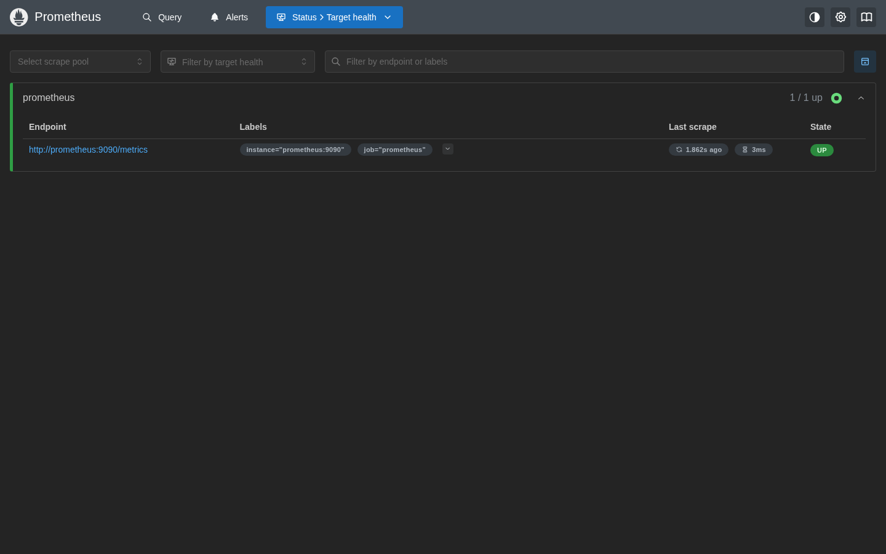
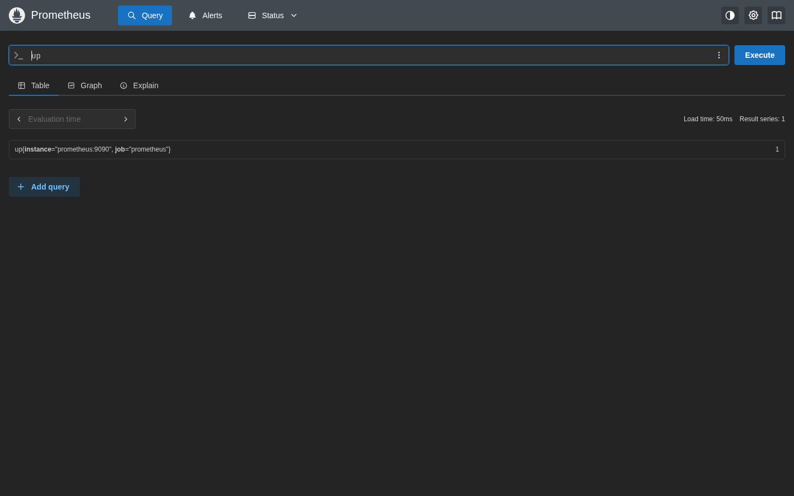
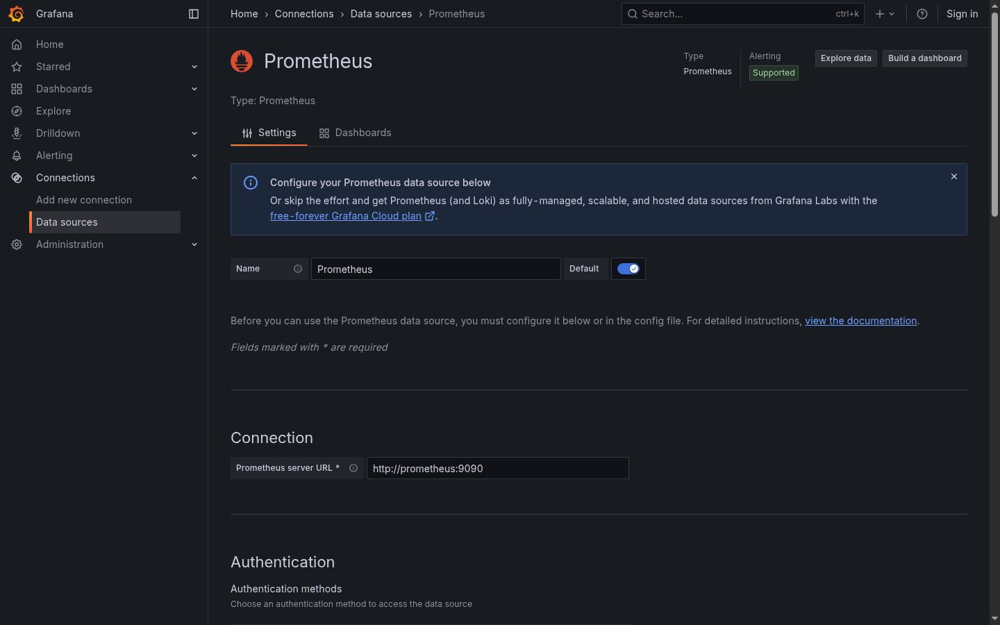
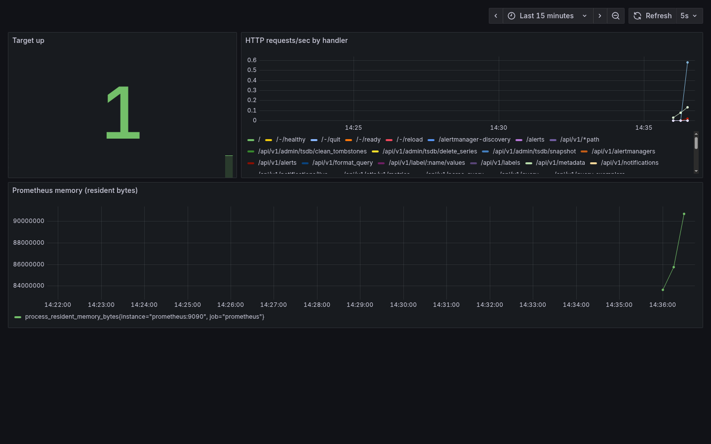
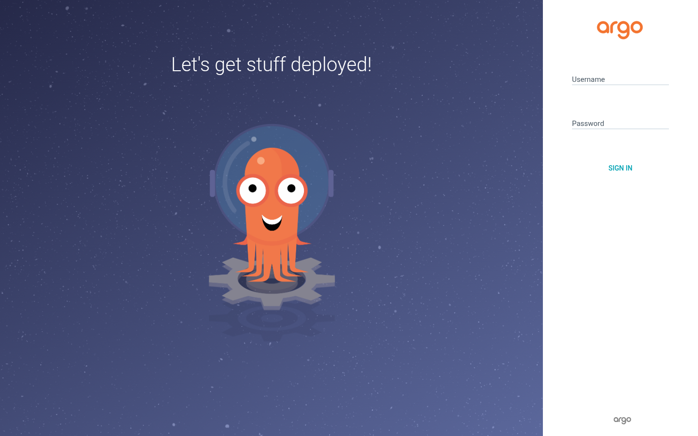
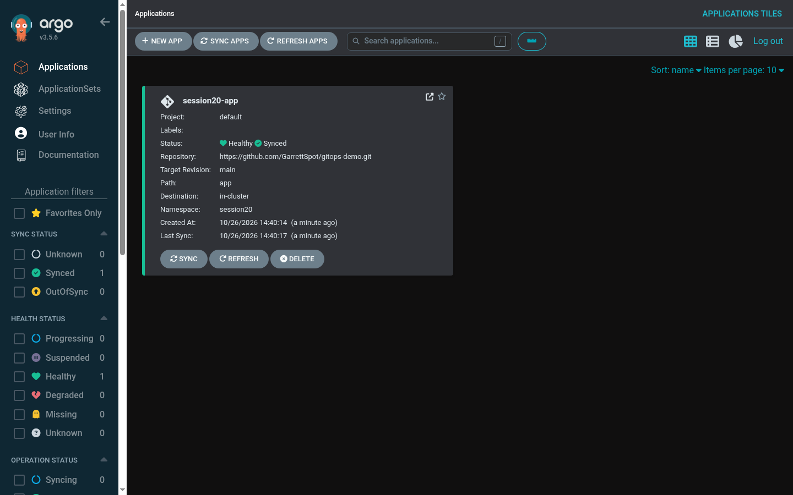
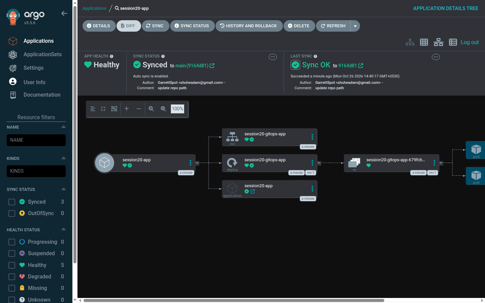
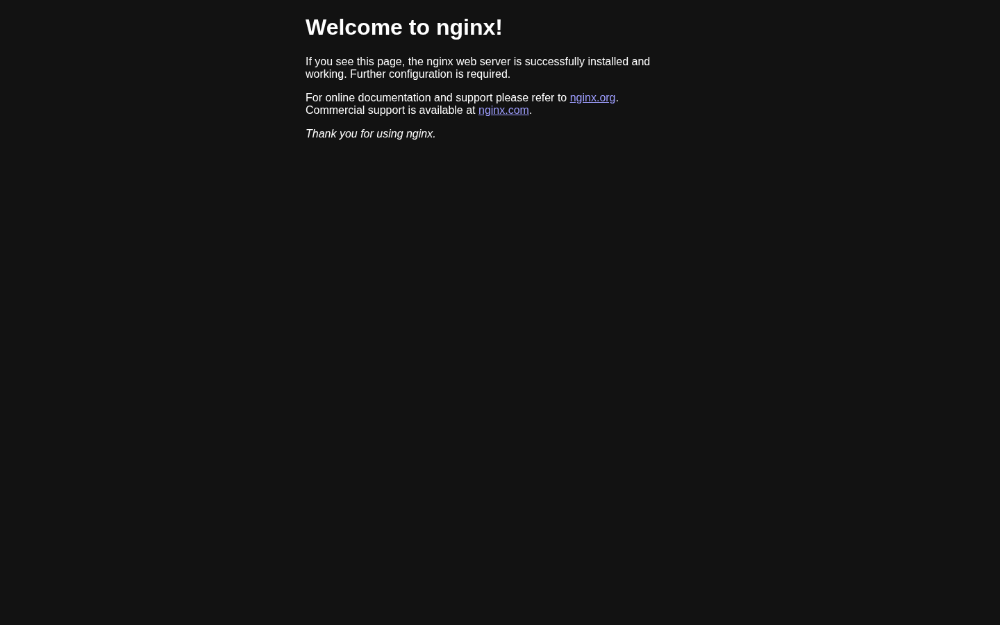
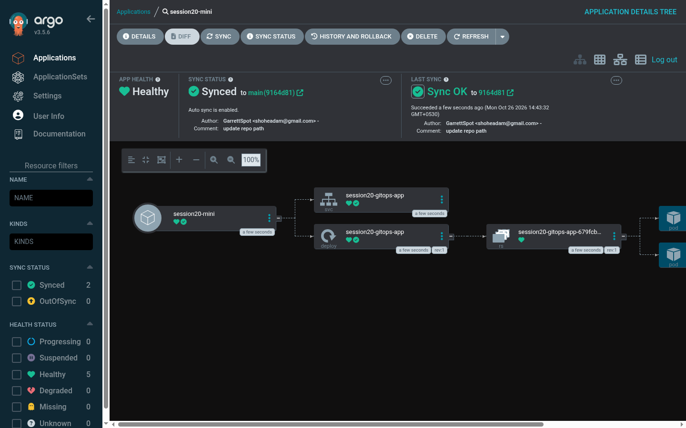

# 20

> Lab run notes: everything was run from a scratch copy of `session20-monitoring-observability-gitops/`. Host ports were remapped to avoid clashes with other stacks on this machine: Prometheus `9090 -> 18400`, Grafana `3000 -> 18401`, app port-forward `9090 -> 18402`, Argo CD UI `8080 -> 18403`. The kind cluster used its own kubeconfig (`$KUBECONFIG`) instead of `~/.kube/config`.

## 02 - Metrics, Logs & Traces (kind cluster)

```bash
…/session20-monitoring-observability-gitops/02-metrics-logs-traces ❯ kind create cluster --name session20 --kubeconfig $KUBECONFIG
Creating cluster "session20" ...
 ✓ Ensuring node image (kindest/node:v1.37.0) 🖼️
 ✓ Preparing nodes 📦 
 ✓ Writing configuration 📜
 ✓ Starting control-plane 🕹️
 ✓ Installing CNI 🔌
 ✓ Installing StorageClass 💾
Set kubectl context to "kind-session20"
You can now use your cluster with:

kubectl cluster-info --context kind-session20 --kubeconfig /tmp/claude-1000/-home-shohe-year-3-devops-mine/a1bf6e3b-3c54-412a-89c8-35788d81aa0b/scratchpad/k8s-c/kubeconfig

Thanks for using kind! 😊

…/session20-monitoring-observability-gitops/02-metrics-logs-traces ❯ kubectl get nodes
NAME                      STATUS     ROLES           AGE   VERSION
session20-control-plane   NotReady   control-plane   4s    v1.37.0

…/session20-monitoring-observability-gitops/02-metrics-logs-traces ❯ kubectl apply -f k8s-demo/
deployment.apps/session20-demo created
service/session20-demo created

…/session20-monitoring-observability-gitops/02-metrics-logs-traces ❯ kubectl get pods
NAME                              READY   STATUS    RESTARTS   AGE
session20-demo-6698db549f-nqg9m   1/1     Running   0          27s

…/session20-monitoring-observability-gitops/02-metrics-logs-traces ❯ kubectl logs deployment/session20-demo
Session 20 observability demo started
Request received
Health check OK
Request received
Health check OK
Request received
Health check OK

…/session20-monitoring-observability-gitops/02-metrics-logs-traces ❯ kubectl describe deployment session20-demo
Name:                   session20-demo
Namespace:              default
CreationTimestamp:      Mon, 26 Oct 2026 14:37:04 +0530
Labels:                 <none>
Annotations:            deployment.kubernetes.io/revision: 1
Selector:               app=session20-demo
Replicas:               1 desired | 1 updated | 1 total | 1 available | 0 unavailable
StrategyType:           RollingUpdate
MinReadySeconds:        0
RollingUpdateStrategy:  25% max unavailable, 25% max surge
Pod Template:
  Labels:  app=session20-demo
  Containers:
   app:
    Image:      busybox:1.36
    Port:       <none>
    Host Port:  <none>
    Command:
      /bin/sh
      -c
      echo "Session 20 observability demo started"
      while true; do
        echo "Request received"
        echo "Health check OK"
        sleep 10
      done
      
    Environment:   <none>
    Mounts:        <none>
  Volumes:         <none>
  Node-Selectors:  <none>
  Tolerations:     <none>
Conditions:
  Type           Status  Reason
  ----           ------  ------
  Available      True    MinimumReplicasAvailable
  Progressing    True    NewReplicaSetAvailable
OldReplicaSets:  <none>
NewReplicaSet:   session20-demo-6698db549f (1/1 replicas created)
Events:
  Type    Reason             Age   From                   Message
  ----    ------             ----  ----                   -------
  Normal  ScalingReplicaSet  28s   deployment-controller  Scaled up replica set session20-demo-6698db549f from 0 to 1

…/session20-monitoring-observability-gitops/02-metrics-logs-traces ❯ kubectl delete -f k8s-demo/
deployment.apps "session20-demo" deleted from default namespace
service "session20-demo" deleted from default namespace
```

## 03 - Prometheus

Targets via the HTTP API, then PromQL queries (`up`, `sum(up)`, and a `rate()` query).

```bash
…/session20-monitoring-observability-gitops/03-prometheus ❯ cat docker-compose.yml
services:
  prometheus:
    image: prom/prometheus:v3.5.0
    container_name: session20-prometheus
    ports:
      - "18400:9090"
    volumes:
      - ./prometheus.yml:/etc/prometheus/prometheus.yml:ro

…/session20-monitoring-observability-gitops/03-prometheus ❯ docker compose up -d
 Image prom/prometheus:v3.5.0 Pulling 
 097a69c6efe6 Pull complete 0B
 2dfc70ad9941 Pull complete 0B
 a4e782810d03 Pull complete 0B
 76619c1908eb Pull complete 0B
 2ee6cb77bebd Pull complete 0B
 208063e2dcbb Pull complete 0B
 fd1d3a5a5f79 Pull complete 0B
 5e4c02bc6754 Pull complete 0B
 Image prom/prometheus:v3.5.0 Pulled 
 Network 03-prometheus_default Creating 
 Network 03-prometheus_default Created 
 Container session20-prometheus Creating 
 Container session20-prometheus Created 
 Container session20-prometheus Starting 
 Container session20-prometheus Started 

…/session20-monitoring-observability-gitops/03-prometheus ❯ docker compose ps
NAME                   IMAGE                    COMMAND                  SERVICE      CREATED          STATUS          PORTS
session20-prometheus   prom/prometheus:v3.5.0   "/bin/prometheus --c…"   prometheus   15 seconds ago   Up 15 seconds   0.0.0.0:18400->9090/tcp, [::]:18400->9090/tcp

…/session20-monitoring-observability-gitops/03-prometheus ❯ curl -s localhost:18400/api/v1/targets | jq '.data.activeTargets[] | {job: .labels.job, instance: .labels.instance, health, lastScrape}'
{
  "job": "prometheus",
  "instance": "prometheus:9090",
  "health": "up",
  "lastScrape": "2026-10-26T09:02:40.248037976Z"
}

…/session20-monitoring-observability-gitops/03-prometheus ❯ curl -s 'localhost:18400/api/v1/query?query=up' | jq
{
  "status": "success",
  "data": {
    "resultType": "vector",
    "result": [
      {
        "metric": {
          "__name__": "up",
          "instance": "prometheus:9090",
          "job": "prometheus"
        },
        "value": [
          1793005360.545,
          "1"
        ]
      }
    ]
  }
}

…/session20-monitoring-observability-gitops/03-prometheus ❯ curl -s 'localhost:18400/api/v1/query?query=sum(up)' | jq '.data.result'
[
  {
    "metric": {},
    "value": [
      1793005360.557,
      "1"
    ]
  }
]

…/session20-monitoring-observability-gitops/03-prometheus ❯ curl -s 'localhost:18400/api/v1/query' --data-urlencode 'query=sum by (handler) (rate(prometheus_http_requests_total[1m])) > 0' | jq -r '.data.result[] | "\(.metric.handler)  \(.value[1])"'
/api/v1/query  0.13681011038233884
/api/v1/targets  0.017101263797792355
/metrics  0.17101263797792354

…/session20-monitoring-observability-gitops/03-prometheus ❯ docker compose down
 Container session20-prometheus Stopping 
 Container session20-prometheus Stopped 
 Container session20-prometheus Removing 
 Container session20-prometheus Removed 
 Network 03-prometheus_default Removing 
 Network 03-prometheus_default Removed 
```





![Prometheus graph: rate(prometheus_http_requests_total[1m])](prometheus-rate-graph.png)

## 04 - Grafana

In the scratch compose file Grafana got `GF_AUTH_ANONYMOUS_ENABLED=true` and `GF_AUTH_ANONYMOUS_ORG_ROLE=Admin` so the headless browser could screenshot it without the login form. The Prometheus data source (`http://prometheus:9090`) and a dashboard were created through the Grafana HTTP API.

```bash
…/session20-monitoring-observability-gitops/04-grafana ❯ docker compose up -d
 Image grafana/grafana:12.1.1 Pulling 
 9824c27679d3 Pull complete 0B
 b5f55c75514d Pull complete 0B
 d394204a1bdc Pull complete 0B
 cc8d890506a2 Pull complete 0B
 d4acc02fae7c Pull complete 0B
 8c90a7c3d0e1 Pull complete 0B
 85954acfa484 Pull complete 0B
 164de8f14b64 Pull complete 0B
 be3398fa2dbf Pull complete 0B
 8711a47cb968 Pull complete 0B
 Image grafana/grafana:12.1.1 Pulled 
 Network 04-grafana_default Creating 
 Network 04-grafana_default Created 
 Container session20-prometheus Creating 
 Container session20-prometheus Created 
 Container session20-grafana Creating 
 Container session20-grafana Created 
 Container session20-prometheus Starting 
 Container session20-prometheus Started 
 Container session20-grafana Starting 
 Container session20-grafana Started 

…/session20-monitoring-observability-gitops/04-grafana ❯ docker compose ps
NAME                   IMAGE                    COMMAND                  SERVICE      CREATED          STATUS          PORTS
session20-grafana      grafana/grafana:12.1.1   "/run.sh"                grafana      20 seconds ago   Up 20 seconds   0.0.0.0:18401->3000/tcp, [::]:18401->3000/tcp
session20-prometheus   prom/prometheus:v3.5.0   "/bin/prometheus --c…"   prometheus   20 seconds ago   Up 20 seconds   0.0.0.0:18400->9090/tcp, [::]:18400->9090/tcp

…/session20-monitoring-observability-gitops/04-grafana ❯ curl -s localhost:18401/api/health | jq
{
  "database": "ok",
  "version": "12.1.1",
  "commit": "df5de8219b41d1e639e003bf5f3a85913761d167"
}

…/session20-monitoring-observability-gitops/04-grafana ❯ curl -s -X POST localhost:18401/api/datasources -H 'Content-Type: application/json' -d '{"name":"Prometheus","type":"prometheus","url":"http://prometheus:9090","access":"proxy","isDefault":true}' | jq
{
  "datasource": {
    "id": 1,
    "uid": "cg2dmzr0kc074e",
    "orgId": 1,
    "name": "Prometheus",
    "type": "prometheus",
    "typeLogoUrl": "public/plugins/prometheus/img/prometheus_logo.svg",
    "access": "proxy",
    "url": "http://prometheus:9090",
    "user": "",
    "database": "",
    "basicAuth": false,
    "basicAuthUser": "",
    "withCredentials": false,
    "isDefault": true,
    "jsonData": {},
    "secureJsonFields": {},
    "version": 1,
    "readOnly": false,
    "apiVersion": ""
  },
  "id": 1,
  "message": "Datasource added",
  "name": "Prometheus"
}

…/session20-monitoring-observability-gitops/04-grafana ❯ curl -s localhost:18401/api/datasources | jq ".[] | {id, uid, name, type, url}"
{
  "id": 1,
  "uid": "cg2dmzr0kc074e",
  "name": "Prometheus",
  "type": "prometheus",
  "url": "http://prometheus:9090"
}

…/session20-monitoring-observability-gitops/04-grafana ❯ curl -s localhost:18401/api/datasources/uid/cg2dmzr0kc074e/health | jq
{
  "details": {
    "application": "Prometheus",
    "features": {
      "rulerApiEnabled": false
    }
  },
  "message": "Successfully queried the Prometheus API.",
  "status": "OK"
}

…/session20-monitoring-observability-gitops/04-grafana ❯ cat dashboard.json | jq -c ".dashboard.panels[] | {title, type, expr: .targets[0].expr}"
{"title":"Target up","type":"stat","expr":"up"}
{"title":"HTTP requests/sec by handler","type":"timeseries","expr":"sum by (handler) (rate(prometheus_http_requests_total[1m]))"}
{"title":"Prometheus memory (resident bytes)","type":"timeseries","expr":"process_resident_memory_bytes"}

…/session20-monitoring-observability-gitops/04-grafana ❯ curl -s -X POST localhost:18401/api/dashboards/db -H 'Content-Type: application/json' -d @dashboard.json | jq
{
  "folderUid": "",
  "id": 1,
  "slug": "session-20-prometheus",
  "status": "success",
  "uid": "session20",
  "url": "/d/session20/session-20-prometheus",
  "version": 1
}

…/session20-monitoring-observability-gitops/04-grafana ❯ curl -s 'localhost:18401/api/search?query=Session' | jq
[
  {
    "id": 1,
    "uid": "session20",
    "orgId": 1,
    "title": "Session 20 - Prometheus",
    "uri": "db/session-20-prometheus",
    "url": "/d/session20/session-20-prometheus",
    "slug": "",
    "type": "dash-db",
    "tags": [],
    "isStarred": false,
    "sortMeta": 0,
    "isDeleted": false
  }
]

…/session20-monitoring-observability-gitops/04-grafana ❯ docker compose down
 Container session20-grafana Stopping 
 Container session20-grafana Stopped 
 Container session20-grafana Removing 
 Container session20-grafana Removed 
 Container session20-prometheus Stopping 
 Container session20-prometheus Stopped 
 Container session20-prometheus Removing 
 Container session20-prometheus Removed 
 Network 04-grafana_default Removing 
 Network 04-grafana_default Removed 
```





## 05 - Introduction to GitOps (manual apply first)

```bash
…/session20-monitoring-observability-gitops/05-introduction-to-gitops ❯ kubectl apply -f app/
deployment.apps/session20-app created
service/session20-app created

…/session20-monitoring-observability-gitops/05-introduction-to-gitops ❯ kubectl get deployment
NAME            READY   UP-TO-DATE   AVAILABLE   AGE
session20-app   2/2     2            2           11s

…/session20-monitoring-observability-gitops/05-introduction-to-gitops ❯ kubectl get pods -l app=session20-app
NAME                             READY   STATUS    RESTARTS   AGE
session20-app-75879b6878-rxkh8   1/1     Running   0          11s
session20-app-75879b6878-w2nk8   1/1     Running   0          11s

…/session20-monitoring-observability-gitops/05-introduction-to-gitops ❯ kubectl delete -f app/
deployment.apps "session20-app" deleted from default namespace
service "session20-app" deleted from default namespace
```

## 06 - Git as Source of Truth

Run in a scratch copy of `gitops-repo/` (local commits only, nothing pushed).

```bash
…/06-git-as-source-of-truth/gitops-repo ❯ git init
Initialized empty Git repository in /tmp/claude-1000/-home-shohe-year-3-devops-mine/a1bf6e3b-3c54-412a-89c8-35788d81aa0b/scratchpad/k8s-c/session20-monitoring-observability-gitops/06-git-as-source-of-truth/gitops-repo/.git/

…/06-git-as-source-of-truth/gitops-repo ❯ git status
On branch master

No commits yet

Untracked files:
  (use "git add <file>..." to include in what will be committed)
	README.md
	app/

nothing added to commit but untracked files present (use "git add" to track)

…/06-git-as-source-of-truth/gitops-repo ❯ git add .

…/06-git-as-source-of-truth/gitops-repo ❯ git commit -m "Add session 20 application manifests"
[master (root-commit) b3bf5ef] Add session 20 application manifests
 3 files changed, 53 insertions(+)
 create mode 100644 README.md
 create mode 100644 app/deployment.yaml
 create mode 100644 app/service.yaml

…/06-git-as-source-of-truth/gitops-repo ❯ git diff
diff --git i/app/deployment.yaml w/app/deployment.yaml
index 88d7606..7b4b2c0 100644
--- i/app/deployment.yaml
+++ w/app/deployment.yaml
@@ -3,7 +3,7 @@ kind: Deployment
 metadata:
   name: session20-gitops-app
 spec:
-  replicas: 2
+  replicas: 3
   selector:
     matchLabels:
       app: session20-gitops-app

…/06-git-as-source-of-truth/gitops-repo ❯ git add .

…/06-git-as-source-of-truth/gitops-repo ❯ git commit -m "Scale application to three replicas"
[master dfd84ad] Scale application to three replicas
 1 file changed, 1 insertion(+), 1 deletion(-)

…/06-git-as-source-of-truth/gitops-repo ❯ git log --oneline
dfd84ad Scale application to three replicas
b3bf5ef Add session 20 application manifests
```

## 07 - Argo CD: install

```bash
…/session20-monitoring-observability-gitops/07-argocd ❯ kubectl cluster-info
Kubernetes control plane is running at https://127.0.0.1:43713
CoreDNS is running at https://127.0.0.1:43713/api/v1/namespaces/kube-system/services/kube-dns:dns/proxy

To further debug and diagnose cluster problems, use 'kubectl cluster-info dump'.

…/session20-monitoring-observability-gitops/07-argocd ❯ kubectl get nodes
NAME                      STATUS   ROLES           AGE   VERSION
session20-control-plane   Ready    control-plane   92s   v1.37.0

…/session20-monitoring-observability-gitops/07-argocd ❯ kubectl create namespace argocd
namespace/argocd created

…/session20-monitoring-observability-gitops/07-argocd ❯ kubectl apply -n argocd --server-side --force-conflicts -f https://raw.githubusercontent.com/argoproj/argo-cd/stable/manifests/install.yaml
customresourcedefinition.apiextensions.k8s.io/applications.argoproj.io serverside-applied
customresourcedefinition.apiextensions.k8s.io/applicationsets.argoproj.io serverside-applied
customresourcedefinition.apiextensions.k8s.io/appprojects.argoproj.io serverside-applied
serviceaccount/argocd-application-controller serverside-applied
serviceaccount/argocd-applicationset-controller serverside-applied
serviceaccount/argocd-dex-server serverside-applied
serviceaccount/argocd-notifications-controller serverside-applied
serviceaccount/argocd-redis serverside-applied
serviceaccount/argocd-repo-server serverside-applied
serviceaccount/argocd-server serverside-applied
role.rbac.authorization.k8s.io/argocd-application-controller serverside-applied
role.rbac.authorization.k8s.io/argocd-applicationset-controller serverside-applied
role.rbac.authorization.k8s.io/argocd-dex-server serverside-applied
role.rbac.authorization.k8s.io/argocd-notifications-controller serverside-applied
role.rbac.authorization.k8s.io/argocd-redis serverside-applied
role.rbac.authorization.k8s.io/argocd-server serverside-applied
clusterrole.rbac.authorization.k8s.io/argocd-application-controller serverside-applied
clusterrole.rbac.authorization.k8s.io/argocd-applicationset-controller serverside-applied
clusterrole.rbac.authorization.k8s.io/argocd-server serverside-applied
rolebinding.rbac.authorization.k8s.io/argocd-application-controller serverside-applied
rolebinding.rbac.authorization.k8s.io/argocd-applicationset-controller serverside-applied
rolebinding.rbac.authorization.k8s.io/argocd-dex-server serverside-applied
rolebinding.rbac.authorization.k8s.io/argocd-notifications-controller serverside-applied
rolebinding.rbac.authorization.k8s.io/argocd-redis serverside-applied
rolebinding.rbac.authorization.k8s.io/argocd-server serverside-applied
clusterrolebinding.rbac.authorization.k8s.io/argocd-application-controller serverside-applied
clusterrolebinding.rbac.authorization.k8s.io/argocd-applicationset-controller serverside-applied
clusterrolebinding.rbac.authorization.k8s.io/argocd-server serverside-applied
configmap/argocd-cm serverside-applied
configmap/argocd-cmd-params-cm serverside-applied
configmap/argocd-gpg-keys-cm serverside-applied
configmap/argocd-notifications-cm serverside-applied
configmap/argocd-rbac-cm serverside-applied
configmap/argocd-ssh-known-hosts-cm serverside-applied
configmap/argocd-tls-certs-cm serverside-applied
secret/argocd-notifications-secret serverside-applied
secret/argocd-secret serverside-applied
service/argocd-applicationset-controller serverside-applied
service/argocd-dex-server serverside-applied
service/argocd-metrics serverside-applied
service/argocd-notifications-controller-metrics serverside-applied
service/argocd-redis serverside-applied
service/argocd-repo-server serverside-applied
service/argocd-server serverside-applied
service/argocd-server-metrics serverside-applied
deployment.apps/argocd-applicationset-controller serverside-applied
deployment.apps/argocd-dex-server serverside-applied
deployment.apps/argocd-notifications-controller serverside-applied
deployment.apps/argocd-redis serverside-applied
deployment.apps/argocd-repo-server serverside-applied
deployment.apps/argocd-server serverside-applied
statefulset.apps/argocd-application-controller serverside-applied
networkpolicy.networking.k8s.io/argocd-application-controller-network-policy serverside-applied
networkpolicy.networking.k8s.io/argocd-applicationset-controller-network-policy serverside-applied
networkpolicy.networking.k8s.io/argocd-dex-server-network-policy serverside-applied
networkpolicy.networking.k8s.io/argocd-notifications-controller-network-policy serverside-applied
networkpolicy.networking.k8s.io/argocd-redis-network-policy serverside-applied
networkpolicy.networking.k8s.io/argocd-repo-server-network-policy serverside-applied
networkpolicy.networking.k8s.io/argocd-server-network-policy serverside-applied

~/year_3/gitops-demo ❯ kubectl get pods -n argocd
NAME                                                READY   STATUS    RESTARTS   AGE
argocd-application-controller-0                     1/1     Running   0          110s
argocd-applicationset-controller-86bcdc46cf-wxw5z   1/1     Running   0          110s
argocd-dex-server-7f65987db5-57l4k                  1/1     Running   0          110s
argocd-notifications-controller-6885f68ddd-vrldp    1/1     Running   0          110s
argocd-redis-7d5d5cb5b6-llpcj                       1/1     Running   0          110s
argocd-repo-server-7f4759f94-sxm54                  1/1     Running   0          110s
argocd-server-777cfb8fc4-wxqq5                      1/1     Running   0          110s

~/year_3/gitops-demo ❯ kubectl -n argocd get secret argocd-initial-admin-secret -o jsonpath="{.data.password}" | base64 -d && echo
****
```

## 07 - Argo CD: Application from my GitOps repo

The Application points at [GarrettSpot/gitops-demo](https://github.com/GarrettSpot/gitops-demo) (`path: app`, namespace `session20`, automated sync with `prune` + `selfHeal`).

```bash
~/year_3/gitops-demo ❯ git remote -v
origin	https://github.com/GarrettSpot/gitops-demo.git (fetch)
origin	https://github.com/GarrettSpot/gitops-demo.git (push)

~/year_3/gitops-demo ❯ git log --oneline
9164d81 update repo path
69784a6 add app
a847540 Initial commit

~/year_3/gitops-demo ❯ cat app/argocd-application.yaml
# Apply this file from your local/admin environment; do not put it under the Git source path.
apiVersion: argoproj.io/v1alpha1
kind: Application
metadata:
  name: session20-app
  namespace: argocd
spec:
  project: default

  source:
    repoURL: https://github.com/GarrettSpot/gitops-demo.git
    targetRevision: main
    path: app

  destination:
    server: https://kubernetes.default.svc
    namespace: session20

  syncPolicy:
    automated:
      prune: true
      selfHeal: true
    syncOptions:
      - CreateNamespace=true

~/year_3/gitops-demo ❯ kubectl apply -f app/argocd-application.yaml
application.argoproj.io/session20-app created
```

## 07 - Argo CD: sync status, health and resources

```bash
~/year_3/gitops-demo ❯ kubectl get applications -n argocd
NAME            SYNC STATUS   HEALTH STATUS
session20-app   Synced        Healthy

~/year_3/gitops-demo ❯ kubectl get application session20-app -n argocd -o jsonpath='{.status.sync.revision}{"\n"}'
9164d8185b872e087923e2df237f1c540dac682e

~/year_3/gitops-demo ❯ kubectl get application session20-app -n argocd -o json | jq '{sync: .status.sync.status, health: .status.health.status, revision: .status.sync.revision, resources: [.status.resources[] | {kind, name, namespace, status, health: .health.status}]}'
{
  "sync": "Synced",
  "health": "Healthy",
  "revision": "9164d8185b872e087923e2df237f1c540dac682e",
  "resources": [
    {
      "kind": "Service",
      "name": "session20-gitops-app",
      "namespace": "session20",
      "status": "Synced",
      "health": null
    },
    {
      "kind": "Deployment",
      "name": "session20-gitops-app",
      "namespace": "session20",
      "status": "Synced",
      "health": null
    },
    {
      "kind": "Application",
      "name": "session20-app",
      "namespace": "argocd",
      "status": "Synced",
      "health": null
    }
  ]
}

~/year_3/gitops-demo ❯ kubectl get pods -n session20
NAME                                    READY   STATUS    RESTARTS   AGE
session20-gitops-app-679fcbbd85-jp89x   1/1     Running   0          10s
session20-gitops-app-679fcbbd85-rc2q4   1/1     Running   0          10s

~/year_3/gitops-demo ❯ kubectl get deployment session20-gitops-app -n session20
NAME                   READY   UP-TO-DATE   AVAILABLE   AGE
session20-gitops-app   2/2     2            2           10s

~/year_3/gitops-demo ❯ kubectl get svc -n session20
NAME                   TYPE        CLUSTER-IP      EXTERNAL-IP   PORT(S)   AGE
session20-gitops-app   ClusterIP   10.96.150.135   <none>        80/TCP    10s

~/year_3/gitops-demo ❯ kubectl port-forward svc/session20-gitops-app -n session20 18402:80
Forwarding from 127.0.0.1:18402 -> 80
Forwarding from [::1]:18402 -> 80

~/year_3/gitops-demo ❯ curl -s localhost:18402 | head -20
<!DOCTYPE html>
<html>
<head>
<title>Welcome to nginx!</title>
<style>
html { color-scheme: light dark; }
body { width: 35em; margin: 0 auto;
font-family: Tahoma, Verdana, Arial, sans-serif; }
</style>
</head>
<body>
<h1>Welcome to nginx!</h1>
<p>If you see this page, the nginx web server is successfully installed and
working. Further configuration is required.</p>

<p>For online documentation and support please refer to
<a href="http://nginx.org/">nginx.org</a>.<br/>
Commercial support is available at
<a href="http://nginx.com/">nginx.com</a>.</p>
```

Since `app/argocd-application.yaml` lives inside the synced `app/` path, Argo CD also tracks the `session20-app` Application object itself (it shows up as a child resource).









## 07 - Argo CD: API (CLI-style) view

```bash
~/year_3/gitops-demo ❯ kubectl port-forward svc/argocd-server -n argocd 18403:443
Forwarding from 127.0.0.1:18403 -> 8080
Forwarding from [::1]:18403 -> 8080

~/year_3/gitops-demo ❯ ARGOCD_TOKEN=$(curl -sk https://localhost:18403/api/v1/session -H "Content-Type: application/json" -d "{\"username\":\"admin\",\"password\":\"****\"}" | jq -r .token)

~/year_3/gitops-demo ❯ curl -sk https://localhost:18403/api/version -H "Authorization: Bearer $ARGOCD_TOKEN" | jq "{Version, KubectlVersion}"
{
  "Version": "v3.5.6",
  "KubectlVersion": "v0.36.1"
}

~/year_3/gitops-demo ❯ curl -sk https://localhost:18403/api/v1/applications/session20-app -H "Authorization: Bearer $ARGOCD_TOKEN" | jq "{repo: .spec.source.repoURL, path: .spec.source.path, sync: .status.sync.status, health: .status.health.status, lastSync: .status.operationState.phase, message: .status.operationState.message}"
{
  "repo": "https://github.com/GarrettSpot/gitops-demo.git",
  "path": "app",
  "sync": "Synced",
  "health": "Healthy",
  "lastSync": "Succeeded",
  "message": "successfully synced (all tasks run)"
}

~/year_3/gitops-demo ❯ curl -sk https://localhost:18403/api/v1/applications/session20-app/resource-tree -H "Authorization: Bearer $ARGOCD_TOKEN" | jq -r ".nodes[] | [.kind, .name, (.health.status // \"-\")] | @tsv" | column -t
Pod          session20-gitops-app-679fcbbd85-jp89x  Healthy
Pod          session20-gitops-app-679fcbbd85-rc2q4  Healthy
Service      session20-gitops-app                   Healthy
Deployment   session20-gitops-app                   Healthy
ReplicaSet   session20-gitops-app-679fcbbd85        Healthy
Application  session20-app                          -
```

## 07 - Argo CD: selfHeal demo

Git says `replicas: 2`. Scaling by hand to 5 makes the app `OutOfSync`, and Argo CD reverts it back to 2 within a few seconds.

```bash
~/year_3/gitops-demo ❯ grep replicas app/deployment.yaml
  replicas: 2

~/year_3/gitops-demo ❯ kubectl scale deployment session20-gitops-app -n session20 --replicas=5
deployment.apps/session20-gitops-app scaled

~/year_3/gitops-demo ❯ kubectl get deployment session20-gitops-app -n session20
NAME                   READY   UP-TO-DATE   AVAILABLE   AGE
session20-gitops-app   2/5     5            2           101s

~/year_3/gitops-demo ❯ for i in 1 2 3 4 5 6; do date +%T; kubectl get deployment session20-gitops-app -n session20 --no-headers; kubectl get application session20-app -n argocd --no-headers; sleep 3; done
14:41:58
session20-gitops-app   2/5   5     2     101s
session20-app   OutOfSync   Progressing
14:42:01
session20-gitops-app   2/2   2     2     105s
session20-app   Synced   Healthy
14:42:05
session20-gitops-app   2/2   2     2     108s
session20-app   Synced   Healthy
14:42:08
session20-gitops-app   2/2   2     2     111s
session20-app   Synced   Healthy
14:42:11
session20-gitops-app   2/2   2     2     114s
session20-app   Synced   Healthy
14:42:14
session20-gitops-app   2/2   2     2     117s
session20-app   Synced   Healthy

~/year_3/gitops-demo ❯ kubectl get pods -n session20
NAME                                    READY   STATUS    RESTARTS   AGE
session20-gitops-app-679fcbbd85-jp89x   1/1     Running   0          2m
session20-gitops-app-679fcbbd85-rc2q4   1/1     Running   0          2m

~/year_3/gitops-demo ❯ kubectl get application session20-app -n argocd -o json | jq '.status.operationState | {phase, message, startedAt, finishedAt, initiatedBy: .operation.initiatedBy}'
{
  "phase": "Succeeded",
  "message": "successfully synced (all tasks run)",
  "startedAt": "2026-10-26T09:11:58Z",
  "finishedAt": "2026-10-26T09:11:58Z",
  "initiatedBy": {
    "automated": true
  }
}

~/year_3/gitops-demo ❯ kubectl get events -n session20 --sort-by=.lastTimestamp | tail -8
20s         Normal   SuccessfulCreate    replicaset/session20-gitops-app-679fcbbd85   Created pod: session20-gitops-app-679fcbbd85-qzq25
20s         Normal   SuccessfulCreate    replicaset/session20-gitops-app-679fcbbd85   Created pod: session20-gitops-app-679fcbbd85-2tnx9
20s         Normal   SuccessfulDelete    replicaset/session20-gitops-app-679fcbbd85   Deleted pod: session20-gitops-app-679fcbbd85-qzq25
20s         Normal   SuccessfulDelete    replicaset/session20-gitops-app-679fcbbd85   Deleted pod: session20-gitops-app-679fcbbd85-v6j8b
20s         Normal   SuccessfulDelete    replicaset/session20-gitops-app-679fcbbd85   Deleted pod: session20-gitops-app-679fcbbd85-2tnx9
20s         Normal   Scheduled           pod/session20-gitops-app-679fcbbd85-qzq25    Successfully assigned session20/session20-gitops-app-679fcbbd85-qzq25 to session20-control-plane
20s         Normal   ScalingReplicaSet   deployment/session20-gitops-app              Scaled up replica set session20-gitops-app-679fcbbd85 from 2 to 5
20s         Normal   ScalingReplicaSet   deployment/session20-gitops-app              Scaled down replica set session20-gitops-app-679fcbbd85 from 5 to 2
```

Deleting a managed resource is healed the same way, and a manual sync can be triggered by patching the Application:

```bash
~/year_3/gitops-demo ❯ kubectl delete svc session20-gitops-app -n session20
service "session20-gitops-app" deleted from session20 namespace

~/year_3/gitops-demo ❯ kubectl get svc -n session20
NAME                   TYPE        CLUSTER-IP      EXTERNAL-IP   PORT(S)   AGE
session20-gitops-app   ClusterIP   10.96.229.179   <none>        80/TCP    8s

~/year_3/gitops-demo ❯ kubectl patch application session20-app -n argocd --type merge -p '{"operation":{"sync":{}}}'
application.argoproj.io/session20-app patched

~/year_3/gitops-demo ❯ kubectl get application session20-app -n argocd -o jsonpath='{.status.operationState.phase}{" "}{.status.operationState.message}{"\n"}'
Succeeded successfully synced (all tasks run)

~/year_3/gitops-demo ❯ kubectl get applications -n argocd
NAME            SYNC STATUS   HEALTH STATUS
session20-app   Synced        Healthy
```

## 07 - Argo CD: cleanup

The Application has no `resources-finalizer`, so deleting it leaves the deployed resources behind (removed with the namespace).

```bash
~/year_3/gitops-demo ❯ kubectl delete -f app/argocd-application.yaml
application.argoproj.io "session20-app" deleted from argocd namespace

~/year_3/gitops-demo ❯ kubectl get applications -n argocd
No resources found in argocd namespace.

~/year_3/gitops-demo ❯ kubectl get all -n session20
NAME                                        READY   STATUS    RESTARTS   AGE
pod/session20-gitops-app-679fcbbd85-jp89x   1/1     Running   0          2m45s
pod/session20-gitops-app-679fcbbd85-rc2q4   1/1     Running   0          2m45s

NAME                           TYPE        CLUSTER-IP      EXTERNAL-IP   PORT(S)   AGE
service/session20-gitops-app   ClusterIP   10.96.229.179   <none>        80/TCP    37s

NAME                                   READY   UP-TO-DATE   AVAILABLE   AGE
deployment.apps/session20-gitops-app   2/2     2            2           2m45s

NAME                                              DESIRED   CURRENT   READY   AGE
replicaset.apps/session20-gitops-app-679fcbbd85   2         2         2       2m45s

~/year_3/gitops-demo ❯ kubectl delete namespace session20
namespace "session20" deleted
```

## 08 - Mini Project

The mini-project Application has a `YOUR_USERNAME/YOUR_GITOPS_REPO` placeholder. In the scratch copy it was pointed at my repo (`GarrettSpot/gitops-demo`), and `directory.exclude: argocd-application.yaml` was added so this second Application doesn't recreate `session20-app`. Because my repo contains `session20-gitops-app` (not `session20-mini`), the scale/log commands use that deployment name.

```bash
…/session20-monitoring-observability-gitops/08-mini-project ❯ kubectl get nodes
NAME                      STATUS   ROLES           AGE     VERSION
session20-control-plane   Ready    control-plane   6m39s   v1.37.0

…/session20-monitoring-observability-gitops/08-mini-project ❯ kubectl get pods -n argocd
NAME                                                READY   STATUS    RESTARTS   AGE
argocd-application-controller-0                     1/1     Running   0          4m57s
argocd-applicationset-controller-86bcdc46cf-wxw5z   1/1     Running   0          4m57s
argocd-dex-server-7f65987db5-57l4k                  1/1     Running   0          4m57s
argocd-notifications-controller-6885f68ddd-vrldp    1/1     Running   0          4m57s
argocd-redis-7d5d5cb5b6-llpcj                       1/1     Running   0          4m57s
argocd-repo-server-7f4759f94-sxm54                  1/1     Running   0          4m57s
argocd-server-777cfb8fc4-wxqq5                      1/1     Running   0          4m57s

…/session20-monitoring-observability-gitops/08-mini-project ❯ cat app/argocd-application.yaml
# Apply this file from your local/admin environment; do not put it under the Git source path.
apiVersion: argoproj.io/v1alpha1
kind: Application
metadata:
  name: session20-mini
  namespace: argocd
spec:
  project: default

  source:
    repoURL: https://github.com/GarrettSpot/gitops-demo.git
    targetRevision: main
    path: app
    directory:
      exclude: argocd-application.yaml

  destination:
    server: https://kubernetes.default.svc
    namespace: session20

  syncPolicy:
    automated:
      prune: true
      selfHeal: true
    syncOptions:
      - CreateNamespace=true

…/session20-monitoring-observability-gitops/08-mini-project ❯ kubectl apply -f app/argocd-application.yaml
application.argoproj.io/session20-mini created

…/session20-monitoring-observability-gitops/08-mini-project ❯ kubectl get applications -n argocd
NAME             SYNC STATUS   HEALTH STATUS
session20-mini   Synced        Healthy

…/session20-monitoring-observability-gitops/08-mini-project ❯ kubectl get all -n session20
NAME                                        READY   STATUS    RESTARTS   AGE
pod/session20-gitops-app-679fcbbd85-d7pnr   1/1     Running   0          3s
pod/session20-gitops-app-679fcbbd85-v5lpr   1/1     Running   0          3s

NAME                           TYPE        CLUSTER-IP     EXTERNAL-IP   PORT(S)   AGE
service/session20-gitops-app   ClusterIP   10.96.229.20   <none>        80/TCP    3s

NAME                                   READY   UP-TO-DATE   AVAILABLE   AGE
deployment.apps/session20-gitops-app   2/2     2            2           3s

NAME                                              DESIRED   CURRENT   READY   AGE
replicaset.apps/session20-gitops-app-679fcbbd85   2         2         2       3s

…/session20-monitoring-observability-gitops/08-mini-project ❯ kubectl scale deployment session20-gitops-app -n session20 --replicas=1
deployment.apps/session20-gitops-app scaled

…/session20-monitoring-observability-gitops/08-mini-project ❯ kubectl get deployment -n session20
NAME                   READY   UP-TO-DATE   AVAILABLE   AGE
session20-gitops-app   1/1     1            1           10s

…/session20-monitoring-observability-gitops/08-mini-project ❯ kubectl get deployment -n session20
NAME                   READY   UP-TO-DATE   AVAILABLE   AGE
session20-gitops-app   2/2     2            2           18s

…/session20-monitoring-observability-gitops/08-mini-project ❯ kubectl logs deployment/session20-gitops-app -n session20
Found 2 pods, using pod/session20-gitops-app-679fcbbd85-d7pnr
/docker-entrypoint.sh: /docker-entrypoint.d/ is not empty, will attempt to perform configuration
/docker-entrypoint.sh: Looking for shell scripts in /docker-entrypoint.d/
/docker-entrypoint.sh: Launching /docker-entrypoint.d/10-listen-on-ipv6-by-default.sh
10-listen-on-ipv6-by-default.sh: info: Getting the checksum of /etc/nginx/conf.d/default.conf
10-listen-on-ipv6-by-default.sh: info: Enabled listen on IPv6 in /etc/nginx/conf.d/default.conf
/docker-entrypoint.sh: Sourcing /docker-entrypoint.d/15-local-resolvers.envsh
/docker-entrypoint.sh: Launching /docker-entrypoint.d/20-envsubst-on-templates.sh
/docker-entrypoint.sh: Launching /docker-entrypoint.d/30-tune-worker-processes.sh
/docker-entrypoint.sh: Configuration complete; ready for start up
2026/10/26 09:13:22 [notice] 1#1: using the "epoll" event method
2026/10/26 09:13:22 [notice] 1#1: nginx/1.27.5
2026/10/26 09:13:22 [notice] 1#1: built by gcc 14.2.0 (Alpine 14.2.0) 
2026/10/26 09:13:22 [notice] 1#1: OS: Linux 7.2.5-3-omarchy
2026/10/26 09:13:22 [notice] 1#1: getrlimit(RLIMIT_NOFILE): 2147483584:2147483584
2026/10/26 09:13:22 [notice] 1#1: start worker processes
2026/10/26 09:13:22 [notice] 1#1: start worker process 37
2026/10/26 09:13:22 [notice] 1#1: start worker process 38
2026/10/26 09:13:22 [notice] 1#1: start worker process 39
2026/10/26 09:13:22 [notice] 1#1: start worker process 40
2026/10/26 09:13:22 [notice] 1#1: start worker process 41
2026/10/26 09:13:22 [notice] 1#1: start worker process 42
2026/10/26 09:13:22 [notice] 1#1: start worker process 43
2026/10/26 09:13:22 [notice] 1#1: start worker process 44

…/session20-monitoring-observability-gitops/08-mini-project ❯ kubectl get pods -n session20
NAME                                    READY   STATUS    RESTARTS   AGE
session20-gitops-app-679fcbbd85-6bwjq   1/1     Running   0          8s
session20-gitops-app-679fcbbd85-d7pnr   1/1     Running   0          18s

…/session20-monitoring-observability-gitops/08-mini-project ❯ kubectl get application session20-mini -n argocd
NAME             SYNC STATUS   HEALTH STATUS
session20-mini   Synced        Healthy
```



## 08 - Cleanup

```bash
…/session20-monitoring-observability-gitops/08-mini-project ❯ kubectl delete -f app/argocd-application.yaml
application.argoproj.io "session20-mini" deleted from argocd namespace

…/session20-monitoring-observability-gitops/08-mini-project ❯ kind delete cluster --name session20 --kubeconfig $KUBECONFIG
Deleting cluster "session20" ...
Deleted nodes: ["session20-control-plane"]
```

## Git-driven steps not run (would need a push)

These README steps change the GitOps repo and push; they were skipped so `GarrettSpot/gitops-demo` stays untouched:

- 07 "Scale down to 2 replicas": already `replicas: 2` in my repo, nothing to change.
- 07 "Scale up to 3 replicas" / 08 "Scale application to three replicas": in `app/deployment.yaml` change `replicas: 2` to `replicas: 3`, then `git commit -m "Scale up to 3 replicas"` and `git push`. Argo CD would then sync the deployment to 3 pods.
