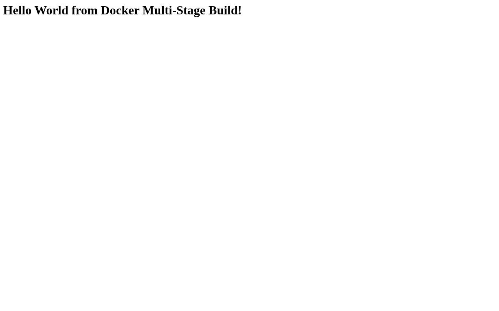
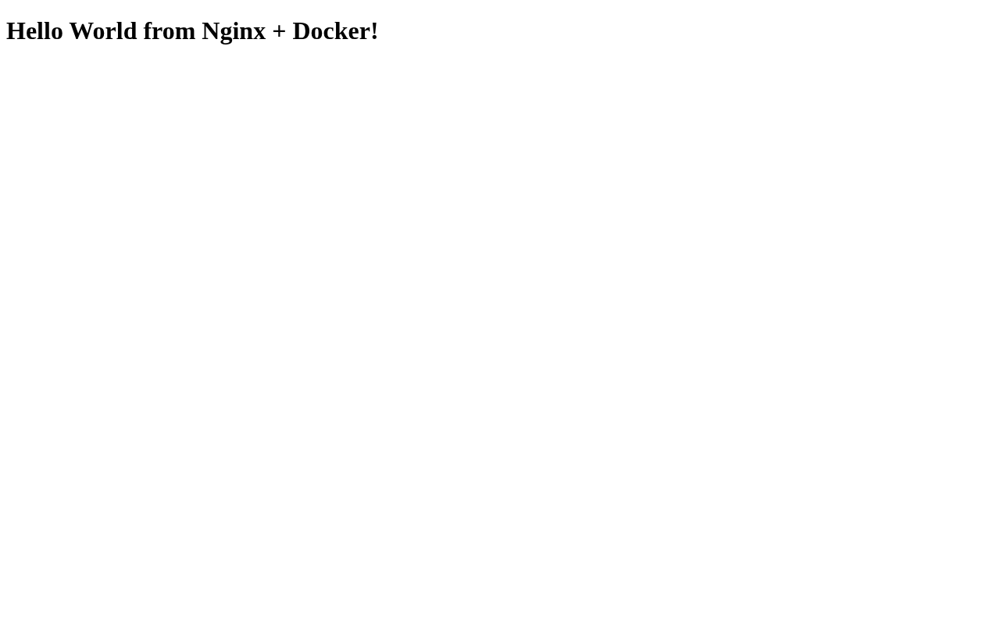

# Docker Images

Lab source: `session6-7-docker/` (node-app, python-app, nginx-web, multi-stage-dockerfile, docker-compose-app, docker.md).
Basic build/run was already covered in `5_docker_fundamentals`, so this section focuses on **images**: layers, `docker history`,
`docker inspect`, tags, multi-stage builds and image sizes, plus Docker Compose and the cleanup commands from `docker.md`.

> Notes: every image/container/network here is prefixed with `s6-` and host ports are in the `18000-18999` range
> (another project was using Docker on the same machine). Long build/pull outputs have the layer download progress lines trimmed.

## Node app image (`node-app`)

```bash
…/session6-7-docker/node-app ❯ cat Dockerfile
FROM node:24-alpine

WORKDIR /app

COPY package*.json ./

RUN npm install

COPY . .

EXPOSE 3000

CMD ["npm", "start"]

…/session6-7-docker/node-app ❯ docker build -t s6-node-app:1.0 .
#0 building with "default" instance using docker driver

#1 [internal] load build definition from Dockerfile
#1 transferring dockerfile: 155B done
#1 DONE 0.0s

#2 [internal] load metadata for docker.io/library/node:24-alpine
#2 DONE 2.4s

#3 [internal] load .dockerignore
#3 transferring context: 2B done
#3 DONE 0.0s

#4 [internal] load build context
#4 transferring context: 656B done
#4 DONE 0.0s

#5 [1/5] FROM docker.io/library/node:24-alpine@sha256:06d7adf3e0ef61a13f1d28682726366f97a15aa1888c934d3ecec86c33918b53
#5 resolve docker.io/library/node:24-alpine@sha256:06d7adf3e0ef61a13f1d28682726366f97a15aa1888c934d3ecec86c33918b53 0.0s done
... (layer download progress lines trimmed) ...
#5 sha256:109c2f814f468711ac666fb9494ce76528e972ee8636468ad822267a0af959e5 443B / 443B 0.2s done
#5 sha256:f0a5c9e3ce7dcc7fca3a816f70b3d42bc5324066b627223af466eff9030e171f 1.26MB / 1.26MB 0.5s done
#5 sha256:15577f11e05afbda845cbd2903e55f0a3da41dc2a576435999474e7a2654651b 57.37MB / 57.37MB 8.9s done
#5 extracting sha256:15577f11e05afbda845cbd2903e55f0a3da41dc2a576435999474e7a2654651b
#5 extracting sha256:15577f11e05afbda845cbd2903e55f0a3da41dc2a576435999474e7a2654651b 0.9s done
#5 extracting sha256:f0a5c9e3ce7dcc7fca3a816f70b3d42bc5324066b627223af466eff9030e171f
#5 extracting sha256:f0a5c9e3ce7dcc7fca3a816f70b3d42bc5324066b627223af466eff9030e171f 0.0s done
#5 extracting sha256:109c2f814f468711ac666fb9494ce76528e972ee8636468ad822267a0af959e5 0.0s done
#5 DONE 9.9s

#6 [2/5] WORKDIR /app
#6 DONE 0.1s

#7 [3/5] COPY package*.json ./
#7 DONE 0.0s

#8 [4/5] RUN npm install
#8 2.506 
#8 2.506 added 65 packages, and audited 66 packages in 2s
#8 2.506 
#8 2.506 29 packages are looking for funding
#8 2.506   run `npm fund` for details
#8 2.506 
#8 2.506 found 0 vulnerabilities
#8 2.508 npm notice
#8 2.508 npm notice New major version of npm available! 11.19.1 -> 12.2.1
#8 2.508 npm notice Changelog: https://github.com/npm/cli/releases/tag/v12.2.1
#8 2.508 npm notice To update run: npm install -g npm@12.2.1
#8 2.508 npm notice
#8 DONE 2.6s

#9 [5/5] COPY . .
#9 DONE 0.0s

#10 exporting to image
#10 exporting layers
#10 exporting layers 0.3s done
#10 exporting manifest sha256:82e93de93ac6a6bc53a3276ad95ed90002a6d8bb421e484b0af423f192217343 done
#10 exporting config sha256:62c8b42a78917af471da63cd525572830d21b522e4945fa86fff5d8a43fae378 done
#10 exporting attestation manifest sha256:162ed3c02d6d8fd75b4c94827075c724f1d53d886e50272c010eb9286084ea8f done
#10 exporting manifest list sha256:9881e7237f7f731d2f86d3664e07b7603450bbdfb7a0bce1cd88516ff6882d2a done
#10 naming to docker.io/library/s6-node-app:1.0 done
#10 unpacking to docker.io/library/s6-node-app:1.0
#10 unpacking to docker.io/library/s6-node-app:1.0 0.2s done
#10 DONE 0.5s

…/session6-7-docker/node-app ❯ docker run -d --name s6-node -p 18001:3000 s6-node-app:1.0
20e4d67994f57be7fe29f9c4ac01c6d9ede825c2f7b2886422287eeb5498b8f9

…/session6-7-docker/node-app ❯ docker ps --filter name=s6-node
CONTAINER ID   IMAGE             COMMAND                  CREATED         STATUS         PORTS                                           NAMES
20e4d67994f5   s6-node-app:1.0   "docker-entrypoint.s…"   3 seconds ago   Up 2 seconds   0.0.0.0:18001->3000/tcp, [::]:18001->3000/tcp   s6-node

…/session6-7-docker/node-app ❯ curl -s http://localhost:18001
<h1>Hello World from Docker!</h1>

…/session6-7-docker/node-app ❯ docker logs s6-node

> docker-hello-world@1.0.0 start
> node server.js

Server running on port 3000
```


## Multi-stage build (`multi-stage-dockerfile`)
Stage 1 (`builder`) installs everything and copies the whole source; stage 2 (`production`) starts again from a fresh
`node:24-alpine` and only copies `package*.json` + `server.js` out of the builder, then runs `npm install --omit=dev`.
`--target builder` builds only the first stage so the two can be compared.

```bash
…/session6-7-docker/multi-stage-dockerfile ❯ cat Dockerfile
# -------------------------
# Stage 1: Build
# -------------------------
FROM node:24-alpine AS builder
WORKDIR /app
COPY package*.json ./
RUN npm install
COPY . .

# -------------------------
# Stage 2: Production
# -------------------------
FROM node:24-alpine AS production
WORKDIR /app
COPY --from=builder /app/package*.json ./
RUN npm install --omit=dev
COPY --from=builder /app/server.js ./
EXPOSE 3000
CMD ["npm", "start"]

…/session6-7-docker/multi-stage-dockerfile ❯ docker build -t s6-multistage-app:1.0 .
#0 building with "default" instance using docker driver

#1 [internal] load build definition from Dockerfile
#1 transferring dockerfile: 468B done
#1 DONE 0.0s

#2 [internal] load metadata for docker.io/library/node:24-alpine
#2 DONE 0.3s

#3 [internal] load .dockerignore
#3 transferring context: 2B done
#3 DONE 0.0s

#4 [builder 1/5] FROM docker.io/library/node:24-alpine@sha256:06d7adf3e0ef61a13f1d28682726366f97a15aa1888c934d3ecec86c33918b53
#4 resolve docker.io/library/node:24-alpine@sha256:06d7adf3e0ef61a13f1d28682726366f97a15aa1888c934d3ecec86c33918b53 0.0s done
#4 DONE 0.0s

#5 [internal] load build context
#5 transferring context: 987B done
#5 DONE 0.0s

#6 [builder 2/5] WORKDIR /app
#6 CACHED

#7 [builder 3/5] COPY package*.json ./
#7 CACHED

#8 [builder 4/5] RUN npm install
#8 CACHED

#9 [builder 5/5] COPY . .
#9 DONE 0.0s

#6 [builder 2/5] WORKDIR /app
#6 CACHED

#10 [production 3/5] COPY --from=builder /app/package*.json ./
#10 DONE 0.0s

#11 [production 4/5] RUN npm install --omit=dev
#11 3.322 
#11 3.322 added 65 packages, and audited 66 packages in 3s
#11 3.322 
#11 3.323 29 packages are looking for funding
#11 3.323   run `npm fund` for details
#11 3.324 
#11 3.324 found 0 vulnerabilities
#11 3.326 npm notice
#11 3.326 npm notice New major version of npm available! 11.19.1 -> 12.2.1
#11 3.326 npm notice Changelog: https://github.com/npm/cli/releases/tag/v12.2.1
#11 3.326 npm notice To update run: npm install -g npm@12.2.1
#11 3.326 npm notice
#11 DONE 3.4s

#12 [production 5/5] COPY --from=builder /app/server.js ./
#12 DONE 0.0s

#13 exporting to image
#13 exporting layers
#13 exporting layers 0.2s done
#13 exporting manifest sha256:1fa4264f0ce6388fe8a5ea6b92720fed7cd7c342127708764b2b98004c81b69a done
#13 exporting config sha256:c89aa7a15c0b414f32b58338b18a8bca022a8ebc297a033a9eb7888bbc14de42 done
#13 exporting attestation manifest sha256:59b2a76799389715ef62d3014bbef3d73de9e7337ee2c5d9100cb41609317b96 0.0s done
#13 exporting manifest list sha256:ee94145a738d6dd8e52afd4a6858f2c28749e693d240acec8278d00b4151f1e9 done
#13 naming to docker.io/library/s6-multistage-app:1.0 done
#13 unpacking to docker.io/library/s6-multistage-app:1.0 0.1s done
#13 DONE 0.4s

…/session6-7-docker/multi-stage-dockerfile ❯ docker build --target builder -t s6-multistage-app:builder .
#0 building with "default" instance using docker driver

#1 [internal] load build definition from Dockerfile
#1 transferring dockerfile: 468B done
#1 DONE 0.0s

#2 [internal] load metadata for docker.io/library/node:24-alpine
#2 DONE 0.3s

#3 [internal] load .dockerignore
#3 transferring context: 2B done
#3 DONE 0.0s

#4 [internal] load build context
#4 transferring context: 93B done
#4 DONE 0.0s

#5 [builder 1/5] FROM docker.io/library/node:24-alpine@sha256:06d7adf3e0ef61a13f1d28682726366f97a15aa1888c934d3ecec86c33918b53
#5 resolve docker.io/library/node:24-alpine@sha256:06d7adf3e0ef61a13f1d28682726366f97a15aa1888c934d3ecec86c33918b53 0.0s done
#5 DONE 0.0s

#6 [builder 4/5] RUN npm install
#6 CACHED

#7 [builder 2/5] WORKDIR /app
#7 CACHED

#8 [builder 3/5] COPY package*.json ./
#8 CACHED

#9 [builder 5/5] COPY . .
#9 CACHED

#10 exporting to image
#10 exporting layers 0.0s done
#10 exporting manifest sha256:c389ae2761cb7ed487571a29dcb0359fd2119b054f28e86590f21a6949f062e5 done
#10 exporting config sha256:1c46785d11efa9cba914b17babf20d72aaab0db4a421dded13a075178b1f61c1 done
#10 exporting attestation manifest sha256:1030c0cc1167838aca92affb429e7d151a48a82076546cb07741d9efb5583948
#10 exporting attestation manifest sha256:1030c0cc1167838aca92affb429e7d151a48a82076546cb07741d9efb5583948 done
#10 exporting manifest list sha256:c59f658fb40b84fe39db76d6a234459eae8713c5760e55f089ca968144f51c16 done
#10 naming to docker.io/library/s6-multistage-app:builder done
#10 unpacking to docker.io/library/s6-multistage-app:builder 0.0s done
#10 DONE 0.1s

…/session6-7-docker/multi-stage-dockerfile ❯ docker run -d --name s6-multistage -p 18002:3000 s6-multistage-app:1.0
c47246fa82f40cc0dd57a7fb5d7b1fac512439b0fa99807a6b670062c1c562cc

…/session6-7-docker/multi-stage-dockerfile ❯ curl -s http://localhost:18002
<h1>Hello World from Docker Multi-Stage Build!</h1>

…/session6-7-docker/multi-stage-dockerfile ❯ docker exec s6-multistage ls -la /app
total 40
drwxr-xr-x    1 root     root            18 Oct 26 08:52 .
drwxr-xr-x    1 root     root             8 Oct 26 08:52 ..
drwxr-xr-x    1 root     root          1340 Oct 26 08:52 node_modules
-rw-r--r--    1 root     root         29822 Oct 26 08:52 package-lock.json
-rw-r--r--    1 root     root           178 Oct 26 08:51 package.json
-rw-r--r--    1 root     root           258 Oct 26 08:51 server.js

…/session6-7-docker/multi-stage-dockerfile ❯ docker run --rm s6-multistage-app:builder ls -la /app
total 44
drwxr-xr-x    1 root     root            62 Oct 26 08:52 .
drwxr-xr-x    1 root     root             0 Oct 26 08:52 ..
-rw-r--r--    1 root     root           429 Oct 26 08:51 Dockerfile
drwxr-xr-x    1 root     root          1340 Oct 26 08:52 node_modules
-rw-r--r--    1 root     root         29822 Oct 26 08:52 package-lock.json
-rw-r--r--    1 root     root           178 Oct 26 08:51 package.json
-rw-r--r--    1 root     root           258 Oct 26 08:51 server.js
```

The final image doesn't contain the `Dockerfile` (or anything else from the build context) - only what was explicitly copied with `COPY --from=builder`.



## Nginx static site image (`nginx-web`)

```bash
…/session6-7-docker/nginx-web ❯ docker build -t s6-nginx-web:1.0 .
#0 building with "default" instance using docker driver

#1 [internal] load build definition from Dockerfile
#1 DONE 0.0s

#1 [internal] load build definition from Dockerfile
#1 transferring dockerfile: 153B done
#1 DONE 0.0s

#2 [internal] load metadata for docker.io/library/nginx:latest
#2 DONE 2.5s

#3 [internal] load .dockerignore
#3 transferring context: 2B done
#3 DONE 0.0s

#4 [internal] load build context
#4 transferring context: 178B done
#4 DONE 0.0s

#5 [1/2] FROM docker.io/library/nginx:latest@sha256:4c41e2d0a3a55b325ed572cd0200bdb72af1433c3daa2bca6ef8eea68ce504a2
#5 resolve docker.io/library/nginx:latest@sha256:4c41e2d0a3a55b325ed572cd0200bdb72af1433c3daa2bca6ef8eea68ce504a2 0.0s done
#5 DONE 0.1s

#5 [1/2] FROM docker.io/library/nginx:latest@sha256:4c41e2d0a3a55b325ed572cd0200bdb72af1433c3daa2bca6ef8eea68ce504a2
... (layer download progress lines trimmed) ...
#5 sha256:8334177aa35bb8b1c2047c4160eb0fa0326f21dfc924d1d6968a85ccf283ac57 1.40kB / 1.40kB 0.2s done
#5 sha256:a856bfc2a772ef056c042c1d609d713c6680e83575dccfce4ac133a74ada04e2 1.21kB / 1.21kB 0.5s done
#5 sha256:24bf03b6a474380c0028556fb90b12481507ce72a8eb2c47bf7cb5821ff67ed0 405B / 405B 0.7s done
#5 sha256:dd00b11a22aa6edf682f44c616708dccfcc2513833ae3332fa592a274c8d0b46 963B / 963B 0.7s done
#5 sha256:9a2c3eb3312e060544ab843916778df87bdfd1ccc2f900f4c7b5b6621cafb969 627B / 627B 0.4s done
#5 sha256:d5f3a4724daf7ef265e822b9e7bc813f81fa874021416f85600b1a50f8f31668 34.03MB / 34.03MB 5.1s done
#5 extracting sha256:d5f3a4724daf7ef265e822b9e7bc813f81fa874021416f85600b1a50f8f31668
#5 extracting sha256:d5f3a4724daf7ef265e822b9e7bc813f81fa874021416f85600b1a50f8f31668 0.6s done
#5 DONE 6.2s

#5 [1/2] FROM docker.io/library/nginx:latest@sha256:4c41e2d0a3a55b325ed572cd0200bdb72af1433c3daa2bca6ef8eea68ce504a2
#5 extracting sha256:9a2c3eb3312e060544ab843916778df87bdfd1ccc2f900f4c7b5b6621cafb969 0.0s done
#5 extracting sha256:dd00b11a22aa6edf682f44c616708dccfcc2513833ae3332fa592a274c8d0b46 0.0s done
#5 extracting sha256:24bf03b6a474380c0028556fb90b12481507ce72a8eb2c47bf7cb5821ff67ed0 0.0s done
#5 extracting sha256:a856bfc2a772ef056c042c1d609d713c6680e83575dccfce4ac133a74ada04e2 0.0s done
#5 extracting sha256:8334177aa35bb8b1c2047c4160eb0fa0326f21dfc924d1d6968a85ccf283ac57 0.0s done
#5 DONE 6.3s

#6 [2/2] COPY index.html /usr/share/nginx/html/index.html
#6 DONE 0.1s

#7 exporting to image
#7 exporting layers 0.1s done
#7 exporting manifest sha256:fb3832cbcf002cfc794a5cae5c242b615d0517fd2c9f41807128aac5c0db8613 done
#7 exporting config sha256:7b04b61d2eeff24db0993beb2a99eaab28f34aa7021d01fe8393ac82a6a34dcb done
#7 exporting attestation manifest sha256:322174662da72f1328b011ec191bd4506db51b8e991a130a7a8f4d35d467d749 done
#7 exporting manifest list sha256:5748c294352191c9fb8d7875b59bf5afc89ce6e4ee016e2df97072fa82a6f0c5 done
#7 naming to docker.io/library/s6-nginx-web:1.0 done
#7 unpacking to docker.io/library/s6-nginx-web:1.0
#7 unpacking to docker.io/library/s6-nginx-web:1.0 0.0s done
#7 DONE 0.1s

…/session6-7-docker/nginx-web ❯ docker run -d --name s6-nginx -p 18003:80 s6-nginx-web:1.0
a222619115dd6ebeb45d2a790bc5db976a7cdae259a53bd4329f9e414730f8d4

…/session6-7-docker/nginx-web ❯ curl -s http://localhost:18003
<!DOCTYPE html>
<html>
<head>
    <title>Hello Docker</title>
</head>
<body>
    <h1>Hello World from Nginx + Docker!</h1>
</body>
</html> 
```



## Python app image (`python-app`) - fixing a broken Dockerfile
The lab Dockerfile doesn't build as-is. First error: `requirements.txt` is referenced but doesn't exist in the folder.

```bash
…/session6-7-docker/python-app ❯ cat Dockerfile
FROM python:3.11-slim

WORKDIR /app

RUN apt update && apt install -y pip3 python3

COPY requirements.txt .

RUN pip install -r requirements.txt

COPY app.py .

CMD ["python", "app.py"]

…/session6-7-docker/python-app ❯ docker build -t s6-python-app:1.0 .
#0 building with "default" instance using docker driver

#1 [internal] load build definition from Dockerfile
#1 transferring dockerfile: 225B done
#1 DONE 0.0s

#2 [internal] load metadata for docker.io/library/python:3.11-slim
#2 DONE 2.3s

#3 [internal] load .dockerignore
#3 transferring context: 2B done
#3 DONE 0.0s

#4 [internal] load build context
#4 transferring context: 66B done
#4 DONE 0.0s

#5 [2/6] WORKDIR /app
#5 CACHED

#6 [3/6] RUN apt update && apt install -y pip3 python3
#6 CACHED

#7 [4/6] COPY requirements.txt .
#7 ERROR: failed to calculate checksum of ref ueyoj89x3af3skcpkodh5pd0z::s1wy94s5vbsdby13gn13954ml: "/requirements.txt": not found

#8 [1/6] FROM docker.io/library/python:3.11-slim@sha256:b7a9e5f6a93d6d4a31f129bbd4bdee69efccb6ded0fb230d78aafaf37af98377
#8 resolve docker.io/library/python:3.11-slim@sha256:b7a9e5f6a93d6d4a31f129bbd4bdee69efccb6ded0fb230d78aafaf37af98377 0.0s done
#8 CANCELED
------
 > [4/6] COPY requirements.txt .:
------
Dockerfile:7
--------------------
   5 |     RUN apt update && apt install -y pip3 python3
   6 |     
   7 | >>> COPY requirements.txt .
   8 |     
   9 |     RUN pip install -r requirements.txt
--------------------
ERROR: failed to build: failed to solve: failed to compute cache key: failed to calculate checksum of ref ueyoj89x3af3skcpkodh5pd0z::s1wy94s5vbsdby13gn13954ml: "/requirements.txt": not found
```

The app (`print("Hello World from Docker!")`) has no dependencies, so an empty `requirements.txt` is enough.
Rebuilding with `--no-cache` exposed the second error: `pip3` is not an apt package name (it's `python3-pip`).

```bash
…/session6-7-docker/python-app ❯ touch requirements.txt

…/session6-7-docker/python-app ❯ docker build --no-cache -t s6-python-app:1.0 .
#0 building with "default" instance using docker driver

#1 [internal] load build definition from Dockerfile
#1 transferring dockerfile: 225B done
#1 DONE 0.0s

#2 [internal] load metadata for docker.io/library/python:3.11-slim
#2 DONE 0.3s

#3 [internal] load .dockerignore
#3 transferring context: 2B done
#3 DONE 0.0s

#4 [internal] load build context
#4 transferring context: 103B done
#4 DONE 0.0s

#5 [1/6] FROM docker.io/library/python:3.11-slim@sha256:b7a9e5f6a93d6d4a31f129bbd4bdee69efccb6ded0fb230d78aafaf37af98377
#5 resolve docker.io/library/python:3.11-slim@sha256:b7a9e5f6a93d6d4a31f129bbd4bdee69efccb6ded0fb230d78aafaf37af98377 0.0s done
... (layer download progress lines trimmed) ...
#5 sha256:b0aec4a98ced1e92f1d50c37aa89c78d60e3dc6a52d61f8134afda24b185ad06 249B / 249B 0.2s done
#5 sha256:90d47cf54851a8d83f33db71f0025a8ba367c12fb24817259dd9736098cb305b 1.29MB / 1.29MB 2.1s done
#5 extracting sha256:90d47cf54851a8d83f33db71f0025a8ba367c12fb24817259dd9736098cb305b 0.0s done
#5 sha256:6d9af71a343efe2a00fdfc9507db3bdf3530bf3f8cf2975eb1be235a7eb70128 14.46MB / 14.46MB 2.6s done
#5 extracting sha256:6d9af71a343efe2a00fdfc9507db3bdf3530bf3f8cf2975eb1be235a7eb70128
#5 extracting sha256:6d9af71a343efe2a00fdfc9507db3bdf3530bf3f8cf2975eb1be235a7eb70128 0.3s done
#5 DONE 3.0s

#5 [1/6] FROM docker.io/library/python:3.11-slim@sha256:b7a9e5f6a93d6d4a31f129bbd4bdee69efccb6ded0fb230d78aafaf37af98377
#5 extracting sha256:b0aec4a98ced1e92f1d50c37aa89c78d60e3dc6a52d61f8134afda24b185ad06 0.0s done
#5 DONE 3.0s

#6 [2/6] WORKDIR /app
#6 DONE 0.1s

#7 [3/6] RUN apt update && apt install -y pip3 python3
#7 0.124 
#7 0.124 WARNING: apt does not have a stable CLI interface. Use with caution in scripts.
#7 0.124 
#7 0.208 Hit:1 http://deb.debian.org/debian trixie InRelease
#7 0.245 Get:2 http://deb.debian.org/debian trixie-updates InRelease [47.3 kB]
#7 0.264 Get:3 http://deb.debian.org/debian-security trixie-security InRelease [43.4 kB]
#7 0.281 Get:4 http://deb.debian.org/debian trixie/main amd64 Packages [9678 kB]
#7 1.517 Get:5 http://deb.debian.org/debian trixie-updates/main amd64 Packages [720 B]
#7 1.527 Get:6 http://deb.debian.org/debian-security trixie-security/main amd64 Packages [270 kB]
#7 2.040 Fetched 10.0 MB in 2s (5288 kB/s)
#7 2.040 Reading package lists...
#7 2.409 Building dependency tree...
#7 2.498 Reading state information...
#7 2.510 1 package can be upgraded. Run 'apt list --upgradable' to see it.
#7 2.514 
#7 2.514 WARNING: apt does not have a stable CLI interface. Use with caution in scripts.
#7 2.514 
#7 2.516 Reading package lists...
#7 2.900 Building dependency tree...
#7 2.992 Reading state information...
#7 3.004 Error: Unable to locate package pip3
#7 ERROR: process "/bin/sh -c apt update && apt install -y pip3 python3" did not complete successfully: exit code: 100
------
 > [3/6] RUN apt update && apt install -y pip3 python3:
1.517 Get:5 http://deb.debian.org/debian trixie-updates/main amd64 Packages [720 B]
1.527 Get:6 http://deb.debian.org/debian-security trixie-security/main amd64 Packages [270 kB]

2.409 Building dependency tree...
2.498 Reading state information...
2.510 1 package can be upgraded. Run 'apt list --upgradable' to see it.

2.900 Building dependency tree...
2.992 Reading state information...
3.004 Error: Unable to locate package pip3
------
Dockerfile:5
--------------------
   3 |     WORKDIR /app
   4 |     
   5 | >>> RUN apt update && apt install -y pip3 python3
   6 |     
   7 |     COPY requirements.txt .
--------------------
ERROR: failed to build: failed to solve: process "/bin/sh -c apt update && apt install -y pip3 python3" did not complete successfully: exit code: 100
```

The `python:3.11-slim` base image already ships Python and pip, so the `apt` line isn't needed at all (it would only add a big extra layer). Removed it:

```bash
…/session6-7-docker/python-app ❯ diff -u Dockerfile.orig Dockerfile
--- Dockerfile.orig	2026-10-26 14:23:19.912449001 +0530
+++ Dockerfile	2026-10-26 14:23:19.913353785 +0530
@@ -2,8 +2,6 @@
 
 WORKDIR /app
 
-RUN apt update && apt install -y pip3 python3
-
 COPY requirements.txt .
 
 RUN pip install -r requirements.txt

…/session6-7-docker/python-app ❯ docker run --rm python:3.11-slim pip --version
Unable to find image 'python:3.11-slim' locally
3.11-slim: Pulling from library/python
Digest: sha256:b7a9e5f6a93d6d4a31f129bbd4bdee69efccb6ded0fb230d78aafaf37af98377
Status: Downloaded newer image for python:3.11-slim
pip 24.0 from /usr/local/lib/python3.11/site-packages/pip (python 3.11)

…/session6-7-docker/python-app ❯ docker build -t s6-python-app:1.0 .
#0 building with "default" instance using docker driver

#1 [internal] load build definition from Dockerfile
#1 transferring dockerfile: 178B done
#1 DONE 0.0s

#2 [internal] load metadata for docker.io/library/python:3.11-slim
#2 DONE 0.0s

#3 [internal] load .dockerignore
#3 transferring context: 2B done
#3 DONE 0.0s

#4 [internal] load build context
#4 transferring context: 60B done
#4 DONE 0.0s

#5 [1/5] FROM docker.io/library/python:3.11-slim@sha256:b7a9e5f6a93d6d4a31f129bbd4bdee69efccb6ded0fb230d78aafaf37af98377
#5 resolve docker.io/library/python:3.11-slim@sha256:b7a9e5f6a93d6d4a31f129bbd4bdee69efccb6ded0fb230d78aafaf37af98377 0.0s done
#5 DONE 0.0s

#6 [2/5] WORKDIR /app
#6 CACHED

#7 [3/5] COPY requirements.txt .
#7 DONE 0.1s

#8 [4/5] RUN pip install -r requirements.txt
#8 1.069 WARNING: Running pip as the 'root' user can result in broken permissions and conflicting behaviour with the system package manager. It is recommended to use a virtual environment instead: https://pip.pypa.io/warnings/venv
#8 1.292 
#8 1.292 [notice] A new release of pip is available: 24.0 -> 26.2.2
#8 1.292 [notice] To update, run: pip install --upgrade pip
#8 DONE 1.5s

#9 [5/5] COPY app.py .
#9 DONE 0.1s

#10 exporting to image
#10 exporting layers
#10 exporting layers 0.5s done
#10 exporting manifest sha256:539aff66b044793603826854e12476928a09d11a6a0eaca79f22d6c899c4ed96 done
#10 exporting config sha256:2ff19a099a92f0bb0a81b2f545f960473c24c0d511f5528acd0cfe705ed0ee9b done
#10 exporting attestation manifest sha256:f8e759c97a60e6be7617bbb97ca7db4d2586e5efc61bd089c4c1ac0608d2f73e 0.0s done
#10 exporting manifest list sha256:2258d3d5abecd557339c46b9f5dcc954d0764cb9c17763d08eba8d880fa7fd05 0.0s done
#10 naming to docker.io/library/s6-python-app:1.0 done
#10 unpacking to docker.io/library/s6-python-app:1.0
#10 unpacking to docker.io/library/s6-python-app:1.0 0.2s done
#10 DONE 0.8s

…/session6-7-docker/python-app ❯ docker run --rm --name s6-python s6-python-app:1.0
Hello World from Docker!
```

## Comparing image sizes with `docker images`

```bash
…/session6-7-docker ❯ docker images --filter reference='s6-*'
IMAGE                       ID             DISK USAGE   CONTENT SIZE   EXTRA
s6-multistage-app:1.0       ee94145a738d        252MB         64.4MB   U    
s6-multistage-app:builder   c59f658fb40b        258MB         65.4MB        
s6-nginx-web:1.0            5748c2943521        240MB         63.9MB   U    
s6-node-app:1.0             9881e7237f7f        258MB         65.4MB   U    
s6-python-app:1.0           2258d3d5abec        201MB         49.7MB        

…/session6-7-docker ❯ docker image ls --format 'table {{.Repository}}:{{.Tag}}\t{{.Size}}' --filter reference='s6-*'
REPOSITORY:TAG              SIZE
s6-python-app:1.0           201MB
s6-nginx-web:1.0            240MB
s6-multistage-app:1.0       252MB
s6-multistage-app:builder   258MB
s6-node-app:1.0             258MB
```

| Image | Base | Size |
|---|---|---|
| s6-python-app:1.0 | python:3.11-slim | 201MB |
| s6-nginx-web:1.0 | nginx:latest | 240MB |
| s6-multistage-app:1.0 (production stage) | node:24-alpine | 252MB |
| s6-multistage-app:builder (builder stage) | node:24-alpine | 258MB |
| s6-node-app:1.0 (single stage) | node:24-alpine | 258MB |

The multi-stage image is smaller (252MB vs 258MB). The saving is small here because express has no devDependencies and the
app is tiny - most of the size is the `node:24-alpine` base (~164MB node layer). In a real app with build tools / dev
dependencies / compiled assets, the difference is much bigger.

## Image layers - `docker history`
Each Dockerfile instruction becomes a layer. `RUN npm install` is 12.7MB in the single-stage image vs 7.78MB for
`npm install --omit=dev` in the multi-stage image. Metadata instructions (`CMD`, `EXPOSE`, `WORKDIR`) are 0B.

```bash
…/session6-7-docker ❯ docker history s6-node-app:1.0
IMAGE          CREATED              CREATED BY                                      SIZE      COMMENT
9881e7237f7f   About a minute ago   CMD ["npm" "start"]                             0B        buildkit.dockerfile.v0
<missing>      About a minute ago   EXPOSE [3000/tcp]                               0B        buildkit.dockerfile.v0
<missing>      About a minute ago   COPY . . # buildkit                             8.19kB    buildkit.dockerfile.v0
<missing>      About a minute ago   RUN /bin/sh -c npm install # buildkit           12.7MB    buildkit.dockerfile.v0
<missing>      About a minute ago   COPY package*.json ./ # buildkit                4.1kB     buildkit.dockerfile.v0
<missing>      About a minute ago   WORKDIR /app                                    0B        buildkit.dockerfile.v0
<missing>      4 days ago           CMD ["node"]                                    0B        buildkit.dockerfile.v0
<missing>      4 days ago           ENTRYPOINT ["docker-entrypoint.sh"]             0B        buildkit.dockerfile.v0
<missing>      4 days ago           COPY docker-entrypoint.sh /usr/local/bin/ # …   4.1kB     buildkit.dockerfile.v0
<missing>      4 days ago           RUN /bin/sh -c apk add --no-cache --virtual …   5.43MB    buildkit.dockerfile.v0
<missing>      4 days ago           ENV YARN_VERSION=1.22.22                        0B        buildkit.dockerfile.v0
<missing>      4 days ago           RUN /bin/sh -c addgroup -g 1000 node     && …   164MB     buildkit.dockerfile.v0
<missing>      4 days ago           ENV NODE_VERSION=24.22.1                        0B        buildkit.dockerfile.v0
<missing>      4 days ago           CMD ["/bin/sh"]                                 0B        buildkit.dockerfile.v0
<missing>      4 days ago           ADD alpine-minirootfs-3.24.3-x86_64.tar.gz /…   10.1MB    buildkit.dockerfile.v0

…/session6-7-docker ❯ docker history s6-multistage-app:1.0
IMAGE          CREATED              CREATED BY                                      SIZE      COMMENT
ee94145a738d   About a minute ago   CMD ["npm" "start"]                             0B        buildkit.dockerfile.v0
<missing>      About a minute ago   EXPOSE [3000/tcp]                               0B        buildkit.dockerfile.v0
<missing>      About a minute ago   COPY /app/server.js ./ # buildkit               4.1kB     buildkit.dockerfile.v0
<missing>      About a minute ago   RUN /bin/sh -c npm install --omit=dev # buil…   7.78MB    buildkit.dockerfile.v0
<missing>      About a minute ago   COPY /app/package*.json ./ # buildkit           36.9kB    buildkit.dockerfile.v0
<missing>      About a minute ago   WORKDIR /app                                    0B        buildkit.dockerfile.v0
<missing>      4 days ago           CMD ["node"]                                    0B        buildkit.dockerfile.v0
<missing>      4 days ago           ENTRYPOINT ["docker-entrypoint.sh"]             0B        buildkit.dockerfile.v0
<missing>      4 days ago           COPY docker-entrypoint.sh /usr/local/bin/ # …   4.1kB     buildkit.dockerfile.v0
<missing>      4 days ago           RUN /bin/sh -c apk add --no-cache --virtual …   5.43MB    buildkit.dockerfile.v0
<missing>      4 days ago           ENV YARN_VERSION=1.22.22                        0B        buildkit.dockerfile.v0
<missing>      4 days ago           RUN /bin/sh -c addgroup -g 1000 node     && …   164MB     buildkit.dockerfile.v0
<missing>      4 days ago           ENV NODE_VERSION=24.22.1                        0B        buildkit.dockerfile.v0
<missing>      4 days ago           CMD ["/bin/sh"]                                 0B        buildkit.dockerfile.v0
<missing>      4 days ago           ADD alpine-minirootfs-3.24.3-x86_64.tar.gz /…   10.1MB    buildkit.dockerfile.v0

…/session6-7-docker ❯ docker history s6-python-app:1.0
IMAGE          CREATED          CREATED BY                                      SIZE      COMMENT
2258d3d5abec   21 seconds ago   CMD ["python" "app.py"]                         0B        buildkit.dockerfile.v0
<missing>      21 seconds ago   COPY app.py . # buildkit                        4.1kB     buildkit.dockerfile.v0
<missing>      21 seconds ago   RUN /bin/sh -c pip install -r requirements.t…   12MB      buildkit.dockerfile.v0
<missing>      22 seconds ago   COPY requirements.txt . # buildkit              0B        buildkit.dockerfile.v0
<missing>      44 seconds ago   WORKDIR /app                                    0B        buildkit.dockerfile.v0
<missing>      5 days ago       CMD ["python3"]                                 0B        buildkit.dockerfile.v0
<missing>      5 days ago       RUN /bin/sh -c set -eux;  for src in idle3 p…   20.5kB    buildkit.dockerfile.v0
<missing>      5 days ago       RUN /bin/sh -c set -eux;   savedAptMark="$(a…   47.4MB    buildkit.dockerfile.v0
<missing>      5 days ago       ENV PYTHON_SHA256=bfb74ad39efae27cda510f134a…   0B        buildkit.dockerfile.v0
<missing>      5 days ago       ENV PYTHON_VERSION=3.11.17                      0B        buildkit.dockerfile.v0
<missing>      5 days ago       ENV GPG_KEY=A035C8C19219BA821ECEA86B64E628F8…   0B        buildkit.dockerfile.v0
<missing>      5 days ago       RUN /bin/sh -c set -eux;  apt-get update;  a…   5.54MB    buildkit.dockerfile.v0
<missing>      5 days ago       ENV LANG=C.UTF-8                                0B        buildkit.dockerfile.v0
<missing>      5 days ago       ENV PATH=/usr/local/bin:/usr/local/sbin:/usr…   0B        buildkit.dockerfile.v0
<missing>      5 days ago       # debian.sh --arch 'amd64' out/ 'trixie' '@1…   86.7MB    debuerreotype 0.17
```

## `docker inspect` (image + container)

```bash
…/session6-7-docker ❯ docker inspect --format '{{json .Config.Cmd}} {{json .Config.ExposedPorts}} {{.Config.WorkingDir}} {{.Architecture}}/{{.Os}}' s6-node-app:1.0
["npm","start"] {"3000/tcp":{}} /app amd64/linux

…/session6-7-docker ❯ docker inspect --format '{{json .RootFS.Layers}}' s6-nginx-web:1.0 | tr ',' '\n'
["sha256:a70f6272827f64e1427d048ced77491aab5d64ab95725e56920802ff391197d7"
"sha256:5b65ebc674e37e031211472d9daccdfc836deccc22d2bc6e3b9616026890015d"
"sha256:5bdb3e39551e891d1b6a231e7174d8eab2e7efb59517af07d4de9c94cde673f7"
"sha256:e0c29b40a33c2113d037f63f05979be7de012c4cbde039dc9efc02648ab55be9"
"sha256:45eb37d90ba6cd61f9eaa468629c2cc3cb77297c292f8c72f025f8093855e03e"
"sha256:7e1ac4e38335ee3bbd84e0fc94d8a5b4dc5542a6426fa73119c539d06fa851dd"
"sha256:b80b23f364ce22ae18b4169d3be4e2fed1768adcb5cea2516b4b7cf98b7c6a45"
"sha256:49d4f0a7a9995671066260adbbc420b127216c3914504d0ec0e6dc1a7bb5122a"]

…/session6-7-docker ❯ docker inspect --format 'IP={{.NetworkSettings.Networks.bridge.IPAddress}} Status={{.State.Status}} Ports={{json .NetworkSettings.Ports}}' s6-node
IP=172.17.0.2 Status=running Ports={"3000/tcp":[{"HostIp":"0.0.0.0","HostPort":"18001"},{"HostIp":"::","HostPort":"18001"}]}
```

## `docker diff` and `docker save`
`docker diff` shows what changed in the container's writable layer on top of the image (A = added, C = changed).

```bash
…/session6-7-docker ❯ docker exec s6-nginx sh -c 'echo changed > /tmp/x.txt'

…/session6-7-docker ❯ docker diff s6-nginx
C /run
A /run/nginx.pid
C /var
C /var/cache
C /var/cache/nginx
A /var/cache/nginx/client_temp
A /var/cache/nginx/fastcgi_temp
A /var/cache/nginx/proxy_temp
A /var/cache/nginx/scgi_temp
A /var/cache/nginx/uwsgi_temp
C /etc
C /etc/nginx
C /etc/nginx/conf.d
C /etc/nginx/conf.d/default.conf
C /tmp
A /tmp/x.txt

…/session6-7-docker ❯ docker save -o s6-nginx-web.tar s6-nginx-web:1.0 && ls -lh s6-nginx-web.tar
-rw------- 1 shohe shohe 61M Oct 26 14:23 s6-nginx-web.tar
```

## Tagging images
A tag is just another name pointing at the same image ID. (Not pushed to any registry.)

```bash
…/session6-7-docker ❯ docker tag s6-node-app:1.0 s6-node-app:latest

…/session6-7-docker ❯ docker tag s6-node-app:1.0 shohe/s6-node-app:v1

…/session6-7-docker ❯ docker images --filter reference='*s6-node-app*' --filter reference='*/s6-node-app*'
IMAGE                  ID             DISK USAGE   CONTENT SIZE   EXTRA
s6-node-app:1.0        9881e7237f7f        258MB         65.4MB   U    
s6-node-app:latest     9881e7237f7f        258MB         65.4MB   U    
shohe/s6-node-app:v1   9881e7237f7f        258MB         65.4MB   U    

…/session6-7-docker ❯ docker rmi s6-node-app:latest shohe/s6-node-app:v1
Untagged: s6-node-app:latest
Untagged: shohe/s6-node-app:v1
```

## Docker Compose (`docker-compose-app`)
Compose file runs `nginx:alpine` + `redis:alpine`. Changed the host port from 8080 to 18080 (8080 is used on this machine)
and used `-p s6-compose` as the project name.

```bash
…/session6-7-docker/docker-compose-app ❯ diff -u docker-compose.yml.orig docker-compose.yml
--- docker-compose.yml.orig	2026-10-26 14:24:02.204385415 +0530
+++ docker-compose.yml	2026-10-26 14:24:02.205727734 +0530
@@ -3,7 +3,7 @@
   web:
     image: nginx:alpine
     ports:
-      - "8080:80"
+      - "18080:80"
     depends_on:
       - redis

…/session6-7-docker/docker-compose-app ❯ docker compose -p s6-compose config
name: s6-compose
services:
  redis:
    image: redis:alpine
    networks:
      default: null
  web:
    depends_on:
      redis:
        condition: service_started
        required: true
    image: nginx:alpine
    networks:
      default: null
    ports:
      - mode: ingress
        target: 80
        published: "18080"
        protocol: tcp
networks:
  default:
    name: s6-compose_default

…/session6-7-docker/docker-compose-app ❯ docker compose -p s6-compose up -d
 Image redis:alpine Pulling 
 Image nginx:alpine Pulling 
... (layer download progress lines trimmed) ...
 Image nginx:alpine Pulled 
 Image redis:alpine Pulled 
 Network s6-compose_default Creating 
 Network s6-compose_default Creating 
 Network s6-compose_default Created 
 Network s6-compose_default Created 
 Container s6-compose-redis-1 Creating 
 Container s6-compose-redis-1 Created 
 Container s6-compose-web-1 Creating 
 Container s6-compose-web-1 Created 
 Container s6-compose-redis-1 Starting 
 Container s6-compose-redis-1 Started 
 Container s6-compose-web-1 Starting 
 Container s6-compose-web-1 Started 

…/session6-7-docker/docker-compose-app ❯ docker compose -p s6-compose ps
NAME                 IMAGE          COMMAND                  SERVICE   CREATED         STATUS         PORTS
s6-compose-redis-1   redis:alpine   "docker-entrypoint.s…"   redis     3 seconds ago   Up 2 seconds   6379/tcp
s6-compose-web-1     nginx:alpine   "/docker-entrypoint.…"   web       3 seconds ago   Up 2 seconds   0.0.0.0:18080->80/tcp, [::]:18080->80/tcp

…/session6-7-docker/docker-compose-app ❯ curl -sI http://localhost:18080 | head -3
HTTP/1.1 200 OK
Server: nginx/1.31.8
Date: Mon, 26 Oct 2026 08:54:32 GMT

…/session6-7-docker/docker-compose-app ❯ docker compose -p s6-compose exec redis redis-cli ping
PONG

…/session6-7-docker/docker-compose-app ❯ docker compose -p s6-compose exec web ping -c 2 redis
PING redis (172.18.0.2): 56 data bytes
64 bytes from 172.18.0.2: seq=0 ttl=64 time=0.136 ms
64 bytes from 172.18.0.2: seq=1 ttl=64 time=0.149 ms

--- redis ping statistics ---
2 packets transmitted, 2 packets received, 0% packet loss
round-trip min/avg/max = 0.136/0.142/0.149 ms

…/session6-7-docker/docker-compose-app ❯ docker compose -p s6-compose logs --tail 5
redis-1  | 1:M 26 Oct 2026 08:54:29.881 * Module 'ReJSON' loaded from /usr/local/lib/redis/modules//rejson.so
redis-1  | 1:M 26 Oct 2026 08:54:29.881 * <search> Acquired RedisJSON_V8 API
redis-1  | 1:M 26 Oct 2026 08:54:29.881 * Server initialized
redis-1  | 1:M 26 Oct 2026 08:54:29.881 * Ready to accept connections tcp
redis-1  | 1:M 26 Oct 2026 08:54:29.881 # WARNING: Redis does not require authentication and is not protected by network restrictions. Redis will accept connections from any IP address on any network interface.
web-1    | 2026/10/26 08:54:29 [notice] 1#1: start worker process 34
web-1    | 2026/10/26 08:54:29 [notice] 1#1: start worker process 35
web-1    | 2026/10/26 08:54:29 [notice] 1#1: start worker process 36
web-1    | 2026/10/26 08:54:29 [notice] 1#1: start worker process 37
web-1    | 172.18.0.1 - - [26/Oct/2026:08:54:32 +0000] "HEAD / HTTP/1.1" 200 0 "-" "curl/8.22.0" "-"

…/session6-7-docker/docker-compose-app ❯ docker network ls --filter name=s6-compose
NETWORK ID     NAME                 DRIVER    SCOPE
8648de436a97   s6-compose_default   bridge    local

…/session6-7-docker/docker-compose-app ❯ docker compose -p s6-compose down
 Container s6-compose-web-1 Stopping 
 Container s6-compose-web-1 Stopped 
 Container s6-compose-web-1 Removing 
 Container s6-compose-web-1 Removed 
 Container s6-compose-redis-1 Stopping 
 Container s6-compose-redis-1 Stopped 
 Container s6-compose-redis-1 Removing 
 Container s6-compose-redis-1 Removed 
 Network s6-compose_default Removing 
 Network s6-compose_default Removed 

…/session6-7-docker/docker-compose-app ❯ docker compose -p s6-compose ps -a
NAME      IMAGE     COMMAND   SERVICE   CREATED   STATUS    PORTS
```

Compose creates a default network (`s6-compose_default`) so `web` can reach `redis` by service name, and `down` removes both the containers and that network.


## Cleanup commands from `docker.md`
`docker.md` lists global cleanup commands (`docker stop $(docker ps -q)`, `docker rm $(docker ps -aq)`, `docker rm -f $(docker ps -aq)`,
`docker rmi $(docker images -q)`, `docker system prune -a`). Because another project was running containers on the same Docker daemon,
I ran them **scoped with `--filter`** so they only touch my `s6-` containers/images. `docker system prune -a` was **not** run
(it would delete every unused image on the machine); `docker system df` is shown instead.

```bash
…/session6-7-docker ❯ docker ps --filter name=s6-
CONTAINER ID   IMAGE                   COMMAND                  CREATED              STATUS              PORTS                                           NAMES
a222619115dd   s6-nginx-web:1.0        "/docker-entrypoint.…"   About a minute ago   Up About a minute   0.0.0.0:18003->80/tcp, [::]:18003->80/tcp       s6-nginx
c47246fa82f4   s6-multistage-app:1.0   "docker-entrypoint.s…"   2 minutes ago        Up 2 minutes        0.0.0.0:18002->3000/tcp, [::]:18002->3000/tcp   s6-multistage
20e4d67994f5   s6-node-app:1.0         "docker-entrypoint.s…"   2 minutes ago        Up 2 minutes        0.0.0.0:18001->3000/tcp, [::]:18001->3000/tcp   s6-node

…/session6-7-docker ❯ docker ps -q --filter name=s6-
a222619115dd
c47246fa82f4
20e4d67994f5

…/session6-7-docker ❯ docker stop $(docker ps -q --filter name=s6-)
a222619115dd
c47246fa82f4
20e4d67994f5

…/session6-7-docker ❯ docker ps -a --filter name=s6-
CONTAINER ID   IMAGE                   COMMAND                  CREATED              STATUS                              PORTS     NAMES
a222619115dd   s6-nginx-web:1.0        "/docker-entrypoint.…"   About a minute ago   Exited (0) Less than a second ago             s6-nginx
c47246fa82f4   s6-multistage-app:1.0   "docker-entrypoint.s…"   2 minutes ago        Exited (1) Less than a second ago             s6-multistage
20e4d67994f5   s6-node-app:1.0         "docker-entrypoint.s…"   2 minutes ago        Exited (1) Less than a second ago             s6-node

…/session6-7-docker ❯ docker rm $(docker ps -aq --filter name=s6-)
a222619115dd
c47246fa82f4
20e4d67994f5

…/session6-7-docker ❯ docker run -d --name s6-tmp1 s6-nginx-web:1.0 && docker run -d --name s6-tmp2 s6-nginx-web:1.0
c990fdc91ee2da29b9c74ac2ab5aff8da1462032da75287855398dbfb6d33374
6b37edd962e85058fa4986127b25fbbdb33591496f8fc4b4c1ad6ec52ba18e2f

…/session6-7-docker ❯ docker rm -f $(docker ps -aq --filter name=s6-)
6b37edd962e8
c990fdc91ee2

…/session6-7-docker ❯ docker images -q --filter reference='s6-*'
2258d3d5abec
5748c2943521
ee94145a738d
c59f658fb40b
9881e7237f7f

…/session6-7-docker ❯ docker rmi $(docker images -q --filter reference='s6-*')
Untagged: s6-python-app:1.0
Deleted: sha256:2258d3d5abecd557339c46b9f5dcc954d0764cb9c17763d08eba8d880fa7fd05
Untagged: s6-nginx-web:1.0
Deleted: sha256:5748c294352191c9fb8d7875b59bf5afc89ce6e4ee016e2df97072fa82a6f0c5
Untagged: s6-multistage-app:1.0
Deleted: sha256:ee94145a738d6dd8e52afd4a6858f2c28749e693d240acec8278d00b4151f1e9
Untagged: s6-multistage-app:builder
Deleted: sha256:c59f658fb40b84fe39db76d6a234459eae8713c5760e55f089ca968144f51c16
Untagged: s6-node-app:1.0
Deleted: sha256:9881e7237f7f731d2f86d3664e07b7603450bbdfb7a0bce1cd88516ff6882d2a

…/session6-7-docker ❯ docker images --filter reference='s6-*'
IMAGE   ID             DISK USAGE   CONTENT SIZE   EXTRA

…/session6-7-docker ❯ docker system df
TYPE            TOTAL     ACTIVE    SIZE      RECLAIMABLE
Images          10        0         2.579GB   2.449GB (94%)
Containers      0         0         0B        0B
Local Volumes   0         0         0B        0B
Build Cache     123       1         2.057GB   1.163GB
```

