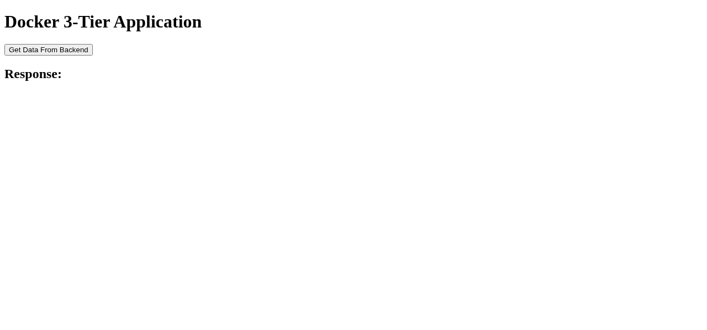
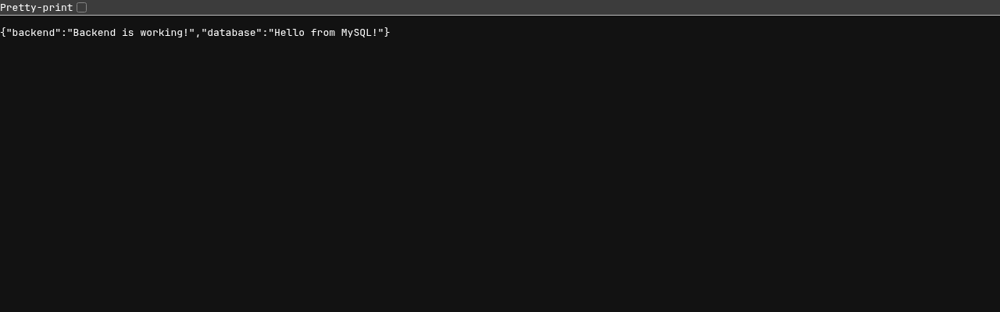

# 7. Docker Networking

Lab source: `session8-docker-networking-volume/` (README -> https://docs.docker.com/engine/network/drivers/, `demo/` 3-tier app).

> Notes: everything I created is prefixed with `s7-` and host ports are in the `18000-18999` range because another
> project was using Docker on the same machine.

## Default networks: bridge, host, none

```bash
…/session8-docker-networking-volume ❯ docker network ls
NETWORK ID     NAME      DRIVER    SCOPE
abed3003796f   bridge    bridge    local
5571fed2fc77   host      host      local
aaa2847df8cc   none      null      local

…/session8-docker-networking-volume ❯ docker network inspect bridge --format '{{.Name}} driver={{.Driver}} subnet={{(index .IPAM.Config 0).Subnet}} gateway={{(index .IPAM.Config 0).Gateway}}'
bridge driver=bridge subnet=172.17.0.0/16 gateway=172.17.0.1
```

## User-defined bridge network + DNS by container name
Containers on a user-defined network can reach each other **by name** (Docker's embedded DNS).

```bash
…/session8-docker-networking-volume ❯ docker network create s7-appnet
be80951a3ec10bba5307cdd101425906a16cb1b8d5f60ecf8902b8ce1093ac8a

…/session8-docker-networking-volume ❯ docker network ls --filter name=s7-
NETWORK ID     NAME        DRIVER    SCOPE
be80951a3ec1   s7-appnet   bridge    local

…/session8-docker-networking-volume ❯ docker network inspect s7-appnet
[
    {
        "Name": "s7-appnet",
        "Id": "be80951a3ec10bba5307cdd101425906a16cb1b8d5f60ecf8902b8ce1093ac8a",
        "Created": "2026-10-26T14:25:00.445926783+05:30",
        "Scope": "local",
        "Driver": "bridge",
        "EnableIPv4": true,
        "EnableIPv6": false,
        "IPAM": {
            "Driver": "default",
            "Options": {},
            "Config": [
                {
                    "Subnet": "172.18.0.0/16",
                    "Gateway": "172.18.0.1"
                }
            ]
        },
        "Internal": false,
        "Attachable": false,
        "Ingress": false,
        "ConfigFrom": {
            "Network": ""
        },
        "ConfigOnly": false,
        "Options": {},
        "Labels": {},
        "Containers": {},
        "Status": {
            "IPAM": {
                "Subnets": {
                    "172.18.0.0/16": {
                        "IPsInUse": 3,
                        "DynamicIPsAvailable": 65533
                    }
                }
            }
        }
    }
]

…/session8-docker-networking-volume ❯ docker run -d --name s7-web --network s7-appnet nginx:alpine
0d00b966ce7eeb2e2b170b954405ed18227f2cee54194a9aca804fa1d527b325

…/session8-docker-networking-volume ❯ docker run --rm --network s7-appnet alpine sh -c 'ping -c 2 s7-web && wget -qO- http://s7-web | head -4'
Unable to find image 'alpine:latest' locally
latest: Pulling from library/alpine
3da1513d2124: Download complete
3ec36f3670df: Download complete
Digest: sha256:be2656061b536c1883c4034790e21d0a09c5aaaf51968b89368a3c0371ea2c9a
Status: Downloaded newer image for alpine:latest
PING s7-web (172.18.0.2): 56 data bytes
64 bytes from 172.18.0.2: seq=0 ttl=64 time=0.045 ms
64 bytes from 172.18.0.2: seq=1 ttl=64 time=0.060 ms

--- s7-web ping statistics ---
2 packets transmitted, 2 packets received, 0% packet loss
round-trip min/avg/max = 0.045/0.052/0.060 ms
<!DOCTYPE html>
<html>
<head>
<title>Welcome to nginx!</title>

…/session8-docker-networking-volume ❯ docker network inspect s7-appnet --format '{{range .Containers}}{{.Name}} {{.IPv4Address}}{{println}}{{end}}'
s7-web 172.18.0.2/16
```

On the **default `bridge`** network there is no name resolution - only the IP works:

```bash
…/session8-docker-networking-volume ❯ docker run -d --name s7-default-web nginx:alpine
f472e38a18fe149915a3c2904d7e0cd39a62a107242c582b658940bd5e110b98

…/session8-docker-networking-volume ❯ docker run --rm --name s7-default-client alpine ping -c 2 -W 2 s7-default-web
ping: bad address 's7-default-web'

…/session8-docker-networking-volume ❯ docker inspect s7-default-web --format '{{.NetworkSettings.Networks.bridge.IPAddress}}'
172.17.0.2

…/session8-docker-networking-volume ❯ docker run --rm alpine ping -c 2 $(docker inspect s7-default-web --format '{{.NetworkSettings.Networks.bridge.IPAddress}}')
PING 172.17.0.2 (172.17.0.2): 56 data bytes
64 bytes from 172.17.0.2: seq=0 ttl=64 time=0.108 ms
64 bytes from 172.17.0.2: seq=1 ttl=64 time=0.104 ms

--- 172.17.0.2 ping statistics ---
2 packets transmitted, 2 packets received, 0% packet loss
round-trip min/avg/max = 0.104/0.106/0.108 ms
```

## `docker network connect` / `disconnect`
A running container can be attached to more networks. Once `s7-default-web` joins `s7-appnet`, `s7-web` can resolve it; after disconnecting, the name is gone again.

```bash
…/session8-docker-networking-volume ❯ docker network connect s7-appnet s7-default-web

…/session8-docker-networking-volume ❯ docker inspect s7-default-web --format '{{range $k, $v := .NetworkSettings.Networks}}{{$k}}={{$v.IPAddress}} {{end}}'
bridge=172.17.0.2 s7-appnet=172.18.0.3 

…/session8-docker-networking-volume ❯ docker exec s7-web ping -c 2 s7-default-web
PING s7-default-web (172.18.0.3): 56 data bytes
64 bytes from 172.18.0.3: seq=0 ttl=64 time=0.081 ms
64 bytes from 172.18.0.3: seq=1 ttl=64 time=0.088 ms

--- s7-default-web ping statistics ---
2 packets transmitted, 2 packets received, 0% packet loss
round-trip min/avg/max = 0.081/0.084/0.088 ms

…/session8-docker-networking-volume ❯ docker network disconnect s7-appnet s7-default-web

…/session8-docker-networking-volume ❯ docker exec s7-web ping -c 1 -W 2 s7-default-web
ping: bad address 's7-default-web'
```

## bridge vs host vs none
- **none**: only a loopback interface, no network access at all.
- **bridge** (default): its own `eth0` with a `172.17.x.x` address, NAT to the outside, ports must be published with `-p`.
- **host**: shares the host's network stack (same interfaces, same hostname); no `-p` needed and `docker ps` shows no port mapping.

```bash
…/session8-docker-networking-volume ❯ docker run --rm --network none alpine ip addr
1: lo: <LOOPBACK,UP,LOWER_UP> mtu 65536 qdisc noqueue state UNKNOWN qlen 1000
    link/loopback 00:00:00:00:00:00 brd 00:00:00:00:00:00
    inet 127.0.0.1/8 scope host lo
       valid_lft forever preferred_lft forever
    inet6 ::1/128 scope host 
       valid_lft forever preferred_lft forever

…/session8-docker-networking-volume ❯ docker run --rm --network none alpine ping -c 1 -W 2 8.8.8.8
PING 8.8.8.8 (8.8.8.8): 56 data bytes
ping: sendto: Network unreachable

…/session8-docker-networking-volume ❯ docker run --rm alpine ip -4 addr
1: lo: <LOOPBACK,UP,LOWER_UP> mtu 65536 qdisc noqueue state UNKNOWN qlen 1000
    inet 127.0.0.1/8 scope host lo
       valid_lft forever preferred_lft forever
2: eth0@if46: <BROADCAST,MULTICAST,UP,LOWER_UP,M-DOWN> mtu 1500 qdisc noqueue state UP 
    inet 172.17.0.3/16 brd 172.17.255.255 scope global eth0
       valid_lft forever preferred_lft forever

…/session8-docker-networking-volume ❯ docker run --rm --network host alpine ip -4 addr | grep inet
    inet 127.0.0.1/8 scope host lo
    inet 100.129.161.37/20 brd 100.129.175.255 scope global dynamic noprefixroute wlp0s20f3
    inet 172.17.0.1/16 brd 172.17.255.255 scope global docker0
    inet 172.18.0.1/16 brd 172.18.255.255 scope global br-be80951a3ec1

…/session8-docker-networking-volume ❯ docker run --rm --network host alpine hostname; hostname
kekww
kekww

…/session8-docker-networking-volume ❯ docker run -d --name s7-hostnet --network host python:3.11-slim python -m http.server 18100
b78346cf8f0a911c54c46110874649a7b771c94028a21f0970b17edf09b9f174

…/session8-docker-networking-volume ❯ curl -s http://localhost:18100 | head -5
<!DOCTYPE HTML>
<html lang="en">
<head>
<meta charset="utf-8">
<title>Directory listing for /</title>

…/session8-docker-networking-volume ❯ docker ps --filter name=s7-hostnet --format 'table {{.Names}}\t{{.Ports}}\t{{.Networks}}'
NAMES        PORTS     NETWORKS
s7-hostnet             host
```

## Volumes - named volume
Data in a named volume survives the container being removed. A container without the volume doesn't see it.

```bash
…/session8-docker-networking-volume ❯ docker volume create s7-data
s7-data

…/session8-docker-networking-volume ❯ docker volume ls --filter name=s7-
DRIVER    VOLUME NAME
local     s7-data

…/session8-docker-networking-volume ❯ docker volume inspect s7-data
[
    {
        "CreatedAt": "2026-10-26T14:25:46+05:30",
        "Driver": "local",
        "Labels": null,
        "Mountpoint": "/var/lib/docker/volumes/s7-data/_data",
        "Name": "s7-data",
        "Options": null,
        "Scope": "local"
    }
]

…/session8-docker-networking-volume ❯ docker run --rm -v s7-data:/data alpine sh -c 'echo "written at $(date)" > /data/note.txt && cat /data/note.txt'
written at Mon Oct 26 08:55:46 UTC 2026

…/session8-docker-networking-volume ❯ docker run --rm -v s7-data:/data alpine cat /data/note.txt
written at Mon Oct 26 08:55:46 UTC 2026

…/session8-docker-networking-volume ❯ docker run -d --name s7-writer -v s7-data:/data alpine sh -c 'echo from-s7-writer >> /data/note.txt; sleep 300'
f951760a4990920f9c17106e7720c5d9706205da1558a1595fbc087eda7d50fd

…/session8-docker-networking-volume ❯ docker rm -f s7-writer
s7-writer

…/session8-docker-networking-volume ❯ docker run --rm -v s7-data:/data alpine cat /data/note.txt
written at Mon Oct 26 08:55:46 UTC 2026
from-s7-writer

…/session8-docker-networking-volume ❯ docker run --rm alpine ls /data
ls: /data: No such file or directory
```

## Volumes - bind mount
A bind mount maps a host directory into the container. Edits on the host show up immediately; `:ro` makes it read-only inside the container.

```bash
…/s7-bind ❯ cat index.html
<h1>Served from a bind mount</h1>

…/s7-bind ❯ docker run -d --name s7-bind-web -p 18101:80 -v $(pwd):/usr/share/nginx/html:ro nginx:alpine
9663937c7dcb5067fe34247d991916329cc96c771a4c250abbd5cd1807687318

…/s7-bind ❯ curl -s http://localhost:18101
<h1>Served from a bind mount</h1>

…/s7-bind ❯ echo '<h1>Edited on the host - no rebuild needed</h1>' > index.html

…/s7-bind ❯ curl -s http://localhost:18101
<h1>Edited on the host - no rebuild needed</h1>

…/s7-bind ❯ docker inspect s7-bind-web --format '{{range .Mounts}}{{.Type}} {{.Source}} -> {{.Destination}} rw={{.RW}}{{println}}{{end}}'
bind /tmp/claude-1000/-home-shohe-year-3-devops-mine/a1bf6e3b-3c54-412a-89c8-35788d81aa0b/scratchpad/s7-bind -> /usr/share/nginx/html rw=false

…/s7-bind ❯ docker inspect s7-named --format '{{range .Mounts}}{{.Type}} {{.Name}} {{.Source}} -> {{.Destination}}{{println}}{{end}}'
volume s7-data /var/lib/docker/volumes/s7-data/_data -> /data

…/s7-bind ❯ docker exec s7-bind-web sh -c 'echo hack > /usr/share/nginx/html/index.html'
sh: can't create /usr/share/nginx/html/index.html: Read-only file system
```

Named volume vs bind mount, from `docker inspect`: the named volume lives under `/var/lib/docker/volumes/...` and is managed by
Docker, the bind mount points at an arbitrary host path.


```bash
…/s7-bind ❯ docker rm -f s7-named s7-bind-web
s7-named
s7-bind-web

…/s7-bind ❯ docker volume rm s7-data
s7-data

…/s7-bind ❯ docker volume ls --filter name=s7-
DRIVER    VOLUME NAME
```

## Demo: 3-tier app with docker compose (`demo/`)
`frontend` (nginx, serves `index.html` and proxies `/api` to `backend:5000`) -> `backend` (Flask) -> `database` (MySQL 8.0, data in the `db_data` volume).
`frontend_net` connects frontend + backend, `backend_net` connects backend + database, so the frontend can't talk to the database directly.

Changed the host port 8080 -> 18200 and used `-p s7-demo` as the project name:

```bash
…/session8-docker-networking-volume/demo ❯ diff -u docker-compose.yml.orig docker-compose.yml
--- docker-compose.yml.orig	2026-10-26 14:26:03.068039136 +0530
+++ docker-compose.yml	2026-10-26 14:26:03.068761869 +0530
@@ -3,7 +3,7 @@
   frontend:
     image: nginx:latest
     ports:
-      - "8080:80"
+      - "18200:80"
     volumes:
       - ./frontend/index.html:/usr/share/nginx/html/index.html
       - ./frontend/nginx.conf:/etc/nginx/conf.d/default.conf

…/session8-docker-networking-volume/demo ❯ docker compose -p s7-demo up -d --build --quiet-pull
 Image nginx:latest Pulling 
 Image mysql:8.0 Pulling 
 Image nginx:latest Pulled 
 Image mysql:8.0 Pulled 
 Image s7-demo-backend Building 
#1 [internal] load local bake definitions
#1 reading from stdin 740B done
#1 DONE 0.0s

#2 [internal] load build definition from Dockerfile
#2 transferring dockerfile: 205B done
#2 DONE 0.0s

#3 [internal] load metadata for docker.io/library/python:3.12-slim
#3 DONE 1.1s

#4 [internal] load .dockerignore
#4 transferring context: 2B done
#4 DONE 0.0s

#5 [internal] load build context
#5 transferring context: 1.24kB done
#5 DONE 0.0s

#6 [1/5] FROM docker.io/library/python:3.12-slim@sha256:a0f57064cbdcd6285fa45f51237ab0b35ea8ebaed06a1f5973e89e19dfb86704
#6 resolve docker.io/library/python:3.12-slim@sha256:a0f57064cbdcd6285fa45f51237ab0b35ea8ebaed06a1f5973e89e19dfb86704 0.0s done
#6 DONE 0.0s

#7 [2/5] WORKDIR /app
#7 CACHED

#8 [3/5] COPY requirements.txt .
#8 DONE 0.1s

#9 [4/5] RUN pip install --no-cache-dir -r requirements.txt
#9 1.309 Collecting Flask (from -r requirements.txt (line 1))
#9 1.591   Downloading flask-3.1.3-py3-none-any.whl.metadata (3.2 kB)
#9 1.700 Collecting mysql-connector-python (from -r requirements.txt (line 2))
#9 1.725   Downloading mysql_connector_python-26.10.0-cp312-cp312-manylinux_2_28_x86_64.whl.metadata (11 kB)
#9 1.836 Collecting blinker>=1.9.0 (from Flask->-r requirements.txt (line 1))
#9 1.906   Downloading blinker-1.9.0-py3-none-any.whl.metadata (1.6 kB)
#9 1.959 Collecting click>=8.1.3 (from Flask->-r requirements.txt (line 1))
#9 1.997   Downloading click-8.5.0-py3-none-any.whl.metadata (2.6 kB)
#9 2.039 Collecting itsdangerous>=2.2.0 (from Flask->-r requirements.txt (line 1))
#9 2.067   Downloading itsdangerous-2.2.0-py3-none-any.whl.metadata (1.9 kB)
#9 2.120 Collecting jinja2>=3.1.2 (from Flask->-r requirements.txt (line 1))
#9 2.152   Downloading jinja2-3.1.6-py3-none-any.whl.metadata (2.9 kB)
#9 2.263 Collecting markupsafe>=2.1.1 (from Flask->-r requirements.txt (line 1))
#9 2.292   Downloading markupsafe-3.0.4-cp312-cp312-manylinux2014_x86_64.manylinux_2_17_x86_64.manylinux_2_28_x86_64.whl.metadata (2.7 kB)
#9 2.352 Collecting werkzeug>=3.1.0 (from Flask->-r requirements.txt (line 1))
#9 2.411   Downloading werkzeug-3.1.9-py3-none-any.whl.metadata (4.1 kB)
#9 2.444 Downloading flask-3.1.3-py3-none-any.whl (103 kB)
#9 2.585 Downloading mysql_connector_python-26.10.0-cp312-cp312-manylinux_2_28_x86_64.whl (21.5 MB)
#9 32.95    ━━━━━━━━━━━━━━━━━━━━━━━━━━━━━━━━━━━━━━━━ 21.5/21.5 MB 709.5 kB/s eta 0:00:00
#9 32.97 Downloading blinker-1.9.0-py3-none-any.whl (8.5 kB)
#9 33.00 Downloading click-8.5.0-py3-none-any.whl (125 kB)
#9 33.04 Downloading itsdangerous-2.2.0-py3-none-any.whl (16 kB)
#9 33.06 Downloading jinja2-3.1.6-py3-none-any.whl (134 kB)
#9 33.12 Downloading markupsafe-3.0.4-cp312-cp312-manylinux2014_x86_64.manylinux_2_17_x86_64.manylinux_2_28_x86_64.whl (22 kB)
#9 33.15 Downloading werkzeug-3.1.9-py3-none-any.whl (228 kB)
#9 33.22 Installing collected packages: mysql-connector-python, markupsafe, itsdangerous, click, blinker, werkzeug, jinja2, Flask
#9 33.92 Successfully installed Flask-3.1.3 blinker-1.9.0 click-8.5.0 itsdangerous-2.2.0 jinja2-3.1.6 markupsafe-3.0.4 mysql-connector-python-26.10.0 werkzeug-3.1.9
#9 33.92 WARNING: Running pip as the 'root' user can result in broken permissions and conflicting behaviour with the system package manager, possibly rendering your system unusable. It is recommended to use a virtual environment instead: https://pip.pypa.io/warnings/venv. Use the --root-user-action option if you know what you are doing and want to suppress this warning.
#9 34.15 
#9 34.15 [notice] A new release of pip is available: 25.0.1 -> 26.2.2
#9 34.15 [notice] To update, run: pip install --upgrade pip
#9 DONE 34.3s

#10 [5/5] COPY app.py .
#10 DONE 0.0s

#11 exporting to image
#11 exporting layers
#11 exporting layers 2.6s done
#11 exporting manifest sha256:8e52f52e19c3746ce319a62f17f251b3200e06725de43318c7ec6c76d0ec7c44 done
#11 exporting config sha256:006e8dc028a1db9d00ff1a267d86f067d8d2383076db75e1976026d42778c6b4 done
#11 exporting attestation manifest sha256:3f45c13b66636091595c8af2e1d51515a4d99290c72c04be3e0d85410adf7481 done
#11 exporting manifest list sha256:c15138919cc43a879cdd02fa1c76cc9c60e1ae8bd7ece880d836632cbf7f72dc done
#11 naming to docker.io/library/s7-demo-backend:latest done
#11 unpacking to docker.io/library/s7-demo-backend:latest
#11 unpacking to docker.io/library/s7-demo-backend:latest 0.5s done
#11 DONE 3.2s

#12 resolving provenance for metadata file
#12 DONE 0.0s
 Image s7-demo-backend Built 
 Network s7-demo_frontend_net Creating 
 Network s7-demo_backend_net Creating 
 Network s7-demo_frontend_net Creating 
 Network s7-demo_backend_net Creating 
 Volume s7-demo_db_data Creating 
 Volume s7-demo_db_data Creating 
 Volume s7-demo_db_data Created 
 Volume s7-demo_db_data Created 
 Network s7-demo_backend_net Created 
 Network s7-demo_backend_net Created 
 Container s7-demo-database-1 Creating 
 Network s7-demo_frontend_net Created 
 Network s7-demo_frontend_net Created 
 Container s7-demo-frontend-1 Creating 
 Container s7-demo-database-1 Created 
 Container s7-demo-backend-1 Creating 
 Container s7-demo-frontend-1 Created 
 Container s7-demo-backend-1 Created 
 Container s7-demo-frontend-1 Starting 
 Container s7-demo-database-1 Starting 
 Container s7-demo-frontend-1 Started 
 Container s7-demo-database-1 Started 
 Container s7-demo-backend-1 Starting 
 Container s7-demo-backend-1 Started 

…/session8-docker-networking-volume/demo ❯ docker compose -p s7-demo ps
NAME                 IMAGE             COMMAND                  SERVICE    CREATED         STATUS         PORTS
s7-demo-backend-1    s7-demo-backend   "python app.py"          backend    3 seconds ago   Up 3 seconds   5000/tcp
s7-demo-database-1   mysql:8.0         "docker-entrypoint.s…"   database   3 seconds ago   Up 3 seconds   3306/tcp, 33060/tcp

…/session8-docker-networking-volume/demo ❯ curl -s http://localhost:18200/api

…/session8-docker-networking-volume/demo ❯ docker network ls --filter name=s7-demo
NETWORK ID     NAME                   DRIVER    SCOPE
d8a3a3546b13   s7-demo_backend_net    bridge    local
d903e6e878c9   s7-demo_frontend_net   bridge    local

…/session8-docker-networking-volume/demo ❯ docker volume ls --filter name=s7-demo
DRIVER    VOLUME NAME
local     s7-demo_db_data
```

The `frontend` container wasn't running. Its logs show why:

```bash
…/session8-docker-networking-volume/demo ❯ docker compose -p s7-demo ps -a
NAME                 IMAGE             COMMAND                  SERVICE    CREATED         STATUS                     PORTS
s7-demo-backend-1    s7-demo-backend   "python app.py"          backend    7 seconds ago   Up 7 seconds               5000/tcp
s7-demo-database-1   mysql:8.0         "docker-entrypoint.s…"   database   7 seconds ago   Up 7 seconds               3306/tcp, 33060/tcp
s7-demo-frontend-1   nginx:latest      "/docker-entrypoint.…"   frontend   7 seconds ago   Exited (1) 7 seconds ago   

…/session8-docker-networking-volume/demo ❯ docker compose -p s7-demo logs frontend
frontend-1  | /docker-entrypoint.sh: /docker-entrypoint.d/ is not empty, will attempt to perform configuration
frontend-1  | /docker-entrypoint.sh: Looking for shell scripts in /docker-entrypoint.d/
frontend-1  | /docker-entrypoint.sh: Launching /docker-entrypoint.d/10-listen-on-ipv6-by-default.sh
frontend-1  | 10-listen-on-ipv6-by-default.sh: info: Getting the checksum of /etc/nginx/conf.d/default.conf
frontend-1  | 10-listen-on-ipv6-by-default.sh: info: /etc/nginx/conf.d/default.conf differs from the packaged version
frontend-1  | /docker-entrypoint.sh: Sourcing /docker-entrypoint.d/15-local-resolvers.envsh
frontend-1  | /docker-entrypoint.sh: Launching /docker-entrypoint.d/20-envsubst-on-templates.sh
frontend-1  | /docker-entrypoint.sh: Launching /docker-entrypoint.d/30-tune-worker-processes.sh
frontend-1  | /docker-entrypoint.sh: Configuration complete; ready for start up
frontend-1  | 2026/10/26 08:57:42 [emerg] 1#1: host not found in upstream "backend" in /etc/nginx/conf.d/default.conf:13
frontend-1  | nginx: [emerg] host not found in upstream "backend" in /etc/nginx/conf.d/default.conf:13
```

nginx resolves `proxy_pass http://backend:5000` at startup, and the frontend started before the backend container existed on
`frontend_net`, so it crashed. Fix: make the frontend wait for the backend with `depends_on` (in my scratch copy of the compose file):

```bash
…/session8-docker-networking-volume/demo ❯ diff -u docker-compose.yml.orig docker-compose.yml
--- docker-compose.yml.orig	2026-10-26 14:26:03.068039136 +0530
+++ docker-compose.yml	2026-10-26 14:27:56.806171999 +0530
@@ -3,12 +3,14 @@
   frontend:
     image: nginx:latest
     ports:
-      - "8080:80"
+      - "18200:80"
     volumes:
       - ./frontend/index.html:/usr/share/nginx/html/index.html
       - ./frontend/nginx.conf:/etc/nginx/conf.d/default.conf
     networks:
       - frontend_net
+    depends_on:
+      - backend
 
   backend:
     build: ./backend

…/session8-docker-networking-volume/demo ❯ docker compose -p s7-demo up -d
 Container s7-demo-database-1 Running 
 Container s7-demo-backend-1 Running 
 Container s7-demo-frontend-1 Starting 
 Container s7-demo-frontend-1 Started 

…/session8-docker-networking-volume/demo ❯ docker compose -p s7-demo ps
NAME                 IMAGE             COMMAND                  SERVICE    CREATED          STATUS          PORTS
s7-demo-backend-1    s7-demo-backend   "python app.py"          backend    18 seconds ago   Up 17 seconds   5000/tcp
s7-demo-database-1   mysql:8.0         "docker-entrypoint.s…"   database   18 seconds ago   Up 17 seconds   3306/tcp, 33060/tcp
s7-demo-frontend-1   nginx:latest      "/docker-entrypoint.…"   frontend   18 seconds ago   Up 3 seconds    0.0.0.0:18200->80/tcp, [::]:18200->80/tcp

…/session8-docker-networking-volume/demo ❯ curl -s http://localhost:18200/api
{"backend":"Backend is working!","database":"Hello from MySQL!"}
```

### Testing the frontend, backend and network isolation

```bash
…/session8-docker-networking-volume/demo ❯ curl -s http://localhost:18200 | head -12
<!DOCTYPE html>

<html>

<head>
    <title>Docker Network Demo</title>
</head>

<body>

    <h1>Docker 3-Tier Application</h1>

…/session8-docker-networking-volume/demo ❯ curl -s http://localhost:18200/api
{"backend":"Backend is working!","database":"Hello from MySQL!"}

…/session8-docker-networking-volume/demo ❯ docker compose -p s7-demo exec backend python -c "import urllib.request;print(urllib.request.urlopen('http://localhost:5000/').read().decode())"
Hello from Backend!

…/session8-docker-networking-volume/demo ❯ docker network inspect s7-demo_frontend_net --format '{{range .Containers}}{{.Name}} {{.IPv4Address}}{{println}}{{end}}'
s7-demo-frontend-1 172.20.0.3/16
s7-demo-backend-1 172.20.0.2/16

…/session8-docker-networking-volume/demo ❯ docker network inspect s7-demo_backend_net --format '{{range .Containers}}{{.Name}} {{.IPv4Address}}{{println}}{{end}}'
s7-demo-database-1 172.19.0.2/16
s7-demo-backend-1 172.19.0.3/16

…/session8-docker-networking-volume/demo ❯ docker compose -p s7-demo exec frontend getent hosts backend
172.20.0.2      backend

…/session8-docker-networking-volume/demo ❯ docker compose -p s7-demo exec frontend getent hosts database || echo 'database NOT resolvable from frontend (different network)'
database NOT resolvable from frontend (different network)

…/session8-docker-networking-volume/demo ❯ docker compose -p s7-demo exec backend getent hosts database
172.19.0.2      database

…/session8-docker-networking-volume/demo ❯ docker compose -p s7-demo exec database mysql -uroot -proot demo -e 'SELECT * FROM messages;'
mysql: [Warning] Using a password on the command line interface can be insecure.
id	message
1	Hello from MySQL!
2	Hello from MySQL!

…/session8-docker-networking-volume/demo ❯ docker compose -p s7-demo logs --tail 5 backend frontend
backend-1   |  * Running on http://172.19.0.3:5000
backend-1   | Press CTRL+C to quit
frontend-1  | 2026/10/26 08:57:57 [notice] 1#1: start worker process 34
frontend-1  | 2026/10/26 08:57:57 [notice] 1#1: start worker process 35
frontend-1  | 172.20.0.1 - - [26/Oct/2026:08:58:00 +0000] "GET /api HTTP/1.1" 200 65 "-" "curl/8.22.0" "-"
frontend-1  | 172.20.0.1 - - [26/Oct/2026:08:58:12 +0000] "GET / HTTP/1.1" 200 558 "-" "curl/8.22.0" "-"
frontend-1  | 172.20.0.1 - - [26/Oct/2026:08:58:12 +0000] "GET /api HTTP/1.1" 200 65 "-" "curl/8.22.0" "-"
backend-1   | 172.20.0.3 - - [26/Oct/2026 08:58:00] "GET /api HTTP/1.1" 200 -
backend-1   | 172.20.0.3 - - [26/Oct/2026 08:58:12] "GET /api HTTP/1.1" 200 -
backend-1   | 127.0.0.1 - - [26/Oct/2026 08:58:12] "GET / HTTP/1.1" 200 -
```





### Data persists across `down`/`up`, `down -v` removes it
`docker compose down` keeps the `db_data` volume, so the rows inserted earlier are still there after `up` (row 3 came from the
`/api` screenshot request, row 4 from the curl below). This clean `up` also confirms the `depends_on` fix - all 3 containers start.
`down -v` deletes the volume as well.

```bash
…/session8-docker-networking-volume/demo ❯ docker compose -p s7-demo down
 Container s7-demo-backend-1 Stopping 
 Container s7-demo-frontend-1 Stopping 
 Container s7-demo-frontend-1 Stopped 
 Container s7-demo-frontend-1 Removing 
 Container s7-demo-frontend-1 Removed 
 Container s7-demo-backend-1 Stopped 
 Container s7-demo-backend-1 Removing 
 Container s7-demo-backend-1 Removed 
 Container s7-demo-database-1 Stopping 
 Container s7-demo-database-1 Stopped 
 Container s7-demo-database-1 Removing 
 Container s7-demo-database-1 Removed 
 Network s7-demo_frontend_net Removing 
 Network s7-demo_backend_net Removing 
 Network s7-demo_backend_net Removed 
 Network s7-demo_frontend_net Removed 

…/session8-docker-networking-volume/demo ❯ docker volume ls --filter name=s7-demo
DRIVER    VOLUME NAME
local     s7-demo_db_data

…/session8-docker-networking-volume/demo ❯ docker compose -p s7-demo up -d
 Network s7-demo_backend_net Creating 
 Network s7-demo_backend_net Creating 
 Network s7-demo_frontend_net Creating 
 Network s7-demo_frontend_net Creating 
 Network s7-demo_frontend_net Created 
 Network s7-demo_frontend_net Created 
 Network s7-demo_backend_net Created 
 Network s7-demo_backend_net Created 
 Container s7-demo-database-1 Creating 
 Container s7-demo-database-1 Created 
 Container s7-demo-backend-1 Creating 
 Container s7-demo-backend-1 Created 
 Container s7-demo-frontend-1 Creating 
 Container s7-demo-frontend-1 Created 
 Container s7-demo-database-1 Starting 
 Container s7-demo-database-1 Started 
 Container s7-demo-backend-1 Starting 
 Container s7-demo-backend-1 Started 
 Container s7-demo-frontend-1 Starting 
 Container s7-demo-frontend-1 Started 

…/session8-docker-networking-volume/demo ❯ docker compose -p s7-demo ps
NAME                 IMAGE             COMMAND                  SERVICE    CREATED          STATUS          PORTS
s7-demo-backend-1    s7-demo-backend   "python app.py"          backend    12 seconds ago   Up 12 seconds   5000/tcp
s7-demo-database-1   mysql:8.0         "docker-entrypoint.s…"   database   12 seconds ago   Up 12 seconds   3306/tcp, 33060/tcp
s7-demo-frontend-1   nginx:latest      "/docker-entrypoint.…"   frontend   12 seconds ago   Up 12 seconds   0.0.0.0:18200->80/tcp, [::]:18200->80/tcp

…/session8-docker-networking-volume/demo ❯ curl -s http://localhost:18200/api
{"backend":"Backend is working!","database":"Hello from MySQL!"}

…/session8-docker-networking-volume/demo ❯ docker compose -p s7-demo exec database mysql -uroot -proot demo -e 'SELECT * FROM messages;'
mysql: [Warning] Using a password on the command line interface can be insecure.
id	message
1	Hello from MySQL!
2	Hello from MySQL!
3	Hello from MySQL!
4	Hello from MySQL!

…/session8-docker-networking-volume/demo ❯ docker compose -p s7-demo down -v
 Container s7-demo-frontend-1 Stopping 
 Container s7-demo-frontend-1 Stopped 
 Container s7-demo-frontend-1 Removing 
 Container s7-demo-frontend-1 Removed 
 Container s7-demo-backend-1 Stopping 
 Container s7-demo-backend-1 Stopped 
 Container s7-demo-backend-1 Removing 
 Container s7-demo-backend-1 Removed 
 Container s7-demo-database-1 Stopping 
 Container s7-demo-database-1 Stopped 
 Container s7-demo-database-1 Removing 
 Container s7-demo-database-1 Removed 
 Volume s7-demo_db_data Removing 
 Network s7-demo_frontend_net Removing 
 Network s7-demo_backend_net Removing 
 Volume s7-demo_db_data Removed 
 Network s7-demo_backend_net Removed 
 Network s7-demo_frontend_net Removed 

…/session8-docker-networking-volume/demo ❯ docker volume ls --filter name=s7-demo
DRIVER    VOLUME NAME

…/session8-docker-networking-volume/demo ❯ docker network ls --filter name=s7-demo
NETWORK ID   NAME      DRIVER    SCOPE
```

## Cleanup

```bash
…/session8-docker-networking-volume ❯ docker ps -a --filter name=s7-
CONTAINER ID   IMAGE              COMMAND                  CREATED         STATUS         PORTS     NAMES
b78346cf8f0a   python:3.11-slim   "python -m http.serv…"   3 minutes ago   Up 3 minutes             s7-hostnet
f472e38a18fe   nginx:alpine       "/docker-entrypoint.…"   3 minutes ago   Up 3 minutes   80/tcp    s7-default-web
0d00b966ce7e   nginx:alpine       "/docker-entrypoint.…"   4 minutes ago   Up 4 minutes   80/tcp    s7-web

…/session8-docker-networking-volume ❯ docker rm -f $(docker ps -aq --filter name=s7-)
b78346cf8f0a
f472e38a18fe
0d00b966ce7e

…/session8-docker-networking-volume ❯ docker network rm s7-appnet
s7-appnet

…/session8-docker-networking-volume ❯ docker rmi s7-demo-backend:latest
Untagged: s7-demo-backend:latest
Deleted: sha256:c15138919cc43a879cdd02fa1c76cc9c60e1ae8bd7ece880d836632cbf7f72dc

…/session8-docker-networking-volume ❯ docker network ls
NETWORK ID     NAME      DRIVER    SCOPE
abed3003796f   bridge    bridge    local
5571fed2fc77   host      host      local
aaa2847df8cc   none      null      local
```

