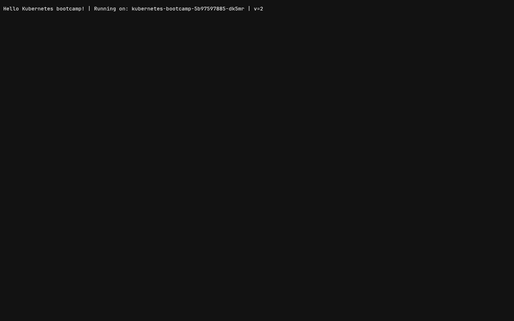

# Kubernetes Fundamentals

Resources from the session:

- Kubernetes basics tutorial: https://kubernetes.io/docs/tutorials/kubernetes-basics/
- Cluster architecture: https://kubernetes.io/docs/concepts/architecture/
- Core objects notes: https://github.com/Nency-Ravaliya/Kubernetes/blob/main/core-objects.md

Instead of minikube I used a local **kind** (Kubernetes-in-Docker) cluster with 1 control-plane and 2 worker nodes. Each "node" is a Docker container running kubelet + containerd. Host ports `18080/18443` are mapped to the control-plane for the ingress lab, and a few NodePorts (`30010-30040`, `30080`) are mapped to `181xx` host ports so NodePort services can be opened from the browser.

## Creating the cluster

```bash
…/year_3/k8s-a ❯ cat kind.yaml
kind: Cluster
apiVersion: kind.x-k8s.io/v1alpha4
nodes:
  - role: control-plane
    kubeadmConfigPatches:
      - |
        kind: InitConfiguration
        nodeRegistration:
          kubeletExtraArgs:
            node-labels: "ingress-ready=true"
    extraPortMappings:
      - {containerPort: 80, hostPort: 18080, protocol: TCP}
      - {containerPort: 443, hostPort: 18443, protocol: TCP}
      - {containerPort: 30010, hostPort: 18110, protocol: TCP}
      - {containerPort: 30020, hostPort: 18120, protocol: TCP}
      - {containerPort: 30030, hostPort: 18130, protocol: TCP}
      - {containerPort: 30040, hostPort: 18140, protocol: TCP}
      - {containerPort: 30080, hostPort: 18180, protocol: TCP}
  - role: worker
  - role: worker

…/year_3/k8s-a ❯ export KUBECONFIG=$PWD/kubeconfig

…/year_3/k8s-a ❯ kind create cluster --name s-a --kubeconfig $KUBECONFIG --config kind.yaml
 • Ensuring node image (kindest/node:v1.37.0) 🖼️  ...
 ✓ Ensuring node image (kindest/node:v1.37.0) 🖼️
 • Preparing nodes 📦 📦 📦   ...
 ✓ Preparing nodes 📦 📦 📦 
 • Writing configuration 📜  ...
 ✓ Writing configuration 📜
 • Starting control-plane 🕹️  ...
 ✓ Starting control-plane 🕹️
 • Installing CNI 🔌  ...
 ✓ Installing CNI 🔌
 • Installing StorageClass 💾  ...
 ✓ Installing StorageClass 💾
 • Joining worker nodes 🚜  ...
 ✓ Joining worker nodes 🚜
Set kubectl context to "kind-s-a"
You can now use your cluster with:

kubectl cluster-info --context kind-s-a --kubeconfig /tmp/…/k8s-a/kubeconfig

Have a question, bug, or feature request? Let us know! https://kind.sigs.k8s.io/#community 🙂

…/year_3/k8s-a ❯ kubectl get nodes
NAME                STATUS     ROLES           AGE   VERSION
s-a-control-plane   NotReady   control-plane   15s   v1.37.0
s-a-worker          NotReady   <none>          1s    v1.37.0
s-a-worker2         NotReady   <none>          1s    v1.37.0
```


## Cluster info, nodes and the control plane

The control plane components (`etcd`, `kube-apiserver`, `kube-controller-manager`, `kube-scheduler`) run as static pods on the control-plane node. Every node runs `kube-proxy` (Service networking) and `kindnet` (the CNI that gives each pod an IP). `coredns` provides cluster DNS.

```bash
…/k8s-a/session9-k8s ❯ kubectl version
Client Version: v1.36.4
Kustomize Version: v5.8.1
Server Version: v1.37.0

…/k8s-a/session9-k8s ❯ kubectl cluster-info
Kubernetes control plane is running at https://127.0.0.1:35339
CoreDNS is running at https://127.0.0.1:35339/api/v1/namespaces/kube-system/services/kube-dns:dns/proxy

To further debug and diagnose cluster problems, use 'kubectl cluster-info dump'.

…/k8s-a/session9-k8s ❯ kubectl get nodes -o wide
NAME                STATUS   ROLES           AGE   VERSION   INTERNAL-IP   EXTERNAL-IP   OS-IMAGE                       KERNEL-VERSION            CONTAINER-RUNTIME
s-a-control-plane   Ready    control-plane   30s   v1.37.0   172.19.0.6    <none>        Debian GNU/Linux 13 (trixie)   7.2.5-3-omarchy (amd64)   containerd://2.3.4
s-a-worker          Ready    <none>          16s   v1.37.0   172.19.0.7    <none>        Debian GNU/Linux 13 (trixie)   7.2.5-3-omarchy (amd64)   containerd://2.3.4
s-a-worker2         Ready    <none>          16s   v1.37.0   172.19.0.5    <none>        Debian GNU/Linux 13 (trixie)   7.2.5-3-omarchy (amd64)   containerd://2.3.4

…/k8s-a/session9-k8s ❯ kubectl get pods -A -o wide
NAMESPACE            NAME                                        READY   STATUS    RESTARTS   AGE   IP           NODE                NOMINATED NODE   READINESS GATES
kube-system          coredns-559f6c778d-62hkk                    1/1     Running   0          19s   10.244.0.2   s-a-control-plane   <none>           <none>
kube-system          coredns-559f6c778d-g9kwp                    1/1     Running   0          19s   10.244.0.3   s-a-control-plane   <none>           <none>
kube-system          etcd-s-a-control-plane                      1/1     Running   0          28s   172.19.0.6   s-a-control-plane   <none>           <none>
kube-system          kindnet-8z98p                               1/1     Running   0          19s   172.19.0.6   s-a-control-plane   <none>           <none>
kube-system          kindnet-94xcs                               1/1     Running   0          16s   172.19.0.5   s-a-worker2         <none>           <none>
kube-system          kindnet-s5zkk                               1/1     Running   0          16s   172.19.0.7   s-a-worker          <none>           <none>
kube-system          kube-apiserver-s-a-control-plane            1/1     Running   0          28s   172.19.0.6   s-a-control-plane   <none>           <none>
kube-system          kube-controller-manager-s-a-control-plane   1/1     Running   0          28s   172.19.0.6   s-a-control-plane   <none>           <none>
kube-system          kube-proxy-6f47g                            1/1     Running   0          16s   172.19.0.7   s-a-worker          <none>           <none>
kube-system          kube-proxy-6nhmp                            1/1     Running   0          16s   172.19.0.5   s-a-worker2         <none>           <none>
kube-system          kube-proxy-cf56s                            1/1     Running   0          19s   172.19.0.6   s-a-control-plane   <none>           <none>
kube-system          kube-scheduler-s-a-control-plane            1/1     Running   0          28s   172.19.0.6   s-a-control-plane   <none>           <none>
local-path-storage   local-path-provisioner-75f7fc7dc5-h44rp     1/1     Running   0          19s   10.244.0.4   s-a-control-plane   <none>           <none>

…/k8s-a/session9-k8s ❯ kubectl get componentstatuses
Warning: v1 ComponentStatus is deprecated in v1.19+
NAME                 STATUS    MESSAGE   ERROR
scheduler            Healthy   ok        
controller-manager   Healthy   ok        
etcd-0               Healthy   ok        

…/k8s-a/session9-k8s ❯ kubectl api-resources --sort-by=name | head -40
NAME                                SHORTNAMES   APIVERSION                        NAMESPACED   KIND
apiservices                                      apiregistration.k8s.io/v1         false        APIService
bindings                                         v1                                true         Binding
certificatesigningrequests          csr          certificates.k8s.io/v1            false        CertificateSigningRequest
clusterrolebindings                              rbac.authorization.k8s.io/v1      false        ClusterRoleBinding
clusterroles                                     rbac.authorization.k8s.io/v1      false        ClusterRole
clustertrustbundles                              certificates.k8s.io/v1            false        ClusterTrustBundle
componentstatuses                   cs           v1                                false        ComponentStatus
configmaps                          cm           v1                                true         ConfigMap
controllerrevisions                              apps/v1                           true         ControllerRevision
cronjobs                            cj           batch/v1                          true         CronJob
csidrivers                                       storage.k8s.io/v1                 false        CSIDriver
csinodes                                         storage.k8s.io/v1                 false        CSINode
csistoragecapacities                             storage.k8s.io/v1                 true         CSIStorageCapacity
customresourcedefinitions           crd,crds     apiextensions.k8s.io/v1           false        CustomResourceDefinition
daemonsets                          ds           apps/v1                           true         DaemonSet
deployments                         deploy       apps/v1                           true         Deployment
deviceclasses                                    resource.k8s.io/v1                false        DeviceClass
devicetaintrules                                 resource.k8s.io/v1                false        DeviceTaintRule
endpoints                           ep           v1                                true         Endpoints
endpointslices                                   discovery.k8s.io/v1               true         EndpointSlice
events                              ev           v1                                true         Event
events                              ev           events.k8s.io/v1                  true         Event
flowschemas                                      flowcontrol.apiserver.k8s.io/v1   false        FlowSchema
horizontalpodautoscalers            hpa          autoscaling/v2                    true         HorizontalPodAutoscaler
ingressclasses                                   networking.k8s.io/v1              false        IngressClass
ingresses                           ing          networking.k8s.io/v1              true         Ingress
ipaddresses                         ip           networking.k8s.io/v1              false        IPAddress
jobs                                             batch/v1                          true         Job
leases                                           coordination.k8s.io/v1            true         Lease
limitranges                         limits       v1                                true         LimitRange
localsubjectaccessreviews                        authorization.k8s.io/v1           true         LocalSubjectAccessReview
mutatingadmissionpolicies                        admissionregistration.k8s.io/v1   false        MutatingAdmissionPolicy
mutatingadmissionpolicybindings                  admissionregistration.k8s.io/v1   false        MutatingAdmissionPolicyBinding
mutatingwebhookconfigurations                    admissionregistration.k8s.io/v1   false        MutatingWebhookConfiguration
namespaces                          ns           v1                                false        Namespace
networkpolicies                     netpol       networking.k8s.io/v1              true         NetworkPolicy
nodes                               no           v1                                false        Node
persistentvolumeclaims              pvc          v1                                true         PersistentVolumeClaim
persistentvolumes                   pv           v1                                false        PersistentVolume

…/k8s-a/session9-k8s ❯ kubectl api-versions
admissionregistration.k8s.io/v1
apiextensions.k8s.io/v1
apiregistration.k8s.io/v1
apps/v1
authentication.k8s.io/v1
authorization.k8s.io/v1
autoscaling/v1
autoscaling/v2
batch/v1
certificates.k8s.io/v1
coordination.k8s.io/v1
discovery.k8s.io/v1
events.k8s.io/v1
flowcontrol.apiserver.k8s.io/v1
networking.k8s.io/v1
node.k8s.io/v1
policy/v1
rbac.authorization.k8s.io/v1
resource.k8s.io/v1
scheduling.k8s.io/v1
storage.k8s.io/v1
storagemigration.k8s.io/v1
v1

…/k8s-a/session9-k8s ❯ kubectl explain pod.spec.containers.ports
KIND:       Pod
VERSION:    v1

FIELD: ports <[]ContainerPort>

DESCRIPTION:
    List of ports to expose from the container. Not specifying a port here DOES
    NOT prevent that port from being exposed. Any port which is listening on the
    default "0.0.0.0" address inside a container will be accessible from the
    network. Modifying this array with strategic merge patch may corrupt the
    data. For more information See
    https://github.com/kubernetes/kubernetes/issues/108255. Cannot be updated.
    ContainerPort represents a network port in a single container.
    
FIELDS:
  containerPort	<integer> -required-
    Number of port to expose on the pod's IP address. This must be a valid port
    number, 0 < x < 65536.

  hostIP	<string>
    What host IP to bind the external port to.

  hostPort	<integer>
    Number of port to expose on the host. If specified, this must be a valid
    port number, 0 < x < 65536. If HostNetwork is specified, this must match
    ContainerPort. Most containers do not need this.

  name	<string>
    If specified, this must be an IANA_SVC_NAME and unique within the pod. Each
    named port in a pod must have a unique name. Name for the port that can be
    referred to by services.

  protocol	<string>
  enum: SCTP, TCP, UDP
    Protocol for port. Must be UDP, TCP, or SCTP. Defaults to "TCP".
    
    Possible enum values:
     - `"SCTP"` is the SCTP protocol.
     - `"TCP"` is the TCP protocol.
     - `"UDP"` is the UDP protocol.
```


## Module 2 - Create a Deployment

```bash
…/k8s-a/session9-k8s ❯ kubectl create deployment kubernetes-bootcamp --image=gcr.io/google-samples/kubernetes-bootcamp:v1
deployment.apps/kubernetes-bootcamp created

…/k8s-a/session9-k8s ❯ kubectl rollout status deployment/kubernetes-bootcamp --timeout=180s
Waiting for deployment "kubernetes-bootcamp" rollout to finish: 0 of 1 updated replicas are available...
deployment "kubernetes-bootcamp" successfully rolled out

…/k8s-a/session9-k8s ❯ kubectl get deployments
NAME                  READY   UP-TO-DATE   AVAILABLE   AGE
kubernetes-bootcamp   1/1     1            1           2m1s

…/k8s-a/session9-k8s ❯ kubectl get rs
NAME                             DESIRED   CURRENT   READY   AGE
kubernetes-bootcamp-5cc66bcc9b   1         1         1       2m1s

…/k8s-a/session9-k8s ❯ kubectl get pods -o wide
NAME                                   READY   STATUS    RESTARTS   AGE    IP           NODE         NOMINATED NODE   READINESS GATES
kubernetes-bootcamp-5cc66bcc9b-mbzcs   1/1     Running   0          2m2s   10.244.2.2   s-a-worker   <none>           <none>
```


## Module 3 - Explore the app (pods, logs, exec, API proxy)

`kubectl proxy` opens an authenticated tunnel to the API server, so the REST API (and even the pod itself through `/proxy/`) can be hit with plain `curl`.

```bash
…/k8s-a/session9-k8s ❯ kubectl proxy --port=18190 &
Starting to serve on 127.0.0.1:18190

…/k8s-a/session9-k8s ❯ curl -s http://localhost:18190/version
{
  "major": "1",
  "minor": "37",
  "emulationMajor": "1",
  "emulationMinor": "37",
  "minCompatibilityMajor": "1",
  "minCompatibilityMinor": "36",
  "gitVersion": "v1.37.0",
  "gitCommit": "f54c212e3a2f75d674b717a9b29052b20b60aefc",
  "gitTreeState": "clean",
  "buildDate": "2026-08-26T10:44:25Z",
  "goVersion": "go1.26.6",
  "compiler": "gc",
  "platform": "linux/amd64"
}

…/k8s-a/session9-k8s ❯ curl -s http://localhost:18190/api/v1/namespaces/default/pods/kubernetes-bootcamp-5cc66bcc9b-mbzcs | head -20
{
  "kind": "Pod",
  "apiVersion": "v1",
  "metadata": {
    "name": "kubernetes-bootcamp-5cc66bcc9b-mbzcs",
    "generateName": "kubernetes-bootcamp-5cc66bcc9b-",
    "namespace": "default",
    "uid": "8f28e7a9-5484-47d5-be93-ed04ef169aba",
    "resourceVersion": "821",
    "generation": 1,
    "creationTimestamp": "2026-10-26T09:03:46Z",
    "labels": {
      "app": "kubernetes-bootcamp",
      "pod-template-hash": "5cc66bcc9b"
    },
    "ownerReferences": [
      {
        "apiVersion": "apps/v1",
        "kind": "ReplicaSet",
        "name": "kubernetes-bootcamp-5cc66bcc9b",

…/k8s-a/session9-k8s ❯ curl -s http://localhost:18190/api/v1/namespaces/default/pods/kubernetes-bootcamp-5cc66bcc9b-mbzcs:8080/proxy/
Hello Kubernetes bootcamp! | Running on: kubernetes-bootcamp-5cc66bcc9b-mbzcs | v=1

…/k8s-a/session9-k8s ❯ kubectl describe pod kubernetes-bootcamp-5cc66bcc9b-mbzcs
Name:             kubernetes-bootcamp-5cc66bcc9b-mbzcs
Namespace:        default
Priority:         0
Service Account:  default
Node:             s-a-worker/172.19.0.7
Start Time:       Mon, 26 Oct 2026 14:33:46 +0530
Labels:           app=kubernetes-bootcamp
                  pod-template-hash=5cc66bcc9b
Annotations:      <none>
Status:           Running
IP:               10.244.2.2
IPs:
  IP:           10.244.2.2
Controlled By:  ReplicaSet/kubernetes-bootcamp-5cc66bcc9b
Containers:
  kubernetes-bootcamp:
    Container ID:   containerd://f6d3b118da2b5b3e043a5c49d6b69acf48e41ae9eb64b41bc7a88dedc3bf9160
    Image:          gcr.io/google-samples/kubernetes-bootcamp:v1
    Image ID:       gcr.io/google-samples/kubernetes-bootcamp@sha256:0d6b8ee63bb57c5f5b6156f446b3bc3b3c143d233037f3a2f00e279c8fcc64af
    Port:           <none>
    Host Port:      <none>
    State:          Running
      Started:      Mon, 26 Oct 2026 14:35:47 +0530
    Ready:          True
    Restart Count:  0
    Environment:    <none>
    Mounts:
      /var/run/secrets/kubernetes.io/serviceaccount from kube-api-access-6mwp2 (ro)
Conditions:
  Type                        Status
  PodReadyToStartContainers   True 
  Initialized                 True 
  Ready                       True 
  ContainersReady             True 
  PodScheduled                True 
Volumes:
  kube-api-access-6mwp2:
    Type:                    Projected (a volume that contains injected data from multiple sources)
    TokenExpirationSeconds:  3607
    ConfigMapName:           kube-root-ca.crt
    Optional:                false
    DownwardAPI:             true
QoS Class:                   BestEffort
Node-Selectors:              <none>
Tolerations:                 node.kubernetes.io/not-ready:NoExecute op=Exists for 300s
                             node.kubernetes.io/unreachable:NoExecute op=Exists for 300s
Events:
  Type    Reason     Age    From               Message
  ----    ------     ----   ----               -------
  Normal  Scheduled  2m16s  default-scheduler  Successfully assigned default/kubernetes-bootcamp-5cc66bcc9b-mbzcs to s-a-worker
  Normal  Pulling    2m16s  kubelet            spec.containers{kubernetes-bootcamp}: Pulling image "gcr.io/google-samples/kubernetes-bootcamp:v1"
  Normal  Pulled     15s    kubelet            spec.containers{kubernetes-bootcamp}: Successfully pulled image "gcr.io/google-samples/kubernetes-bootcamp:v1" in 2m1.233s (2m1.233s including waiting). Image size: 83642968 bytes.
  Normal  Created    15s    kubelet            spec.containers{kubernetes-bootcamp}: Container created
  Normal  Started    15s    kubelet            spec.containers{kubernetes-bootcamp}: Container started

…/k8s-a/session9-k8s ❯ kubectl logs kubernetes-bootcamp-5cc66bcc9b-mbzcs
Kubernetes Bootcamp App Started At: 2026-10-26T09:05:47.860Z | Running On:  kubernetes-bootcamp-5cc66bcc9b-mbzcs 

Running On: kubernetes-bootcamp-5cc66bcc9b-mbzcs | Total Requests: 1 | App Uptime: 15.033 seconds | Log Time: 2026-10-26T09:06:02.893Z

…/k8s-a/session9-k8s ❯ kubectl exec kubernetes-bootcamp-5cc66bcc9b-mbzcs -- env
PATH=/usr/local/sbin:/usr/local/bin:/usr/sbin:/usr/bin:/sbin:/bin
HOSTNAME=kubernetes-bootcamp-5cc66bcc9b-mbzcs
NPM_CONFIG_LOGLEVEL=info
NODE_VERSION=6.3.1
KUBERNETES_SERVICE_HOST=10.96.0.1
KUBERNETES_SERVICE_PORT=443
KUBERNETES_SERVICE_PORT_HTTPS=443
KUBERNETES_PORT=tcp://10.96.0.1:443
KUBERNETES_PORT_443_TCP=tcp://10.96.0.1:443
KUBERNETES_PORT_443_TCP_PROTO=tcp
KUBERNETES_PORT_443_TCP_PORT=443
KUBERNETES_PORT_443_TCP_ADDR=10.96.0.1
HOME=/root

…/k8s-a/session9-k8s ❯ kubectl exec kubernetes-bootcamp-5cc66bcc9b-mbzcs -- cat server.js | head -20
var http = require('http');
var requests=0;
var podname= process.env.HOSTNAME;
var startTime;
var host;
var handleRequest = function(request, response) {
  response.setHeader('Content-Type', 'text/plain');
  response.writeHead(200);
  response.write("Hello Kubernetes bootcamp! | Running on: ");
  response.write(host);
  response.end(" | v=1\n");
  console.log("Running On:" ,host, "| Total Requests:", ++requests,"| App Uptime:", (new Date() - startTime)/1000 , "seconds", "| Log Time:",new Date());
}
var www = http.createServer(handleRequest);
www.listen(8080,function () {
    startTime = new Date();;
    host = process.env.HOSTNAME;
    console.log ("Kubernetes Bootcamp App Started At:",startTime, "| Running On: " ,host, "\n" );
});

…/k8s-a/session9-k8s ❯ kubectl exec kubernetes-bootcamp-5cc66bcc9b-mbzcs -- curl -s http://localhost:8080
Hello Kubernetes bootcamp! | Running on: kubernetes-bootcamp-5cc66bcc9b-mbzcs | v=1
```


## Module 4 - Expose the app with a Service

kind nodes are Docker containers, so a NodePort is reachable on the node's IP (or from inside the node container) rather than from `minikube ip`. After the Service is deleted the NodePort stops answering (`curl` exit code 7 = connection refused), but the app is still running inside the pod.

```bash
…/k8s-a/session9-k8s ❯ kubectl get services
NAME         TYPE        CLUSTER-IP   EXTERNAL-IP   PORT(S)   AGE
kubernetes   ClusterIP   10.96.0.1    <none>        443/TCP   2m46s

…/k8s-a/session9-k8s ❯ kubectl expose deployment/kubernetes-bootcamp --type=NodePort --port 8080
service/kubernetes-bootcamp exposed

…/k8s-a/session9-k8s ❯ kubectl get services
NAME                  TYPE        CLUSTER-IP      EXTERNAL-IP   PORT(S)          AGE
kubernetes            ClusterIP   10.96.0.1       <none>        443/TCP          2m46s
kubernetes-bootcamp   NodePort    10.96.135.126   <none>        8080:30507/TCP   0s

…/k8s-a/session9-k8s ❯ kubectl describe services/kubernetes-bootcamp
Name:                     kubernetes-bootcamp
Namespace:                default
Labels:                   app=kubernetes-bootcamp
Annotations:              <none>
Selector:                 app=kubernetes-bootcamp
Type:                     NodePort
IP Family Policy:         SingleStack
IP Families:              IPv4
IP:                       10.96.135.126
IPs:                      10.96.135.126
Port:                     <unset>  8080/TCP
TargetPort:               8080/TCP
NodePort:                 <unset>  30507/TCP
Endpoints:                10.244.2.2:8080
Session Affinity:         None
External Traffic Policy:  Cluster
Internal Traffic Policy:  Cluster
Events:                   <none>

…/k8s-a/session9-k8s ❯ export NODE_PORT=$(kubectl get services/kubernetes-bootcamp -o go-template='{{(index .spec.ports 0).nodePort}}'); echo NODE_PORT=$NODE_PORT
NODE_PORT=30507

…/k8s-a/session9-k8s ❯ docker exec s-a-control-plane curl -s http://localhost:30507

…/k8s-a/session9-k8s ❯ docker exec s-a-worker2 curl -s http://localhost:30507
```


## Labels

```bash
…/k8s-a/session9-k8s ❯ kubectl describe deployment kubernetes-bootcamp
Name:                   kubernetes-bootcamp
Namespace:              default
CreationTimestamp:      Mon, 26 Oct 2026 14:33:46 +0530
Labels:                 app=kubernetes-bootcamp
Annotations:            deployment.kubernetes.io/revision: 1
Selector:               app=kubernetes-bootcamp
Replicas:               1 desired | 1 updated | 1 total | 1 available | 0 unavailable
StrategyType:           RollingUpdate
MinReadySeconds:        0
RollingUpdateStrategy:  25% max unavailable, 25% max surge
Pod Template:
  Labels:  app=kubernetes-bootcamp
  Containers:
   kubernetes-bootcamp:
    Image:         gcr.io/google-samples/kubernetes-bootcamp:v1
    Port:          <none>
    Host Port:     <none>
    Environment:   <none>
    Mounts:        <none>
  Volumes:         <none>
  Node-Selectors:  <none>
  Tolerations:     <none>
Conditions:
  Type           Status  Reason
  ----           ------  ------
  Available      True    MinimumReplicasAvailable
  Progressing    True    NewReplicaSetAvailable
OldReplicaSets:  <none>
NewReplicaSet:   kubernetes-bootcamp-5cc66bcc9b (1/1 replicas created)
Events:
  Type    Reason             Age    From                   Message
  ----    ------             ----   ----                   -------
  Normal  ScalingReplicaSet  2m17s  deployment-controller  Scaled up replica set kubernetes-bootcamp-5cc66bcc9b from 0 to 1

…/k8s-a/session9-k8s ❯ kubectl get pods -l app=kubernetes-bootcamp
NAME                                   READY   STATUS    RESTARTS   AGE
kubernetes-bootcamp-5cc66bcc9b-mbzcs   1/1     Running   0          2m18s

…/k8s-a/session9-k8s ❯ kubectl get services -l app=kubernetes-bootcamp
NAME                  TYPE       CLUSTER-IP      EXTERNAL-IP   PORT(S)          AGE
kubernetes-bootcamp   NodePort   10.96.135.126   <none>        8080:30507/TCP   1s

…/k8s-a/session9-k8s ❯ kubectl label pods kubernetes-bootcamp-5cc66bcc9b-mbzcs version=v1
pod/kubernetes-bootcamp-5cc66bcc9b-mbzcs labeled

…/k8s-a/session9-k8s ❯ kubectl describe pods kubernetes-bootcamp-5cc66bcc9b-mbzcs | head -12
Name:             kubernetes-bootcamp-5cc66bcc9b-mbzcs
Namespace:        default
Priority:         0
Service Account:  default
Node:             s-a-worker/172.19.0.7
Start Time:       Mon, 26 Oct 2026 14:33:46 +0530
Labels:           app=kubernetes-bootcamp
                  pod-template-hash=5cc66bcc9b
                  version=v1
Annotations:      <none>
Status:           Running
IP:               10.244.2.2

…/k8s-a/session9-k8s ❯ kubectl get pods -l version=v1
NAME                                   READY   STATUS    RESTARTS   AGE
kubernetes-bootcamp-5cc66bcc9b-mbzcs   1/1     Running   0          2m18s

…/k8s-a/session9-k8s ❯ kubectl delete service -l app=kubernetes-bootcamp
service "kubernetes-bootcamp" deleted from default namespace

…/k8s-a/session9-k8s ❯ kubectl get services
NAME         TYPE        CLUSTER-IP   EXTERNAL-IP   PORT(S)   AGE
kubernetes   ClusterIP   10.96.0.1    <none>        443/TCP   2m47s

…/k8s-a/session9-k8s ❯ docker exec s-a-control-plane curl -s --max-time 3 http://localhost:30507; echo "exit code: $?"
exit code: 7

…/k8s-a/session9-k8s ❯ kubectl exec -ti kubernetes-bootcamp-5cc66bcc9b-mbzcs -- curl -s http://localhost:8080
Unable to use a TTY - input is not a terminal or the right kind of file
Hello Kubernetes bootcamp! | Running on: kubernetes-bootcamp-5cc66bcc9b-mbzcs | v=1
```


## Module 5 - Scale the app

When scaled to 4 replicas the Service load-balances across all pods - the `Running on:` pod name changes between requests.

```bash
…/k8s-a/session9-k8s ❯ kubectl expose deployment/kubernetes-bootcamp --type=NodePort --port 8080
service/kubernetes-bootcamp exposed

…/k8s-a/session9-k8s ❯ kubectl get rs
NAME                             DESIRED   CURRENT   READY   AGE
kubernetes-bootcamp-5cc66bcc9b   1         1         1       2m43s

…/k8s-a/session9-k8s ❯ kubectl scale deployments/kubernetes-bootcamp --replicas=4
deployment.apps/kubernetes-bootcamp scaled

…/k8s-a/session9-k8s ❯ kubectl rollout status deployment/kubernetes-bootcamp
Waiting for deployment "kubernetes-bootcamp" rollout to finish: 1 of 4 updated replicas are available...
Waiting for deployment "kubernetes-bootcamp" rollout to finish: 2 of 4 updated replicas are available...
Waiting for deployment "kubernetes-bootcamp" rollout to finish: 3 of 4 updated replicas are available...
deployment "kubernetes-bootcamp" successfully rolled out

…/k8s-a/session9-k8s ❯ kubectl get deployments
NAME                  READY   UP-TO-DATE   AVAILABLE   AGE
kubernetes-bootcamp   4/4     4            4           3m4s

…/k8s-a/session9-k8s ❯ kubectl get pods -o wide
NAME                                   READY   STATUS    RESTARTS   AGE    IP           NODE          NOMINATED NODE   READINESS GATES
kubernetes-bootcamp-5cc66bcc9b-fgqbx   1/1     Running   0          21s    10.244.1.3   s-a-worker2   <none>           <none>
kubernetes-bootcamp-5cc66bcc9b-fn2js   1/1     Running   0          21s    10.244.1.2   s-a-worker2   <none>           <none>
kubernetes-bootcamp-5cc66bcc9b-ljgw6   1/1     Running   0          21s    10.244.2.3   s-a-worker    <none>           <none>
kubernetes-bootcamp-5cc66bcc9b-mbzcs   1/1     Running   0          3m4s   10.244.2.2   s-a-worker    <none>           <none>

…/k8s-a/session9-k8s ❯ kubectl describe deployments/kubernetes-bootcamp | tail -8
  Available      True    MinimumReplicasAvailable
OldReplicaSets:  <none>
NewReplicaSet:   kubernetes-bootcamp-5cc66bcc9b (4/4 replicas created)
Events:
  Type    Reason             Age   From                   Message
  ----    ------             ----  ----                   -------
  Normal  ScalingReplicaSet  3m4s  deployment-controller  Scaled up replica set kubernetes-bootcamp-5cc66bcc9b from 0 to 1
  Normal  ScalingReplicaSet  21s   deployment-controller  Scaled up replica set kubernetes-bootcamp-5cc66bcc9b from 1 to 4

…/k8s-a/session9-k8s ❯ kubectl get endpointslices -l kubernetes.io/service-name=kubernetes-bootcamp
NAME                        ADDRESSTYPE   PORTS   ENDPOINTS                                      AGE
kubernetes-bootcamp-cmnsp   IPv4          8080    10.244.2.2,10.244.2.3,10.244.1.2 + 1 more...   21s

…/k8s-a/session9-k8s ❯ for i in 1 2 3 4 5 6 7 8; do docker exec s-a-control-plane curl -s http://localhost:30517; done
Hello Kubernetes bootcamp! | Running on: kubernetes-bootcamp-5cc66bcc9b-mbzcs | v=1
Hello Kubernetes bootcamp! | Running on: kubernetes-bootcamp-5cc66bcc9b-mbzcs | v=1
Hello Kubernetes bootcamp! | Running on: kubernetes-bootcamp-5cc66bcc9b-fn2js | v=1
Hello Kubernetes bootcamp! | Running on: kubernetes-bootcamp-5cc66bcc9b-fgqbx | v=1
Hello Kubernetes bootcamp! | Running on: kubernetes-bootcamp-5cc66bcc9b-mbzcs | v=1
Hello Kubernetes bootcamp! | Running on: kubernetes-bootcamp-5cc66bcc9b-ljgw6 | v=1
Hello Kubernetes bootcamp! | Running on: kubernetes-bootcamp-5cc66bcc9b-fn2js | v=1
Hello Kubernetes bootcamp! | Running on: kubernetes-bootcamp-5cc66bcc9b-mbzcs | v=1

…/k8s-a/session9-k8s ❯ kubectl scale deployments/kubernetes-bootcamp --replicas=2
deployment.apps/kubernetes-bootcamp scaled

…/k8s-a/session9-k8s ❯ kubectl get deployments
NAME                  READY   UP-TO-DATE   AVAILABLE   AGE
kubernetes-bootcamp   2/2     2            2           3m5s

…/k8s-a/session9-k8s ❯ kubectl get pods -o wide
NAME                                   READY   STATUS        RESTARTS   AGE    IP           NODE          NOMINATED NODE   READINESS GATES
kubernetes-bootcamp-5cc66bcc9b-fgqbx   1/1     Terminating   0          22s    10.244.1.3   s-a-worker2   <none>           <none>
kubernetes-bootcamp-5cc66bcc9b-fn2js   1/1     Terminating   0          22s    10.244.1.2   s-a-worker2   <none>           <none>
kubernetes-bootcamp-5cc66bcc9b-ljgw6   1/1     Running       0          22s    10.244.2.3   s-a-worker    <none>           <none>
kubernetes-bootcamp-5cc66bcc9b-mbzcs   1/1     Running       0          3m5s   10.244.2.2   s-a-worker    <none>           <none>
```


## Module 6 - Rolling update and rollback

Updating to `v2` replaces pods one by one. Then an update to a non-existent tag (`v10`) gets stuck in `ImagePullBackOff` while the old `v2` pods keep serving traffic; `kubectl rollout undo` brings the deployment back to the previous revision.

```bash
…/k8s-a/session9-k8s ❯ kubectl set image deployments/kubernetes-bootcamp kubernetes-bootcamp=docker.io/jocatalin/kubernetes-bootcamp:v2
deployment.apps/kubernetes-bootcamp image updated

…/k8s-a/session9-k8s ❯ kubectl rollout status deployments/kubernetes-bootcamp --timeout=180s
Waiting for deployment "kubernetes-bootcamp" rollout to finish: 1 out of 2 new replicas have been updated...
Waiting for deployment "kubernetes-bootcamp" rollout to finish: 1 out of 2 new replicas have been updated...
Waiting for deployment "kubernetes-bootcamp" rollout to finish: 1 out of 2 new replicas have been updated...
Waiting for deployment "kubernetes-bootcamp" rollout to finish: 1 old replicas are pending termination...
Waiting for deployment "kubernetes-bootcamp" rollout to finish: 1 old replicas are pending termination...
deployment "kubernetes-bootcamp" successfully rolled out

…/k8s-a/session9-k8s ❯ kubectl get pods
NAME                                   READY   STATUS        RESTARTS   AGE
kubernetes-bootcamp-5b97597885-2zv8z   1/1     Running       0          5s
kubernetes-bootcamp-5b97597885-dk5mr   1/1     Running       0          9s
kubernetes-bootcamp-5cc66bcc9b-fgqbx   1/1     Terminating   0          31s
kubernetes-bootcamp-5cc66bcc9b-fn2js   1/1     Terminating   0          31s
kubernetes-bootcamp-5cc66bcc9b-ljgw6   1/1     Terminating   0          31s
kubernetes-bootcamp-5cc66bcc9b-mbzcs   1/1     Terminating   0          3m14s

…/k8s-a/session9-k8s ❯ kubectl describe pods | grep Image:
    Image:          docker.io/jocatalin/kubernetes-bootcamp:v2
    Image:          docker.io/jocatalin/kubernetes-bootcamp:v2
    Image:          gcr.io/google-samples/kubernetes-bootcamp:v1
    Image:          gcr.io/google-samples/kubernetes-bootcamp:v1
    Image:          gcr.io/google-samples/kubernetes-bootcamp:v1
    Image:          gcr.io/google-samples/kubernetes-bootcamp:v1

…/k8s-a/session9-k8s ❯ docker exec s-a-control-plane curl -s http://localhost:30517
Hello Kubernetes bootcamp! | Running on: kubernetes-bootcamp-5b97597885-dk5mr | v=2

…/k8s-a/session9-k8s ❯ kubectl port-forward svc/kubernetes-bootcamp 18191:8080 &
Forwarding from 127.0.0.1:18191 -> 8080
Forwarding from [::1]:18191 -> 8080

…/k8s-a/session9-k8s ❯ curl -s http://localhost:18191
Hello Kubernetes bootcamp! | Running on: kubernetes-bootcamp-5b97597885-dk5mr | v=2

…/k8s-a/session9-k8s ❯ kubectl set image deployments/kubernetes-bootcamp kubernetes-bootcamp=gcr.io/google-samples/kubernetes-bootcamp:v10
deployment.apps/kubernetes-bootcamp image updated

…/k8s-a/session9-k8s ❯ kubectl get deployments
NAME                  READY   UP-TO-DATE   AVAILABLE   AGE
kubernetes-bootcamp   2/2     1            2           3m42s

…/k8s-a/session9-k8s ❯ kubectl get pods
NAME                                   READY   STATUS             RESTARTS   AGE
kubernetes-bootcamp-556487b4d4-9n27k   0/1     ImagePullBackOff   0          25s
kubernetes-bootcamp-5b97597885-2zv8z   1/1     Running            0          33s
kubernetes-bootcamp-5b97597885-dk5mr   1/1     Running            0          37s
kubernetes-bootcamp-5cc66bcc9b-mbzcs   1/1     Terminating        0          3m42s

…/k8s-a/session9-k8s ❯ kubectl rollout history deployment/kubernetes-bootcamp
deployment.apps/kubernetes-bootcamp 
REVISION  CHANGE-CAUSE
1         <none>
2         <none>
3         <none>

…/k8s-a/session9-k8s ❯ kubectl rollout undo deployments/kubernetes-bootcamp
deployment.apps/kubernetes-bootcamp rolled back

…/k8s-a/session9-k8s ❯ kubectl rollout status deployments/kubernetes-bootcamp
deployment "kubernetes-bootcamp" successfully rolled out

…/k8s-a/session9-k8s ❯ kubectl get pods
NAME                                   READY   STATUS        RESTARTS   AGE
kubernetes-bootcamp-556487b4d4-9n27k   0/1     Terminating   0          25s
kubernetes-bootcamp-5b97597885-2zv8z   1/1     Running       0          33s
kubernetes-bootcamp-5b97597885-dk5mr   1/1     Running       0          37s
kubernetes-bootcamp-5cc66bcc9b-mbzcs   1/1     Terminating   0          3m42s

…/k8s-a/session9-k8s ❯ kubectl describe pods | grep Image:
    Image:          gcr.io/google-samples/kubernetes-bootcamp:v10
    Image:          docker.io/jocatalin/kubernetes-bootcamp:v2
    Image:          docker.io/jocatalin/kubernetes-bootcamp:v2
    Image:          gcr.io/google-samples/kubernetes-bootcamp:v1
```


App served through `kubectl port-forward` after the update to v2:



## Cleanup

```bash
…/k8s-a/session9-k8s ❯ kubectl delete deployments/kubernetes-bootcamp services/kubernetes-bootcamp
deployment.apps "kubernetes-bootcamp" deleted from default namespace
service "kubernetes-bootcamp" deleted from default namespace
```

